# 1. 表紙

## CONFIDENTIAL

| 項目 | 内容 |
|--------|--------|
| ドキュメント名 | 外部インタフェース層（EIF）仕様設計書 |
| バージョン | 0.01（ドラフト） |
| Layer | External Interface Layer（EIF） |
| 対象機種 | 共通（Frame）／MiniPrinter（製品CFG 初版） |
| 作成 | T.B.D |

# 2. 更新履歴

| バージョン | 更新日 | 更新者 | 内容 |
|--------|--------|--------|--------|
| 0.01 | 2026-10-20 | T.B.D | 要件定義 初版（0.01）をもとに初版作成。AdapterLayer仕様設計書の章立てに、実行コンテキスト・エラー変換・機種展開手順・移行計画・トレーサビリティ・未決事項の章を追加 |

# 3. 目次

1. 表紙
2. 更新履歴
3. 目次
4. 概要
5. 用語集
6. 関連ドキュメント
7. 制約事項
8. 他のモジュールとの接続
9. 機能概要
10. IF仕様
11. コンフィグレーション仕様（製品CFG）
12. 呼び出しシーケンス
13. 組み込み手順
14. 排他・整合性設計
15. 実行コンテキスト設計（追加）
16. エラー・結果コード変換設計（追加）
17. 機種展開手順（追加）
18. 現行実装からの移行計画（追加）
19. 要件トレーサビリティ（追加）
20. 未決事項（追加）

# 4. 概要

## 4.1 本ドキュメントの目的

本ドキュメントは、外部インタフェース層（EIF）の仕様を規定する。

EIFが外部アプリケーションへ提供するIF、PCL・REFとの接続関係、内部コンポーネント構成、製品CFGの構成方針、および呼び出しシーケンスを示す。

特に、現行実装の最大の課題である「機種依存部（REFの購読登録・データアクセス、PCLの製品要求ID、変換ロジック）がEIFのコードに直書きされ、次機種開発でEIFを作り直す必要がある」問題を解消するため、**Frame（機種非依存）と製品CFG（機種依存）の分離方式**を定義する。

## 4.2 本ドキュメントの読み手

- EIFの実装者（Frame、製品CFG、Binding）
- 新機種でEIFの製品CFGを作成する設計者
- EIFを利用する外部アプリケーション（APIサーバーBinding）の設計者
- PCL外部APIおよびREF（RIM）公開APIの設計者（EIFからの要求事項の確認）
- システム統合担当者（起動処理の実装者）

## 4.3 本モジュールの位置づけ

EIFは本ソフトウェアの最上位レイヤであり、外部アプリケーションとの唯一の境界である（全体構成設計 2.3）。

EIFは次の4区分で構成する。

| 区分 | 機種依存 | 概要 |
|---|---|---|
| Binding | なし（プロトコル依存） | 外部通信ライブラリ（APIサーバー）のコールバック契約とEIF公開APIを接続する。外部アプリケーション側の部品として扱う |
| Boundary | なし | EIF公開API・公開ID・公開モデル。外部アプリケーションが参照する唯一のヘッダ群 |
| Frame | なし | 要求受付、相関、情報取得、購読管理、通知配信、印字データ受付の共通処理 |
| 製品CFG（ProductProfile） | **あり** | 公開範囲、内部ID対応、型変換ルール、購読表。機種ごとに差し替える |

この構成は、参考資料の次の既存の仕組みを踏襲している。

| 参考元 | 踏襲する仕組み |
|---|---|
| RIM（`PAD_Firm_RIM-develop`） | `core`（製品非依存）と`products/<製品>`（製品定義）の分離。`ProductDefinition`による宣言的な製品定義。`DataItemDefinition`（ID・型・正規化関数を1行で定義する表） |
| PCL AutoRequestGenerator | `frame/`と`src/<MODEL>/`の分離。`AutoRequestGenerator_Config`（表＋関数ポインタ）を製品側`Setup()`が組み立ててFrameの`Initialize()`へ注入する方式。CMakeの`MODEL`変数による製品ソース選択 |
| EXE pipelines | `frame/`・`product/`・`include/`のディレクトリ分割 |
| 現行EIF WebSocket購読 | `static const`の購読表で購読対象とコールバックを1行ずつ対応させる方式（表をFrameと製品CFGに分割して発展させる） |

# 5. 用語集

## 5.1 制御階層に関する用語

| 用語 | 定義 |
|--------|--------|
| 外部アプリケーション | EIF公開APIを利用するソフトウェア。現時点ではAPIサーバーとそのBinding |
| 外部通信ライブラリ | APIサーバー（`libpad_firm_external_interface.so`）。REST/WebSocketのプロトコル処理を担う |
| PCL | 製品制御層。製品要求の受付可否判定・実行を担う。EIFの要求先 |
| REF / RIM | 参照サービス／情報軸（ReactiveInfoManager）。システム情報の保持・配信を担う。EIFの参照・購読先 |

## 5.2 設計原則に関する用語

| 用語 | 定義 |
|--------|--------|
| Frame | 製品に依存しない共通実装。登録ループ、振り分け、排他、エラー変換、PCL/REF呼び出しを持つ |
| 製品CFG（ProductProfile） | 製品ごとに差し替える定義。表（機能定義・マッピング）と変換関数（ルール）のみを持つ |
| Port | FrameがPCL・REFを呼び出すための関数ポインタ構造体。Frameを下位の具象APIから切り離し、単体テストを可能にする |
| Binding | 外部通信ライブラリのコールバック契約とEIF公開APIを相互に変換する部品 |
| 注入 | 上位が下位へ関数ポインタ（コールバック）を渡し、下位はその実体を知らずに呼び出す方式（全体構成設計 5.1） |

## 5.3 モジュール固有用語

| 用語 | 定義 |
|--------|--------|
| 公開要求ID（`eif_request_id_t`） | EIFが外部へ公開する要求の識別子。全機種共通の値空間を持ち、製品CFGで有効なものを選ぶ |
| 公開情報ID（`eif_info_id_t`） | EIFが外部へ公開するシステム情報の識別子 |
| 公開設定ID（`eif_setting_id_t`） | 部分更新（PATCH）可能な設定の識別子 |
| 公開イベントID（`eif_event_id_t`） | EIFが通知先へ配信するイベントの識別子 |
| 公開モデル | 公開情報・公開イベントのデータ型（`include/model/`で定義） |
| 要求ハンドル（`EIF_RequestHandle`） | EIFが要求受付時に払い出す識別子。PCLの受付ID（generation ID）を外部へ出さないために用いる |
| 受付ID | PCLが払い出すgeneration ID |
| 通知先（Sink） | 外部アプリケーションが`EIF_SetCallbacks()`で注入する通知コールバック |
| RequestMap / InfoMap / SettingMap / SubscriptionTable | 製品CFGが持つ4つの表（11章） |
| 作業領域 | 差分導出などの変換のためにFrameが製品CFGへ貸し出すメモリ。システム情報の保持を目的としない |

## 5.4 上位・下位Layerに関する用語

| 用語 | 定義 |
|--------|--------|
| 上位 | 外部アプリケーション（Binding経由のAPIサーバー） |
| 下位 | PCL（要求・取消・結果照会） |
| 横断 | REF（参照・購読） |

## 5.5 モジュール構成区分に関する用語

| 用語 | 定義 |
|--------|--------|
| 本モジュール本体 | Boundary＋Frame。全機種で再利用する |
| 本モジュールCFG | 製品CFG（`product/<MODEL>/`）。機種ごとに作成する |
| 外付け部品 | Binding（`binding/<外部通信ライブラリ>/`）。外部通信ライブラリごとに作成する |

# 6. 関連ドキュメント

| # | 文書名 | 版 | 備考 |
|---|---|---|---|
| 1 | 全体構成設計（プリンタ制御ソフトウェア アーキテクチャ構造説明） | - | 上位文書。2.3、3.4～3.6、5章、7章 |
| 2 | EIF要件定義（`要件定義.md`） | 0.01 | 本書の入力 |
| 2a | QA表（`QA表.md`） | - | 確認事項・合意事項。本文中の「QA-xx」 |
| 2b | Frame／機種依存分離設計（`Frame機種依存分離設計.md`） | 0.01 | 本書11章・13章・17章の説明資料 |
| 3 | EIF構成図（`EIF構成図.drawio`） | 0.01 | ブロック図、コールバックの仕組み、現行実装の課題 |
| 4 | PCL外部API仕様書（`product-control-external-api-spec.md`） | - | `ExternalRequestIngressSubmit`、完了callback、取消、GetResult |
| 5 | RIM外部仕様書 / `rim_api_common.h` | - | `RIM_Subscribe`、`RIM_GetBinary`等 |
| 6 | APIサーバー `server_api.h`、`rest_callbacks.h`、`ws_events.h` | - | Bindingが利用するコールバック契約 |
| 7 | AdapterLayer仕様設計書（RIM） | - | 本書の章立ての参考 |
| 8 | RAM-JOB管理 `architectur_design_ver2.md` | - | 印字データ経路（T.B.D部分）の参考 |

# 7. 制約事項

## 7.1 機能制約

- EIFは製品挙動の決定、受付可否判定、実行状態の保持を行わない。
- EIFがREFへ書き込むのは、外部から変更可能と定義した設定値に限る（QA-01）。
- EIFはEXE・RSC・DEVを参照しない。
- EIF本体（Boundary・Frame・製品CFG）は外部通信ライブラリのヘッダを参照しない。
- Frameは製品固有ヘッダ（RIM製品別ヘッダ`rim_proto.h`／`rim_types.h`／`rim_data_id.h`等）を参照しない。Frameが参照するREFのヘッダは製品非依存の`rim_api_common.h`／`rim_types_common.h`に限る。
- 製品CFGは変換ルールと表のみを持ち、登録・送信・排他・スレッド生成を行わない。
- 公開要求APIは受付で即時復帰し、完了を待たない。
- 印字データ経路（10.7節）の詳細はT.B.Dとする。

## 7.2 前提条件

- REF（RIM）は`RIM_Create()`／`RIM_Start()`済みであること。
- PCLは`ExternalRequestIngress_Setup()`済みであること。
- 製品CFGはビルド時にMODEL指定で1つだけリンクされること。
- 外部アプリケーションは`EIF_Start()`の前に`EIF_SetCallbacks()`で通知先を注入すること。

## 7.3 呼び出し制約

- `EIF_Setup()`／`EIF_SetCallbacks()`／`EIF_Start()`は起動処理から1回だけ、この順に呼ぶ。
- 要求系・情報系APIは`EIF_Start()`成功後、複数スレッドから同時に呼んでよい。
- 通知先コールバックの中からEIFの要求系APIを呼んではならない（PCL完了コールバックのコンテキストで呼ばれるため。15章）。
- 通知先コールバックは長時間ブロックしてはならない。
- 本LayerはRIMに購読解除APIが無いため、停止・再初期化を運用シナリオとして想定しない（QA-07）。

# 8. 他のモジュールとの接続

## 8.1 想定される接続先

| # | 分類 | 接続先 | 接続方式 | 同期性 | 接続要否 | 用途 |
|---|---|---|---|---|---|---|
| 1 | 上位 | APIサーバーBinding | EIF公開API（`include/eif_api.h`） | 同期呼出し | 必須 | 要求、取消、情報取得、設定変更 |
| 2 | 上位 | APIサーバーBinding | 通知先コールバック（`EIF_SetCallbacks`で注入） | 非同期通知 | 必須 | 要求完了、情報変化イベント |
| 3 | 下位 | PCL | `ExternalRequestIngressSubmit` 等（PclPort経由） | 同期呼出し（受付） | 必須 | 製品要求、取消、結果照会 |
| 4 | 下位 | PCL | 完了コールバック（Submit時に注入） | 非同期通知 | 必須 | 製品要求の終端結果 |
| 5 | 横断 | REF（RIM） | `RIM_GetBinary`／`RIM_GetCapability*`（RefPort経由） | 同期呼出し | 必須 | 公開情報の取得 |
| 6 | 横断 | REF（RIM） | `RIM_Subscribe`（RefPort経由）＋通知コールバック | 登録は同期・通知は非同期 | 必須 | 情報変化の購読 |
| 7 | 下位 | PCL（貯蔵チャネル） | T.B.D | T.B.D | 任意 | 印字データ書込み |
| 8 | 横断 | ログ基盤（foundation log） | `UT_LOG_*` | 同期 | 任意 | ログ出力 |

## 8.1.1 コンポーネント接続概要

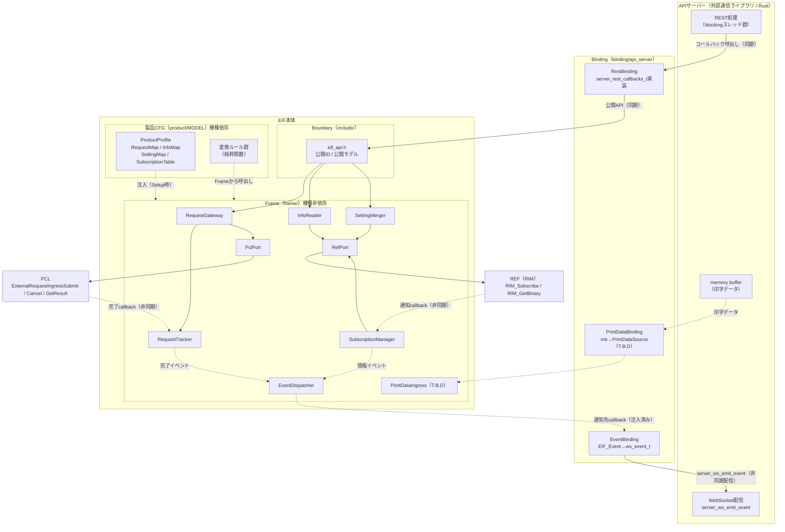

## 8.1.2 PCLとの連携

- FrameはPclPortを介してPCL公開API（`RequestIngress.h`、`product_control_api.h`）を呼ぶ。
- 製品要求のSubmit時、Frameの完了トランポリン関数を完了callbackとして注入する。PCLの完了callbackには利用者コンテキストが無いため、受付ID（generation ID）でRequestTrackerを検索して要求ハンドルへ相関する。
- PCLの製品要求ID（`product_request_id_t`の値）は製品CFGのRequestMapにのみ記述する。Frameは型のみを扱う。

## 8.1.3 REFとの連携

- FrameはRefPortを介してREFの**製品非依存API**（`RIM_Subscribe`、`RIM_GetBinary`、`RIM_GetCapabilityInt32`等）だけを呼ぶ。
- REFのID値と、`RI_BINARY`を製品型（例：`RIM_network_info_t`）として解釈する処理は製品CFGの変換ルールで行う。
- 設定値の書込みはRefPort（`RIM_SetBinary`）経由で行う。書込み先のIDと型は製品CFGのSettingMapにのみ記述する（QA-01）。

## 8.1.4 Bindingの役割

- `server_rest_callbacks_t`の各コールバックを実装し、APIサーバー型 ⇔ EIF公開モデルを変換してEIF公開APIを呼ぶ。
- `EIF_SetCallbacks()`で通知先を注入し、受け取った`EIF_Event`を`ws_event_t`へ変換して`server_ws_emit_event()`で送信する。
- EIFの結果コード（`EIF_Result`）を`uc_result_t`へ変換する。
- REST（同期プロトコル）で完了待ちが必要な場合は、Binding内で上限時間付きの待ち合わせを行う（Frameは待たない）。
- Bindingは機種に依存しない。公開APIに新しい公開ID・公開モデルが増えた場合のみ変更する。

## 8.1.5 製品CFGの役割

- 製品で公開する要求・情報・設定・イベントを表で宣言する（機能定義）。
- 公開ID ⇔ PCL製品要求ID／REF IDの対応を表で宣言する（マッピング）。
- 内部型 ⇔ 公開モデルの変換、PATCHマージ、イベント生成を純粋関数で提供する（ルール）。
- `EIF_Setup()`を実装し、ProductProfileを組み立ててFrameの`EIF_Initialize()`へ注入する。

## 8.2 接続方針

- APIサーバーBindingはEIF公開ヘッダ（`include/`）のみに依存する。
- Frameは`frame/include/`の内部ヘッダ、PCL公開ヘッダ、REF製品非依存ヘッダのみに依存する。
- 製品CFGは`frame/include/eif_profile.h`、PCL公開ヘッダ、REF製品別ヘッダに依存してよい。
- Frame・製品CFGは外部通信ライブラリのヘッダに依存しない。

### 8.2.1 利用する入力IF

| 入力 | IF | 方式 |
|---|---|---|
| 要求 | `EIF_SubmitRequest(公開要求ID, パラメータ)` | 単一入力IF（IDで識別） |
| 情報取得 | `EIF_GetInfo(公開情報ID, 出力)` | 単一入力IF |
| 設定変更 | `EIF_PatchSetting(公開設定ID, パッチ)` | 単一入力IF |

単一入力IF方式（AdapterLayer仕様設計書 8.2.1と同じ）を採用する。

採用理由:
- 公開要求・公開情報の追加時に公開APIの関数を増やさずに済む（IDと公開モデルの追加のみ）。
- 公開範囲の判定を入口1か所に集約できる。
- Frameの処理を表駆動で共通化できる。

### 8.2.2 Layer間依存方針

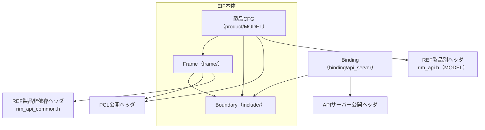

| 依存元 | 依存先 | 可否 |
|---|---|---|
| Binding | Boundary | 可 |
| Binding | 外部通信ライブラリ公開ヘッダ | 可（Bindingのみ） |
| Binding | Frame内部 / 製品CFG | **不可** |
| Frame | Boundary、PCL公開ヘッダ、REF製品非依存ヘッダ | 可 |
| Frame | REF製品別ヘッダ、製品CFG | **不可**（製品CFGはProfile経由でのみ参照） |
| Frame / 製品CFG | 外部通信ライブラリ公開ヘッダ | **不可** |
| 製品CFG | Frameの`eif_profile.h`、PCL公開ヘッダ、REF製品別ヘッダ | 可 |
| EIF全体 | EXE / RSC / DEV | **不可** |
| PCL / REF / 他レイヤ | EIF | **不可** |

依存規則はCMakeの`target_include_directories`のPRIVATE/PUBLIC指定で強制する（13.1.3）。

# 9. 機能概要

## 9.1 システム構造における位置づけ

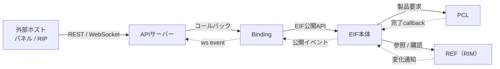

### 9.1.1 システム構造概要

| 経路 | 同期/非同期 | 実行コンテキスト | 概要 |
|---|---|---|---|
| REST GET（情報取得） | 同期 | APIサーバーblockingスレッド | Binding→`EIF_GetInfo`→REF取得→変換→応答 |
| REST POST（要求） | 受付は同期、結果は非同期 | 受付:APIサーバーblockingスレッド / 結果:PCL要求処理コンテキスト | Binding→`EIF_SubmitRequest`→PCL Submit→要求ハンドル返却。完了時にPCL→EIF→通知先 |
| REST PATCH（設定変更） | 同期 | APIサーバーblockingスレッド | REFから現在値取得→マージ→REFへ書込み |
| WebSocket（情報変化） | 非同期 | RIM通知ワーカー | RIM→EIF購読トランポリン→イベント生成→通知先→`server_ws_emit_event` |
| 印字データ | 非同期 | EIF印字データタスク | memory buffer→PrintDataIngress→貯蔵チャネル（T.B.D） |

### 9.1.2 本モジュールの役割

- 外部へ公開する範囲と形式を、製品CFGで宣言的に定義できるようにする。
- 製品に依存しない処理（登録、振り分け、相関、排他、エラー変換）をFrameへ集約し、機種展開で作り直さずに済むようにする。
- 外部通信ライブラリの差し替えをBindingの差し替えに閉じる。

## 9.2 内部処理モデル

EIFは自身の処理スレッドを持たない（印字データ受信タスクを除く）。すべての処理は呼び出し元のコンテキストで実行する（15章）。

### 9.2.1 正常系処理（要求）

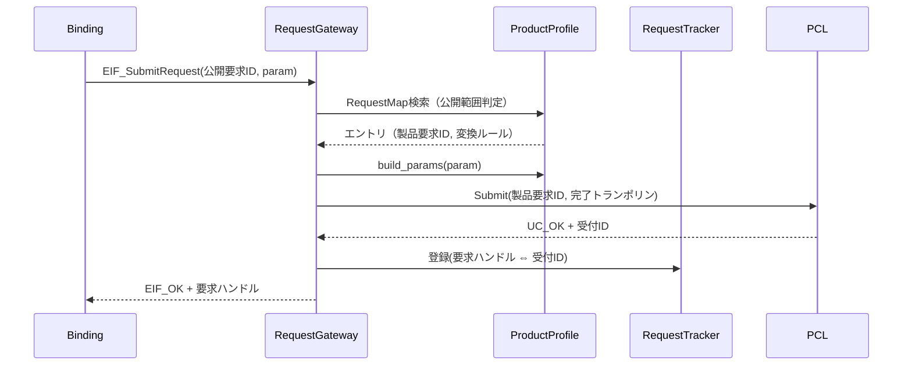

### 9.2.2 入力異常処理

| 異常 | 判定箇所 | 結果 | 後続処理 |
|---|---|---|---|
| 未初期化 | 各API入口 | `EIF_ERR_UNAVAILABLE` | 何もしない |
| 引数NULL・サイズ不一致 | 各API入口 | `EIF_ERR_INVALID_PARAM` | 何もしない |
| 公開対象外ID | Profile検索 | `EIF_ERR_NOT_EXPOSED` | PCL/REFを呼ばない |
| 変換ルール失敗 | 製品CFG関数の戻り値 | `EIF_ERR_INVALID_PARAM` | PCL/REFを呼ばない |
| PCL受付拒否 | PclPort戻り値 | 16章の変換表 | 相関登録しない |
| REF取得失敗 | RefPort戻り値 | 16章の変換表 | 出力しない |

## 9.3 責務

### 9.3.1 公開範囲の判定

公開要求・公開情報・公開設定のIDを製品CFGの表から検索し、表に無いものは`EIF_ERR_NOT_EXPOSED`とする。公開範囲はコード上のスタブ関数（現行の`UC_ERR_NOT_IMPLEMENTED`を返す関数群）では表現しない。

### 9.3.2 要求の変換と転送

公開要求IDを製品要求IDへ、公開パラメータを製品要求パラメータへ変換し、PCLへ転送する。受付可否はPCLの結果をそのまま返す。

### 9.3.3 相関（要求ハンドル ⇔ 受付ID）

受付成功時に要求ハンドルを払い出し、受付IDとの対応をRequestTrackerへ登録する。PCLの完了callbackを受けたら対応を引き、完了イベントを通知した後に対応を削除する。

### 9.3.4 情報の取得と変換

InfoMapのエントリに従いREFから値を取得し（最大4ソース）、製品CFGの変換ルールで公開モデルへ変換する。

### 9.3.5 設定のマージと転送

SettingMapのエントリに従い、REFから現在値（内部形式）を取得し、パッチをマージした結果をREFへ書き込む（QA-01）。未指定項目は現在値のまま保持される。

### 9.3.6 購読と通知

SubscriptionTableの全エントリをREFへ登録し、通知を受けたら対象エントリの変換ルールで公開イベントを生成し、通知先へ配信する。

### 9.3.7 通知先の管理

外部アプリケーションが注入した通知先を保持し、要求完了イベント・情報変化イベントを同一の配信処理で通知する。

## 9.4 非責務

### 9.4.1 通信プロトコル処理

HTTP/WebSocket処理、JSONのシリアライズ、セッション管理はAPIサーバーの責務とする。

### 9.4.2 製品判断

受付可否、実行順序、継続可否、異常判定はPCL以下の責務とする。

### 9.4.3 情報の生成・保持・書込み

システム情報の生成・保持・意味付け・REFへの書込みは行わない。差分導出の作業領域は保持にあたらない。

### 9.4.4 実行状態の管理

要求の進捗・実行中状態は保持しない。進捗の公開はREFの情報（例：ジョブ情報リスト）から変換する（QA-05）。

### 9.4.5 印字データの加工・保管

行わない。

# 10. IF仕様

## 10.1 概要

EIFの公開IFは`include/`配下のヘッダ群で定義する。外部アプリケーションはこれ以外を参照しない。
公開IFはすべて製品非依存である（機種によって変わるのは「どのIDが有効か」だけ）。

## 10.2 外部公開インターフェース一覧

| # | IF名 | 同期性 | 再入性 | 用途 | 対応要件IF |
|---|---|---|---|---|---|
| 1 | `EIF_Setup` | 同期 | 不可（起動時1回） | 製品既定CFGで初期化 | EIF-IF-00 |
| 2 | `EIF_SetCallbacks` | 同期 | 不可（起動時1回） | 通知先の注入 | EIF-IF-03 |
| 3 | `EIF_Start` | 同期 | 不可（起動時1回） | 購読登録、受付開始 | EIF-IF-00 |
| 4 | `EIF_SubmitRequest` | 同期（受付）＋非同期（結果） | 可（複数スレッド） | 公開要求の受付 | EIF-IF-01 |
| 5 | `EIF_CancelRequest` | 同期（受付）＋非同期（結果） | 可 | 取消 | EIF-IF-02 |
| 6 | `EIF_GetRequestResult` | 同期 | 可 | 結果照会 | EIF-IF-08 |
| 7 | `EIF_GetInfo` | 同期 | 可 | 公開情報の取得 | EIF-IF-05 |
| 8 | `EIF_PatchSetting` | 同期 | 可 | 設定の部分更新 | EIF-IF-07 |
| 9 | `EIF_IsExposed` | 同期 | 可 | 公開対象かの照会（Bindingの404/501判定用） | EIF-IF-00 |
| 10 | `EIF_PrintData*` | T.B.D | T.B.D | 印字データ | EIF-IF-04 |

## 10.3 外部利用インターフェース一覧

| # | IF名 | 提供元 | 用途 | 呼出し元 |
|---|---|---|---|---|
| 1 | `ExternalRequestIngressSubmit` | PCL | 製品要求 | PclPort |
| 2 | `ExternalRequestIngressCancelRequestedByOwnerGeneration` | PCL | 取消 | PclPort |
| 3 | `ExternalRequestIngressGetResult` | PCL | 結果照会 | PclPort |
| 4 | `external_request_completion_cb_t` | PCL（型） | 完了通知の受け口 | RequestTracker |
| 5 | `RIM_Subscribe` | REF | 購読登録 | RefPort |
| 6 | `RIM_GetBinary` | REF | Data取得 | RefPort |
| 7 | `RIM_GetCapabilityInt32` 他 | REF | Capability/Facade取得 | RefPort |
| 8 | `RINotificationCallback` | REF（型） | 変化通知の受け口 | SubscriptionManager |
| 9 | 貯蔵チャネル開設/書込/閉塞 | PCL | 印字データ | PrintDataIngress（T.B.D） |

## 10.4 公開型一覧

| # | 型名 | ヘッダ | カテゴリ | 用途 |
|---|---|---|---|---|
| 1 | `EIF_Result` | `eif_types.h` | enum | 結果コード |
| 2 | `EIF_RequestHandle` | `eif_types.h` | 値型（uint64_t） | 要求ハンドル。0は無効 |
| 3 | `eif_request_id_t` | `eif_public_id.h` | enum | 公開要求ID |
| 4 | `eif_info_id_t` | `eif_public_id.h` | enum | 公開情報ID |
| 5 | `eif_setting_id_t` | `eif_public_id.h` | enum | 公開設定ID |
| 6 | `eif_event_id_t` | `eif_public_id.h` | enum | 公開イベントID |
| 7 | `EIF_RequestOutcome` | `eif_types.h` | enum | 要求の終端結果（完了/失敗/取消/拒否/未対応） |
| 8 | `EIF_Event` | `eif_event.h` | struct | 通知イベント |
| 9 | `EIF_Callbacks` | `eif_api.h` | struct | 通知先 |
| 10 | 公開モデル各種 | `model/*.h` | struct | 公開情報・パラメータ・イベントペイロード |

## 10.5 契約利用型一覧

| # | 型名 | 定義元 | 概要 | 利用箇所 |
|---|---|---|---|---|
| 1 | `product_request_id_t` | PCL `product_request_id.h` | 製品要求ID | Frame（型のみ）、製品CFG（値） |
| 2 | `external_request_result_t` | PCL `product_control_api.h` | 受付結果 | PclPort |
| 3 | `external_request_execution_response_state_t` | PCL | 終端結果 | RequestTracker、16章 |
| 4 | `uc_result_t` | PCL `product_control_result.h` | PCL API結果 | PclPort、16章 |
| 5 | `RI_SUBSCRIPTION_REQUEST`、`RINotificationCallback` | REF `rim_types_common.h` | 購読 | RefPort |
| 6 | `RI_BINARY`、`RIStatus` | REF `rim_api_common.h` | 取得・結果 | RefPort、16章 |
| 7 | REF製品別型（例：`RIM_network_info_t`、`RIM_FaultInfoList`） | REF `rim_types.h`（MODEL） | 製品別データ | **製品CFGのみ** |

## 10.6 型仕様

### 10.6.1 EIF_Result

```c
typedef enum {
    EIF_OK = 0,
    EIF_ERR_INVALID_PARAM,   /* 引数不正、変換失敗 */
    EIF_ERR_NOT_EXPOSED,     /* 公開対象外（製品CFGに無い） */
    EIF_ERR_NOT_FOUND,       /* 要求ハンドル・情報が存在しない */
    EIF_ERR_BUSY,            /* 下位が受付不可（容量、機能禁止、実行中 等） */
    EIF_ERR_UNAVAILABLE,     /* 未初期化、下位未初期化 */
    EIF_ERR_INTERNAL         /* その他内部エラー */
} EIF_Result;
```

### 10.6.2 EIF_RequestOutcome

```c
typedef enum {
    EIF_OUTCOME_COMPLETED = 0, /* PCL: ACCEPTED（正常完了） */
    EIF_OUTCOME_INVALID,       /* PCL: INVALID */
    EIF_OUTCOME_NOT_SUPPORTED, /* PCL: NOT_SUPPORTED */
    EIF_OUTCOME_FAILED,        /* PCL: FAILED */
    EIF_OUTCOME_CANCELED,      /* PCL: CANCELED */
    EIF_OUTCOME_PENDING        /* 未確定（照会時のみ） */
} EIF_RequestOutcome;
```

### 10.6.3 公開ID

公開IDは全機種共通の値空間とし、値を追加しても既存値は変えない（ABI）。各機種はこのうち製品CFGに登録したものだけが有効になる。

```c
typedef enum {
    EIF_REQ_INVALID = 0,
    EIF_REQ_PRINT,
    EIF_REQ_TEST_PRINT,
    EIF_REQ_HEAD_CLEANING,
    EIF_REQ_WIPER_MAINTENANCE,
    EIF_REQ_HUMIDIFIER_MAINTENANCE,
    EIF_REQ_INK_INTRODUCTION,
    EIF_REQ_TUBE_AIR_REMOVAL,
    EIF_REQ_CAP_PUMP_CHECK,
    EIF_REQ_PAUSE,              /* 一時停止（全体構成設計 3.9：独立した要求） */
    EIF_REQ_RESUME,             /* 再開 */
    /* 追加は末尾へ */
    EIF_REQ_COUNT
} eif_request_id_t;

typedef enum {
    EIF_INFO_INVALID = 0,
    EIF_INFO_NETWORK_SETTINGS,
    EIF_INFO_PRINT_SETTINGS,
    EIF_INFO_AMBIENT_STATUS,
    EIF_INFO_MAINTENANCE_STATUS,
    EIF_INFO_DEVICE_INFORMATION,
    EIF_INFO_SOFTWARE_INFORMATION,
    EIF_INFO_JOB,               /* ジョブ情報（QA-05） */
    EIF_INFO_COUNT
} eif_info_id_t;

typedef enum {
    EIF_SETTING_INVALID = 0,
    EIF_SETTING_NETWORK,
    EIF_SETTING_PRINT,
    EIF_SETTING_COUNT
} eif_setting_id_t;

typedef enum {
    EIF_EVT_INVALID = 0,
    EIF_EVT_REQUEST_COMPLETED,  /* 要求の終端（要求ハンドル付き） */
    EIF_EVT_ERROR_RAISED,
    EIF_EVT_ERROR_RESOLVED,
    EIF_EVT_WARNING_RAISED,
    EIF_EVT_WARNING_RESOLVED,
    EIF_EVT_INK_LEVEL_CHANGED,
    EIF_EVT_JOB_PROGRESS,
    EIF_EVT_COUNT
} eif_event_id_t;
```

上記は初版の候補であり、APIサーバーのOpenAPI/AsyncAPIの資源と対応させて確定する（QA-08）。

### 10.6.4 EIF_Event

```c
typedef struct {
    eif_event_id_t     event_id;
    EIF_RequestHandle  handle;        /* EIF_EVT_REQUEST_COMPLETED のみ有効 */
    eif_request_id_t   request_id;    /* EIF_EVT_REQUEST_COMPLETED のみ有効 */
    EIF_RequestOutcome outcome;       /* EIF_EVT_REQUEST_COMPLETED のみ有効 */
    union {
        eif_alarm_t       alarm;      /* ERROR/WARNING系 */
        eif_ink_level_t   ink_level;
        eif_job_progress_t job_progress;
    } payload;
} EIF_Event;
```

イベントは通知先コールバックの呼出し中だけ有効とする。

### 10.6.5 EIF_Callbacks

```c
typedef void (*EIF_EventCallback)(const EIF_Event *event, void *user_context);

typedef struct {
    EIF_EventCallback on_event;    /* 必須 */
    void             *user_context;
} EIF_Callbacks;
```

通知先は最大`EIF_MAX_SINKS`（初版4）件まで登録できる（EIF-FR-04 複数通知方式）。

## 10.7 外部公開メソッド

### 10.7.1 EIF_Setup

| 項目 | 内容 |
|---|---|
| 構文 | `EIF_Result EIF_Setup(void)` |
| 実装場所 | 製品CFG（`product/<MODEL>/eif_product_setup.c`） |
| 同期性 | 同期 |
| 再入性 | 不可。起動処理から1回 |
| 機能説明 | 製品CFGがProductProfileとPort（既定はPCL/REFの実API）を組み立て、Frameの`EIF_Initialize()`へ注入する。ARGの`AutoRequestGenerator_Setup()`と同じ方式 |
| 戻り値 | `EIF_OK`、`EIF_ERR_INVALID_PARAM`（Profile検証失敗）、`EIF_ERR_INTERNAL` |

### 10.7.2 EIF_SetCallbacks

| 項目 | 内容 |
|---|---|
| 構文 | `EIF_Result EIF_SetCallbacks(const EIF_Callbacks *callbacks)` |
| 同期性 | 同期 |
| 再入性 | 不可。`EIF_Start()`前に呼ぶ。登録件数分呼んでよい |
| 機能説明 | 通知先を追加する。構造体はコピーして保持する。`EIF_Start()`後の呼出しは`EIF_ERR_BUSY` |

### 10.7.3 EIF_Start

| 項目 | 内容 |
|---|---|
| 構文 | `EIF_Result EIF_Start(void)` |
| 同期性 | 同期 |
| 機能説明 | SubscriptionTableの全エントリをREFへ登録し、要求受付を開始する。最初の登録失敗で中断して失敗を返す（RIMに購読解除が無いため登録済み分は残る） |
| 戻り値 | `EIF_OK`、`EIF_ERR_UNAVAILABLE`（未Setup・REF未初期化）、`EIF_ERR_INTERNAL` |

### 10.7.4 EIF_SubmitRequest

| 項目 | 内容 |
|---|---|
| 構文 | `EIF_Result EIF_SubmitRequest(eif_request_id_t id, const void *param, size_t param_size, EIF_RequestHandle *out_handle)` |
| 同期性 | 受付は同期。終端結果は`EIF_EVT_REQUEST_COMPLETED`で非同期通知 |
| 再入性 | 可（複数スレッド）。通知先コールバック内からは不可 |
| 入力 | `id`：公開要求ID。`param`：公開モデルのパラメータ（不要ならNULL/0）。サイズはRequestMapで検証 |
| 出力 | `out_handle`：受付成功時のみ非0 |
| 戻り値 | `EIF_OK`（受付）、`EIF_ERR_NOT_EXPOSED`、`EIF_ERR_INVALID_PARAM`、`EIF_ERR_BUSY`、`EIF_ERR_UNAVAILABLE`、`EIF_ERR_INTERNAL` |
| 注意 | `EIF_OK`は受付完了であり実行完了ではない（PCL外部API仕様と同じ） |

### 10.7.5 EIF_CancelRequest

| 項目 | 内容 |
|---|---|
| 構文 | `EIF_Result EIF_CancelRequest(EIF_RequestHandle handle)` |
| 機能説明 | 要求ハンドルを受付IDへ変換し、PCLの`ExternalRequestIngressCancelRequestedByOwnerGeneration()`へ転送する。最終結果は完了イベントで通知 |
| 戻り値 | `EIF_OK`（取消受付）、`EIF_ERR_NOT_FOUND`、`EIF_ERR_BUSY`、`EIF_ERR_INTERNAL` |

### 10.7.6 EIF_GetRequestResult

| 項目 | 内容 |
|---|---|
| 構文 | `EIF_Result EIF_GetRequestResult(EIF_RequestHandle handle, EIF_RequestOutcome *out)` |
| 機能説明 | 対応表に残っていればPCLの`ExternalRequestIngressGetResult()`へ委譲する。EIFは結果を保持しない |
| 戻り値 | `EIF_OK`、`EIF_ERR_NOT_FOUND`（対応表に無い、またはPCLの保持対象外） |

### 10.7.7 EIF_GetInfo

| 項目 | 内容 |
|---|---|
| 構文 | `EIF_Result EIF_GetInfo(eif_info_id_t id, void *out, size_t out_size)` |
| 同期性 | 同期 |
| 機能説明 | InfoMapのソース定義に従いREFから取得し、変換ルールで公開モデルへ変換して`out`へ書く。`out_size`はInfoMapの公開モデルサイズと一致すること |
| 戻り値 | `EIF_OK`、`EIF_ERR_NOT_EXPOSED`、`EIF_ERR_INVALID_PARAM`、`EIF_ERR_NOT_FOUND`、`EIF_ERR_UNAVAILABLE`、`EIF_ERR_INTERNAL` |

### 10.7.8 EIF_PatchSetting

| 項目 | 内容 |
|---|---|
| 構文 | `EIF_Result EIF_PatchSetting(eif_setting_id_t id, const void *patch, size_t patch_size)` |
| 同期性 | 同期（REFへの書込み完了で復帰） |
| 再入性 | 可。同一設定IDへの同時PATCHは設定IDごとのmutexで直列化する（14.1） |
| 機能説明 | SettingMapの書込み先をREFから取得（現在値）→ 製品CFGのマージ関数でパッチを反映 → REFへ書込み（QA-01） |
| 戻り値 | `EIF_OK`、`EIF_ERR_NOT_EXPOSED`、`EIF_ERR_INVALID_PARAM`（パッチ値不正）、`EIF_ERR_UNAVAILABLE`、`EIF_ERR_INTERNAL` |

### 10.7.9 EIF_IsExposed

| 項目 | 内容 |
|---|---|
| 構文 | `bool EIF_IsExposed(eif_id_kind_t kind, uint32_t id)` |
| 機能説明 | 公開対象かを返す。BindingがHTTPのステータス（非公開を404/501のどちらで返すか）を決めるために使う |

## 10.8 内部利用インターフェース（Frame内部・製品CFG向け）

### 10.8.1 EIF_Initialize（Frame）

```c
EIF_Result EIF_Initialize(const EIF_ProductProfile *profile, const EIF_Ports *ports);
```

- `frame/include/eif_frame_api.h`で宣言し、公開しない（ARGの`*_FrameApi.h`と同じ扱い）。
- Profileの検証（11.4）を行い、成功したらProfileとPortの参照を保持する。Profile・Portは`const`でプログラム終了まで有効であること。

### 10.8.2 Port

```c
typedef struct {
    external_request_result_t (*submit)(product_request_id_t id,
                                        external_request_completion_cb_t cb);       /* パラメータ対応はQA-02（保留） */
    uc_result_t (*cancel)(uint64_t generation_id);
    uc_result_t (*get_result)(uint64_t generation_id, external_request_result_t *out);
} EIF_PclPort;

typedef struct {
    RIStatus (*subscribe)(const RI_SUBSCRIPTION_REQUEST *req, uint64_t *out_id);
    RIStatus (*get_binary)(uint32_t data_id, RI_BINARY *out);
    RIStatus (*set_binary)(uint32_t data_id, const void *data, size_t size);   /* 設定値の書込み（QA-01） */
    RIStatus (*get_capability_int32)(uint32_t capability_id, int32_t *out);
    RIStatus (*get_facade_bool)(uint32_t facade_id, int *out);
} EIF_RefPort;

typedef struct {
    const EIF_PclPort *pcl;
    const EIF_RefPort *ref;
} EIF_Ports;
```

- 既定実装（`frame/port/eif_port_default.c`）はPCL/REFの実APIを指す。
- 単体テストではスタブのPortを注入する。

# 11. コンフィグレーション仕様（製品CFG）

## 11.1 設計方針

- 製品差分はすべて`EIF_ProductProfile`に集約する（全体構成設計 3.6 の機能定義・マッピング・ルール）。
- 表は`static const`で定義し、1つの公開IDにつき1行で完結させる（現行README「対応の一元化」の原則を継承）。
- 変換ルールは純粋関数とし、入力（内部値・現在値・作業領域）から出力を作るだけにする。登録・送信・ログ以外の副作用を持たない。
- 表に無いものは公開対象外。スタブ関数を並べて公開範囲を表現しない。

## 11.2 ProductProfile

```c
typedef struct {
    const char *product_name;          /* ログ・検証用 */
    uint32_t    profile_version;

    const EIF_RequestMapEntry     *requests;      size_t request_count;
    const EIF_InfoMapEntry        *infos;         size_t info_count;
    const EIF_SettingMapEntry     *settings;      size_t setting_count;
    const EIF_SubscriptionEntry   *subscriptions; size_t subscription_count;
    const EIF_OutcomeMapEntry     *outcomes;      size_t outcome_count;   /* NULLならFrame既定表 */
    const EIF_PrintDataConfig     *print_data;                             /* T.B.D、NULL可 */
} EIF_ProductProfile;
```

## 11.3 各表の定義

### 11.3.1 RequestMap（公開要求 → 製品要求）

```c
typedef bool (*EIF_BuildRequestParamFn)(const void *public_param, size_t public_size,
                                        void *out_params, size_t out_capacity, size_t *out_size);

typedef struct {
    eif_request_id_t        public_id;        /* 機能定義：公開する要求 */
    product_request_id_t    product_request;  /* マッピング：PCL製品要求ID */
    size_t                  public_param_size;/* 公開パラメータのサイズ（0=パラメータ無し） */
    EIF_BuildRequestParamFn build_params;     /* ルール：パラメータ変換（NULL=パラメータ無し） */
} EIF_RequestMapEntry;
```

MiniPrinterの記述例:

```c
static const EIF_RequestMapEntry k_requests[] = {
    /* 公開要求ID                   製品要求ID                               パラメータ                         変換 */
    { EIF_REQ_PRINT,             PRODUCT_REQUEST_ID_PRINT,               0,                                 NULL },
    { EIF_REQ_HEAD_CLEANING,     PRODUCT_REQUEST_ID_NORMAL_PURGE_ALL,    sizeof(eif_head_cleaning_param_t), mp_build_head_cleaning },
    { EIF_REQ_WIPER_MAINTENANCE, PRODUCT_REQUEST_ID_WIPE_ALL,            0,                                 NULL },
};
```

### 11.3.2 InfoMap（公開情報 → REFソース＋変換）

```c
typedef enum { EIF_SRC_DATA_BINARY, EIF_SRC_CAPABILITY_INT32, EIF_SRC_FACADE_BOOL } EIF_SourceKind;

typedef struct {
    EIF_SourceKind kind;
    uint32_t       ref_id;         /* REFのData/Capability/Facade ID（製品別） */
    size_t         expected_size;  /* DATA_BINARYのとき、製品型のsizeof（型不一致検出） */
} EIF_InfoSource;

typedef struct { const void *data; size_t size; int32_t i32; int b; } EIF_SourceValue;

typedef bool (*EIF_ConvertInfoFn)(const EIF_SourceValue *sources, size_t source_count,
                                  void *out_public, size_t out_size);

typedef struct {
    eif_info_id_t        public_id;
    EIF_InfoSource       sources[EIF_MAX_INFO_SOURCES];  /* 初版 4 */
    size_t               source_count;
    size_t               public_size;    /* 公開モデルのsizeof */
    EIF_ConvertInfoFn    convert;        /* ルール：REF製品型 → 公開モデル */
} EIF_InfoMapEntry;
```

MiniPrinterの記述例（現行`settings_get_network()`の置き換え）:

```c
static const EIF_InfoMapEntry k_infos[] = {
    { EIF_INFO_NETWORK_SETTINGS,
      { { EIF_SRC_DATA_BINARY, RI_DATA_NETWORK_INFO, sizeof(RIM_network_info_t) },
        { EIF_SRC_DATA_BINARY, RI_DATA_HOSTNAME,     RIM_HOSTNAME_LEN },
        { EIF_SRC_DATA_BINARY, RI_DATA_MACADDRESS,   RIM_MACADDRESS_LEN } }, 3,
      sizeof(eif_network_settings_t), mp_convert_network_settings },
};
```

`mp_convert_network_settings`はIPv4・MAC・ホスト名の文字列化のみを行う（現行`settings.c`の`#pragma region Network Settings Converters`部分をそのまま移す）。

### 11.3.3 SettingMap（公開設定 → マージ → REF書込み）

```c
/* current：REFから読んだ現在値（内部形式）。マージ結果を out へ書く（現在値をコピーしてからパッチ項目だけ上書き） */
typedef bool (*EIF_MergeSettingFn)(const void *current, size_t current_size,
                                   const void *patch, void *out, size_t out_size);

typedef struct {
    eif_setting_id_t      public_id;
    uint32_t              ref_data_id;      /* マッピング：書込み先のREF Data ID（製品別） */
    size_t                ref_size;         /* 書込み先の製品型のsizeof（型不一致検出） */
    size_t                patch_size;       /* 公開パッチモデルのsizeof */
    EIF_MergeSettingFn    merge;            /* ルール：パッチ（公開形式）→ 内部形式へ変換して現在値へ反映 */
} EIF_SettingMapEntry;
```

MiniPrinterの記述例（現行`settings_patch_network()`の置き換え）:

```c
static const EIF_SettingMapEntry k_settings[] = {
    { EIF_SETTING_NETWORK, RI_DATA_NETWORK_INFO, sizeof(RIM_network_info_t),
      sizeof(eif_network_settings_patch_t), mp_merge_network_settings },
};
```

Frameは「RefPort.get_binary → merge → RefPort.set_binary」を設定IDごとのmutex内で行う（読み込みと書込みの間に他のPATCHが割り込まないようにする）。

### 11.3.4 SubscriptionTable（REF購読 → 公開イベント）

```c
typedef size_t (*EIF_BuildEventsFn)(const EIF_SourceValue *sources, size_t source_count,
                                    void *work, size_t work_size,     /* 差分用の作業領域（Frame所有） */
                                    EIF_Event *out_events, size_t max_events);

typedef struct {
    RI_TARGET_TYPE          target_type;   /* 購読対象種別 */
    uint32_t                target_id;     /* 購読対象ID（製品別） */
    RI_NOTIFICATION_TRIGGER trigger;       /* 変化通知 / 定期通知 */
    uint32_t                interval_ms;   /* 定期通知の周期 */
    EIF_InfoSource          sources[EIF_MAX_INFO_SOURCES]; /* 通知時に取得する値（通常は購読対象自身） */
    size_t                  source_count;
    size_t                  work_size;     /* 作業領域サイズ（0=不要） */
    EIF_BuildEventsFn       build_events;  /* ルール：値（＋前回値）→ 公開イベント列 */
} EIF_SubscriptionEntry;
```

MiniPrinterの記述例（現行`k_subscriptions`＋`ApiServerWsCallback_FaultInfoList`の置き換え）:

```c
static const EIF_SubscriptionEntry k_subscriptions[] = {
    { RI_TARGET_DATA, RI_DATA_FAULT_INFO_LIST, RI_TRIGGER_ON_CHANGE, 0,
      { { EIF_SRC_DATA_BINARY, RI_DATA_FAULT_INFO_LIST, sizeof(RIM_FaultInfoList) } }, 1,
      sizeof(RIM_FaultInfoList),             /* 前回値（差分で発生/解消を導出） */
      mp_build_fault_events },
};
```

`mp_build_fault_events`は「前回値と今回値の差分 → `EIF_EVT_ERROR_RAISED`/`RESOLVED`」と「Faultコード → 公開アラームID/コード」の変換（マッピング表）だけを持つ。RIMへの登録、取得、送信はFrameが行う。

### 11.3.5 OutcomeMap（PCL終端結果 → 公開結果）

既定はFrameの共通表（16.2）。要求ごとに変えたい場合のみ製品CFGで上書きする。

## 11.4 Profile検証（EIF_Initialize時）

| 検証 | 失敗時 |
|---|---|
| 公開IDが範囲内で、同一表内に重複が無い | `EIF_ERR_INVALID_PARAM` |
| `public_param_size>0`なら`build_params`が非NULL | 同上 |
| InfoMapの`convert`非NULL、`source_count`が1以上`EIF_MAX_INFO_SOURCES`以下 | 同上 |
| SettingMapの`merge`非NULL、`ref_size`と`patch_size`が0でない | 同上 |
| SubscriptionTableの`build_events`非NULL、作業領域合計が上限以下 | 同上 |

## 11.5 製品選択（ビルド）

ARGと同じくCMakeの`MODEL`変数で`product/<MODEL>/`を選ぶ。`MODEL`未指定時の既定は`Skeleton`（全表が空＝何も公開しない）とし、誤って別機種のCFGでビルドされることを防ぐ。

```cmake
set(EIF_MODEL ${MODEL})
if(NOT EIF_MODEL OR NOT EXISTS ${CMAKE_CURRENT_SOURCE_DIR}/product/${EIF_MODEL})
    set(EIF_MODEL Skeleton)
endif()
file(GLOB EIF_PRODUCT_SRCS product/${EIF_MODEL}/*.c)
```

# 12. 呼び出しシーケンス

## 12.1 概要

代表シナリオの呼び出しシーケンスを示す。各図の右端の注記は実行コンテキスト（15章）である。

## 12.2 起動・配線

### 12.2.1 シナリオ概要

起動処理（Main）がREF・PCLを初期化した後、EIFを初期化し、Bindingが通知先を注入してAPIサーバーを開始する。最後に購読を開始する。

### 12.2.2 シーケンス図

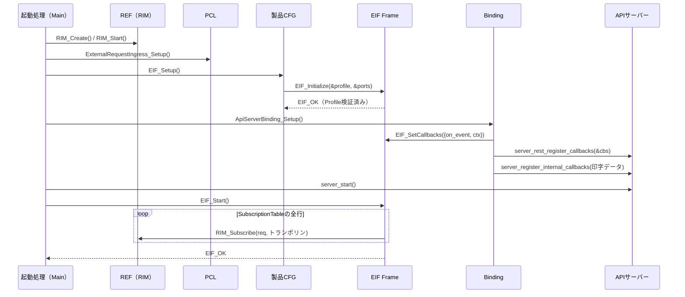

### 12.2.3 処理内容

1. EIFの初期化は起動処理が行い、PCLの中（現行`StartUpApiServer.c`）では行わない。
2. 通知先注入は`EIF_Start()`より前に行う（購読開始直後の通知を取りこぼさないため）。
3. `EIF_Start()`の失敗時、起動処理は`server_stop()`して起動失敗とする（現行の振る舞いを継承）。

## 12.3 製品要求（REST POST /jobs）

### 12.3.1 シナリオ概要

外部から要求を受け付け、受付結果を同期で返し、終端結果を非同期で通知する。

### 12.3.2 シーケンス図

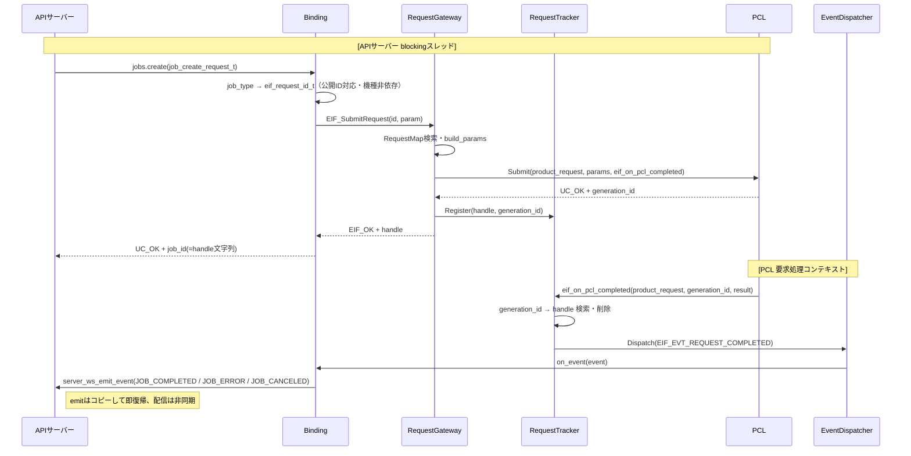

### 12.3.3 処理内容

1. 受付結果は同期で返す（`EIF_OK`＝受付完了）。
2. PCLの完了callbackが`Register`より先に到着した場合に備え、RequestTrackerは未登録の受付IDの完了を「先着完了」として一時保持し、`Register`時に即通知する（14.2）。
3. 完了イベント通知後に対応付けを削除する。

## 12.4 公開対象外の要求

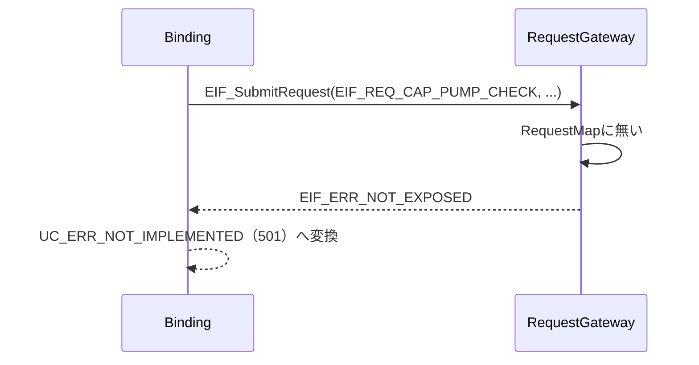

PCL・REFは呼ばない。

## 12.5 システム情報取得（REST GET）

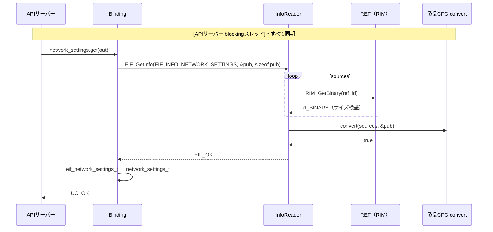

## 12.6 設定変更（REST PATCH）

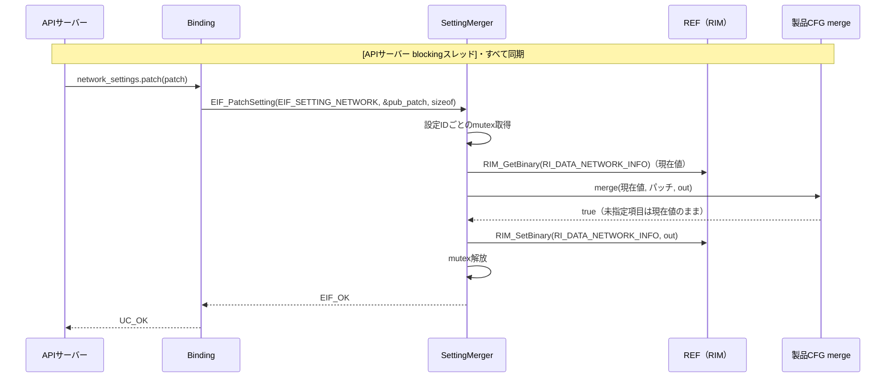

REFへの書込みは外部から変更可能と定義した設定値に限る（QA-01）。永続化はREFを購読するRSC/DEVが行う（全体構成設計 13.1）。

## 12.7 情報変化通知（WebSocket）

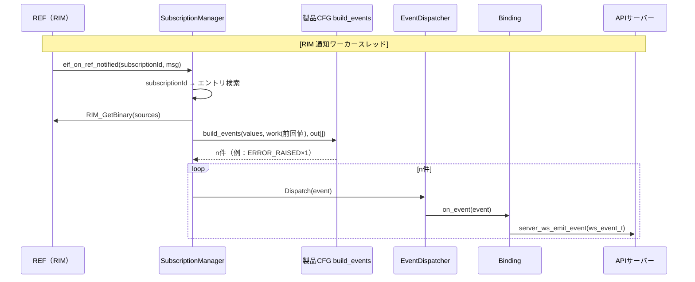

## 12.8 取消

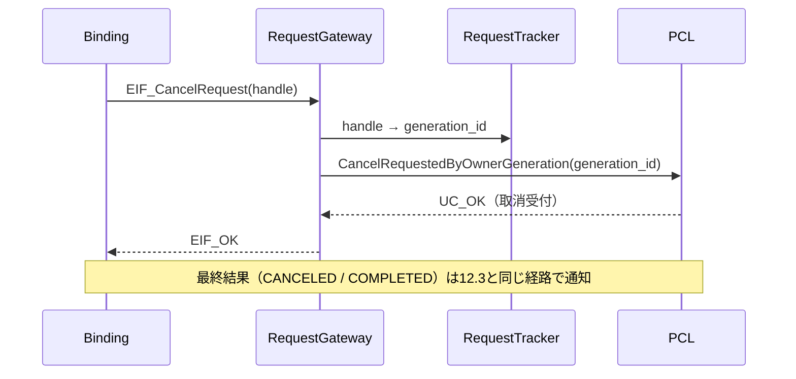

## 12.9 印字データ（T.B.D・方向性）

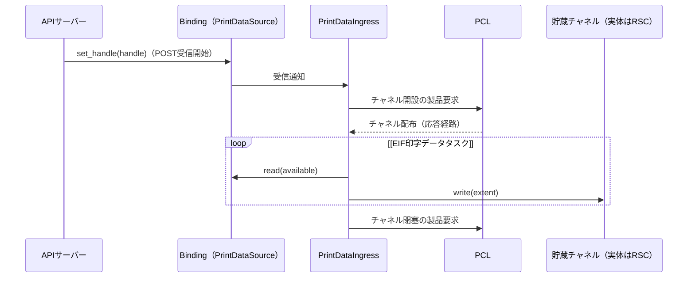

- EIFはDataPlane/PrintDataStorageのヘッダを参照しない（現行は直接参照しており移行対象。18章）。
- memory bufferはAPIサーバーの部品のため、Binding側の`PrintDataSource`ポートとして抽象化する。

# 13. 組み込み手順

本Layerはシステム起動時に生成され、電源断まで継続動作する構成を前提とする。モジュール単位の停止・再起動は想定しない（RIMに購読解除APIが無いため）。

## 13.1 ファイル構造

### 13.1.1 構成方針

- 区分（Binding／Boundary／Frame／製品CFG）をディレクトリで分ける。ディレクトリを見ればどれが機種依存かが分かるようにする。
- 公開ヘッダは`include/`の1か所だけにする。
- Frameは機能単位（request／info／notify／printdata／port）でサブディレクトリを切る。
- 製品CFGは`product/<MODEL>/`に閉じる。新機種はこのディレクトリをコピーして作る。

### 13.1.2 ファイル構成

```text
externalInterfaceLayer/
├─ CMakeLists.txt                   … MODEL選択、依存規則の強制
├─ README.md                        … 区分と依存規則、機種展開手順への導線
├─ include/                         … 【Boundary】外部アプリが参照する唯一のヘッダ群（機種非依存）
│   ├─ eif_api.h                    … 公開関数
│   ├─ eif_types.h                  … EIF_Result、EIF_RequestHandle、EIF_RequestOutcome
│   ├─ eif_public_id.h              … 公開要求/情報/設定/イベントID
│   ├─ eif_event.h                  … EIF_Event
│   └─ model/                       … 公開モデル（OpenAPIスキーマと同形）
│       ├─ eif_model_settings.h
│       ├─ eif_model_status.h
│       ├─ eif_model_job.h
│       └─ eif_model_alarm.h
├─ frame/                           … 【Frame】機種非依存の共通実装
│   ├─ include/
│   │   ├─ eif_frame_api.h          … EIF_Initialize（製品CFG向け）
│   │   ├─ eif_profile.h            … EIF_ProductProfile と各表の型
│   │   └─ eif_port.h               … EIF_PclPort / EIF_RefPort
│   ├─ core/eif_core.c              … 初期化・状態管理・Profile検証
│   ├─ request/
│   │   ├─ eif_request_gateway.c    … 要求受付・公開範囲判定・PCL転送
│   │   └─ eif_request_tracker.c    … 要求ハンドル⇔受付ID、PCL完了トランポリン
│   ├─ info/
│   │   ├─ eif_info_reader.c        … REF取得＋変換
│   │   ├─ eif_setting_merger.c     … PATCHマージ＋REF書込み
│   │   └─ eif_subscription_manager.c … 購読登録ループ、REF通知トランポリン
│   ├─ notify/eif_event_dispatcher.c … 通知先の保持・配信
│   ├─ printdata/eif_printdata_ingress.c … 印字データ受付（T.B.D）
│   ├─ port/eif_port_default.c      … PCL/REF実APIを指す既定Port
│   └─ util/eif_result_map.c        … 結果コード変換（16章）
├─ product/                         … 【製品CFG】機種依存（MODELで1つ選択）
│   ├─ Skeleton/                    … 雛形（何も公開しない）
│   │   └─ eif_product_setup.c
│   └─ MiniPrinter/
│       ├─ eif_product_setup.c      … EIF_Setup()：Profile組立て→EIF_Initialize
│       ├─ eif_product_requests.c   … RequestMap＋パラメータ変換
│       ├─ eif_product_infos.c      … InfoMap＋情報変換（ネットワーク設定 等）
│       ├─ eif_product_settings.c   … SettingMap＋マージ
│       ├─ eif_product_subscriptions.c … SubscriptionTable＋イベント生成
│       └─ eif_product_codes.c      … Faultコード→公開アラームID 等の対応表
├─ binding/                         … 【Binding】外部通信ライブラリ別（機種非依存）
│   └─ api_server/
│       ├─ include/api_server_binding.h  … ApiServerBinding_Setup()
│       ├─ api_server_binding.c     … 登録の集約
│       ├─ rest/                    … OpenAPIカテゴリ別：APIサーバー型⇔公開モデル
│       │   ├─ rest_jobs.c
│       │   ├─ rest_settings.c
│       │   ├─ rest_status.c
│       │   └─ rest_information.c
│       ├─ ws/ws_event_binding.c    … EIF_Event → ws_event_t → server_ws_emit_event
│       └─ printdata/printdata_source.c … memory buffer → PrintDataSource（T.B.D）
└─ test/
    ├─ frame/                       … スタブPort＋テスト用Profileで Frame を単体試験
    ├─ product/MiniPrinter/         … 変換ルールの単体試験（純粋関数）
    └─ binding/api_server/
```

### 13.1.3 依存ポリシー（CMakeで強制）

| ターゲット | PUBLIC include | PRIVATE include | link |
|---|---|---|---|
| `eif_frame` | `include/` | `frame/include`、PCL公開、REF `include/common` | `foundation_log` |
| `eif_product_<MODEL>` | - | `frame/include`、PCL公開、REF `include/<MODEL>` | `eif_frame`、`rim`、`request_control` |
| `eif_binding_api_server` | `binding/api_server/include` | `libs/api-server/include` | `eif_frame`（公開ヘッダのみ） |
| `external_interface_layer`（INTERFACE） | - | - | 上記3つ |

- `eif_frame`のinclude pathにREFの`include/<MODEL>`とAPIサーバーのincludeを**含めない**ことで、Frameからの機種依存ヘッダ・外部通信ライブラリヘッダのincludeをビルドエラーにする。

## 13.2 組み込み準備

### 13.2.1 前提確認

- REF（RIM）が生成・開始済みであること。
- PCLが`ExternalRequestIngress_Setup()`済みであること。
- 製品CFGが`MODEL`で選択されていること。

## 13.3 接続手順

### 13.3.1 製品CFG接続

起動処理から`EIF_Setup()`を呼ぶ（12.2）。

### 13.3.2 外部アプリケーション接続

`ApiServerBinding_Setup()`が`EIF_SetCallbacks()`と`server_rest_register_callbacks()`を行う。

### 13.3.3 購読開始

`server_start()`後に`EIF_Start()`を呼ぶ。

## 13.4 呼び出し側の責務

### 13.4.1 公開ID契約遵守

公開モデルのサイズ（`sizeof`）を正しく渡すこと。

### 13.4.2 通知先コールバックの制約

通知先コールバックはブロックせず、EIFの要求系APIを呼ばないこと（15章）。

### 13.4.3 受付と完了の区別

`EIF_OK`は受付完了であり、完了ではない。完了は完了イベントで判定すること。

### 13.4.4 非責務の理解

呼び出し側はEIFへ、受付可否判定、実行状態の保持、情報の保持を期待してはならない。

# 14. 排他・整合性設計

## 14.1 共有状態一覧

| 共有状態 | 所有 | 書く側（コンテキスト） | 読む側 | 排他 |
|---|---|---|---|---|
| ProductProfile | 製品CFG（const） | 初期化時のみ | 全コンテキスト | 不要（不変） |
| Port | 製品CFG（const） | 初期化時のみ | 全コンテキスト | 不要（不変） |
| 通知先一覧 | EventDispatcher | 起動時のみ（`EIF_Start`前） | PCL完了・RIM通知コンテキスト | 不要（Start後不変。Start時にメモリバリア） |
| 要求対応表（handle⇔generation） | RequestTracker | APIサーバースレッド群、PCL完了コンテキスト | 同左 | mutex |
| 購読ID一覧 | SubscriptionManager | 起動時のみ | RIM通知コンテキスト | 不要（Start後不変） |
| 作業領域（前回公開値。QA-03） | SubscriptionManager | RIM通知コンテキスト | 同左 | エントリ単位mutex（RIMの通知直列性が保証されるまで。QA-11） |
| 設定値の読込み～書込み区間 | SettingMerger | APIサーバースレッド群 | 同左 | 設定IDごとのmutex（同時PATCHによる更新の消失を防ぐ） |
| 初期化状態 | core | 起動時 | 全API | atomic |

## 14.2 RequestTrackerの整合性

- 容量はPCLの未完了要求上限（32件）＋先着完了用の余裕分とする。満杯時は`EIF_ERR_BUSY`。
- **先着完了**：PCLの完了callbackが`Register`より先に届いた場合、未登録の受付IDの完了結果を一時保持し、`Register`時に検出して即座に完了イベントを通知する。
- mutexはPCLのAPI呼出し中・通知先コールバック呼出し中には保持しない（デッドロック防止。PCLのSubmitが同期的に完了callbackを呼ぶ実装になっても成立させるため）。
- 要求ハンドルは単調増加のuint64とし、再利用しない。

## 14.3 製品CFGの整合性

- 表と変換関数は状態を持たない。状態が必要な差分導出は、Frameが貸し出す作業領域で行う。
- 変換関数は戻り値で成否を返し、失敗時は出力を書かない（現行README「失敗経路の明示」を継承）。

# 15. 実行コンテキスト設計（追加）

## 15.1 実行コンテキスト一覧

| # | コンテキスト | 生成元 | EIF内で走る処理 | 制約 |
|---|---|---|---|---|
| C1 | 起動処理スレッド | Main | `EIF_Setup`/`SetCallbacks`/`Start` | 1回のみ |
| C2 | APIサーバー blockingスレッド（複数） | APIサーバー（tokio blocking pool） | Binding REST、`EIF_SubmitRequest`/`GetInfo`/`PatchSetting`/`Cancel` | 同時並行あり。上限時間を超える待ちは`UC_ERR_TIMEOUT` |
| C3 | PCL要求処理コンテキスト | PCL | 完了トランポリン→EventDispatcher→通知先 | 直列。**PCL同期APIへ再入禁止**、長時間ブロック禁止 |
| C4 | RIM通知ワーカー | REF（RIM） | 購読トランポリン→REF取得→イベント生成→通知先 | 長時間ブロック禁止。RIM APIの再入可否は要確認 |
| C5 | EIF印字データタスク | EIF（PrintDataIngress） | memory buffer読出し→チャネル書込み | EIF唯一の自前スレッド |

## 15.2 同期・非同期の整理

| 区間 | 方向 | 種別 | 方式 |
|---|---|---|---|
| APIサーバー → Binding | 要求 | 同期 | APIサーバーがコールバックを呼ぶ |
| Binding → EIF | 要求・取得 | 同期 | 公開API呼出し |
| EIF → PCL | 要求 | 同期（受付のみ） | `Submit`は即時復帰 |
| PCL → EIF | 結果 | **非同期** | Submit時に注入した完了callback |
| EIF → REF | 取得 | 同期 | `RIM_Get*` |
| REF → EIF | 変化 | **非同期** | `RIM_Subscribe`で注入した通知callback |
| EIF → Binding | 通知 | **非同期**（EIFから見て） | `EIF_SetCallbacks`で注入した通知先callback |
| Binding → APIサーバー | 通知 | 非同期 | `server_ws_emit_event`（コピーして即復帰） |

## 15.3 コールバックの仕組み（注入と呼出し）

| # | 注入する側 | 注入される側 | 注入タイミング | コールバック | 呼ばれるコンテキスト |
|---|---|---|---|---|---|
| 1 | Binding | APIサーバー | 起動時 `server_rest_register_callbacks` | REST各コールバック | C2 |
| 2 | Binding | EIF | 起動時 `EIF_SetCallbacks` | `on_event` | C3、C4 |
| 3 | 製品CFG | EIF Frame | 起動時 `EIF_Initialize` | 変換ルール（RequestMap等の関数ポインタ） | 呼出し元と同じ |
| 4 | EIF Frame | PCL | 要求ごと `Submit` | `eif_on_pcl_completed` | C3 |
| 5 | EIF Frame | REF | 起動時 `RIM_Subscribe` | `eif_on_ref_notified` | C4 |

いずれも「注入される側は呼出し先の実体を知らない」（全体構成設計 5.1）。Frameが登録するのは常にFrameの共通トランポリン関数1つで、製品ごとの処理はトランポリンが表を引いて呼び分ける。これにより、**製品CFGはPCL・REFへコールバックを直接登録しない**。

## 15.4 将来検討

通知先コールバックがC3/C4で実行されるため、通知先が遅いとPCL・RIMを止める。APIサーバーの`server_ws_emit_event`はコピーして即復帰するため現状は問題ないが、遅い通知先を追加する場合はEventDispatcherに配信キュー＋専用スレッドを追加する（公開APIは変えない）。

# 16. エラー・結果コード変換設計（追加）

変換は各境界で1か所の表で行う（現行README「異常処理の共通化」を継承）。

## 16.1 PCL受付結果 → EIF_Result（Frame `eif_result_map.c`）

| PCL `uc_result_t` | EIF_Result |
|---|---|
| `UC_OK` | `EIF_OK` |
| `UC_ERR_INVALID_PARAM` | `EIF_ERR_INVALID_PARAM` |
| `UC_ERR_BUSY` | `EIF_ERR_BUSY` |
| `UC_ERR_NOT_FOUND` | `EIF_ERR_NOT_FOUND` |
| `UC_ERR_SERVER_UNAVAILABLE` | `EIF_ERR_UNAVAILABLE` |
| その他 | `EIF_ERR_INTERNAL` |

## 16.2 PCL終端結果 → EIF_RequestOutcome（既定表）

| PCL `execution_result` | EIF_RequestOutcome |
|---|---|
| `ACCEPTED` | `EIF_OUTCOME_COMPLETED` |
| `INVALID` | `EIF_OUTCOME_INVALID` |
| `NOT_SUPPORTED` | `EIF_OUTCOME_NOT_SUPPORTED` |
| `FAILED` | `EIF_OUTCOME_FAILED` |
| `CANCELED` | `EIF_OUTCOME_CANCELED` |
| `PENDING` | `EIF_OUTCOME_PENDING`（照会時のみ） |

## 16.3 REF結果 → EIF_Result（Frame）

| `RIStatus` | EIF_Result |
|---|---|
| `RI_SUCCESS` | `EIF_OK` |
| `RI_INVALID_PARAMETER` | `EIF_ERR_INTERNAL`（EIFが正しいIDを渡す前提のため、引数不正はEIF内部の不整合） |
| `RI_NOT_INITIALIZED` | `EIF_ERR_UNAVAILABLE` |
| `RI_NO_DATA` | `EIF_ERR_NOT_FOUND` |
| その他 | `EIF_ERR_INTERNAL` |

※現行`settings_map_rim_status()`は`RI_INVALID_PARAMETER`を外部の引数不正（`UC_ERR_INVALID_PARAM`）にしているが、外部入力の不正とREF呼出しの不正は別物のため分離する。

## 16.4 EIF_Result → uc_result_t（Binding）

| EIF_Result | `uc_result_t` | HTTP（APIサーバー） |
|---|---|---|
| `EIF_OK` | `UC_OK` | 2xx |
| `EIF_ERR_INVALID_PARAM` | `UC_ERR_INVALID_PARAM` | 400系 |
| `EIF_ERR_NOT_EXPOSED` | `UC_ERR_NOT_IMPLEMENTED` | 501（QA-09） |
| `EIF_ERR_NOT_FOUND` | `UC_ERR_NOT_FOUND` | 404 |
| `EIF_ERR_BUSY` | `UC_ERR_BUSY` | 409/503 |
| `EIF_ERR_UNAVAILABLE` | `UC_ERR_SERVER_UNAVAILABLE` | 503 |
| `EIF_ERR_INTERNAL` | `UC_ERR_INTERNAL` | 500 |

# 17. 機種展開手順（追加）

新機種（例：`PrinterB`）でEIFを用意する手順。**Frame・Binding・公開APIは変更しない**ことを前提とする。

| # | 作業 | 対象 | 種別 |
|---|---|---|---|
| 1 | `product/Skeleton/`を`product/PrinterB/`へコピー | 製品CFG | 追加 |
| 2 | 公開する要求をRequestMapへ1行ずつ記述（PCLの製品要求IDと対応） | 製品CFG | 機能定義＋マッピング |
| 3 | 公開する情報をInfoMapへ記述し、REF製品型→公開モデルの変換関数を書く | 製品CFG | マッピング＋ルール |
| 4 | 設定変更をSettingMapへ記述し（書込み先のREF ID）、マージ関数を書く | 製品CFG | マッピング＋ルール |
| 5 | 購読するREF項目をSubscriptionTableへ記述し、イベント生成関数を書く | 製品CFG | マッピング＋ルール |
| 6 | 内部コード→公開コードの対応表を書く | 製品CFG | マッピング |
| 7 | `MODEL=PrinterB`でビルド | ビルド | - |
| 8 | 変換関数の単体試験（純粋関数のため入出力のみで試験可能） | test/product | - |

外部IF仕様（OpenAPI/AsyncAPI）に新しい資源が増える場合のみ、次も行う。これは全体構成設計 3.1.1 の「外部IF仕様の変更」というEIF本来の変更理由に当たる。

| # | 作業 | 対象 |
|---|---|---|
| 9 | 公開ID・公開モデルの追加（末尾追加、既存値不変） | Boundary |
| 10 | APIサーバー型⇔公開モデルの変換追加 | Binding |

# 18. 現行実装からの移行計画（追加）

課題の詳細は`EIF構成図.drawio`の「3.現行実装の課題」シートを参照（課題IDは同シートの一覧と対応）。

| Step | 内容 | 主な対象（現行） | 解消する課題 |
|---|---|---|---|
| 1 | ディレクトリを4区分へ再編し、公開ヘッダを`include/`へ集約、命名規則を統一。未使用の`external_request_ingress.c`（旧`control_runtime`API）を削除。APIサーバー依存をBindingへ隔離 | 全体 | A-1～A-4、A-7、D-1 |
| 2 | Frame骨格（core、Port、EventDispatcher、Profile型）を作り、Skeleton製品CFGでビルドを通す | 新規 | B-全般の受け皿 |
| 3 | WebSocket購読を移行：`k_subscriptions`と`ApiServerWsCallback_FaultInfoList`を、Frame（SubscriptionManager）と製品CFG（購読表＋`mp_build_fault_events`）へ分割 | `ws/api_server_ws_subscribe.c`、`ws/api_server_ws_callbacks.c` | B-2、B-3、C-2 |
| 4 | REST GETを移行：`settings_get_network()`をInfoMap＋`mp_convert_network_settings`へ。Bindingは型の詰め替えのみ | `rest/settings.c` | B-1、A-5 |
| 5 | REST PATCHを移行：製品別API `RIM_SetNetworkInfo` の直接呼出しを、SettingMap＋RefPort.set_binary へ置き換え | `rest/settings.c` | B-5 |
| 6 | Jobsを接続：RequestGateway/RequestTracker経由でPCLへ。WSのjob系Publisherは完了イベントのBindingへ統合 | `rest/jobs.c`、`ws/api_server_ws_job_publisher.c` | C-1、B-4 |
| 7 | 起動配線をPCLのStartUpから起動処理（Main）へ移す | `productControlLayer/StartUp/frame/StartUpApiServer.c` | A-6 |
| 8 | 印字データ：DEV直接参照を廃止し、貯蔵チャネル（PCL経由）＋PrintDataSource（Binding）へ（全体構成設計 7.2確定後） | `external_request_printdata_ingress.c` | B-6、C-6 |

Step 3・4は既存の動作を保ったまま移行できるため、Frame/製品CFG方式の効果検証（機種非依存化）として先行実施を推奨する。

# 19. 要件トレーサビリティ（追加）

| 要件ID | 設計箇所 |
|---|---|
| EIF-FR-01 | 9.3.1、11.3（各表）、11.4、12.4 |
| EIF-FR-02 | 10.7.4、11.3.1、12.3 |
| EIF-FR-03 | 9.3.3、10.7.6、12.3、14.2、16.2 |
| EIF-FR-04 | 10.6.5、10.7.2、15.3 |
| EIF-FR-05/06 | 10.2 #10、12.9（T.B.D） |
| EIF-FR-07 | 10.7.7、10.7.8、11.3.2、11.3.3、12.5、12.6 |
| EIF-FR-08 | 11.3.4、12.7、15.3 |
| EIF-FR-09 | 11.3.4、12.7 |
| EIF-FR-10 | 10.7.5、12.8 |
| EIF-NFR-01 | 13.1.2（`include/`集約） |
| EIF-NFR-02 | 10.4（要求ハンドルで受付IDを隠蔽）、10.5 #7 |
| EIF-NFR-03 / 07 | 8.2.2、13.1.3 |
| EIF-NFR-04 | 15.2、12.6（Binding側待ち合わせ） |
| EIF-NFR-05 | 8.2.2、13.1.3 |
| EIF-NFR-06 | 11章、13.1.2、17章 |
| EIF-NFR-08 | 14章、15章 |
| EIF-NFR-09 | 15.1 C5、12.9 |

# 20. 未決事項（追加）

確認事項・合意事項は QA表（`QA表.md`）で一元管理する。本書に関係する主なものは次のとおり。

| No | 内容 | 方針 | 状態 | 本書の関係箇所 |
|---|---|---|---|---|
| QA-01 | 設定変更をEIFからREFへ直接書き込む | 直接書込み（全体構成設計 S3 の例外） | 回答済 | 10.7.8、11.3.3、12.6 |
| QA-02 | PCL Submitへの要求パラメータ追加 | 現時点では不要 | 保留 | 10.8.2、11.3.1 |
| QA-03 | 異常の発生/解消の差分をEIFが前回値を保持して導出する | EIFが前回公開値を作業領域に保持 | 合意待ち | 11.3.4、14.1 |
| QA-04 | 初期化順序と呼出し元 | 起動処理が REF→PCL→EIF→APIサーバー | 合意待ち | 12.2 |
| QA-05～QA-12 | ジョブ状態の情報源、印字データ経路、購読解除API、公開モデルの二重定義、非公開時のHTTPステータス、RI_BINARYの寿命、RIM通知の直列性、uc_result_tの二重定義 | QA表参照 | 未回答 | 各章 |
