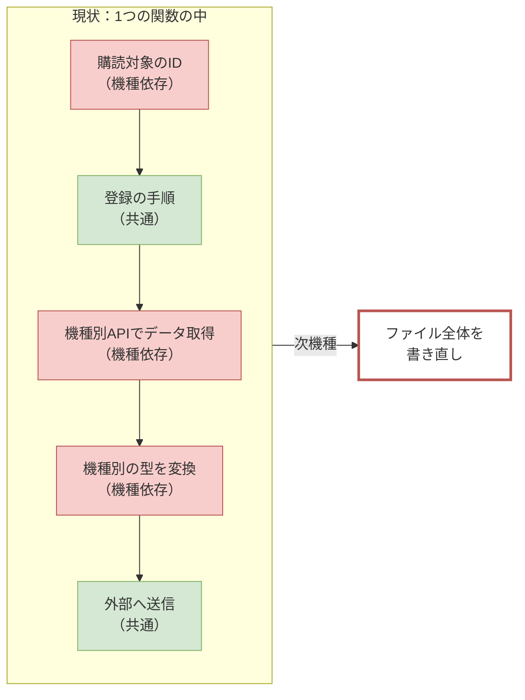
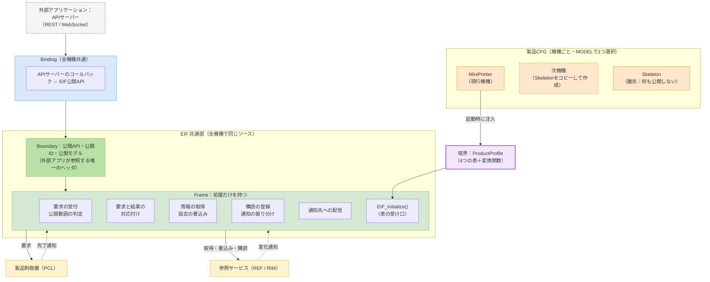
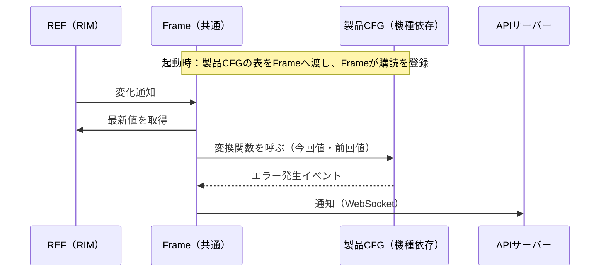

# 外部インタフェース層（EIF）Frame／機種依存 分離設計

| 項目 | 内容 |
|---|---|
| 文書名 | EIF Frame／機種依存 分離設計（説明資料） |
| 版 | 0.01 |
| 作成日 | 2026-10-20 |
| 関連文書 | EIF要件定義（初版）、EIF仕様設計書、EIF構成図（`EIF構成図.drawio` 5〜6シート）、QA表 |

---

## 1. 本資料の目的

本資料は、外部インタフェース層（EIF）を **「機種によらず共通の部分（Frame）」** と **「機種ごとに作る部分（製品CFG）」** に分ける設計を説明するものです。

この設計の目的は、**次機種の開発でEIFを作り直さずに済むようにすること**です。

---

## 2. 背景：現状の問題

現在のEIFの実装では、次の2種類の内容が同じファイル・同じ関数の中に混在しています。

| 種類 | 内容 | 例 |
|---|---|---|
| 機種で変わる「定義」 | どの情報を購読するか／どの内部APIで取るか／どの製品要求へ変換するか／内部データの型 | `RI_DATA_FAULT_INFO_LIST`の購読、`RIM_GetNetworkInfo()`の呼出し、`RIM_network_info_t`型の解釈 |
| 機種で変わらない「処理」 | 購読の登録手順、通知の振り分け、エラーの変換、外部への送信 | 購読表を順に登録するループ、失敗時のログとエラー変換 |

また、参照サービス（REF）の機種別ヘッダ（`rim/include/MiniPrinter`）を直接参照しています。

このため、次機種でREFのIDや型が変わると、**EIFのほぼ全ファイルを書き直すことになります**。



---

## 3. 解決の方針

### 3.1 一言でいうと

> **「処理」はFrameに、「定義」は製品CFGに分ける。次機種では定義（製品CFG）だけを作る。**

### 3.2 3つの原則

| # | 原則 | 内容 |
|---|---|---|
| 1 | 処理と定義を分ける | 機種で変わらない処理（登録、振り分け、エラー変換、排他）はFrameへ。機種で変わる定義（ID、対応関係、型の変換）は製品CFGへ |
| 2 | 製品CFGは「表」と「変換関数」だけ | 製品CFGは1行＝1項目の表と、入力を出力へ変換するだけの関数で書く。登録や送信は書かない |
| 3 | 混入をビルドで防ぐ | Frameのビルド設定には、機種別ヘッダ・外部通信ライブラリのヘッダを参照する設定を入れない。Frameに機種依存コードを書くとビルドエラーになる |

### 3.3 この方針の根拠

- 全体構成設計 3.6「製品差分のデータ化方針」（機能定義・マッピング・ルールの3属性で製品差を注入する）に沿った設計です。
- 既に社内で実績のある次の仕組みと同じ考え方です。

| 既存の仕組み | 同じ考え方の部分 |
|---|---|
| 参照サービス RIM | `core`（製品非依存）と`products/<製品>`（製品定義）の分離。製品は表（`DataItemDefinition`）で宣言する |
| PCL 自発要求生成（ARG） | `frame/`と`src/<MODEL>/`の分離。製品側の`Setup()`が表と関数を組み立ててFrameへ渡す。ビルド時に`MODEL`で製品を選ぶ |

---

## 4. ブロック図

### 4.1 全体構成



正式な図は `EIF構成図.drawio` の「5.Frame／機種依存 分離構成」シートを参照してください。

### 4.2 各ブロックの役割

| ブロック | 役割 | 機種依存 | 次機種での変更 |
|---|---|---|---|
| Binding | 外部通信ライブラリ（APIサーバー）のコールバックとEIF公開APIの橋渡し。型の詰め替えのみ | なし | なし |
| Boundary | 外部アプリが参照する公開API・公開ID・公開モデル | なし | なし（外部IF仕様が増えた場合のみ追記） |
| Frame | 要求の受付、相関、情報の取得・書込み、購読、通知の配信などの共通処理 | なし | **なし** |
| 製品CFG | 公開範囲、内部IDとの対応、内部型との変換、購読対象 | **あり** | **ここだけ作成** |

---

## 5. Frameと製品CFGの境界

### 5.1 製品CFGが持つ4つの表

製品CFGは、次の4つの表をFrameへ渡します。**表に載っていない項目は外部へ公開されません**（公開範囲の定義を兼ねます）。

| 表 | 1行に書く内容 | Frameが行うこと |
|---|---|---|
| RequestMap（要求） | 公開要求ID → PCLの製品要求ID | 受付、PCLへの転送、結果との対応付け、完了通知 |
| InfoMap（情報取得） | 公開情報ID → REFのID群＋変換関数 | REFからの取得、サイズ検証、エラー変換 |
| SettingMap（設定変更） | 公開設定ID → REFの書込み先＋マージ関数 | 現在値の取得、排他、REFへの書込み |
| SubscriptionTable（購読） | REFの購読ID・通知契機 → イベント生成関数 | REFへの登録、通知の振り分け、前回値の保持、配信 |

### 5.2 記述例（異常通知の購読）

現状は、購読表・登録処理・データ取得・変換・送信が2つのファイルにまたがって書かれています。分離後、製品CFGに書くのは次の **表1行と変換関数1つだけ** です。

```c
/* product/MiniPrinter/eif_product_subscriptions.c */
static const EIF_SubscriptionEntry k_subscriptions[] = {
    /* 購読対象                      通知契機            取得する値                                       前回値の領域                変換関数 */
    { RI_TARGET_DATA, RI_DATA_FAULT_INFO_LIST, RI_TRIGGER_ON_CHANGE, 0,
      { { EIF_SRC_DATA_BINARY, RI_DATA_FAULT_INFO_LIST, sizeof(RIM_FaultInfoList) } }, 1,
      sizeof(RIM_FaultInfoList), mp_build_fault_events },
};
```

`mp_build_fault_events` は「前回値と今回値の差分から、エラー発生／解消イベントを作る」だけの関数です。REFへの登録、値の取得、外部への送信はFrameが行います。

### 5.3 処理の流れ（異常通知の例）



---

## 6. フォルダ構成

### 6.1 構成

```text
externalInterfaceLayer/
├─ CMakeLists.txt                 MODEL選択と依存規則の強制
├─ README.md
├─ include/                       【Boundary】外部アプリが参照する唯一の公開ヘッダ   … 共通
│   ├─ eif_api.h
│   ├─ eif_types.h
│   ├─ eif_public_id.h
│   ├─ eif_event.h
│   └─ model/
├─ frame/                         【Frame】処理だけを持つ                            … 共通
│   ├─ include/                   表の型（eif_profile.h）、Port、EIF_Initialize
│   ├─ core/                      初期化・表の検証
│   ├─ request/                   要求の受付・結果との対応付け
│   ├─ info/                      情報取得・設定書込み・購読
│   ├─ notify/                    通知先への配信
│   ├─ printdata/                 印字データ（T.B.D）
│   ├─ port/                      PCL・REFの呼出し口（試験時はスタブ）
│   └─ util/                      エラー変換
├─ product/                       【製品CFG】機種ごとに作る部分                      … 機種依存
│   ├─ Skeleton/                  雛形（何も公開しない）
│   ├─ MiniPrinter/               現行機種
│   │   ├─ eif_product_setup.c         表の組立て → Frameへ渡す
│   │   ├─ eif_product_requests.c      要求の表
│   │   ├─ eif_product_infos.c         情報取得の表＋変換関数
│   │   ├─ eif_product_settings.c      設定変更の表＋マージ関数
│   │   ├─ eif_product_subscriptions.c 購読の表＋イベント生成関数
│   │   └─ eif_product_codes.c         異常コード → 公開アラームID
│   └─ <次機種>/                  ★次機種で追加するのはここだけ
├─ binding/                       【Binding】外部通信ライブラリ別                    … 共通
│   └─ api_server/
│       ├─ rest/
│       ├─ ws/
│       └─ printdata/
└─ test/                          Frame（スタブ）／製品CFG（変換関数）／Binding の試験
```

正式な図は `EIF構成図.drawio` の「6.フォルダ構成」シートを参照してください。

### 6.2 依存規則

フォルダごとに参照してよいヘッダを決め、ビルド設定（CMakeのinclude path）で強制します。

| 区分 | 参照してよい | 参照してはいけない |
|---|---|---|
| Binding | 公開ヘッダ（include/）、APIサーバーのヘッダ | frame/、product/ |
| Frame | 公開ヘッダ、PCL公開ヘッダ、REFの製品非依存ヘッダ | **REFの機種別ヘッダ**、**APIサーバーのヘッダ**、product/ |
| 製品CFG | frame/include/、PCL公開ヘッダ、REFの機種別ヘッダ | APIサーバーのヘッダ |

### 6.3 現行ファイルとの対応

| 現行 | 分離後 |
|---|---|
| `ws/api_server_ws_subscribe.c`（購読表） | 表は `product/MiniPrinter/`、登録処理は `frame/info/` |
| `ws/api_server_ws_callbacks.c`（変換） | `product/MiniPrinter/`（変換関数・コード対応表） |
| `ws/*_publisher.c` | `binding/api_server/ws/` |
| `rest/settings.c`（REF取得・変換） | `product/MiniPrinter/`（情報・設定の表と関数） |
| `rest/settings.c`（APIサーバー型） | `binding/api_server/rest/` |
| `rest/jobs.c` ほか | `binding/api_server/rest/` ＋ `product/MiniPrinter/`（要求の表） |
| `external_request_printdata_ingress.c` | `frame/printdata/` ＋ `binding/api_server/printdata/`（T.B.D） |
| `external_request_ingress.c` | 削除（ビルド対象外・旧API） |

---

## 7. 次機種開発での作業

### 7.1 作業手順

| # | 作業 | 場所 |
|---|---|---|
| 1 | `product/Skeleton/` を `product/<次機種>/` へコピー | 製品CFG |
| 2 | 公開する要求を要求の表へ1行ずつ書く | 製品CFG |
| 3 | 公開する情報を情報の表へ書き、変換関数を書く | 製品CFG |
| 4 | 変更可能な設定を設定の表へ書き、マージ関数を書く | 製品CFG |
| 5 | 購読する情報を購読の表へ書き、イベント生成関数を書く | 製品CFG |
| 6 | 異常コードと公開アラームIDの対応表を書く | 製品CFG |
| 7 | `MODEL=<次機種>` でビルド | ビルド |
| 8 | 変換関数の単体試験 | test/ |

### 7.2 現状との比較

| 観点 | 現状 | 分離後 |
|---|---|---|
| 次機種で変更するファイル | rest/\*.c、ws/\*.c、ExternalRequestIngress/\*.c、CMake、PCLのStartUp | **product/<次機種>/ のみ** |
| 共通部の変更 | 必要（混在しているため） | 不要 |
| 公開範囲の変更 | 関数を書き換える | 表の行を追加・削除する |
| 試験 | REF・PCL・APIサーバーをつないで試験 | 変換関数は単体で試験可能（入力と出力だけ） |
| 機種依存コードの混入 | 検出手段なし | ビルドエラーで検出 |

### 7.3 目標

- 既存の公開要求・公開情報だけを使う次機種では、**Frame・Bindingの変更行数を0にする**（要件 EIF-NFR-06）。

---

## 8. 現行実装からの移行

既存の動作を保ったまま、段階的に移行します。

| Step | 内容 | 効果 |
|---|---|---|
| 1 | フォルダを4区分（Binding／Boundary／Frame／製品CFG）へ再編 | 構成の分かりにくさを解消 |
| 2 | Frameの骨格と雛形（Skeleton）を作成 | 分離の受け皿 |
| 3 | WebSocket購読（異常通知）を分離 | **機種依存分離の効果検証（先行実施を推奨）** |
| 4 | 情報取得（REST GET）を分離 | 同上 |
| 5 | 設定変更（REST PATCH）を分離 | 機種別の書込みAPIを共通部から排除 |
| 6 | ジョブ（PCL接続）を分離・接続 | 製品要求の公開 |
| 7 | 初期化をPCLのStartUpから起動処理へ移動 | 依存方向の是正 |
| 8 | 印字データ経路の分離 | 全体構成設計 7.2 確定後 |

---

## 9. 前提・合意事項

本設計は次の事項を前提としています。詳細はQA表を参照してください。

| No | 内容 | 状態 |
|---|---|---|
| QA-01 | 設定変更はEIFからREFへ直接書き込む | 回答済 |
| QA-03 | 異常の発生／解消の差分は、EIFが前回値を保持して導出する | 合意待ち |
| QA-04 | 初期化は起動処理が REF→PCL→EIF→APIサーバー の順に行う | 合意待ち |

---

## 付録：用語

| 用語 | 意味 |
|---|---|
| Frame | 機種によらず共通の処理を持つ部分 |
| 製品CFG | 機種ごとに作る定義（表と変換関数） |
| ProductProfile | 製品CFGがFrameへ渡す4つの表のまとまり |
| Binding | 外部通信ライブラリ（APIサーバー）とEIFをつなぐ部品 |
| Boundary | 外部アプリが参照するEIFの公開ヘッダ |
| MODEL | ビルド時に指定する機種名。どの製品CFGを使うかを決める |
| 注入 | 起動時に表や関数をFrameへ渡し、Frameがそれを使って動くこと |
