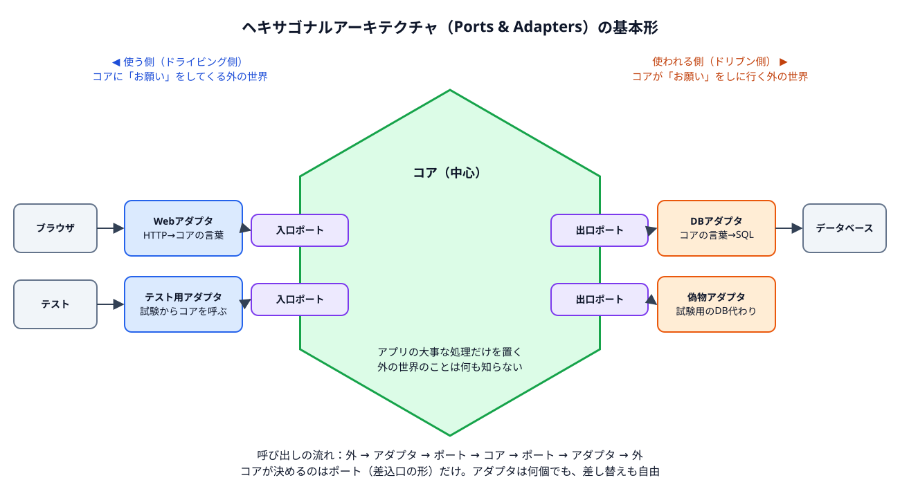
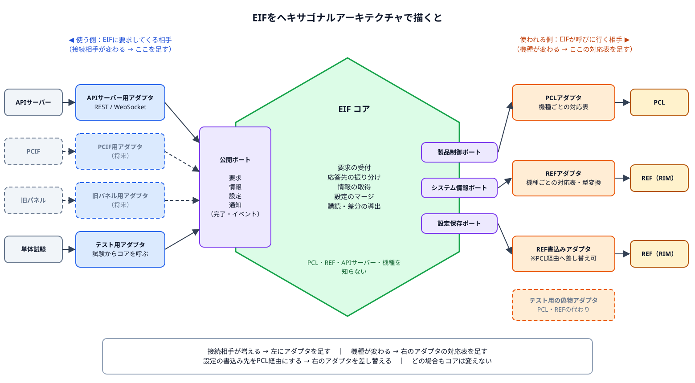

# ヘキサゴナルアーキテクチャ入門 ― EIFを例に

| 項目 | 内容 |
|---|---|
| 対象 | 「ヘキサゴナルアーキテクチャ」を初めて聞く人 |
| 読む時間 | 約10分 |
| 関連資料 | [EIF設計書（ヘキサゴナル版）](設計書_ヘキサゴナル版.md)、[構成図（ヘキサゴナル版）](構成図_ヘキサゴナル版.drawio) |

---

## 1. 一言でいうと

> **大事な処理（コア）を真ん中に置き、外の世界とは必ず「差込口（ポート）」と「変換アダプタ（アダプタ）」を通してつなぐ設計。**

外の世界とは、画面、通信、データベース、他のレイヤなど、コアの外側にあるものすべてです。
コアは外の世界のことを何も知りません。だから、外の世界が変わってもコアは変わりません。

別名を **Ports & Adapters（ポートとアダプタ）** といいます。こちらの方が中身を表した名前です。

---

## 2. 身近なたとえ：海外旅行の変換プラグ

| 身近なもの | ヘキサゴナルでいうと |
|---|---|
| ドライヤー本体 | **コア**（大事な処理） |
| ドライヤーのプラグの形 | **ポート**（コアが決めた差込口の形） |
| 国ごとの変換プラグ | **アダプタ**（外の世界との間で形を変換する部品） |
| 各国のコンセント | **外の世界** |

- 行く国が変わっても、ドライヤー本体は作り直しません。変換プラグを替えるだけです。
- 変換プラグは国の数だけ用意すればよく、ドライヤー本体には手を入れません。
- ドライヤーの試験は、本物のコンセントがなくても「試験用の電源」につなげばできます。

---

## 3. 図で見る

### 3.1 登場人物は4つ

| 名前 | 役割 | 図の色 |
|---|---|---|
| **コア** | アプリの大事な処理。外の世界を知らない | 緑の六角形 |
| **ポート** | コアが決めた「差込口の形」（関数の型、呼び方の約束） | 紫 |
| **アダプタ（使う側）** | 外からのお願いを、コアの言葉に変換してポートに差し込む | 青（左側） |
| **アダプタ（使われる側）** | コアのお願いを、外の世界の言葉に変換して実行する | オレンジ（右側） |

### 3.2 左と右の違い

| | 左側（使う側／ドライビング側） | 右側（使われる側／ドリブン側） |
|---|---|---|
| 誰が呼び始めるか | 外の世界がコアを呼ぶ | コアが外の世界を呼ぶ |
| 例 | 画面、通信、テストプログラム | データベース、メール、他のレイヤ |
| ポートの持ち主 | コア | コア |

左も右も、**ポート（差込口の形）を決めるのはコア**です。ここが一番大事なポイントです。

### 3.3 なぜ「六角形」なのか

形に特別な意味はありません。辺がたくさんあり「いくつでも差込口をつけられる」ことを表すために六角形で描かれる、というだけです。差込口の数は6つに限りません。

---

## 4. 守るルールは1つだけ

> **依存の矢印は、必ず「外 → 内」に向ける。コアは外を知らない。**

- コアのソースコードには、通信ライブラリ、データベース、他のレイヤのヘッダーが1つも出てこない。
- コアが外の世界を呼ぶときも、相手の関数を直接呼ばない。自分が決めたポートを呼び、その先にどのアダプタがつながっているかは知らない。
- アダプタはコアのポートを知っている（アダプタ → コア）。逆は無い。

これを守ると、次の章の「良いこと」が自然に手に入ります。

---

## 5. 良いこと

| 良いこと | 理由 |
|---|---|
| 外の世界を替えてもコアは変わらない | アダプタを替えるだけで済む |
| つなぐ相手を増やせる | アダプタを足すだけで済む |
| コアだけで試験できる | 右側に「偽物アダプタ」をつなげば、本物の相手がいなくても動く |
| 変更の影響範囲が分かりやすい | 「外の都合」はアダプタ、「中の都合」はコア、と置き場所が決まっている |

---

## 6. よくある誤解

| 誤解 | 実際 |
|---|---|
| 六角形の辺の数だけポートを作る | 形に意味はない。ポートはいくつでもよい |
| アダプタは通信用だけ | 試験用、他レイヤ用、ファイル用など何でもアダプタになる |
| レイヤ構造と対立する | 対立しない。レイヤ構造の中の1つのレイヤ（例：EIF）の内部を、この考え方で作ることができる |
| 部品が増えて遅くなる | ポートは関数ポインタ1回の呼出し程度。タスクやキューを挟む必要はない |

---

## 7. EIFに当てはめると

### 7.1 EIFの登場人物

| ヘキサゴナルの名前 | EIFでは | 中身 |
|---|---|---|
| コア | **EIFコア** | 要求の受付と応答先の振り分け、情報の取得、設定のマージ、購読と差分の導出 |
| 入口ポート | **公開ポート** | 要求、情報、設定、通知（`eif_api.h`） |
| 使う側のアダプタ | **APIサーバー用アダプタ**（将来：PCインタフェース用、旧パネル用） | REST／WebSocketやコマンドを、EIFの言葉に変換する |
| 出口ポート | **製品制御ポート、システム情報ポート、設定保存ポート** | EIFコアがPCL・REFへお願いするときの差込口 |
| 使われる側のアダプタ | **PCLアダプタ、REFアダプタ、REF書込みアダプタ** | EIFの言葉を、PCL・REFのAPIと機種ごとのID・型に変換する |

### 7.2 何が変わったら、どこを直すか

| 起きること | 直す場所 | コア |
|---|---|---|
| 接続相手が増える（PCインタフェース、旧パネル） | 左に**アダプタを足す** | 変えない |
| 機種が変わる（REFのID・型、PCLの製品要求ID） | 右の**アダプタの対応表を足す** | 変えない |
| 設定の書込み先をREFからPCL経由に変える | 右の**アダプタを差し替える** | 変えない |
| PCLやREFのAPIが変わる | 右の**アダプタを直す** | 変えない |
| 外部に公開する機能そのものを増やす | 公開ポートとコアに追加 | 変える（EIF本来の変更） |

### 7.3 現在の設計（Frame／製品CFG）との関係

現在の設計も、考え方はほぼ同じです。ヘキサゴナル版は、次の2点をよりはっきりさせたものです。

| 観点 | 現在の設計 | ヘキサゴナル版 |
|---|---|---|
| コア（Frame）が知っているもの | PCLの公開型、REFの製品非依存の型 | **何も知らない**（EIF自身の型だけ） |
| 機種ごとの違いの置き場所 | 製品CFG（表）をFrameへ注入 | 右側の**アダプタの対応表** |

詳しくは[EIF設計書（ヘキサゴナル版）](設計書_ヘキサゴナル版.md)を参照してください。

---

## 8. まとめ

1. 大事な処理を**コア**として真ん中に置く。
2. コアは外の世界を知らない。外とは**ポート（差込口）**を通してだけつながる。
3. 外の世界との変換は**アダプタ**が行う。左は「使う側」、右は「使われる側」。
4. EIFでは、**接続相手の違いは左のアダプタ、機種の違いは右のアダプタ**で吸収し、EIFコアは変えない。

---

## 付録：用語

| 用語 | 意味 |
|---|---|
| ヘキサゴナルアーキテクチャ | 本資料の設計の考え方。Alistair Cockburn氏が提唱。別名 Ports & Adapters |
| コア | アプリの大事な処理。外の世界を知らない |
| ポート | コアが決めた差込口の形（関数の型や呼び方の約束） |
| アダプタ | 外の世界とポートの間で変換する部品 |
| ドライビング側（使う側） | コアを呼んでくる側。図の左 |
| ドリブン側（使われる側） | コアが呼びに行く側。図の右 |
| 偽物アダプタ（フェイク） | 試験のために本物の代わりにつなぐアダプタ |
