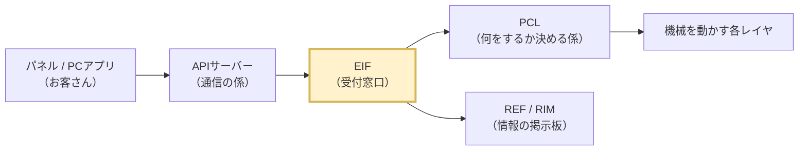

# EIF要件定義 合意会議 カンペ（60分）

## 0. 会議の概要

| 項目 | 内容 |
|---|---|
| 目的 | EIF要件定義（初版）の合意、現状実装と課題の共有 |
| ゴール | ⓪ EIFを知らない人にも役割を理解してもらう　① 要件定義の内容に合意をもらう　② QA-01〜04 の方針に合意をもらう　③ 課題認識（特に機種依存）を共有する |
| 時間 | 60分（質疑込み） |
| 画面で見せる資料 | `要件定義.md` ／ `EIF構成図.drawio`（1・3・4・5シート）／ `QA表.md` |
| 手元資料 | 本カンペ、`Frame機種依存分離設計.md`（聞かれたとき用） |

### タイムテーブル

| 時刻 | 分 | 内容 | 見せる資料 |
|---|---|---|---|
| 0:00 | 2 | 開会・目的・本日のゴール | - |
| 0:02 | 5 | **EIFとは？**（EIFを知らない人向けの導入） | 本カンペ 2.2 の図（またはホワイトボード） |
| 0:07 | 17 | **要件定義の説明**（質疑含む） | 要件定義.md、構成図 1シート |
| 0:24 | 10 | **現状の実装** | 構成図 3シート（左側の図） |
| 0:34 | 11 | **現状実装の課題**（対策の方向性を含む） | 構成図 3シート（右の表）、4シート、5シート |
| 0:45 | 10 | QA・合意事項の確認 | QA表.md |
| 0:55 | 5 | まとめ・次のアクション | - |

> 押したときの調整：
> - 要件の説明で押したら、FR-05/06（印字データ）と NFR-08/09 は「資料のとおり」で飛ばしてよい。
> - 課題で押したら、A群（構成）は一覧表を見せるだけにして、B群（機種依存）に時間を使う。
> - 「EIFとは？」は5分厳守。質問は「この後詳しく」と預かる。
> - QA-01〜04 の確認（0:45〜）は**必ず時間を確保する**。

---

## 1. 開会（0:00〜0:02／2分）

**話すこと**

- 「本日は外部インタフェース層、EIFの要件定義について合意をいただきたく、お時間をいただきました。」
- 「最初の5分で、EIFとは何かを簡単にご説明します。その後、3つの内容をお話しします。1つ目が要件定義の説明、2つ目が現在の実装の状況、3つ目が現在の実装の課題です。」
- 「最後の10分で、確認事項4点（QA表の1〜4）について方針の合意をいただきたいと考えています。」
- 「質問は各パートの最後にまとめてお受けします。」

---

## 2. EIFとは？（0:02〜0:07／5分）★EIFを知らない人向け

> 狙い：専門用語を使わずに「EIF＝受付窓口」というイメージを持ってもらう。
> ここで細かい質問が出たら「この後の要件の説明で詳しくお話しします」と預かる。
> 画面：このカンペの 2.2 の図をそのまま映すか、ホワイトボードに書く。

### 2.1 一言でいうと（1分）

**話すこと**

- 「最初に、EIFを初めて聞く方もいらっしゃると思うので、5分だけEIFが何かをご説明します。」
- 「EIFは、このプリンタ制御ソフトの**受付窓口**です。」
- 「ホテルのフロントをイメージしてください。お客さんは客室係や厨房に直接頼まず、フロントに頼みます。フロントが担当部署に伝えて、結果をお客さんに返します。」
- 「プリンタでいうと、パネルやPCのアプリからの『印刷して』『設定を変えて』『状態を教えて』を、まずEIFが受け付けます。」

### 2.2 図で見ると（1.5分）



ホワイトボードに書く場合：

```text
 パネル/PCアプリ → APIサーバー → 【EIF】 → PCL（何をするか決める）→ 機械
   （お客さん）     （通信の係）  （受付窓口） → REF（情報の掲示板）
```

**話すこと**

- 「左から、パネルやPCのアプリ、通信を担当するAPIサーバー、そしてEIFです。」
- 「EIFの先には2つの相手がいます。」
  - 「**PCL**：頼まれたことを『実行するかどうか、どう実行するか』を決める係です。」
  - 「**REF（RIM）**：機械の状態や設定値が書かれている掲示板のようなものです。」
- 「外の世界と中の世界の境目にいるのがEIF、と覚えてください。」

### 2.3 EIFがやること・やらないこと（1.5分）

| EIFがやること | ホテルでいうと |
|---|---|
| 外からの頼みごとを受け付けて、担当（PCL）へ渡す | フロントが依頼を受けて担当部署へ回す |
| 外と中の「言葉の違い」を通訳する（データ形式の変換） | お客さんの言葉を社内用語に言い換える |
| 結果やお知らせを外へ伝える | 「準備ができました」と連絡する |
| 何を外に見せるかを決める（公開範囲） | お客さんに見せるメニューを決める |

| EIFがやらないこと | ホテルでいうと |
|---|---|
| 実行してよいかの判断（PCLが決める） | フロントは料理を作らない・作るか決めない |
| 機械を直接動かすこと | フロントは部屋を掃除しない |
| 情報を自分で持つこと（REFが持つ） | 予約台帳はフロントの私物ではない |

**話すこと**

- 「EIFは**受け付けて、通訳して、伝える**だけです。判断や機械の操作はしません。」
- 「窓口を1つにしておくと、中の仕組みを作り変えても、外のアプリには影響が出ません。これがEIFを置く理由です。」

### 2.4 代表的な3つのやりとり（1分）

| 例 | 流れ | 今日の説明での呼び方 |
|---|---|---|
| ネットワーク設定を見る | 聞かれたら、その場で掲示板（REF）を見て答える | **同期**（すぐ返事） |
| ヘッドクリーニングをする | 「受け付けました」とすぐ返し、終わったら「完了しました」と後で知らせる | **非同期**（受付と完了が別） |
| エラーが起きた | 頼まれていなくても、EIFから外へ知らせる | **通知** |

**話すこと**

- 「この後の説明で『同期』『非同期』『通知』という言葉が出てきますが、この3つのことです。」
- 「では、この窓口に求める条件、つまり要件定義をご説明します。」

### 今日出てくる言葉（画面に出したまま進めてよい）

| 言葉 | 意味 |
|---|---|
| EIF | 外部インタフェース層。プリンタ制御ソフトの受付窓口 |
| APIサーバー | パネルやPCアプリとの通信を担当する部品（REST／WebSocket） |
| PCL | 製品制御層。頼まれたことを実行するか・どう実行するかを決める |
| REF／RIM | 参照サービス／情報軸。機械の状態や設定値を集めて持っている掲示板 |
| 機種依存 | 機種（製品）ごとに中身が変わる部分 |
| Frame／製品CFG | 機種によらず共通の部分／機種ごとに作る部分 |

---

## 3. 要件定義の説明（0:07〜0:24／17分）

### 3.1 位置づけの補足（導入で説明済みのため一言のみ）　【構成図 1シートを表示】

- 「先ほどの窓口の図を、実際の部品で描いたのがこの図です。要件の出発点は全体構成設計の7章で、そこに現行コードの状況を加えて要件を起こしました。」

### 3.2 目的（2分）　【要件定義 7.1】

**話すこと**

- 「目的は3つです。」
  1. 「本ソフトウェアの機能の**公開窓口**になり、内部構造を外から隠すこと。」
  2. 「外部の形式と内部の形式を**変換**し、外部アプリが内部データに依存しないようにすること。」
  3. 「機種ごとに違う部分を**製品CFGとして分け**、機種展開のときにEIFの共通部を変えずに済むようにすること。」
- 「3つ目は全体構成設計にはない、今回追加した目的です。理由は後半の課題で説明します。」

### 3.3 機能要件（8分）　【要件定義 7.2】

1件30〜50秒で説明する。

| 要件 | 一言で | 話すポイント |
|---|---|---|
| FR-01 公開インタフェース管理 | 何を外に見せるかをEIFが決める | 製品要求の一覧はPCLが決める。EIFは「そのうちどれを公開するか」だけを決める。公開範囲は製品CFGの表で持ち、コードに埋め込まない |
| FR-02 製品要求の受付 | 外部の要求をPCLへ渡す | 受付可否はPCLが判断し、EIFは判断しない。受付結果はその場で返す |
| FR-03 製品要求応答 | 結果を外部へ返す | 結果は後から非同期で返る。外部の要求とPCLの受付IDを対応付けて保持する。これは「実行状態」ではなく「対応表」 |
| FR-04 通知管理 | 通知先は外部アプリが登録する | 通知先はコールバックとして注入する。EIFは通知先の中身を知らない |
| FR-05/06 印字データ | 方式はT.B.D | 全体構成設計7.2で決まっている制約だけを要件化。EIFはDataPlaneやDEVを直接参照しない |
| FR-07 システム情報の公開・設定 | 情報を見せる・設定を変える | 取得はREFから同期で取る。**設定変更はREFへ直接書き込む（QA-01）**。PATCHの未指定項目は現在値を保持 |
| FR-08 情報購読 | REFの変化を購読する | 何を購読するかは製品CFGの表で決める。登録の処理は共通部で行う |
| FR-09 システム情報通知 | 変化を外部へ通知する | 異常の発生／解消は、**EIFが前回値を持って差分を出す（QA-03）** |
| FR-10 製品要求の取消 | 取消をPCLへ渡す | 取消の成否はPCLが判断する。一時停止・再開は別の要求として扱う（全体構成設計3.9） |

### 3.4 非機能要件（4分）　【要件定義 7.3】

**話すこと**（特に太字の3つは新しく追加したもの）

- NFR-01 境界の一元化：「公開ヘッダは1か所に集めます。」
- NFR-02 内部構造の隠蔽：「PCLの受付IDやREFのIDも外には出しません。」
- NFR-03 疎結合／NFR-04 非同期応答：「要求APIは受け付けたらすぐ返します。取得と設定変更は同期です。」
- NFR-05 依存規則：「EIFが使ってよいのはPCLとREFの公開APIだけです。EXE・RSC・DEVは使いません。EIFの初期化をPCLの中で行うことも禁止します。」
- **NFR-06 機種展開容易性**：「機種で変わるものは製品CFGに分け、次機種では共通部を変えないことを要件にしました。**目標は、共通部の変更行数0**です。」
- **NFR-07 外部通信ライブラリ非依存**：「EIF本体はAPIサーバーのヘッダを参照しません。つなぐ部分はBindingという部品に分けます。」
- **NFR-08 実行コンテキスト**：「APIサーバー・RIM・PCLのコールバックは、それぞれ別のスレッドから呼ばれます。その前提で排他を設計します。」
- NFR-09 性能：「印字性能 80MB/s を阻害しないこと。」

### 3.5 持たない責務と設計方針（1分）　【要件定義 7.5・7.6】

- 「EIFは製品の判断、実行状態の保持、資源やデバイスの制御を行いません。」
- 「構成は Binding／Boundary／Frame／製品CFG の4つに分けます。詳しくは課題のパートでお見せします。」

### 3.6 質疑（2分）

想定質問は「6. 想定問答」を参照。

---

## 4. 現状の実装（0:24〜0:34／10分）　【構成図 3シート 左側】

### 4.1 全体像（3分）

**話すこと**

- 「現在のEIFは `src/externalInterfaceLayer` にあり、2つのフォルダで構成されています。」
  - 「**ApiServerAdapter**：APIサーバーのREST・WebSocketのコールバックを実装している部分です。」
  - 「**ExternalRequestIngress**：印字データを受け取る部分です。」
- 「規模はテストを含めて約4,000行、そのうち約1,750行がテストです。」
- 「起動処理（登録とサーバー起動）は、EIFではなくPCLの `StartUp` に書かれています。」

### 4.2 実装済みの機能（4分）

| 機能 | 状態 | 話すポイント |
|---|---|---|
| ネットワーク設定の取得（GET） | 実装済 | RIMから取得して文字列へ変換し、返している |
| ネットワーク設定の変更（PATCH） | 実装済 | RIMの現在値に変更分を反映し、RIMへ書き込んでいる |
| 異常通知（WebSocket） | 結合確認レベル | RIMの異常リストを購読している。ただし通知する内容は**仮値**（NET0001 / E10001） |
| 印字データ受信 | 実装済 | 常駐タスクがAPIサーバーのバッファからMain bufferへコピーしている |
| ジョブ（印刷・メンテ） | **未実装** | 全て「未実装」を返す。PCLにはつながっていない |
| その他の設定・状態・情報 | **未実装** | 「未実装」を返すスタブ関数のみ |

### 4.3 良い点（1分）

- 「登録の入口を1つにまとめる、表で対応関係を管理する、という方針は既に一部取り入れられています（WebSocketの購読表）。」
- 「今回の設計は、この方針を広げて共通部と機種依存部に分けるものです。」

### 4.4 質疑（2分）

---

## 5. 現状実装の課題（0:34〜0:45／11分）　【構成図 3シート 右の表 → 4シート → 5シート】

### 5.1 課題の全体（1分）

**話すこと**

- 「課題は22件を4つに分類しました。バッジの色が分類です。」

| 分類 | 件数 | 内容 |
|---|---|---|
| A：フォルダ・ファイル構成 | 7 | 構成が分かりにくい |
| **B：機種依存** | **6** | **次機種で作り直しになる。最重要** |
| C：同期／非同期・コールバック | 6 | PCL未接続、差分検知なし など |
| D：境界・型 | 3 | APIサーバーのヘッダに依存 など |

### 5.2 A：構成が分かりにくい（2分）

- 「フォルダ名が役割を表していません。`ApiServerAdapter` はプロトコルの名前、`ExternalRequestIngress` はPCLにある同名のコンポーネントと名前がぶつかっています。」（A-1）
- 「公開ヘッダが3か所に分かれていて、外から見える範囲が分かりません。」（A-2）
- 「ビルドされていない古いファイルが残っています。」（A-4）
- 「EIFの初期化がPCLのStartUpに書かれていて、下のレイヤが上のレイヤを呼ぶ形になっています。」（A-6）

### 5.3 B：機種依存（5分）★ここに一番時間を使う　【構成図 4シート】

**話すこと**

- 「最も大きな課題です。結論から言うと、**今の作りのままでは次機種でEIFをほぼ作り直すことになります**。」
- 「理由は、**機種で変わる情報**と**機種で変わらない処理**が、同じ関数の中に書かれているためです。」
- （4シートの例1を指して）「例えば異常通知では、1つのファイルの中に次の内容が混在しています。」
  - 「どのRIMの項目を購読するか → 機種で変わる（赤）」
  - 「購読を登録するループ → 変わらない（緑）」
  - 「機種別のAPIでデータを取る、機種別の型を解釈する → 機種で変わる（赤）」
  - 「APIサーバーへ送る → 変わらない（青）」
- 「さらに、RIMの機種別ヘッダ（`include/MiniPrinter`）をビルド設定で直接参照しています。次機種ではRIMのIDも型も変わるので、REST・WebSocketのファイルを全て書き直すことになります。」
- 「設定のREST、ジョブの対応表（switch文）、印字データも同じ構造です。」（B-1〜B-6）
- 「印字データについては、EIFがDEVのPrintDataStorageを直接呼んでおり、レイヤを飛ばしています。」（B-6）

### 5.4 C・D：その他の主な課題（1分）

- 「PCLにつながっていないため、ジョブが外から使えません。」（C-1）
- 「異常通知は件数が1以上なら『発生』と固定で送っていて、正しく発生／解消を通知できません。」（C-2 → QA-03）
- 「EIF全体がAPIサーバーのヘッダに依存しています。」（D-1）

### 5.5 対策の方向性（2分）　【構成図 5シート】

**話すこと**

- 「対策は、**処理と定義を分けること**です。」
- 「機種で変わらない処理はFrame（緑）に、機種で変わる定義は製品CFG（オレンジ）に分けます。」
- 「製品CFGに書くのは表と変換関数だけです。先ほどの異常通知なら、表の1行と変換関数1つになります。」
- 「次機種では、雛形をコピーして製品CFGのフォルダを1つ作るだけにします。」
- 「Frameのビルド設定には機種別ヘッダを渡さないので、機種依存のコードが共通部に入るとビルドエラーで気づけます。」
- 「この考え方はRIMの core／products や、PCLの自発要求生成の frame／MODEL 分けと同じです。」
- 「詳しい設計は別資料（Frame機種依存分離設計）にまとめています。今日は方向性の共有のみとし、詳細は別途ご説明します。」

---

## 6. QA・合意事項の確認（0:45〜0:55／10分）　【QA表.md を表示】

1件2分程度。**決まったことをその場で口頭で復唱して記録する。**

| No | 確認したいこと | 提示する方針 | 合意をもらうポイント |
|---|---|---|---|
| QA-01 | 設定変更はEIFからREFへ直接書き込んでよいか | 直接書き込む | 全体構成設計 S3（REFへの書込みはPCL以下）の**例外になる**。全体構成設計へ「EIFは設定値に限り書込み可」と追記してよいか |
| QA-02 | PCLのSubmitへパラメータを渡す口が必要か | 現時点では不要（保留） | パラメータ付きジョブが必要になった時点で再検討、でよいか |
| QA-03 | 異常の発生／解消の差分をEIFが前回値を保持して出すか | EIFが前回値を保持する | 要件の「EIFはシステム情報を保持しない」との関係。**前回値は変換のための作業領域であり、情報の保持ではない**という整理でよいか。REF側で差分を出す案との比較を聞かれたら「REFの改修が不要、EIF内で閉じる」 |
| QA-04 | 初期化の順序と呼び出し元 | 起動処理が REF→PCL→EIF→APIサーバー の順に初期化 | 全体構成設計 5.2（EIFがPCLを初期化）を修正すること。EIFの初期化をPCLのStartUpから移すこと |

**話すこと（導入）**

- 「最後に、要件を確定するために方針を決めたい点が4つあります。」

**話すこと（締め）**

- 「QA-05以降は、REF・APIサーバー担当への確認事項です。本日は一覧の紹介のみとし、個別に確認します。」

---

## 7. まとめ・次のアクション（0:55〜1:00／5分）

**話すこと**

- 「本日合意いただいた内容を確認します。」（合意した項目を読み上げる）
  - 要件定義 初版：合意／条件付き合意／持ち帰り
  - QA-01〜04：それぞれ合意／持ち帰り
- 「次のアクションです。」

| # | アクション | 担当 | 期限 |
|---|---|---|---|
| 1 | 本日の指摘を反映し、要件定義を確定 | 自分 | （その場で決める） |
| 2 | 全体構成設計への追記依頼（QA-01：REF書込みの例外、QA-04：初期化順序） | 自分 → 全体構成設計 担当 | |
| 3 | QA-05〜QA-12 の個別確認 | 自分 → REF／PCL／APIサーバー 担当 | |
| 4 | Frame／機種依存分離設計の説明の場を設定 | 自分 | |
| 5 | 移行の先行実施（WebSocket購読・GETの分離）の可否判断 | （その場で決める） | |

---

## 8. 想定問答

### EIFとは？（導入）について

| 想定質問 | 回答 |
|---|---|
| APIサーバーとEIFは何が違うのか | APIサーバーは「通信の係」で、HTTPやWebSocketといった通信の手順を扱います。EIFは「受付窓口」で、届いた頼みごとを社内の言葉に直して担当へ渡します。通信の方式が変わってもEIFは変わらない、という分担です。 |
| なぜ外のアプリが直接PCLやREFを呼ばないのか | 窓口を1つにしておくと、中の仕組みを作り変えても外のアプリを直さずに済むためです。また、外に見せてよい機能をEIFで絞ることができます。 |
| EIFはプリンタを動かすのか | 動かしません。動かすかどうかはPCLが決め、実際に動かすのはさらに下のレイヤです。EIFは依頼を渡して、結果を伝えるだけです。 |

### 要件定義について

| 想定質問 | 回答 |
|---|---|
| 全体構成設計では「EIFは無変換で転送する」とあるが、変換を入れてよいのか | 全体構成設計7.1にも「将来、外部向けの表現と内部が乖離する場合はEIFが仲介する可能性がある」とあります。現状でもAPIサーバーのジョブ種別とPCLの製品要求IDは一致していないため、変換が必要です。 |
| 要求と受付IDの対応表を持つのは「実行状態の保持」にあたらないか | 対応表は「どの外部要求がどの受付IDか」の変換情報だけで、進捗や待ち状態は持ちません。結果はPCLに問い合わせます。 |
| なぜ設定変更だけREFへ直接書くのか（他はPCL経由なのに） | 設定値の変更は製品の動作判断を伴わず、REFの値を書き換えるだけで済むためです（QA-01）。書き込めるのは外部から変更可能と定義した設定値だけに限定します。 |
| 前回値を持つのは「システム情報を保持しない」に反しないか | 前回値は発生／解消を判定するための作業領域で、外部へ情報を提供する元ではありません。対象も購読表で宣言したものに限ります（QA-03）。 |
| 印字データの要件がT.B.Dのままで良いのか | 全体構成設計7.2自体がT.B.Dのため、確定済みの制約（レイヤを飛ばさない、DataPlaneを直接参照しない）だけを要件にしています。7.2の確定後に追記します。 |
| 「共通部の変更行数0」は本当に可能か | 既存の公開要求・公開情報の範囲であれば可能な構造です。新しい公開APIが増える場合は、外部IF仕様の変更なのでBoundaryとBindingへの追記が必要です。これは全体構成設計でもEIFの正当な変更理由です。 |
| 性能要件の根拠は | 全体構成設計13.3の暫定基準（80MB/s以上）です。現状は全量受信を待ってからコピーしているので、APIサーバー側の同期対応が必要です（C-6）。 |

### 現状・課題について

| 想定質問 | 回答 |
|---|---|
| 今の実装は作り直しになるのか | 作り直しではなく移設です。変換関数などの中身はほぼそのまま製品CFGへ移せます。変わるのは「どこに書くか」です。 |
| 移行のリスクは | 既存の動作を変えずに段階的に移します。最初はWebSocket購読とGETの2か所だけを移して効果を確認する案です。 |
| 移行の工数は | 詳細は分離設計の説明時にお示しします。（聞かれた場合は持ち帰り） |
| APIサーバーのヘッダへの依存はなぜ問題か | 全体構成設計2.3で「本ソフトウェアは外部アプリのヘッダを参照しない」と決めているためです。APIサーバーが変わったときの影響をBindingに閉じ込めます。 |
| PCL未接続はいつ解消するのか | PCLの外部API（ExternalRequestIngressSubmit）は既にあるので、EIF側の接続（相関と完了通知の受け口）を作れば接続できます。移行Step6で対応します。 |

---

## 9. 当日のチェックリスト

- [ ] 「EIFとは？」の図（本カンペ 2.2）をすぐ映せるようにしておく（またはホワイトボードを用意）
- [ ] `EIF構成図.drawio` を開き、1・3・4・5シートへすぐ切り替えられるようにしておく
- [ ] `要件定義.md` をプレビュー表示（表が見やすい状態）にしておく
- [ ] `QA表.md` を開いておく
- [ ] 合意結果を記録する議事メモを用意する
- [ ] 0:45 の時点で QA の確認に入れているか、時計を確認する
