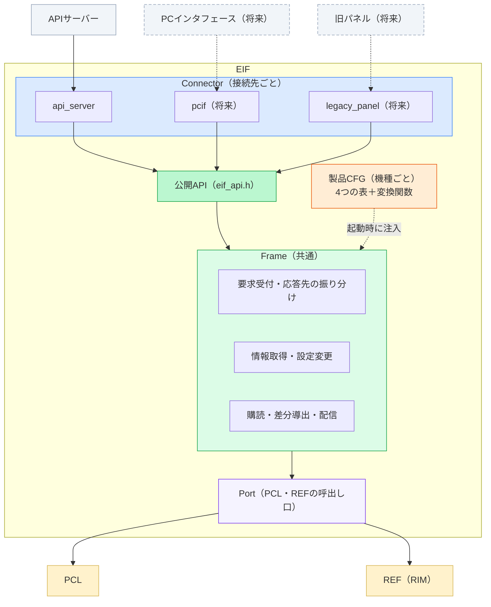
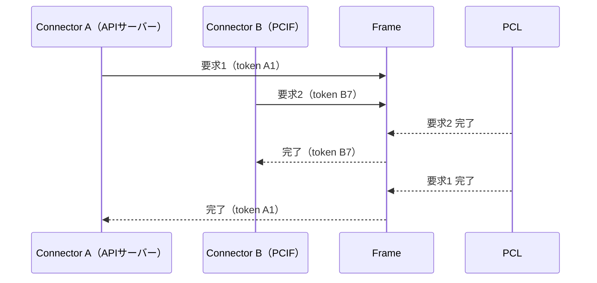

# 外部インタフェース層（EIF）Frame／接続先依存／機種依存 分離設計

| 項目 | 内容 |
|---|---|
| 文書名 | EIF Frame／接続先依存／機種依存 分離設計（説明資料） |
| 版 | 0.02 |
| 更新日 | 2026-10-21 |
| 関連文書 | EIF要件定義（2026/10/20 合意版）、仕様設計書、詳細設計書、EIF構成図（`EIF構成図.drawio` 1〜5シート）、QA表 |

| 版 | 日付 | 内容 |
|---|---|---|
| 0.01 | 2026-10-20 | 初版（Frame／機種依存の分離） |
| 0.02 | 2026-10-21 | 2026/10/20 打合せを反映。接続先依存（Connector）の軸を追加 |

---

## 1. 本資料の目的

本資料は、外部インタフェース層（EIF）を次の3つに分ける設計を説明するものです。

| 区分 | 内容 |
|---|---|
| **Frame** | 接続先にも機種にも依存しない共通部分 |
| **Connector（接続先依存）** | 接続相手（APIサーバー、PCインタフェース、旧パネル等）ごとに作る部分 |
| **製品CFG（機種依存）** | 機種ごとに作る部分 |

目的は、**接続相手が変わっても、機種が変わっても、EIFを作り直さずに済むようにすること**です。

---

## 2. 背景

### 2.1 現状の問題（機種依存）

現在のEIFの実装では、機種で変わる内容（REFのID・型・API、PCLの製品要求）と、機種で変わらない処理（登録、エラー変換、送信）が、同じファイル・同じ関数の中に書かれています。
そのため、次機種ではEIFのほぼ全ファイルを書き直すことになります。

### 2.2 2026/10/20 打合せでの指摘（接続先依存）

- EIFの外側の相手は今後も変わる。APIサーバーだけでなく、PCインタフェースのコマンドや旧パネルがつながる可能性がある。
- 相手によって、通信方式・データ形式・要求の粒度が違う。例えば旧コマンドは、1つのコマンドを複数の製品要求に分けたり、即時応答を返してから遅延応答を返したりする必要がある。
- それでも内部（PCL・REF）は守らなければならない。**「ここまでが接続相手で変わる、ここからは共通」と言えるFrameを持つ**。
- 今回はAPIサーバーにつながれば良い。ただし、APIサーバーに依存する部分は差し替えられる場所に収め、関数ポインタで呼ばれる構造にする。

→ 要件定義（合意版）の **EIF-FR-02 外部接続差異吸収** として追加されました。

---

## 3. 解決の方針

### 3.1 一言でいうと

> **「処理」はFrameに、「接続相手の違い」はConnectorに、「機種の違い」は製品CFGに分ける。**

### 3.2 原則

| # | 原則 | 内容 |
|---|---|---|
| 1 | 変わる理由ごとに分ける | 接続相手で変わるもの → Connector、機種で変わるもの → 製品CFG、どちらでも変わらないもの → Frame |
| 2 | 製品CFGは「表」と「変換関数」だけ | 1行＝1項目の表と、入力を出力へ変換するだけの関数で書く。登録や送信は書かない |
| 3 | 内部の接続先も差し替えられるようにする | PCL・REFの呼出しはPortを通す。設定の書込み先（REFへ直接／PCL経由）も表の1列で切り替える（QA-01） |
| 4 | 混入をビルドで防ぐ | Frameのビルド設定には、REFの機種別ヘッダーとAPIサーバーのヘッダーを渡さない |
| 5 | 早く軽く | EIF内にタスクやキューを挟まず、不要なコピーをしない |

### 3.3 根拠と前例

- 全体構成設計 3.6「製品差分のデータ化方針」（機能定義・マッピング・ルールで製品差を注入する）
- 社内の既存の仕組み

| 既存の仕組み | 同じ考え方の部分 |
|---|---|
| 参照サービス RIM | `core`（製品非依存）と`products/<製品>`（製品定義）の分離 |
| PCL 自発要求生成（ARG） | `frame/`と`src/<MODEL>/`の分離。製品側の`Setup()`が表と関数をFrameへ渡す |
| PCL 要求仲裁（RequestArbitration） | `frame/`（処理）と`src/`（製品ごとの表）の分離 |

---

## 4. ブロック図



正式な図は `EIF構成図.drawio` の「1.EIF全体構成」シートを参照してください。

### 4.1 各ブロックの役割

| ブロック | 役割 | 接続相手が変わったら | 機種が変わったら |
|---|---|---|---|
| Connector | 外部形式⇔公開要求・公開モデルの変換。旧コマンドのシーケンス、即時応答＋遅延応答 | **1つ追加** | 変更なし |
| 公開API | 外部コンポーネント側の部品（Connector）が使う唯一のヘッダー | 変更なし | 変更なし |
| Frame | 要求受付、応答先の振り分け、情報取得、設定変更、購読、差分導出、配信 | **変更なし** | **変更なし** |
| 製品CFG | 公開範囲、PCLの製品要求ID、REFのIDと型の変換、購読対象、設定の書込み先 | 変更なし | **1つ追加** |
| Port | PCL・REFの呼出し口 | 変更なし | 変更なし |

---

## 5. 主な仕組み

### 5.1 応答先の振り分け（打合せ指摘）

PCLは1つ前の相手（EIF）しか知りません。複数の接続相手から要求が来て、PCLが順不同に完了した場合でも、EIFは正しい要求元へ結果を返す必要があります。

EIFは要求台帳に「PCLの受付ID → 要求元Connector・要求元トークン」を記録し、完了時にその要求元にだけ返します。



### 5.2 製品CFGの4つの表

| 表 | 1行に書く内容 | Frameが行うこと |
|---|---|---|
| 要求の表 | 公開要求ID → PCLの製品要求ID | 受付、PCLへの転送、応答先の振り分け |
| 情報の表 | 公開情報ID → REFのID群＋変換関数 | REFからの取得、サイズ検証、エラー変換 |
| 設定の表 | 公開設定ID → 書込み先（REF直接／PCL経由）＋マージ関数 | 現在値の取得、排他、書込み |
| 購読の表 | REFの購読ID・通知契機（変化／定期） → イベント生成関数 | REFへの登録、通知の振り分け、前回値の保持、配信 |

表に載っていない項目は外部へ公開されません（公開範囲の定義を兼ねます）。

記述例（異常通知の購読）：

```c
/* product/MiniPrinter/eif_product_subscriptions.c */
static const EIF_SubscriptionEntry k_subscriptions[] = {
    { RI_TARGET_DATA, RI_DATA_FAULT_INFO_LIST, RI_TRIGGER_ON_CHANGE, 0,
      { RI_DATA_FAULT_INFO_LIST }, { sizeof(RIM_FaultInfoList) }, 1,
      true, mp_build_fault_events },
};
```

### 5.3 設定の書込み先の切替（QA-01）

設定をREFへ直接書くか、PCL経由にするかは未決です。設定の表の1列（`sink`）で切り替えられるようにしています。
Connectorは「すぐ完了（`EIF_OK`）」と「受付後に完了通知（`EIF_ACCEPTED`）」の両方を扱うため、書込み先が変わってもConnectorは変更不要です。

### 5.4 差分導出（QA-03）

異常情報リストのように一覧で来る情報から、1件ずつの発生／解消を作るため、前回値を保持します。保持するのはFrameの中のStateCacheという1つの部品だけです。

### 5.5 定期通知

EIFはタイマーを持ちません。値が変わらなくても定期的に送る必要がある情報は、購読の表で「定期通知」を指定し、REFの定期通知を使います。

---

## 6. フォルダ構成

### 6.1 構成

```text
externalInterfaceLayer/
├─ CMakeLists.txt                 MODEL選択と依存規則の強制
├─ include/                       【公開API】利用者がincludeする唯一のヘッダー       … 共通
├─ frame/                         【Frame】処理だけを持つ                          … 共通
│   ├─ core/  connector/  request/
│   ├─ info/  notify/
│   └─ port/  util/  printdata/
├─ connectors/                    【Connector】接続先ごと                         … 接続先依存
│   ├─ api_server/                APIサーバー用
│   └─ <次の接続先>/              ★接続相手が増えたら追加するのはここだけ
├─ product/                       【製品CFG】機種ごと（MODELで1つ選択）             … 機種依存
│   ├─ Skeleton/                  雛形（何も公開しない）
│   ├─ MiniPrinter/               現行機種
│   └─ <次機種>/                  ★機種が増えたら追加するのはここだけ
└─ test/
```

正式な図は `EIF構成図.drawio` の「5.フォルダ構成」シートを参照してください。

### 6.2 依存規則（CMakeのinclude pathで強制）

| 区分 | 参照してよい | 参照してはいけない |
|---|---|---|
| Connector | 公開ヘッダー（include/）、外部コンポーネントのヘッダー | frame/、product/、PCL、REF |
| Frame | 公開ヘッダー、PCL公開ヘッダー、REFの製品非依存ヘッダー | **REFの機種別ヘッダー**、**外部コンポーネントのヘッダー** |
| 製品CFG | `eif_profile.h`、PCL公開ヘッダー、REFの機種別ヘッダー | 外部コンポーネントのヘッダー |

### 6.3 現行ファイルとの対応

| 現行 | 分離後 |
|---|---|
| `ws/api_server_ws_subscribe.c`（購読表） | 表は `product/MiniPrinter/`、登録処理は `frame/info/` |
| `ws/api_server_ws_callbacks.c`（変換） | `product/MiniPrinter/`（イベント生成関数・コード対応表）、差分は `frame/info/`（StateCache） |
| `ws/*_publisher.c` | `connectors/api_server/ws/` |
| `rest/settings.c`（REF取得・変換） | `product/MiniPrinter/`（情報・設定の表と関数） |
| `rest/settings.c`（APIサーバー型） | `connectors/api_server/rest/` |
| `rest/jobs.c` ほか | `connectors/api_server/rest/` ＋ `product/MiniPrinter/`（要求の表） |
| `external_request_printdata_ingress.c` | `frame/printdata/` ＋ `connectors/api_server/printdata/`（T.B.D） |
| `external_request_ingress.c` | 削除（ビルド対象外・旧API） |

---

## 7. 開発時の作業

### 7.1 次機種の開発

| # | 作業 | 場所 |
|---|---|---|
| 1 | `product/Skeleton/` を `product/<次機種>/` へコピー | 製品CFG |
| 2 | 4つの表に、その機種で公開する行を書く | 製品CFG |
| 3 | REFの型と公開モデルの変換関数を書く | 製品CFG |
| 4 | `MODEL=<次機種>` でビルド | ビルド |

### 7.2 接続相手の追加

| # | 作業 | 場所 |
|---|---|---|
| 1 | `connectors/<接続先>/` を作る | Connector |
| 2 | 外部の要求を公開要求へ変換する処理を書く（複数要求への分割、即時応答＋遅延応答を含む） | Connector |
| 3 | 公開イベントを外部の通知形式へ変換する処理を書く | Connector |
| 4 | 起動処理でConnectorを登録する | 起動処理 |

### 7.3 現状との比較

| 観点 | 現状 | 分離後 |
|---|---|---|
| 次機種で変更するファイル | rest/\*.c、ws/\*.c、ExternalRequestIngress/\*.c、CMake、PCLのStartUp | **product/<次機種>/ のみ** |
| 接続相手の追加 | 想定していない（APIサーバー専用） | **connectors/<接続先>/ のみ** |
| 設定の書込み先の変更（REF→PCL） | settings.c の書き直し | **設定の表の1列** |
| 試験 | REF・PCL・APIサーバーをつないで試験 | 変換関数は単体で、FrameはスタブのPortで試験可能 |

---

## 8. 現行実装からの移行

| Step | 内容 |
|---|---|
| 1 | フォルダを `include/`・`frame/`・`connectors/`・`product/` へ再編 |
| 2 | Frameの骨格と雛形（Skeleton）を作成 |
| 3 | WebSocket購読（異常通知）を分離 **← 効果検証のため先行実施を推奨** |
| 4 | 情報取得（REST GET）を分離 |
| 5 | 設定変更（REST PATCH）を分離（書込み先は当面REF直接） |
| 6 | ジョブ（PCL接続）を分離・接続 |
| 7 | 初期化をPCLのStartUpから起動処理へ移動 |
| 8 | 印字データ経路の分離（QA-06の決定後） |

---

## 9. 前提・未決事項

詳細はQA表を参照してください。

| No | 内容 | 状態 |
|---|---|---|
| QA-01 | 設定の書込み先（REF直接／PCL経由） | 暫定（当面REF直接、切替可能な設計） |
| QA-03 | 差分導出をEIFで行う | 暫定（StateCacheに集約） |
| QA-04 | 初期化の順序と呼出し元 | 合意待ち |
| QA-06 | 印字データ経路（EIF→RSC直結の例外規定を検討中） | 保留 |

---

## 付録：用語

| 用語 | 意味 |
|---|---|
| Frame | 接続先にも機種にも依存しない共通部分 |
| Connector | 接続相手（外部コンポーネント）ごとに作る部分 |
| 製品CFG | 機種ごとに作る定義（表と変換関数） |
| Port | PCL・REFを呼ぶ口。差し替えられる |
| 要求台帳 | 要求の受付IDと要求元を記録する表。応答先の振り分けに使う |
| StateCache | 差分導出のための前回値を持つ部品 |
| MODEL | ビルド時に指定する機種名 |
