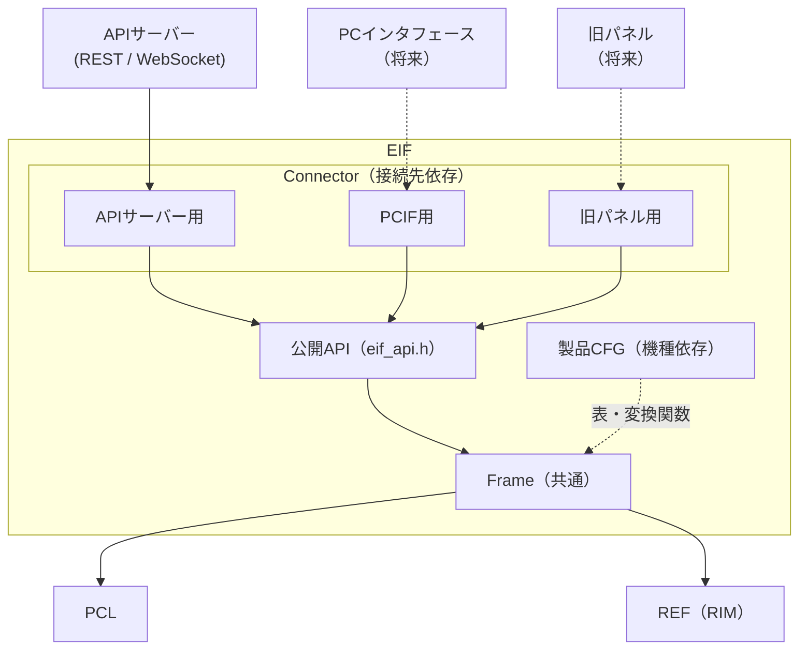
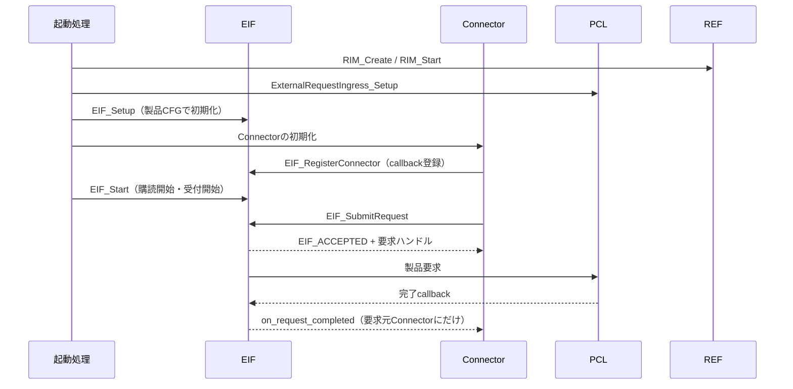
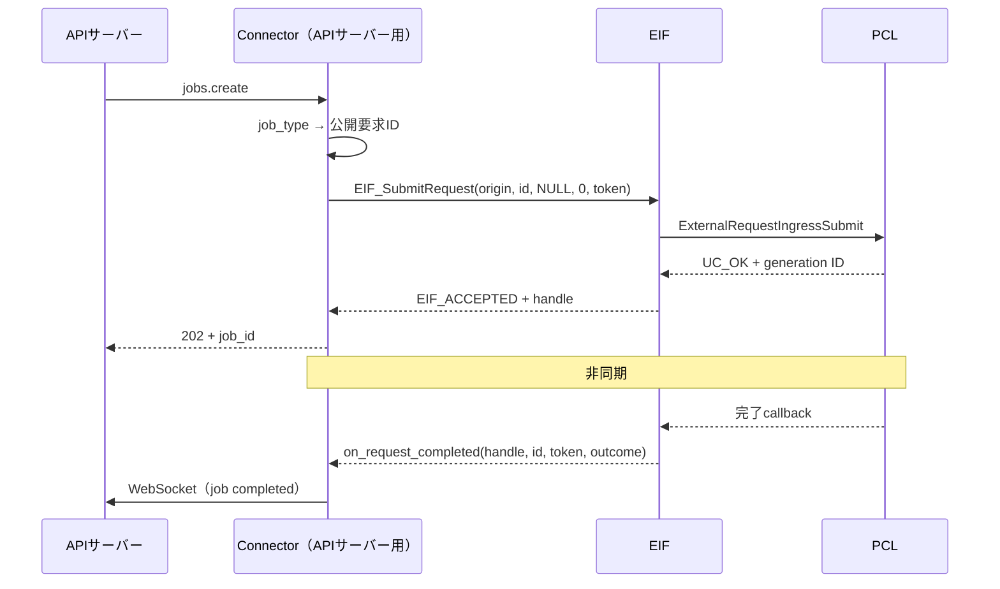
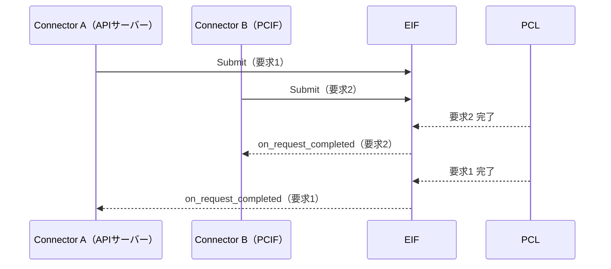
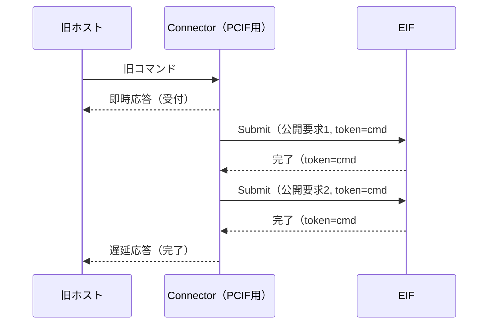
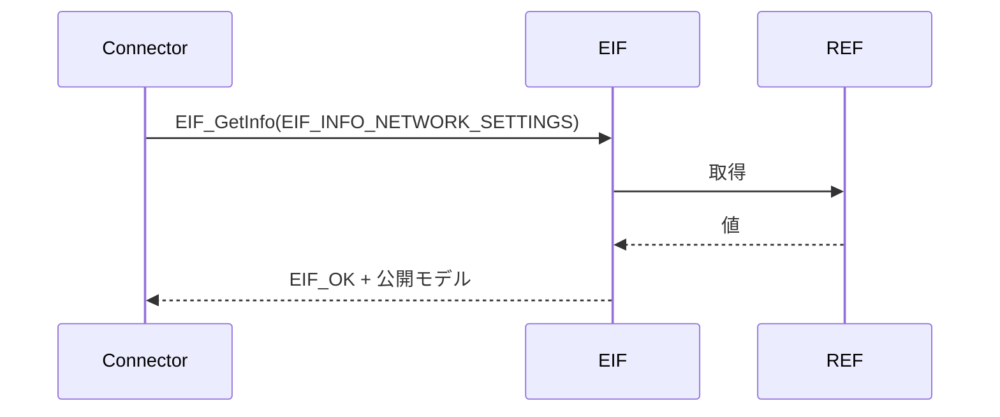
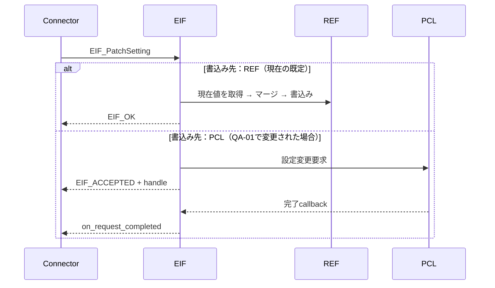
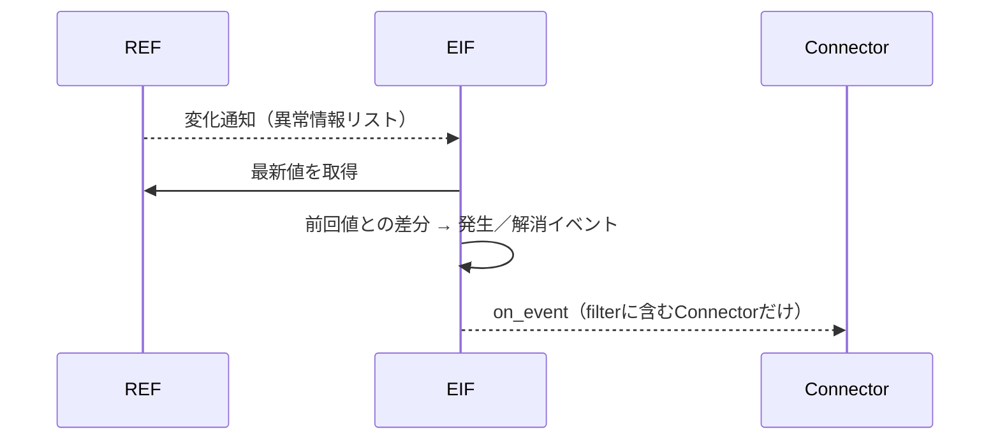

# CONFIDENTIAL

|  |  |
|------|------|
| ドキュメント名 | ExternalInterfaceLayer（EIF）仕様設計書 |
| バージョン | 0.01 |
| レイヤ | External Interface Layer |
| 対象機種 | 全機種共通（製品CFGで機種差を吸収） |

| 作成 |
|------|
| （検討ドラフト） |

---

## 更新履歴

| バージョン | 更新日 | 更新者 | 内容 |
|------------|--------|--------|------|
| 0.01 | 2026/10/21 | - | 初版作成（要件定義 合意版、2026/10/20 打合せ結果を反映） |

---

## 目次

1. 表紙
2. 更新履歴
3. 目次
4. 概要
    - 4.1 本ドキュメントの目的
    - 4.2 本書が対象とする範囲
    - 4.3 本ドキュメントの読み手
5. 用語集
6. 関連ドキュメント
7. 制約事項
    - 7.1 機能制約（サポート範囲・禁止事項）
    - 7.2 前提条件
8. 他のモジュールとの接続
    - 8.1 想定される接続先
    - 8.2 接続方針
9. 機能概要
    - 9.1 システム構造における位置づけ
    - 9.2 外部から見た処理モデル
    - 9.3 ライフサイクル
    - 9.4 非責務
10. IF仕様
    - 10.1 初期化API
    - 10.2 公開型
    - 10.3 Connector登録
    - 10.4 Submitと完了通知
    - 10.5 結果照会
    - 10.6 取消API
    - 10.7 情報取得
    - 10.8 設定変更
    - 10.9 イベント通知
    - 10.10 容量とtimeout
    - 10.11 Thread safety
    - 10.12 ABI契約
11. コンフィグレーション仕様
12. 呼び出しシーケンス
13. 組み込み手順
    - 13.1 ファイル構造
    - 13.2 初期化手順
    - 13.3 通常利用手順
    - 13.4 接続先（Connector）の追加手順
    - 13.5 機種（製品CFG）の追加手順
    - 13.6 テスト方針
14. 非保証事項

---

## 4. 概要

### 4.1 本ドキュメントの目的

本書は、外部インタフェース層（EIF）を利用して、外部コンポーネント（APIサーバー、将来のPCインタフェースや旧パネル等）を本ソフトウェアへ接続するための公開契約を定義する。

EIFは、本ソフトウェアと外部との唯一の境界である。接続相手が変わっても、その影響をPCL・REFへ波及させないことを最大の目的とする（要件 EIF-FR-02 外部接続差異吸収）。

### 4.2 本書が対象とする範囲

- EIFの公開ヘッダーと公開API
- 接続先依存部（Connector）の登録と、要求・応答・通知の契約
- 製品要求の受付、完了通知、結果照会、取消
- システム情報の取得、設定変更、変化通知
- API利用時の結果、所有権、寿命、再入およびthread safety
- 利用者がEIFを組み込む際の呼出順序と前提条件
- 接続先・機種を追加する際の手順

EIFの内部構造と各機能の仕組みは[EIF詳細設計書](詳細設計書.md)で定義する。

### 4.3 本ドキュメントの読み手

| 読み手 | 主に読む章 |
|---|---|
| Connector（接続先依存部）の実装者：APIサーバーとEIFをつなぐ人、将来の接続先を追加する人 | 8、9、10、12、13.4 |
| 製品CFG（機種依存部）の作成者：機種ごとに公開範囲や変換を定義する人 | 9.2、11、13.5 |
| 起動処理の実装者：EIFを初期化して他レイヤと配線する人 | 7.2、9.3、10.1、13.2 |
| 外部コンポーネント（APIサーバー等）の担当者：EIFの振る舞い（同期・非同期、結果）を知りたい人 | 9、10.4〜10.9、10.11 |

| 用途 | includeするヘッダー |
|---|---|
| 初期化、Connector登録、要求・情報・設定・通知のAPI、公開型 | `eif_api.h` |
| 公開ID（公開要求・公開情報・公開設定・公開イベント） | `eif_public_id.h`（`eif_api.h`が再公開する） |
| 公開モデル（情報・パラメータ・イベントのデータ型） | `eif_model.h`（`eif_api.h`が再公開する） |
| 製品CFGの作成（製品CFG作成者のみ） | `eif_profile.h` |

利用者は公開include path（`externalInterfaceLayer/include/`）から上記ヘッダーをincludeする。EIFの内部ディレクトリ（`frame/`）にある個別ヘッダーを直接includeしてはならない。

## 5. 用語集

| 用語 | 意味 |
|---|---|
| 外部コンポーネント | 本ソフトウェアの外にあり、EIFを経由して本ソフトウェアを利用するもの。例：APIサーバー（REST／WebSocket）、PCインタフェース、旧パネル |
| Connector（接続先依存部） | 1つの外部コンポーネントとEIFをつなぐ部品。外部の通信方式・データ形式・要求粒度を、EIFの公開要求・公開モデルへ変換する。外部コンポーネントごとに1つ作る |
| Frame | EIFのうち、接続先にも機種にも依存しない共通部分 |
| 製品CFG（機種依存部） | 機種ごとに作る定義。公開範囲、PCL製品要求IDとの対応、REFのIDと型の変換を表と変換関数で持つ |
| 外部要求 | 外部コンポーネントが送ってくる要求そのもの（RESTのリクエスト、コマンドのバイト列、ボタン操作等）。全体構成設計 4.3 |
| 公開要求 | EIFが受け付ける要求の単位。公開要求IDで識別する。PCLの製品要求に対応する |
| 製品要求 | PCLが受け付ける要求の単位（`product_request_id_t`）。全体構成設計 4.4 |
| 公開情報／公開設定／公開イベント | EIFが外部へ公開する、システム情報／変更可能な設定／通知 |
| システム情報 | REFが保持し、システム全体で共有される情報（定義は全体構成設計で追記予定。QA-18） |
| 要求ハンドル | EIFが受付成功時に払い出す要求の識別子（`EIF_RequestHandle`）。PCLの受付ID（generation ID）は外へ出さない |
| 要求元トークン | Connectorが要求ごとに付ける任意の値。完了通知でそのまま返す。Connectorが自分の要求（RESTの要求等）と結果を対応付けるために使う |
| 受付完了 | 要求がEIFとPCLで追跡可能になった状態。実行完了ではない |
| 終端結果 | `EIF_OUTCOME_COMPLETED`、`INVALID`、`NOT_SUPPORTED`、`FAILED`、`CANCELED` |

## 6. 関連ドキュメント

| # | 文書名 | 版 | 備考 |
|---|--------|----|------|
| 1 | 全体構成設計 | - | 上位文書。2.3、4章（要求の変換モデル）、7章（EIF） |
| 2 | [EIF要件定義](../../00.共通/要件定義.md) | 合意版（2026/10/20） | 本書の入力 |
| 3 | [EIF詳細設計書](詳細設計書.md) | 0.01 | EIFの内部構造と各機能の仕組み |
| 4 | [QA表](../../00.共通/QA表.md) | - | 確認事項・合意事項。本文中の「QA-xx」 |
| 5 | [EIF構成図](EIF構成図.drawio) | 0.01 | ブロック図、要求と応答の流れ、フォルダ構成 |
| 6 | ProductControlLayer 外部API仕様書 | 0.01 | EIFが利用するPCLの公開契約 |
| 7 | RIM外部仕様書 | - | EIFが利用するREFの公開契約 |

## 7. 制約事項

### 7.1 機能制約（サポート範囲・禁止事項）

- 公開する要求・情報・設定・イベントは、製品CFGの表に登録したものに限る。表にないIDは`EIF_ERR_NOT_EXPOSED`で拒否する。
- `EIF_SubmitRequest()`の`EIF_ACCEPTED`は受付完了を示し、実行完了を示さない。
- 完了通知は、要求を出したConnectorにだけ届く。ほかのConnectorには届かない。
- 完了通知は、受付成功した要求について最大1回呼ばれる。
- 完了通知・イベント通知の中から、EIFの要求系API（Submit、Cancel、GetResult、PatchSetting）を呼んではならない。
- EIFは受付可否を判定しない。可否はPCLの判定結果をそのまま返す。
- EIFは時間を契機とした処理（定期送信、生存応答等）を行わない。定期的な通知が必要な情報は、製品CFGでREFの定期通知を購読して実現する。
- 設定変更の書込み先（REFへ直接／PCL経由）は設定ごとに製品CFGで決まる。Connectorはどちらであっても同じ手順で扱う（10.8）。現時点の既定はREFへ直接（QA-01）。
- 印字データの受付（要件 EIF-FR-05、EIF-FR-06）は方式未確定のため本版の対象外とする（QA-06）。
- Connectorを登録・解除できるのは起動時（`EIF_Start()`前）だけとする。

### 7.2 前提条件

- REF（RIM）が生成・開始済みであること。
- PCLが`ExternalRequestIngress_Setup()`済みであること。
- 製品CFGがビルド時に1つだけ選択されていること。
- Connectorは`EIF_Start()`の前に`EIF_RegisterConnector()`で登録すること。
- Connectorが登録する関数ポインタとユーザーcontextは、プログラム終了まで有効であること。

## 8. 他のモジュールとの接続

### 8.1 想定される接続先

| # | 分類 | 接続先 | 接続方式 | 接続要否 | 用途 |
|---|------|--------|----------|---------|------|
| 1 | 上位 | Connector（APIサーバー用） | 公開API、完了通知・イベント通知のcallback | 必須 | REST／WebSocketからの要求、取得、設定、通知 |
| 2 | 上位 | Connector（PCインタフェース用、旧パネル用 等） | 同上 | 任意（将来） | 旧コマンド・旧操作の受付 |
| 3 | 下位 | PCL | `ExternalRequestIngressSubmit()`、取消、GetResult、完了callback | 必須 | 製品要求の実行 |
| 4 | 横断 | REF（RIM） | 取得API、購読API、（設定値の）書込みAPI | 必須 | システム情報の取得・購読、設定値の反映 |
| 5 | 下位 | 印字データの格納先 | T.B.D（QA-06） | 任意 | 印字データ |

### 8.2 接続方針

- 外部コンポーネントは、自分専用のConnectorを通してEIFを利用する。外部コンポーネントがEIFの公開APIを直接呼ぶことは想定しない。
- Connectorは`eif_api.h`だけを使う。PCL・REFのヘッダーをincludeしてはならない。
- 外部コンポーネント固有の通信方式・データ形式・要求の粒度（例：1つの旧コマンドが複数の製品要求になる）は、Connectorの中で吸収する。Frameと製品CFGには持ち込まない。
- 機種固有の内容（PCLの製品要求ID、REFのID・型）は製品CFGの中で吸収する。Connectorには持ち込まない。
- EIFはPCL・REFの公開APIだけを使う。EXE・RSC・DEVを参照しない（要件 EIF-NFR-05）。



## 9. 機能概要

### 9.1 システム構造における位置づけ

EIFは外部コンポーネントとPCL・REFの間に位置する。接続相手ごとの違いをConnectorで、機種ごとの違いを製品CFGで吸収し、Frameは両方に依存しない共通処理を行う。

| 変わるもの | 吸収する場所 | 例 |
|---|---|---|
| 接続相手（通信方式、データ形式、要求の粒度、応答の返し方） | Connector | REST⇔公開API、旧コマンド→複数の公開要求、即時応答＋遅延応答 |
| 機種（公開範囲、PCLの製品要求ID、REFのIDと型） | 製品CFG | 公開要求→`PRODUCT_REQUEST_ID_*`、`RIM_network_info_t`→公開モデル |
| 内部の接続先（設定の書込み先） | 製品CFG（表の1列） | REFへ直接書込み ⇔ PCLへ設定変更要求 |

### 9.2 外部から見た処理モデル

| 機能 | 呼び方 | 同期性 | 結果の受け取り方 |
|---|---|---|---|
| 製品要求 | `EIF_SubmitRequest()` | 受付は同期、結果は非同期 | 受付結果は戻り値。終端結果は要求元Connectorの完了callback |
| 取消 | `EIF_CancelRequest()` | 受付は同期、結果は非同期 | 取消の受付は戻り値。最終結果は元の要求の完了callback |
| 結果照会 | `EIF_GetRequestResult()` | 同期 | 戻り値と出力引数 |
| 情報取得 | `EIF_GetInfo()` | 同期 | 出力引数に公開モデル |
| 設定変更 | `EIF_PatchSetting()` | 書込み先により同期または非同期 | `EIF_OK`なら完了。`EIF_ACCEPTED`なら完了callback |
| 情報変化の通知 | （登録のみ） | 非同期 | 登録時に指定したイベントのcallback |

- 受付成功時、EIFは0以外の要求ハンドルを返す。
- 完了callbackには、要求ハンドルと、Submit時にConnectorが渡した要求元トークンが渡る。

### 9.3 ライフサイクル



初期化の順序と呼出し元はQA-04で確定する。

### 9.4 非責務

- 製品挙動の決定、受付可否の判定、実行順序の決定、実行状態の保持、動作継続可否の判定
- システム情報の生成、意味の定義、異常状態の管理、機能制限の決定
- 資源管理、ユニット制御、実機制御、印字データの加工・保管
- 時間を契機とした処理（定期送信、生存応答、タイムアウト監視）。定期的な通知はREFの定期通知を使う
- 外部コンポーネントとの通信そのもの（ソケット、HTTP、シリアライズ）。これは外部コンポーネントまたはConnectorの責務

## 10. IF仕様

### 10.1 初期化API

#### EIF_Setup

```c
EIF_Result EIF_Setup(void);
```

- 選択された製品CFGで、EIFを初期化する。製品CFGが表と変換関数を組み立ててFrameへ渡す。
- 起動処理から1回だけ呼ぶ。多重呼出しは初期化済み状態を維持して`EIF_OK`を返す。
- 表の検証に失敗した場合は`EIF_ERR_INVALID_CONFIG`を返し、EIFは利用できない。

#### EIF_Start

```c
EIF_Result EIF_Start(void);
```

- 製品CFGの購読表に従ってREFの購読を登録し、要求の受付を開始する。
- `EIF_Start()`より後は、Connectorの登録はできない。
- 購読の登録に失敗した場合は`EIF_ERR_INTERNAL`を返す。REFに購読解除APIが無いため、それまでに登録した購読は残る（QA-07）。

| 戻り値 | 意味 |
|---|---|
| `EIF_OK` | 利用可能 |
| `EIF_ERR_UNAVAILABLE` | `EIF_Setup()`未実行、またはREF未初期化 |
| `EIF_ERR_INTERNAL` | 購読の登録失敗 |

### 10.2 公開型

#### 10.2.1 結果コード

```c
typedef enum {
    EIF_OK = 0,                /* 完了 */
    EIF_ACCEPTED,              /* 受付完了（結果は完了callback） */
    EIF_ERR_INVALID_PARAM,     /* 引数・パラメータ不正 */
    EIF_ERR_NOT_EXPOSED,       /* 公開対象外（製品CFGに無い） */
    EIF_ERR_NOT_FOUND,         /* 要求ハンドル・情報が無い */
    EIF_ERR_BUSY,              /* PCLが受け付けない、容量不足 */
    EIF_ERR_UNAVAILABLE,       /* 未初期化、未開始 */
    EIF_ERR_INVALID_CONFIG,    /* 製品CFGの表が不正（初期化時のみ） */
    EIF_ERR_INTERNAL           /* その他内部エラー */
} EIF_Result;
```

#### 10.2.2 終端結果

| 値 | 数値 | 意味 | PCLの結果との対応 |
|---|---:|---|---|
| `EIF_OUTCOME_COMPLETED` | 0 | 正常完了 | `ACCEPTED` |
| `EIF_OUTCOME_INVALID` | 1 | 要求が不正 | `INVALID` |
| `EIF_OUTCOME_NOT_SUPPORTED` | 2 | 下位機能が未対応 | `NOT_SUPPORTED` |
| `EIF_OUTCOME_FAILED` | 3 | 実行失敗 | `FAILED` |
| `EIF_OUTCOME_CANCELED` | 4 | 取消で終端 | `CANCELED` |
| `EIF_OUTCOME_PENDING` | 5 | 未確定（照会時のみ。完了callbackには渡さない） | `PENDING` |

#### 10.2.3 識別子

| 型 | 内容 |
|---|---|
| `EIF_ConnectorId` | Connectorの識別子。登録時にEIFが払い出す。0は無効 |
| `EIF_RequestHandle` | 要求ハンドル（`uint64_t`）。0は無効。受付成功時だけ払い出す。稼働中は再利用しない |
| `eif_request_id_t` | 公開要求ID。全機種共通の値空間で、機種ごとに有効なIDが異なる |
| `eif_info_id_t` | 公開情報ID |
| `eif_setting_id_t` | 公開設定ID |
| `eif_event_id_t` | 公開イベントID |

公開IDの値は追加のみ行い、既存の値は変更しない。現時点の候補はAPIサーバーのOpenAPI／AsyncAPIの資源に合わせて定義する（QA-08）。

#### 10.2.4 イベント

```c
typedef struct {
    eif_event_id_t event_id;
    union {                       /* event_idに対応する公開モデル */
        eif_alarm_t        alarm;
        eif_ink_level_t    ink_level;
        eif_job_progress_t job_progress;
    } payload;
} EIF_Event;
```

イベントは通知callbackの呼出し中だけ有効である。復帰後も必要な場合は利用者の領域へコピーする。

### 10.3 Connector登録

```c
typedef void (*EIF_RequestCompletedFn)(EIF_RequestHandle handle,
                                       eif_request_id_t  request_id,
                                       uint64_t          origin_token,
                                       EIF_RequestOutcome outcome,
                                       void             *user_context);

typedef void (*EIF_EventFn)(const EIF_Event *event, void *user_context);

typedef struct {
    const char            *name;              /* ログ用。例："api_server" */
    EIF_RequestCompletedFn on_request_completed; /* 必須 */
    EIF_EventFn            on_event;          /* 情報変化を受け取らないならNULL */
    const eif_event_id_t  *event_filter;      /* 受け取る公開イベントIDの一覧 */
    size_t                 event_filter_count;
    void                  *user_context;      /* callbackへそのまま渡す */
} EIF_ConnectorDesc;

EIF_Result EIF_RegisterConnector(const EIF_ConnectorDesc *desc, EIF_ConnectorId *out_id);
```

- `EIF_Start()`の前に呼ぶ。登録できるConnectorは最大`EIF_MAX_CONNECTORS`（初版4）件。
- `desc`の内容はEIFがコピーする。関数ポインタと`user_context`の指す先はプログラム終了まで有効であること。
- `on_request_completed`には、そのConnectorが出した要求の結果だけが届く。
- `on_event`には、`event_filter`に含めた公開イベントだけが届く。公開対象外のイベントは届かない。

| 戻り値 | 意味 |
|---|---|
| `EIF_OK` | 登録した。`out_id`にConnector IDを返す |
| `EIF_ERR_INVALID_PARAM` | NULL、必須callbackがNULL |
| `EIF_ERR_BUSY` | 登録数の上限、または`EIF_Start()`後 |

### 10.4 Submitと完了通知

```c
EIF_Result EIF_SubmitRequest(EIF_ConnectorId    origin,
                             eif_request_id_t   request_id,
                             const void        *param,
                             size_t             param_size,
                             uint64_t           origin_token,
                             EIF_RequestHandle *out_handle);
```

#### 10.4.1 受付結果

| 結果 | 戻り値 | `out_handle` |
|---|---|---:|
| 受付成功 | `EIF_ACCEPTED` | 0以外 |
| 公開対象外のID | `EIF_ERR_NOT_EXPOSED` | 0 |
| 引数・パラメータ不正 | `EIF_ERR_INVALID_PARAM` | 0 |
| PCLが受け付けない（容量、機能禁止、実行中 等） | `EIF_ERR_BUSY` | 0 |
| 未開始 | `EIF_ERR_UNAVAILABLE` | 0 |
| 内部失敗 | `EIF_ERR_INTERNAL` | 0 |

- 失敗時は要求を登録せず、後から完了callbackを呼ばない。
- `param`は呼出し中だけ参照する。現時点ではPCLが要求パラメータを受け付けないため、パラメータ付きの公開要求は定義しない（QA-02）。

#### 10.4.2 完了通知

- 受付成功した要求の終端結果が確定したとき、`origin`のConnectorの`on_request_completed`を1回だけ呼ぶ。
- 引数の`origin_token`には、Submit時に渡した値をそのまま渡す。Connectorはこれで自分の要求（RESTの要求、旧コマンドのシーケンス等）と対応付ける。
- 完了callbackはPCLの要求処理contextから直列に呼ばれる。長時間ブロックしてはならない。callbackの中からEIFの要求系APIを呼んではならない。
- PCLの処理が速い場合、完了callbackが`EIF_SubmitRequest()`の戻りより先に呼ばれることがある。Connectorは要求ハンドルを完了callbackの引数から得ること。
- PCLが応答しない場合、完了callbackは呼ばれない（EIFはタイムアウトを持たない）。

### 10.5 結果照会

```c
EIF_Result EIF_GetRequestResult(EIF_RequestHandle handle, EIF_RequestOutcome *out_outcome);
```

| 条件 | 戻り値 | `out_outcome` |
|---|---|---|
| 未完了 | `EIF_OK` | `EIF_OUTCOME_PENDING` |
| 終端済みで、PCLが結果を保持している | `EIF_OK` | 終端結果 |
| 未登録、または保持期間を過ぎた | `EIF_ERR_NOT_FOUND` | 変更しない |
| `handle`が0、`out_outcome`がNULL | `EIF_ERR_INVALID_PARAM` | 変更しない |

EIFは結果を保持しない。照会はPCLのGetResultへ委譲する。

### 10.6 取消API

```c
EIF_Result EIF_CancelRequest(EIF_ConnectorId origin, EIF_RequestHandle handle);
```

| 戻り値 | 意味 |
|---|---|
| `EIF_OK` | 取消を受け付けた（取消の完了ではない） |
| `EIF_ERR_NOT_FOUND` | 未登録、終端済み、または`origin`が要求元と異なる |
| `EIF_ERR_BUSY` | PCLが取消を受け付けない |
| `EIF_ERR_INVALID_PARAM` | `handle`が0 |

- 最終結果（`EIF_OUTCOME_CANCELED`、または取消が間に合わず`COMPLETED`）は、元の要求の完了callbackで通知する。
- 一時停止・再開は取消ではなく、それぞれ別の公開要求として扱う（全体構成設計 3.9）。

### 10.7 情報取得

```c
EIF_Result EIF_GetInfo(eif_info_id_t info_id, void *out, size_t out_size);
```

- 製品CFGの定義に従ってREFから最新値を取得し、公開モデルへ変換して`out`へ書く。
- `out_size`は公開モデルのサイズと一致すること。
- 同期で完了する。EIFは値を保持しない（毎回REFから取得する）。

| 戻り値 | 意味 |
|---|---|
| `EIF_OK` | 取得した |
| `EIF_ERR_NOT_EXPOSED` | 公開対象外 |
| `EIF_ERR_INVALID_PARAM` | NULL、サイズ不一致 |
| `EIF_ERR_NOT_FOUND` | REFに値が無い |
| `EIF_ERR_UNAVAILABLE` | REF未初期化 |
| `EIF_ERR_INTERNAL` | 変換失敗、その他 |

### 10.8 設定変更

```c
EIF_Result EIF_PatchSetting(EIF_ConnectorId    origin,
                            eif_setting_id_t   setting_id,
                            const void        *patch,
                            size_t             patch_size,
                            uint64_t           origin_token,
                            EIF_RequestHandle *out_handle);
```

- 部分更新（PATCH）を行う。パッチで指定しなかった項目は、現在値のまま保持する。
- 書込み先は設定ごとに製品CFGで決まる。Connectorは書込み先を意識せず、戻り値で次のように扱う。

| 戻り値 | 意味 | Connectorの扱い |
|---|---|---|
| `EIF_OK` | 反映を完了した（REFへ直接書き込む設定） | その場で成功を返す。`out_handle`は0 |
| `EIF_ACCEPTED` | 設定変更要求として受け付けた（PCL経由の設定） | 完了callbackを待つ。`out_handle`は0以外 |
| `EIF_ERR_NOT_EXPOSED` | 公開対象外 | - |
| `EIF_ERR_INVALID_PARAM` | パッチの値が不正 | - |
| `EIF_ERR_BUSY` | PCLが受け付けない（PCL経由の設定） | - |
| `EIF_ERR_UNAVAILABLE`、`EIF_ERR_INTERNAL` | 上記以外の失敗 | - |

> 書込み先をREFからPCLへ変更する可能性がある（QA-01）。Connectorを上の表どおりに実装しておけば、書込み先が変わってもConnectorの修正は不要である。

### 10.9 イベント通知

- `EIF_RegisterConnector()`の`event_filter`に含めた公開イベントについて、発生時に`on_event`を呼ぶ。
- 同じイベントを複数のConnectorが登録している場合は、登録順に各Connectorへ通知する。
- 通知はREFの通知ワーカーのcontextで呼ばれる。長時間ブロックしてはならない。
- 一覧情報（例：異常情報リスト）の変化は、前回からの差分として個別のイベント（発生／解消）に分けて通知する（QA-03）。
- 定期的な通知が必要な情報は、製品CFGでREFの定期通知を購読しておく。値が変わらなくても通知される。

### 10.10 容量とtimeout

| 項目 | 契約 |
|---|---|
| Connector登録数 | 最大4（初版） |
| 未完了要求 | PCLの未完了要求上限（32件）に従う。EIF側の追跡表は32件＋余裕分 |
| 結果照会 | PCLの保持件数（最新32件）に従う |
| 実行完了timeout | EIFでは設定しない |
| 1つの公開イベントあたりの通知先 | 登録済みConnector数まで |

### 10.11 Thread safety

| API・callback | 呼べるcontext | 備考 |
|---|---|---|
| `EIF_Setup`、`EIF_RegisterConnector`、`EIF_Start` | 起動処理のスレッド | 1回ずつ、この順に呼ぶ |
| `EIF_SubmitRequest`、`EIF_CancelRequest`、`EIF_GetRequestResult`、`EIF_GetInfo`、`EIF_PatchSetting` | 任意（複数スレッドから同時に呼んでよい） | 完了callback・イベントcallbackの中からは呼ばない |
| `on_request_completed` | PCLの要求処理context（直列） | 長時間ブロック禁止 |
| `on_event` | REFの通知ワーカー | 長時間ブロック禁止 |

- EIFは自身の処理スレッドを持たない（印字データの受付を除く）。要求はConnectorのスレッドで、そのままPCL・REFへ渡る。
- callback呼出し中は、EIFは内部のロックを保持しない。

### 10.12 ABI契約

- 公開enumの数値と、公開IDの既存値はABIの一部であり変更しない。
- 公開構造体のfield順を変えない。拡張は末尾への追加で行う。
- Connectorは同じ版の公開ヘッダーとライブラリを組み合わせる。

## 11. コンフィグレーション仕様

EIFの機種差は、製品CFG（`product/<MODEL>/`）で定義する。製品CFGは次の表と変換関数を持つ。詳細な型と書き方は[EIF詳細設計書](詳細設計書.md) 6.5を参照する。

| 表 | 1行の内容 | 対応する要件 |
|---|---|---|
| 要求の表（RequestMap） | 公開要求ID → PCL製品要求ID | EIF-FR-01、EIF-FR-02（製品要求の受付） |
| 情報の表（InfoMap） | 公開情報ID → REFのID群＋変換関数 | EIF-FR-01、EIF-FR-07 |
| 設定の表（SettingMap） | 公開設定ID → 書込み先（REF直接／PCL経由）＋マージ関数 | EIF-FR-07 |
| 購読の表（SubscriptionTable） | REFの購読ID・通知契機（変化／定期） → 公開イベント生成関数 | EIF-FR-08、EIF-FR-09 |

- 表にないIDは公開されない（公開範囲の定義を兼ねる）。
- 表は起動後に変更しない。
- 製品はビルド時に`MODEL`で選択する。未指定時は`Skeleton`（何も公開しない）を使う。

Connector側の設定（どの外部コマンドをどの公開要求にするか等）は、各Connectorの中で定義する。

## 12. 呼び出しシーケンス

### 12.1 製品要求（REST POST /jobs の例）



### 12.2 複数の外部コンポーネントからの要求（応答先の振り分け）



完了の順番が要求の順番と異なっても、結果は要求を出したConnectorへ返る。

### 12.3 旧コマンドの吸収（将来のConnectorの例）

1つの旧コマンドが複数の製品要求に分かれ、即時応答と遅延応答を返す必要がある場合も、Connectorの中で吸収する。



### 12.4 情報取得（REST GET）



### 12.5 設定変更（REST PATCH）



### 12.6 情報変化の通知（WebSocket）



## 13. 組み込み手順

### 13.1 ファイル構造

```text
externalInterfaceLayer/
├─ include/            公開ヘッダー（利用者がincludeする）
├─ frame/              共通部（利用者は参照しない）
├─ connectors/         接続先依存部（外部コンポーネントごとに1フォルダ）
│   └─ api_server/
├─ product/            機種依存部（機種ごとに1フォルダ。MODELで1つ選択）
│   ├─ Skeleton/
│   └─ MiniPrinter/
└─ test/
```

詳細は[EIF詳細設計書](詳細設計書.md) 6.4を参照する。

### 13.2 初期化手順

1. REF（RIM）を生成・開始する。
2. PCLを`ExternalRequestIngress_Setup()`で初期化する。
3. `EIF_Setup()`を呼ぶ。
4. 各Connectorを初期化し、`EIF_RegisterConnector()`で登録する。
5. 外部コンポーネント（APIサーバー等）を開始する。
6. `EIF_Start()`を呼ぶ。

順序はQA-04で確定する。

### 13.3 通常利用手順

- 製品要求は`EIF_SubmitRequest()`で出し、`EIF_ACCEPTED`だけを受付成功と判定する。結果は完了callbackで受け取る。
- 設定変更は`EIF_PatchSetting()`を呼び、`EIF_OK`と`EIF_ACCEPTED`の両方を扱う。
- 情報は`EIF_GetInfo()`で取得する。変化を受け取りたい情報は、登録時の`event_filter`に含める。

### 13.4 接続先（Connector）の追加手順

1. `connectors/<接続先名>/`を作る。
2. 外部コンポーネントの要求（コマンド、REST等）を公開要求・公開情報・公開設定へ変換する処理を書く。複数の公開要求に分かれる場合や、即時応答＋遅延応答が必要な場合も、このフォルダの中で扱う。
3. 公開イベントを外部コンポーネントの通知形式へ変換する処理を書く。
4. 起動処理で`EIF_RegisterConnector()`を呼ぶ。
5. Frame・製品CFG・PCL・REFは変更しない。

公開要求・公開情報が足りない場合（外部IF仕様として新しい機能が必要な場合）は、公開IDと公開モデルを追加する。これはEIFの公開範囲の変更であり、製品CFGの表にも行を追加する。

### 13.5 機種（製品CFG）の追加手順

1. `product/Skeleton/`を`product/<機種名>/`へコピーする。
2. 4つの表に、その機種で公開する行を書く。
3. REFの型と公開モデルの変換関数を書く。
4. `MODEL=<機種名>`でビルドする。
5. Frame・Connectorは変更しない。

### 13.6 テスト方針

- Connector：外部形式⇔公開要求・公開モデルの変換、完了callbackでの要求元トークンの対応付け、`EIF_OK`と`EIF_ACCEPTED`の両方の扱い。
- 製品CFG：表の整合（ID重複なし、変換関数の有無）、変換関数の入出力。
- 結合：要求→完了通知、情報取得、設定変更、情報変化の通知、複数Connectorの振り分け。

## 14. 非保証事項

- 再起動をまたぐ要求ハンドルと結果の保持
- PCLが応答しない要求の完了通知（EIFはタイムアウトを持たない）
- 購読の解除と、EIFの停止・再初期化（REFに購読解除APIが無いため。QA-07）
- 印字データの受付（方式未確定。QA-06）
- 通知先callbackが長時間ブロックした場合の、PCL・REFの処理遅延
