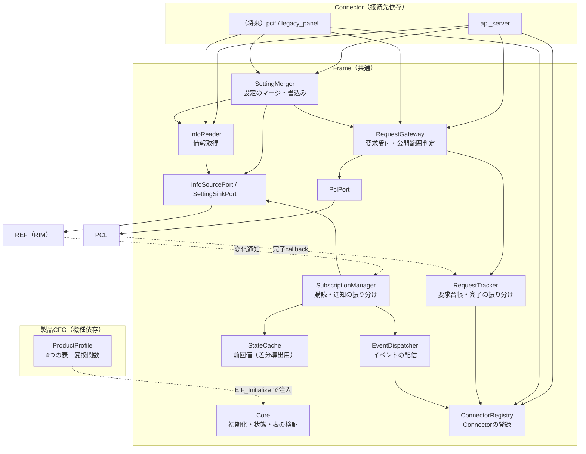

# CONFIDENTIAL

|  |  |
|------|------|
| ドキュメント名 | ExternalInterfaceLayer（EIF）詳細設計書 |
| バージョン | 0.01 |
| レイヤ | External Interface Layer |
| 対象機種 | 全機種共通（Frame）／MiniPrinter（製品CFG 初版） |

| 作成 |
|------|
| （検討ドラフト） |

---

## 更新履歴

| バージョン | 更新日 | 更新者 | 内容 |
|------------|--------|--------|------|
| 0.01 | 2026/10/21 | - | 初版作成（要件定義 合意版、2026/10/20 打合せ結果を反映） |

---

## 目次

1. 表紙
2. 更新履歴
3. 目次
4. 本書の位置づけ
5. 内部用語
6. 内部処理モデル
  - 6.1 コンポーネント境界と責務
  - 6.2 公開IFと内部IF
  - 6.3 内部データ構造
  - 6.4 ファイル構成
  - 6.5 製品ごとの表と差し替え（製品CFG）
  - 6.6 接続先ごとの差し替え（Connector）
  - 6.7 内部接続先の差し替え（Port）
7. 各機能の詳細ロジック
  - 7.1 初期化と開始
  - 7.2 Connector登録
  - 7.3 要求受付
  - 7.4 完了通知と応答先の振り分け
  - 7.5 取消と結果照会
  - 7.6 情報取得
  - 7.7 設定変更（書込み先の切替）
  - 7.8 購読と情報変化の通知
  - 7.9 差分導出（StateCache）
  - 7.10 APIサーバー用Connector
  - 7.11 印字データ（T.B.D）
8. 保護動作
9. 結果コードの変換
10. 内部状態・データ定義
  - 10.1 排他と所有権
  - 10.2 実行コンテキスト
  - 10.3 性能方針（早く軽く）
  - 10.4 依存関係
11. 実装と試験結果
12. 現行実装からの移行
13. 未検討事項・既知の制約
  - 13.1 テスト観点

---

> ステータス：設計ドラフト。実装前。

## 4. 本書の位置づけ

本書は、EIFを実装・保守する人向けに、EIFの内部構造と各機能の仕組みを定義する。

EIFの公開契約（利用者から見た振る舞い）は[EIF仕様設計書](仕様設計書.md)を正とする。本書はその実現方法を定める。

EIFは次の2つの変化から内部（PCL・REF）を守るため、処理を3つに分ける。

| 守る対象の変化 | 吸収する部分 | 根拠 |
|---|---|---|
| 接続相手が変わる（APIサーバー、PCインタフェース、旧パネル等） | Connector（接続先依存部） | 要件 EIF-FR-02 外部接続差異吸収、2026/10/20 打合せ |
| 機種が変わる（公開範囲、PCL製品要求ID、REFのIDと型） | 製品CFG（機種依存部） | 要件 EIF-FR-01（製品ごとに設定可能）、全体構成設計 3.6 |
| どちらにも依存しない処理 | Frame（共通部） | - |

## 5. 内部用語

本書で用いるEIF内部の用語を定義する。公開用語は[EIF仕様設計書](仕様設計書.md) 5章を参照する。

| 用語 | 定義 |
|---|---|
| Frame | 接続先にも機種にも依存しない共通部。表を引いて共通処理を回す |
| Connector | 1つの外部コンポーネントとEIF公開APIをつなぐ部品。`connectors/<名前>/`に置く |
| 製品CFG | 機種ごとの表と変換関数。`product/<MODEL>/`に置く |
| ProductProfile | 製品CFGがFrameへ渡す表一式（`EIF_ProductProfile`） |
| Port | FrameがPCL・REFを呼ぶための関数ポインタ構造体。内部の接続先を差し替える口 |
| トランポリン | FrameがPCL・REFへ登録する共通callback。受け取った通知を表で振り分ける |
| 要求台帳 | 受付中の要求の、要求ハンドル・受付ID・要求元を記録する表（RequestTracker が所有） |
| 先着完了 | PCLの完了callbackが、要求台帳への登録より先に届いた状態 |
| StateCache | 差分導出のための前回値を持つ部品。EIFでデータを保持するのはここだけ |
| 書込み先種別 | 設定の書込み先。REFへ直接（`EIF_SINK_REF_DIRECT`）またはPCL経由（`EIF_SINK_PCL_REQUEST`） |

## 6. 内部処理モデル

### 6.1 コンポーネント境界と責務



#### 6.1.1 責務

| コンポーネント | 責務 |
|---|---|
| Core | 初期化状態の管理、ProductProfileとPortの検証・保持、開始処理 |
| ConnectorRegistry | Connectorの登録と、Connector IDからcallbackへの解決 |
| RequestGateway | 公開範囲の判定、公開要求→製品要求の変換、PCLへの転送、要求台帳への登録 |
| RequestTracker | 要求台帳の管理、PCL完了callbackの受け口（トランポリン）、要求元Connectorへの完了通知、先着完了の処理 |
| InfoReader | 情報の表に従ったREFからの取得、サイズ検証、変換関数の呼出し |
| SettingMerger | 設定の表に従った現在値の取得、マージ、書込み先種別に応じた反映 |
| SubscriptionManager | 購読の表に従ったREFへの購読登録、REF通知callbackの受け口（トランポリン）、イベント生成関数の呼出し |
| StateCache | 購読エントリごとの前回値の保持と排他 |
| EventDispatcher | 公開イベントを、event_filterに一致するConnectorへ配信 |
| PclPort／InfoSourcePort／SettingSinkPort | PCL・REFの実APIの呼出し口（差し替え可能） |

#### 6.1.2 非責務

- 外部形式（REST、コマンド、ボタン操作）の解釈と、外部への送信（Connectorの責務）
- 機種固有のID・型の知識（製品CFGの責務）
- 受付可否、実行状態、タイムアウト、時間を契機とした処理

### 6.2 公開IFと内部IF

#### 6.2.1 公開IF

公開IFは`include/eif_api.h`に限定する（[EIF仕様設計書](仕様設計書.md) 10章）。

| IF | 実装するコンポーネント |
|---|---|
| `EIF_Setup()` | 製品CFG（`product/<MODEL>/eif_product_setup.c`）。表を組み立てて`EIF_Initialize()`を呼ぶ |
| `EIF_Start()` | Core → SubscriptionManager |
| `EIF_RegisterConnector()` | ConnectorRegistry |
| `EIF_SubmitRequest()` | RequestGateway |
| `EIF_CancelRequest()`、`EIF_GetRequestResult()` | RequestGateway → RequestTracker |
| `EIF_GetInfo()` | InfoReader |
| `EIF_PatchSetting()` | SettingMerger |

#### 6.2.2 製品CFG向けIF

| IF | 契約 |
|---|---|
| `EIF_Initialize(const EIF_ProductProfile*, const EIF_Ports*)` | `frame/include/eif_frame_api.h`で宣言。Profileを検証して保持する。製品CFGの`EIF_Setup()`からだけ呼ぶ |
| `eif_profile.h` | 表の型と変換関数の型 |

#### 6.2.3 公開しない内部IF

次の内部ヘッダーは`frame/`配下に置き、CMakeでPRIVATE includeとする。Connectorと製品CFGは使用しない。

- `eif_core_internal.h`
- `eif_request_tracker.h`、`eif_request_gateway.h`
- `eif_info_reader.h`、`eif_setting_merger.h`
- `eif_subscription_manager.h`、`eif_state_cache.h`
- `eif_event_dispatcher.h`、`eif_connector_registry.h`
- `eif_result_map.h`

### 6.3 内部データ構造

#### 6.3.1 要求台帳（RequestTracker）

| field | 型 | 内容 |
|---|---|---|
| `state` | enum | `FREE`、`ACTIVE`、`EARLY_COMPLETED`（先着完了） |
| `handle` | `EIF_RequestHandle` | EIFが払い出した要求ハンドル |
| `generation_id` | `uint64_t` | PCLの受付ID |
| `origin` | `EIF_ConnectorId` | 要求元Connector |
| `origin_token` | `uint64_t` | Connectorが渡した要求元トークン |
| `request_id` | `eif_request_id_t` | 公開要求ID |
| `early_outcome` | `EIF_RequestOutcome` | 先着完了時の終端結果 |

- 件数は`EIF_TRACKER_CAPACITY`＝PCLの未完了要求上限（32）＋先着完了用の余裕（8）とする。
- 実行状態（進捗、WAIT等）は持たない。持つのは「どの要求の結果を、誰へ返すか」だけである（2026/10/20 打合せ：応答先を覚える必要がある）。

#### 6.3.2 Connector登録表（ConnectorRegistry）

| field | 内容 |
|---|---|
| `id` | Connector ID（1〜`EIF_MAX_CONNECTORS`） |
| `desc` | 登録時の`EIF_ConnectorDesc`のコピー（name、callback、event_filter、user_context） |
| `event_mask` | event_filterをビット列にしたもの（配信時の判定を速くするため） |

#### 6.3.3 購読表の実行時情報（SubscriptionManager）

| field | 内容 |
|---|---|
| `entry` | 製品CFGの購読エントリへのポインタ |
| `subscription_id` | REFが払い出した購読ID |
| `cache_slot` | StateCacheのスロット番号（前回値が不要なら無効値） |

### 6.4 ファイル構成

実装（`01.通常版/実装/externalInterfaceLayer/`）の構成。

```text
externalInterfaceLayer/
├── CMakeLists.txt                       MODEL選択と、ターゲットごとのinclude path制限
├── build_and_test.sh                    gccだけでビルド確認・単体試験を行うスクリプト
├── README.md                            区分と依存規則、初版の範囲
├── include/                             【公開】利用者がincludeする唯一のヘッダー群
│   ├── eif_api.h                        公開関数、結果コード、Connector登録の型、EIF_Event
│   ├── eif_public_id.h                  公開要求／情報／設定／イベントID
│   ├── eif_model.h                      公開モデル（OpenAPIスキーマと同形）
│   └── eif_profile.h                    製品CFGの表の型（製品CFG作成者向け）
├── frame/                               【Frame】接続先にも機種にも依存しない処理
│   ├── include/
│   │   ├── eif_frame_api.h              EIF_Initialize（製品CFG向け）、容量の定数
│   │   └── eif_port.h                   PclPort / InfoSourcePort / SettingSinkPort
│   ├── eif_internal.h                   Frame内部の部品間IF
│   ├── core/eif_core.c                  初期化・開始・表の検証
│   ├── connector/eif_connector_registry.c
│   ├── request/eif_request_gateway.c
│   ├── request/eif_request_tracker.c
│   ├── info/eif_info_reader.c
│   ├── info/eif_setting_merger.c
│   ├── info/eif_subscription_manager.c
│   ├── info/eif_state_cache.c
│   ├── notify/eif_event_dispatcher.c
│   ├── port/eif_port_default.c          PCL・REFの実APIを指す既定Port
│   └── util/                            eif_result_map.c（結果コード変換）、eif_lock.h、eif_log.h
├── connectors/                          【Connector】接続先ごと（外部コンポーネントごと）
│   └── api_server/
│       ├── include/eif_connector_api_server.h   起動処理向けの入口（Setup）
│       └── api_server_connector.c       EIFとAPIサーバーへの登録、REST、WebSocket送信
├── product/                             【製品CFG】機種ごと（MODELで1つ選択）
│   ├── Skeleton/eif_product_setup.c     雛形（全表が空）
│   └── MiniPrinter/
│       ├── eif_product_internal.h       表の実体と変換関数の宣言
│       ├── eif_product_setup.c          EIF_Setup()：表の組立て→EIF_Initialize
│       ├── eif_product_requests.c       要求の表
│       ├── eif_product_network.c        ネットワーク設定：情報の表・設定の表・変換関数
│       └── eif_product_fault.c          購読の表・異常の差分→イベント・内部コード→公開アラーム
└── test/
    ├── eif_test.h                       依存の無い最小の試験マクロ
    ├── frame/                           スタブPort＋試験用Profileで Frame を試験
    └── product/                         MiniPrinterの変換関数・表の整合の試験
```

印字データ（`frame/printdata/`）は、方式が決まるまで置かない（QA-06）。

### 6.5 製品ごとの表と差し替え（製品CFG）

製品CFGは4つの表と変換関数を持ち、`EIF_Setup()`で`EIF_ProductProfile`にまとめてFrameへ渡す（関数ポインタによる注入）。PCL AutoRequestGenerator（`frame/`＋`src/<MODEL>/`＋`Setup()`）と同じ方式である。

```c
typedef struct {
    const char *product_name;
    const EIF_RequestMapEntry   *requests;      size_t request_count;
    const EIF_InfoMapEntry      *infos;         size_t info_count;
    const EIF_SettingMapEntry   *settings;      size_t setting_count;
    const EIF_SubscriptionEntry *subscriptions; size_t subscription_count;
} EIF_ProductProfile;
```

#### 6.5.1 要求の表（RequestMap）

```c
typedef struct {
    eif_request_id_t     public_id;        /* 公開する要求（機能定義） */
    product_request_id_t product_request;  /* PCLの製品要求ID（マッピング） */
} EIF_RequestMapEntry;
```

要求パラメータの変換欄は、PCLがパラメータを受け付けるようになった時点で追加する（QA-02）。

#### 6.5.2 情報の表（InfoMap）

```c
typedef struct { const void *data; size_t size; } EIF_SourceView;

typedef bool (*EIF_ConvertInfoFn)(const EIF_SourceView *src, size_t src_count,
                                  void *out_public, size_t out_size);

typedef struct {
    eif_info_id_t      public_id;
    uint32_t           source_ids[EIF_MAX_SOURCES];    /* REFのData ID（製品別）。初版は最大4 */
    size_t             source_sizes[EIF_MAX_SOURCES];  /* 製品型のsizeof（型不一致の検出） */
    size_t             source_count;
    size_t             public_size;                    /* 公開モデルのsizeof */
    EIF_ConvertInfoFn  convert;                        /* REF製品型→公開モデル */
} EIF_InfoMapEntry;
```

MiniPrinterの例：

```c
static const EIF_InfoMapEntry k_infos[] = {
    { EIF_INFO_NETWORK_SETTINGS,
      { RI_DATA_NETWORK_INFO, RI_DATA_HOSTNAME, RI_DATA_MACADDRESS },
      { sizeof(RIM_network_info_t), RIM_HOSTNAME_LEN, RIM_MACADDRESS_LEN }, 3,
      sizeof(eif_network_settings_t), mp_convert_network_settings },
};
```

#### 6.5.3 設定の表（SettingMap）

```c
typedef enum { EIF_SINK_REF_DIRECT, EIF_SINK_PCL_REQUEST } EIF_SettingSinkKind;

typedef bool (*EIF_MergeSettingFn)(const void *current, size_t current_size,
                                   const void *patch, void *out, size_t out_size);

typedef struct {
    eif_setting_id_t     public_id;
    uint32_t             ref_data_id;      /* 現在値を読むREF Data ID（製品別） */
    size_t               ref_size;         /* 製品型のsizeof */
    size_t               patch_size;       /* 公開パッチモデルのsizeof */
    EIF_MergeSettingFn   merge;            /* パッチを内部形式へ変換して現在値へ反映 */
    EIF_SettingSinkKind  sink;             /* 書込み先（QA-01）。現在はREF_DIRECT */
    product_request_id_t product_request;  /* sink=PCL_REQUEST のときの設定変更要求ID */
} EIF_SettingMapEntry;
```

書込み先は`sink`の1列で切り替える。Connectorと公開APIは変わらない（7.7）。

#### 6.5.4 購読の表（SubscriptionTable）

```c
typedef size_t (*EIF_BuildEventsFn)(const EIF_SourceView *now, size_t now_count,
                                    const void *prev, size_t prev_size, bool has_prev,
                                    EIF_Event *out_events, size_t max_events);

typedef struct {
    RI_TARGET_TYPE          target_type;   /* Data / Capability / Facade */
    uint32_t                target_id;     /* 購読するREFのID（製品別） */
    RI_NOTIFICATION_TRIGGER trigger;       /* 変化通知 / 定期通知 */
    uint32_t                interval_ms;   /* 定期通知の周期 */
    uint32_t                source_ids[EIF_MAX_SOURCES];   /* 通知時に取得する値 */
    size_t                  source_sizes[EIF_MAX_SOURCES];
    size_t                  source_count;
    bool                    keep_previous; /* 前回値を保持して差分を出すか（7.9） */
    EIF_BuildEventsFn       build_events;  /* 値（＋前回値）→ 公開イベント */
} EIF_SubscriptionEntry;
```

MiniPrinterの例（現行`k_subscriptions`＋`ApiServerWsCallback_FaultInfoList`の置き換え）：

```c
static const EIF_SubscriptionEntry k_subscriptions[] = {
    { RI_TARGET_DATA, RI_DATA_FAULT_INFO_LIST, RI_TRIGGER_ON_CHANGE, 0,
      { RI_DATA_FAULT_INFO_LIST }, { sizeof(RIM_FaultInfoList) }, 1,
      true, mp_build_fault_events },
};
```

定期的に外部へ送る必要がある情報は`trigger`を`RI_TRIGGER_PERIODIC`にする。EIFはタイマーを持たない（2026/10/20 打合せ）。

#### 6.5.5 表の検証（`EIF_Initialize()`時）

| 検証 | 失敗時 |
|---|---|
| 各表の公開IDが範囲内で、表内に重複がない | `EIF_ERR_INVALID_CONFIG` |
| 変換関数・マージ関数・イベント生成関数がNULLでない | 同上 |
| `source_count`が1以上`EIF_MAX_SOURCES`以下、サイズが0でない | 同上 |
| `sink=PCL_REQUEST`のとき`product_request`が有効 | 同上 |
| `keep_previous=true`の前回値サイズの合計がStateCacheの容量以下 | 同上 |

### 6.6 接続先ごとの差し替え（Connector）

- Connectorは`connectors/<名前>/`に置き、`include/eif_api.h`だけを使う。
- 外部コンポーネントのヘッダー（APIサーバーの`server_api.h`等）を参照してよいのはConnectorだけである。
- Connectorが持ってよいもの：外部形式⇔公開要求・公開モデルの変換表、1つの外部要求を複数の公開要求に分けるシーケンス、即時応答＋遅延応答の制御、要求元トークンと外部の要求（REST要求等）との対応。
- Connectorが持ってはいけないもの：PCLの製品要求ID、REFのID・型（機種依存は製品CFGへ）。
- Connectorを追加しても、Frame・製品CFGは変更しない。

### 6.7 内部接続先の差し替え（Port）

```c
typedef struct {
    external_request_result_t (*submit)(product_request_id_t id, external_request_completion_cb_t cb);
    uc_result_t (*cancel)(uint64_t generation_id);
    uc_result_t (*get_result)(uint64_t generation_id, external_request_result_t *out);
} EIF_PclPort;

typedef struct {
    RIStatus (*get_binary)(uint32_t data_id, RI_BINARY *out);
    RIStatus (*subscribe)(const RI_SUBSCRIPTION_REQUEST *req, uint64_t *out_id);
} EIF_InfoSourcePort;

typedef struct {
    RIStatus (*set_binary)(uint32_t data_id, const void *data, size_t size);
} EIF_SettingSinkPort;

typedef struct {
    const EIF_PclPort         *pcl;
    const EIF_InfoSourcePort  *info;
    const EIF_SettingSinkPort *setting;
} EIF_Ports;
```

- 既定実装（`frame/port/eif_port_default.c`）は、PCL公開API（`product_control_api.h`）とREFの製品非依存API（`rim_api_common.h`）を指す。
- Frameが参照するのはPortの型だけで、REFの製品別ヘッダー（`rim/include/<MODEL>`）を参照しない。
- 情報源をREF以外にする場合や、試験でスタブにする場合はPortを差し替える（打合せ指摘：「REFへ購読」は概念として購読APIがあり、設定でREFにつながる構造とする）。

## 7. 各機能の詳細ロジック

### 7.1 初期化と開始

#### 7.1.1 `EIF_Initialize()`（製品CFGの`EIF_Setup()`から呼ばれる）

1. 初期化済みなら`EIF_OK`を返す（多重呼出し）。
2. ProfileとPortのNULL検査を行う。
3. 6.5.5の表の検証を行う。失敗したら`EIF_ERR_INVALID_CONFIG`を返し、未初期化のままとする。
4. StateCacheのスロットを`keep_previous=true`の購読エントリへ割り当てる。
5. ProfileとPortの参照を保持し、状態を`INITIALIZED`にする。

#### 7.1.2 `EIF_Start()`

1. 状態が`INITIALIZED`でなければ`EIF_ERR_UNAVAILABLE`。
2. ConnectorRegistryを閉じる（以降の登録は`EIF_ERR_BUSY`）。
3. 購読表を先頭から順に、`InfoSourcePort.subscribe()`で登録する。callbackは共通トランポリン`eif_on_ref_notified`、方式は`RI_METHOD_CALLBACK`。
4. 返った購読IDを実行時情報（6.3.3）へ記録する。
5. 途中で失敗したら、その時点で中断して`EIF_ERR_INTERNAL`を返す。登録済みの購読は解除できない（QA-07）。
6. 状態を`STARTED`にする（atomic）。

### 7.2 Connector登録

1. 状態が`STARTED`なら`EIF_ERR_BUSY`。
2. `on_request_completed`がNULLなら`EIF_ERR_INVALID_PARAM`。
3. 空きスロットに`desc`をコピーし、`event_filter`を`event_mask`へ変換する。公開対象外のイベントIDはmaskに含めない。
4. Connector IDを返す。

### 7.3 要求受付

`EIF_SubmitRequest()`は次を行う。

1. 状態、`origin`の登録有無、引数を検証する。
2. RequestMapで`request_id`を探す。無ければ`EIF_ERR_NOT_EXPOSED`（PCLを呼ばない）。
3. `PclPort.submit(product_request, eif_on_pcl_completed)`を呼ぶ。
4. PCLの`api_result`が`UC_OK`以外なら、9.1の表で変換して返す。要求台帳には登録しない。
5. 要求ハンドルを採番し（atomic、単調増加）、要求台帳へ`{handle, generation_id, origin, origin_token, request_id}`を登録する（7.4.2の先着完了を確認）。
6. `EIF_ACCEPTED`と要求ハンドルを返す。

| 条件 | 戻り値 | PCL呼出し | 台帳登録 |
|---|---|---|---|
| 正常 | `EIF_ACCEPTED` | あり | あり |
| 未開始、未登録のorigin | `EIF_ERR_UNAVAILABLE`／`EIF_ERR_INVALID_PARAM` | なし | なし |
| 表に無い | `EIF_ERR_NOT_EXPOSED` | なし | なし |
| PCL拒否 | 9.1の変換結果 | あり | なし |
| 台帳が満杯 | `EIF_ERR_BUSY`（PCLへは取消を依頼する） | あり | なし |

台帳の満杯はPCLの受付後に判明する。PCLの未完了上限と台帳容量を揃えることで通常は発生しないが、発生した場合は受付済み要求を取消し、ログを出す。

### 7.4 完了通知と応答先の振り分け

#### 7.4.1 通常の完了

PCLが共通トランポリン`eif_on_pcl_completed(product_request_id, generation_id, result)`を呼ぶ。

1. 要求台帳のmutexを取り、`generation_id`で検索する。
2. 見つかったら、`origin`、`origin_token`、`handle`、`request_id`を局所変数へ写し、エントリを解放する。mutexを放す。
3. PCLの結果を`EIF_RequestOutcome`へ変換する（9.2）。
4. ConnectorRegistryで`origin`のcallbackを引き、`on_request_completed(handle, request_id, origin_token, outcome, user_context)`を呼ぶ。

callbackは要求を出したConnectorにだけ届く。複数のConnectorが同時に要求を出し、PCLが順不同で完了しても、`generation_id`→`origin`の対応で正しく振り分けられる。

#### 7.4.2 先着完了

PCLの完了callbackが、7.3の手順5（台帳登録）より先に届く場合がある。

- 7.4.1の手順1で見つからない場合、空きエントリに`state=EARLY_COMPLETED`、`generation_id`、`early_outcome`を記録して終わる（通知しない）。
- 7.3の手順5で、同じ`generation_id`の`EARLY_COMPLETED`が見つかった場合は、エントリを解放し、要求元へ完了通知を行ってから`EIF_ACCEPTED`を返す。このため、完了callbackが`EIF_SubmitRequest()`の戻りより先に呼ばれることがある（Connectorは要求ハンドルを、完了callbackの引数から得ること）。
- `EARLY_COMPLETED`が一定数たまり続ける場合（どの要求にも対応しない完了）はログを出す。

#### 7.4.3 ロックの原則

PCL APIの呼出し中、Connectorのcallback呼出し中は、要求台帳のmutexを保持しない。PCLが同じスレッドで完了callbackを呼ぶ実装になっても、デッドロックしない。

### 7.5 取消と結果照会

- `EIF_CancelRequest()`：要求台帳で`handle`を引き、`origin`が一致すれば`PclPort.cancel(generation_id)`を呼ぶ。台帳のエントリは残す（最終結果は7.4で通知）。
- `EIF_GetRequestResult()`：台帳に`generation_id`があれば`PclPort.get_result()`へ委譲する。台帳に無い（終端済み）場合は、`EIF_ERR_NOT_FOUND`を返す。EIFは終端結果を保持しない。

### 7.6 情報取得

`EIF_GetInfo()`は次を行う。

1. InfoMapで`info_id`を探す。無ければ`EIF_ERR_NOT_EXPOSED`。
2. `out_size`と`public_size`を照合する。
3. 各ソースについて`InfoSourcePort.get_binary(source_id)`で取得し、サイズを`source_sizes`と照合する。
4. `convert(sources, count, out, out_size)`を呼ぶ。`false`なら`EIF_ERR_INTERNAL`（`out`の内容は保証しない）。
5. `EIF_OK`を返す。

- REFから取得したデータは`EIF_SourceView`（ポインタとサイズ）のまま変換関数へ渡し、EIF内で中間コピーを作らない（10.3）。ただし`RI_BINARY.data`の有効期間が短い場合はコピーが必要になる（QA-10）。

### 7.7 設定変更（書込み先の切替）

`EIF_PatchSetting()`は、SettingMapの`sink`で処理を分ける。

#### 7.7.1 共通前処理

1. SettingMapで`setting_id`を探す。無ければ`EIF_ERR_NOT_EXPOSED`。
2. `patch_size`を照合する。

#### 7.7.2 `sink = EIF_SINK_REF_DIRECT`（現在の既定）

1. 設定IDごとのmutexを取る（同時PATCHによる更新の消失を防ぐ）。
2. `InfoSourcePort.get_binary(ref_data_id)`で現在値を取得し、作業用バッファへコピーする。
3. `merge(current, patch, work)`を呼ぶ。`false`なら`EIF_ERR_INVALID_PARAM`。
4. `SettingSinkPort.set_binary(ref_data_id, work)`で書き込む。
5. mutexを放し、`EIF_OK`を返す（`out_handle`は0）。

#### 7.7.3 `sink = EIF_SINK_PCL_REQUEST`（QA-01でPCL経由になった場合）

1. 2〜3は7.7.2と同じ（mutexは不要）。
2. マージ結果を要求パラメータとして、RequestGatewayの内部入口で`product_request`をPCLへ送る。
3. 受付成功なら`EIF_ACCEPTED`と要求ハンドルを返す。結果は7.4の経路で要求元Connectorへ通知する。

PCLへのパラメータ受渡しはQA-02に依存する。現時点で`EIF_SINK_PCL_REQUEST`を選ぶと、表の検証で`EIF_ERR_INVALID_CONFIG`とする。

#### 7.7.4 切替の影響範囲

| 変更 | 変更箇所 |
|---|---|
| 書込み先をREF→PCLへ変更 | 製品CFGの設定の表の`sink`と`product_request`の2列 |
| Connector | 変更なし（仕様設計書10.8の`EIF_OK`／`EIF_ACCEPTED`の両方を扱う実装になっているため） |
| データ構造の差（REF型とPCLの要求パラメータ型） | 製品CFGのマージ関数で吸収 |

### 7.8 購読と情報変化の通知

REFが共通トランポリン`eif_on_ref_notified(subscription_id, message)`を呼ぶ。

1. `subscription_id`で購読表の実行時情報を検索する（起動後は不変のため、ロック不要）。見つからなければログを出して終わる。
2. 各ソースを`InfoSourcePort.get_binary()`で取得する。
3. `keep_previous=true`なら、StateCacheのスロットをロックし、前回値を得る（7.9）。
4. `build_events(now, prev, has_prev, out_events, max)`を呼ぶ。
5. 今回値をStateCacheへ保存し、スロットのロックを放す。
6. 生成された各イベントを、EventDispatcherで`event_mask`に一致するConnectorへ登録順に配信する。

イベントは呼出し元（REF通知ワーカー）のスタック上で作り、配信が終われば破棄する。EIF内にキューを持たない（10.3）。

### 7.9 差分導出（StateCache）

- 異常情報リストのように、REFが一覧全体しか渡さない情報について、外部が「新しく発生した」「解消した」を1件ずつ必要とする場合に使う（2026/10/20 打合せ、QA-03）。
- EIFでデータを保持するのはStateCacheだけとし、他のコンポーネントには前回値を持たせない（打合せ：微妙な責務を散らばらせず1か所に集約する）。
- StateCacheは購読エントリごとに1スロットを持ち、スロットの中身は製品型のバイト列（`RIM_FaultInfoList`等）である。中身の解釈は製品CFGのイベント生成関数が行う。
- 起動直後（前回値なし）は`has_prev=false`で呼び、イベント生成関数は「現在発生中のものをすべて発生として通知する」等の初回の扱いを決める。
- 差分をREFやDEVで出せるようになった場合は、`keep_previous=false`にしてStateCacheを使わない構成へ移せる。

### 7.10 APIサーバー用Connector

| 処理 | 内容 |
|---|---|
| 初期化 | `EIF_RegisterConnector()`で自身を登録。`server_rest_register_callbacks()`でRESTのcallbackを登録 |
| REST GET | APIサーバー型の出力先へ、`EIF_GetInfo()`の公開モデルを詰め替える |
| REST PATCH | APIサーバー型→公開パッチモデル。`EIF_PatchSetting()`が`EIF_OK`なら即応答。`EIF_ACCEPTED`なら、要求元トークンに結び付けた待ち合わせで、上限時間まで完了callbackを待つ（RESTは同期応答のため） |
| REST POST /jobs | `job_type`→公開要求ID。`EIF_SubmitRequest()`の要求ハンドルを`job_id`として返す（202） |
| 完了callback | `request_id`と`outcome`から`ws_event_t`（job completed／error／canceled）を作り、`server_ws_emit_event()`で送る |
| イベントcallback | 公開イベント→`ws_event_t`→`server_ws_emit_event()` |
| 結果コード | `EIF_Result`→`uc_result_t`（9.3） |

APIサーバーのcallbackは複数スレッドから同時に呼ばれる。Connector内の待ち合わせ表はConnector自身がmutexで保護する。

### 7.11 印字データ（T.B.D）

- 方式は未確定（QA-06）。2026/10/20 打合せで、EIF→RSC（DataPlane）の直結を例外規定として認める方向で検討中。今クォーター中に必要。
- 方式が決まるまでは、現行の`external_request_printdata_ingress.c`の動作を維持する。
- 想定する構造：Connector（APIサーバー用）がmemory bufferを読み出し口として提供し、Frameの`PrintDataIngress`が格納先へ書き込む。格納先への接続はPortで差し替え可能にする（PCL経由のチャネル／RSC直結のどちらにも対応できるようにする）。

## 8. 保護動作

| 状況 | 動作 |
|---|---|
| 表の検証失敗 | 初期化しない。全APIが`EIF_ERR_UNAVAILABLE` |
| PCLが受付を拒否 | 台帳に登録せず、完了callbackを呼ばない |
| 台帳が満杯（PCL受付後） | PCLへ取消を依頼し、`EIF_ERR_BUSY`を返す |
| 台帳に無い完了 | 先着完了として一時保持（7.4.2） |
| 未登録の購読IDで通知 | ログを出して捨てる |
| REF取得失敗（購読通知時） | そのイベントを生成しない。StateCacheを更新しない |
| 変換関数が失敗 | 出力しない。情報取得は`EIF_ERR_INTERNAL`、購読はイベントを生成しない |
| 設定の書込み失敗 | 結果コードを返す。REFの値は書込み前のまま（REFの書込みが部分的に成功することはない前提。QA-10） |

## 9. 結果コードの変換

変換は各境界の1か所（`util/eif_result_map.c`、Connector内の変換関数）で行う。

### 9.1 PCL受付結果 → EIF_Result

| PCL `uc_result_t` | EIF_Result |
|---|---|
| `UC_OK` | `EIF_ACCEPTED` |
| `UC_ERR_INVALID_PARAM` | `EIF_ERR_INVALID_PARAM` |
| `UC_ERR_BUSY` | `EIF_ERR_BUSY` |
| `UC_ERR_NOT_FOUND` | `EIF_ERR_NOT_FOUND` |
| `UC_ERR_SERVER_UNAVAILABLE` | `EIF_ERR_UNAVAILABLE` |
| その他 | `EIF_ERR_INTERNAL` |

### 9.2 PCL終端結果 → EIF_RequestOutcome

[EIF仕様設計書](仕様設計書.md) 10.2.2の対応表のとおり。

### 9.3 REF結果 → EIF_Result

| `RIStatus` | EIF_Result |
|---|---|
| `RI_SUCCESS` | `EIF_OK` |
| `RI_NOT_INITIALIZED` | `EIF_ERR_UNAVAILABLE` |
| `RI_NO_DATA` | `EIF_ERR_NOT_FOUND` |
| `RI_INVALID_PARAMETER` | `EIF_ERR_INTERNAL`（EIFが渡すIDは表で検証済みのため、内部不整合として扱う） |
| その他 | `EIF_ERR_INTERNAL` |

### 9.4 EIF_Result → uc_result_t（APIサーバー用Connector）

| EIF_Result | `uc_result_t` |
|---|---|
| `EIF_OK`、`EIF_ACCEPTED` | `UC_OK` |
| `EIF_ERR_INVALID_PARAM` | `UC_ERR_INVALID_PARAM` |
| `EIF_ERR_NOT_EXPOSED` | `UC_ERR_NOT_IMPLEMENTED`（QA-09） |
| `EIF_ERR_NOT_FOUND` | `UC_ERR_NOT_FOUND` |
| `EIF_ERR_BUSY` | `UC_ERR_BUSY` |
| `EIF_ERR_UNAVAILABLE` | `UC_ERR_SERVER_UNAVAILABLE` |
| その他 | `UC_ERR_INTERNAL` |

## 10. 内部状態・データ定義

### 10.1 排他と所有権

| 共有状態 | 所有 | 書く側 | 読む側 | 排他 |
|---|---|---|---|---|
| ProductProfile、Port | 製品CFG（const） | 初期化時のみ | 全context | 不要（不変） |
| Connector登録表 | ConnectorRegistry | 起動時のみ | 全context | 不要（`EIF_Start()`後は不変。開始時にメモリバリア） |
| 購読の実行時情報 | SubscriptionManager | `EIF_Start()`のみ | REF通知context | 不要（開始後は不変） |
| 要求台帳 | RequestTracker | Connectorのスレッド群、PCL完了context | 同左 | 台帳mutex |
| StateCacheのスロット | StateCache | REF通知context | 同左 | スロットごとのmutex（REFの通知が直列と保証されれば不要。QA-11） |
| 設定の読込み〜書込み区間 | SettingMerger | Connectorのスレッド群 | 同左 | 設定IDごとのmutex |
| 要求ハンドルの採番 | RequestTracker | Connectorのスレッド群 | - | atomic |
| 初期化状態 | Core | 起動処理 | 全API | atomic |

- callback（Connector、変換関数）を呼ぶ間は、台帳mutexを保持しない。

### 10.2 実行コンテキスト

| # | context | EIF内で走る処理 | 制約 |
|---|---|---|---|
| C1 | 起動処理スレッド | Setup、RegisterConnector、Start | 1回のみ |
| C2 | Connectorのスレッド（APIサーバーのblockingスレッド群等） | Submit、Cancel、GetResult、GetInfo、PatchSetting | 同時並行あり |
| C3 | PCLの要求処理context | 完了トランポリン→Connectorの完了callback | 直列。PCL同期APIへ再入禁止。長時間ブロック禁止 |
| C4 | REFの通知ワーカー | 購読トランポリン→取得→イベント生成→配信 | 長時間ブロック禁止 |
| C5 | EIF印字データタスク | 印字データの書込み（T.B.D） | EIF唯一の自前スレッド |

### 10.3 性能方針（早く軽く）

2026/10/20 打合せの指摘（「早く軽くがEIFの方向性」）に従い、次を設計上の制約とする（要件への追記はQA-16）。

| 方針 | 内容 |
|---|---|
| タスクを挟まない | 要求・取得・設定・通知は、すべて呼出し元のcontextでPCL・REF・Connectorまで直接呼ぶ。EIF内にイベントキューや中継タスクを置かない |
| 不要なコピーをしない | REFから取得したデータはポインタ（`EIF_SourceView`）のまま変換関数へ渡す。コピーするのは公開モデルへの変換結果と、StateCacheの前回値、設定の作業用バッファだけ |
| 検索を軽くする | 表は起動後に不変。要求台帳・購読表は固定長配列。イベント配信はビットマスク判定 |
| 時間で動かない | タイマー、ポーリング、定期送信を持たない（印字データタスクを除く） |
| 測定点 | 公開APIの入口と、Connectorへのcallback呼出しの前後にトレースを置ける構造にする |

### 10.4 依存関係

```text
connectors/api_server
  -> include/eif_api.h
  -> libs/api-server/include（server_api.h 等）       ← ここだけ

frame
  -> include/（公開型）
  -> PCL公開ヘッダー（product_control_api.h、RequestIngress.h）
  -> REF製品非依存ヘッダー（rim_api_common.h、rim_types_common.h）
  -> foundation/log

product/<MODEL>
  -> include/eif_profile.h
  -> PCL公開ヘッダー（product_request_id.h）
  -> REF製品別ヘッダー（rim/include/<MODEL>）       ← ここだけ
```

- `eif_frame`ターゲットのinclude pathに、REF製品別ヘッダーとAPIサーバーのヘッダーを含めない。Frameにこれらをincludeするとビルドエラーになる。
- EXE・RSC・DEVへは依存しない（印字データはQA-06で決定）。

## 11. 実装と試験結果

Frame・製品CFG（MiniPrinter）・APIサーバー用Connectorを実装した（`01.通常版/実装/externalInterfaceLayer/`）。

| 確認 | 方法 | 結果 |
|---|---|---|
| Frameが REF製品別ヘッダー・APIサーバーのヘッダー無しでビルドできる（依存規則） | `build_and_test.sh` 手順1 | 成功 |
| Frameの単体試験（表の検証、要求の振り分け・先着完了・取消・照会、情報取得、設定変更、購読・差分・配信先の選別） | 手順2：スタブPort | 18件すべて成功 |
| MiniPrinterの変換関数・表の整合 | 手順3：本物のRIM型 | 5件すべて成功 |
| 製品CFGのSetup、Skeleton、APIサーバー用Connectorのコンパイル | 手順4 | 成功 |

実装上の補足：

- 設定変更の排他は、設定変更の頻度が低いため、設定IDごとではなく1つのmutexで行う。
- `EIF_SINK_PCL_REQUEST`は、表の検証で`EIF_ERR_INVALID_CONFIG`とする（QA-02の対応後に実装）。
- ロックはPOSIXスレッド（`frame/util/eif_lock.h`）。製品のOS抽象へ寄せる場合はこのファイルだけを差し替える。
- CMakeLists.txt は作成のみで、動作は未確認（作成環境にCMakeが無いため）。

## 12. 現行実装からの移行

| Step | 内容 | 現行の対象 |
|---|---|---|
| 1 | フォルダを`include/`・`frame/`・`connectors/`・`product/`へ再編。未使用の`external_request_ingress.c`を削除 | 全体 |
| 2 | Frameの骨格（Core、Port、ConnectorRegistry、EventDispatcher）と`product/Skeleton`を作り、ビルドを通す | 新規 |
| 3 | WebSocket購読を移行：購読表と変換を製品CFGへ、登録ループと振り分けをFrameへ、送信をConnectorへ。差分導出はStateCacheで行う | `ws/api_server_ws_subscribe.c`、`ws/api_server_ws_callbacks.c` |
| 4 | REST GETを移行：InfoMap＋変換関数へ。Connectorは型の詰め替えのみ | `rest/settings.c` |
| 5 | REST PATCHを移行：SettingMap（`sink=REF_DIRECT`）へ | `rest/settings.c` |
| 6 | ジョブを接続：RequestGateway／RequestTrackerでPCLへつなぐ。WSのjob系Publisherは完了callbackの処理へ統合 | `rest/jobs.c`、`ws/api_server_ws_job_publisher.c` |
| 7 | 起動配線をPCLのStartUpから起動処理へ移す（QA-04） | `productControlLayer/StartUp/frame/StartUpApiServer.c` |
| 8 | 印字データを新構造へ（QA-06の決定後） | `external_request_printdata_ingress.c` |

Step 3・4は既存の動作を変えずに移行でき、Frame／製品CFG／Connectorの分離の効果を確認できるため、先行して行う。

## 13. 未検討事項・既知の制約

- REFに購読解除APIが無いため、EIFの停止・再初期化はできない（QA-07）。
- 設定の書込み先をPCL経由にするには、PCLの要求パラメータ対応が必要（QA-01、QA-02）。
- `RI_BINARY.data`の有効期間によっては、7.6のゼロコピーができない（QA-10）。
- REFの通知が直列かどうかで、StateCacheのロックの要否が変わる（QA-11）。
- 公開ID・公開モデルの確定はAPIサーバーのOpenAPI／AsyncAPIとの突き合わせが必要（QA-08）。
- 旧コマンド用Connector（PCインタフェース、旧パネル）は構造のみ定義し、実装は対象外。旧メニューの細かいシーケンスまでEIFで扱うかは未決（2026/10/20 打合せ）。
- 印字データの方式（QA-06）。

### 13.1 テスト観点

- 表の検証：ID重複、関数NULL、サイズ0、StateCache容量超過で`EIF_ERR_INVALID_CONFIG`
- 公開範囲：表に無い要求・情報・設定・イベントが拒否・配信されないこと
- 要求：受付成功、PCL拒否時に台帳へ登録しないこと、完了が1回だけ要求元に届くこと
- 振り分け：2つのConnectorから要求し、PCLが逆順に完了しても正しい要求元に届くこと
- 先着完了：Submit戻り前に完了callbackが来ても通知されること
- 取消：要求元以外のConnectorから取消できないこと
- 情報取得：サイズ不一致、REF取得失敗、変換失敗
- 設定変更：同時PATCHで更新が消えないこと、`sink`切替で戻り値が`EIF_OK`／`EIF_ACCEPTED`に変わること
- 購読：初回（前回値なし）と差分（発生／解消）、event_filterによる配信先の選別、定期通知
- 性能：EIF内でタスク切替が起きないこと、REFデータの中間コピーが無いこと
