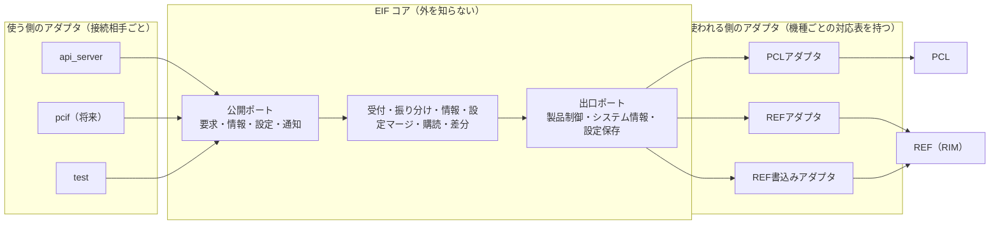
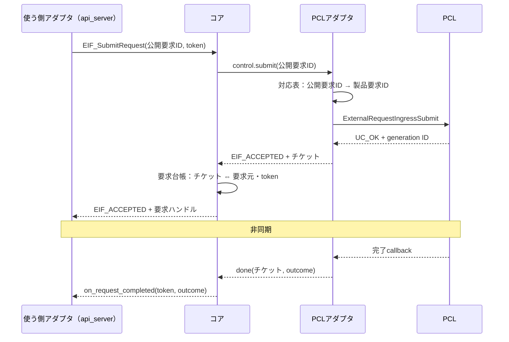
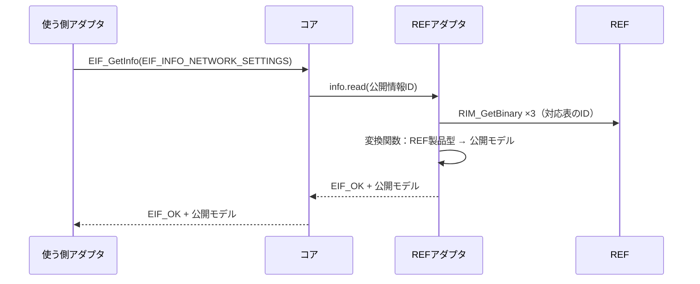
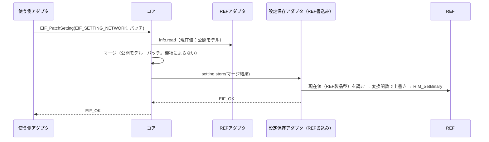
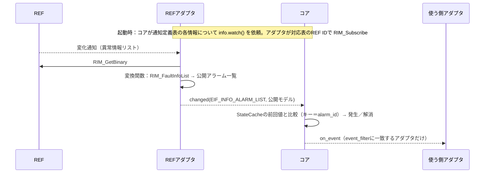

# CONFIDENTIAL

|  |  |
|------|------|
| ドキュメント名 | ExternalInterfaceLayer（EIF）設計書　ヘキサゴナル版 |
| バージョン | 0.01 |
| レイヤ | External Interface Layer |
| 対象機種 | 全機種共通（コア）／MiniPrinter（アダプタの対応表 初版） |

| 作成 |
|------|
| （検討ドラフト：現在の設計（詳細設計書）との比較検討用） |

---

## 更新履歴

| バージョン | 更新日 | 更新者 | 内容 |
|------------|--------|--------|------|
| 0.01 | 2026/10/21 | - | 初版作成 |

---

## 目次

1. 表紙
2. 更新履歴
3. 目次
4. 本書の位置づけ
5. 用語
6. 全体構成
7. コア
8. ポート
9. アダプタ
10. 組立て（Composition Root）
11. 呼び出しシーケンス
12. ファイル構成と依存規則
13. 排他・実行コンテキスト・性能
14. 現在の設計との比較
15. 実装と試験結果
16. 現行実装からの移行
17. 未検討事項

---

## 4. 本書の位置づけ

本書は、EIFの内部構造をヘキサゴナルアーキテクチャ（Ports & Adapters）に当てはめて設計した版である。ヘキサゴナルアーキテクチャそのものの説明は[ヘキサゴナルアーキテクチャ入門](ヘキサゴナルアーキテクチャ入門.md)を参照する。

| 文書 | 本書との関係 |
|---|---|
| [仕様設計書](../../01.通常版/設計/仕様設計書.md) | **公開API（`eif_api.h`）は変更しない。** 本書は公開APIの裏側の構造だけを組み替える。ただし13.5「機種の追加手順」は本書14.3の手順に置き換わる |
| [詳細設計書](../../01.通常版/設計/詳細設計書.md) | 現在の設計（Frame／Connector／製品CFG）。本書はその代替案。どちらを採用するかは14章の比較で判断する |

現在の設計との主な違いは次の2点である。

1. **コアは外の世界の型を一切知らない。** 出口ポートをEIF自身の言葉（公開ID・公開モデル）で定義し、PCL・REFの型（`product_request_id_t`、`RIStatus`、`RI_BINARY`等）は右側のアダプタだけが扱う。
2. **機種ごとの違いは右側のアダプタの対応表に置く。** 現在の設計の「製品CFGをFrameへ注入する」方式をやめ、「機種ごとの対応表を持つアダプタをコアにつなぐ」方式にする。

## 5. 用語

| 用語 | 本書での意味 | 現在の設計での名前 |
|---|---|---|
| コア | EIFの中心。要求の受付と応答先の振り分け、情報の取得、設定のマージ、購読と差分の導出 | Frame |
| 公開ポート | 使う側のアダプタがコアを呼ぶ差込口（`eif_api.h`） | 公開API |
| 出口ポート | コアがPCL・REFへお願いするときの差込口。EIFの言葉で定義する | Port（PCL・REFの型を含む） |
| 使う側のアダプタ（Driving Adapter） | 外部コンポーネントの要求をコアの言葉に変換する | Connector |
| 使われる側のアダプタ（Driven Adapter） | コアのお願いをPCL・REFのAPIと機種ごとのID・型に変換する | 既定Port＋製品CFG |
| 対応表（モデル表） | 使われる側のアダプタが持つ、機種ごとの対応表 | 製品CFGの表 |
| 組立て（Composition Root） | 起動時にコアへどのアダプタをつなぐかを決める場所 | 製品CFGの `EIF_Setup()` |
| チケット | 使われる側のアダプタが払い出す、PCL要求の識別子。コアは中身を知らない | PCLの受付ID（generation ID） |

## 6. 全体構成


正式な図は[構成図_ヘキサゴナル版.drawio](構成図_ヘキサゴナル版.drawio)を参照する。

| シート | 内容 |
|---|---|
| 2.EIFのヘキサゴナル構成 | 全体の形 |
| 4.詳細関係図（同期・非同期） | コア内部の部品・ポート・アダプタ間の呼出しを、同期／非同期／起動時の注入／対応表の参照で描き分けた図 |
| 5.要求と応答の流れ | 受付（同期）と完了（非同期）、チケットによる振り分け |
| 6.情報取得・設定変更・購読の流れ | 取得・設定（同期）と変化通知（非同期）、差分 |



| 区分 | 何で変わるか | 置き場所 |
|---|---|---|
| コア | 外部に公開する機能そのものが増えたとき（EIF本来の変更理由） | `core/` |
| 使う側のアダプタ | 接続相手が変わる・増える | `adapters/driving/<接続先>/` |
| 使われる側のアダプタ（共通処理） | PCL・REFのAPIが変わる | `adapters/driven/pcl/`、`adapters/driven/ref/` |
| 使われる側のアダプタ（対応表） | 機種が変わる | `adapters/driven/*/models/<MODEL>/` |
| 組立て | 機種・構成ごとのつなぎ方 | `composition/<MODEL>/` |

## 7. コア

### 7.1 責務

| 部品 | 責務 |
|---|---|
| RequestGateway | 公開要求の受付、公開範囲の確認（出口ポートの`is_supported`）、製品制御ポートへの転送 |
| RequestTracker | 要求台帳（要求ハンドル ⇔ チケット ⇔ 要求元・要求元トークン）、完了の要求元への振り分け、先着完了の処理 |
| InfoReader | システム情報ポートからの公開モデルの取得 |
| SettingMerger | 現在値（公開モデル）とパッチのマージ、設定保存ポートへの保存 |
| Watcher | 通知定義表に従ったシステム情報ポートへの監視登録、変化の受け口 |
| StateCache | 前回値（公開モデル）の保持。差分導出に使う |
| DiffEngine | 一覧型の公開モデルの差分（キーで比較）から、発生／解消イベントを作る |
| EventDispatcher | 公開イベントを、event_filterに一致する使う側のアダプタへ配信 |

### 7.2 コアが知っているもの・知らないもの

| 知っている | 知らない |
|---|---|
| 公開ID、公開モデル、EIF自身の結果コード | PCLの型（`product_request_id_t`、`external_request_result_t`、`uc_result_t`） |
| 出口ポートの型（コアが定義） | REFの型（`RIStatus`、`RI_BINARY`、`RI_DATA_*`、`RIM_network_info_t`） |
| 公開モデルごとのマージ方法・差分のキー（機種によらない） | 外部コンポーネントの型（`server_api.h`、`ws_event_t`） |
| | 機種（MODEL） |

コアのビルド設定には、PCL・REF・外部コンポーネントのinclude pathを1つも渡さない。

### 7.3 コアが持つ表（機種によらない）

コアにも表があるが、機種ではなく公開モデルに依存するもので、全機種共通である。

| 表 | 内容 | 例 |
|---|---|---|
| 設定定義表 | 公開設定ID → 現在値を取る公開情報ID、マージ関数 | `EIF_SETTING_NETWORK` → `EIF_INFO_NETWORK_SETTINGS`、`eif_merge_network_settings` |
| 通知定義表 | 公開情報ID → 生成する公開イベント、差分の種類（一覧の差分／値の変化） | `EIF_INFO_ALARM_LIST` → `EIF_EVT_ERROR_RAISED`／`RESOLVED`、キー＝`alarm_id` |

差分をコアで行うため、公開情報に`EIF_INFO_ALARM_LIST`（公開モデル`eif_alarm_list_t`）を末尾に追加する（既存の値は変えない）。

マージ関数と差分は公開モデルに対して行うため、機種が変わっても変わらない。公開モデルが増えたときだけ追加する。

## 8. ポート

### 8.1 公開ポート（入口）

[仕様設計書](../../01.通常版/設計/仕様設計書.md) 10章の`eif_api.h`をそのまま使う（変更なし）。

### 8.2 出口ポート

コアが定義し、`core/include/eif_driven_ports.h`に置く。型はすべてEIFの言葉（公開ID、公開モデル、`EIF_Result`）で書く。

#### 8.2.1 製品制御ポート

```c
typedef uint64_t EIF_Ticket;     /* アダプタが払い出す要求の識別子。0は無効。コアは中身を解釈しない */

typedef void (*EIF_ControlDoneFn)(EIF_Ticket ticket, EIF_RequestOutcome outcome);

typedef struct {
    bool       (*is_supported)(eif_request_id_t id);                       /* この機種で公開しているか */
    EIF_Result (*submit)(eif_request_id_t id, EIF_Ticket *out_ticket);     /* EIF_ACCEPTED / EIF_ERR_BUSY 等 */
    EIF_Result (*cancel)(EIF_Ticket ticket);
    EIF_Result (*query)(EIF_Ticket ticket, EIF_RequestOutcome *out);
    void       (*set_done_handler)(EIF_ControlDoneFn fn);                  /* 組立て時に1回。完了時に呼ぶ先 */
} EIF_ProductControlPort;
```

#### 8.2.2 システム情報ポート

```c
typedef void (*EIF_InfoChangedFn)(eif_info_id_t id, const void *public_model, size_t size, void *ctx);

typedef struct {
    bool       (*is_supported)(eif_info_id_t id);
    size_t     (*public_size)(eif_info_id_t id);                            /* 公開モデルのsizeof */
    EIF_Result (*read)(eif_info_id_t id, void *out_public, size_t size);    /* 公開モデルで返す */
    EIF_Result (*watch)(eif_info_id_t id, EIF_InfoChangedFn fn, void *ctx); /* 変化（または定期）の通知を依頼 */
} EIF_SystemInfoPort;
```

- 「変化時に通知するか、定期的に通知するか」はアダプタの対応表で決める。コアはタイマーを持たない。

#### 8.2.3 設定保存ポート

```c
typedef struct {
    bool       (*is_supported)(eif_setting_id_t id);
    /* マージ済みの公開モデルを保存する。
       EIF_OK：保存完了（REF直接）／EIF_ACCEPTED：受付（PCL経由。結果は製品制御ポートの完了で届く） */
    EIF_Result (*store)(eif_setting_id_t id, const void *merged_public, size_t size, EIF_Ticket *out_ticket);
} EIF_SettingStorePort;
```

#### 8.2.4 ポート一式

```c
typedef struct {
    const EIF_ProductControlPort *control;
    const EIF_SystemInfoPort     *info;
    const EIF_SettingStorePort   *setting;
} EIF_DrivenPorts;

EIF_Result EIF_Core_Initialize(const EIF_DrivenPorts *ports);   /* 組立てから呼ぶ */
```

## 9. アダプタ

### 9.1 使う側のアダプタ

現在の設計のConnectorと同じ（[詳細設計書](../../01.通常版/設計/詳細設計書.md) 6.6、7.10）。`adapters/driving/<接続先>/`に置き、`eif_api.h`だけを使う。

### 9.2 PCLアダプタ（使われる側）

| 部分 | 置き場所 | 内容 |
|---|---|---|
| 共通処理 | `adapters/driven/pcl/` | `ExternalRequestIngressSubmit()`等の呼出し、PCLの結果コード→`EIF_Result`の変換、PCLの完了callbackを受けてコアの`EIF_ControlDoneFn`へ渡す。チケット＝PCLの受付ID |
| 対応表 | `adapters/driven/pcl/models/<MODEL>/` | 公開要求ID → `product_request_id_t` |

```c
/* adapters/driven/pcl/models/MiniPrinter/pcl_request_map.c */
static const EIF_PclRequestMap k_map[] = {
    { EIF_REQ_PRINT,             PRODUCT_REQUEST_ID_PRINT },
    { EIF_REQ_HEAD_CLEANING,     PRODUCT_REQUEST_ID_NORMAL_PURGE_ALL },
    { EIF_REQ_WIPER_MAINTENANCE, PRODUCT_REQUEST_ID_WIPE_ALL },
};
```

`is_supported()`は対応表にあるかどうかを返す。**公開範囲は、この対応表に行があるかどうかで決まる。**

### 9.3 REFアダプタ（使われる側）

| 部分 | 置き場所 | 内容 |
|---|---|---|
| 共通処理 | `adapters/driven/ref/` | `RIM_GetBinary()`の呼出しとサイズ検証、`RIM_Subscribe()`の登録ループ、REF通知callbackを受けて変換し、コアの`EIF_InfoChangedFn`へ渡す。`RIStatus`→`EIF_Result`の変換 |
| 対応表 | `adapters/driven/ref/models/<MODEL>/` | 公開情報ID → REFのID群、通知契機（変化／定期）、REF製品型→公開モデルの変換関数 |

```c
/* adapters/driven/ref/models/MiniPrinter/ref_info_map.c */
static const EIF_RefInfoMap k_infos[] = {
    { EIF_INFO_NETWORK_SETTINGS,
      { RI_DATA_NETWORK_INFO, RI_DATA_HOSTNAME, RI_DATA_MACADDRESS },
      { sizeof(RIM_network_info_t), RIM_HOSTNAME_LEN, RIM_MACADDRESS_LEN }, 3,
      RI_TRIGGER_ON_CHANGE, 0, mp_to_network_settings },
    { EIF_INFO_ALARM_LIST,
      { RI_DATA_FAULT_INFO_LIST }, { sizeof(RIM_FaultInfoList) }, 1,
      RI_TRIGGER_ON_CHANGE, 0, mp_to_alarm_list },          /* Faultコード→公開アラームIDもここ */
};
```

### 9.4 REF書込みアダプタ（使われる側）

| 部分 | 置き場所 | 内容 |
|---|---|---|
| 共通処理 | `adapters/driven/ref/` | 書込み先の現在値（REF製品型）を読み、対応表の変換関数で公開モデルの値を上書きし、`RIM_SetBinary()`で書き込む。`EIF_OK`を返す |
| 対応表 | `adapters/driven/ref/models/<MODEL>/` | 公開設定ID → REF Data ID、公開モデル→REF製品型の変換関数 |

公開モデルに無いREFの項目（例：REFだけが持つ内部項目）は、REFの現在値を読んでから上書きするため失われない。

### 9.5 PCL経由の設定アダプタ（将来の差し替え先）

設定の書込み先をPCL経由にする場合（QA-01）は、設定保存ポートにこのアダプタをつなぐ。公開モデル→PCLの要求パラメータへ変換して製品制御ポートと同じ経路で送り、`EIF_ACCEPTED`を返す。PCLの要求パラメータ対応（QA-02）が前提である。**コアと使う側のアダプタは変更しない。**

### 9.6 テスト用の偽物アダプタ

`test/fakes/`に、3つの出口ポートの偽物を置く。決めた値を返す、呼ばれた引数を記録する、完了を任意のタイミングで起こす、ができる。コアはPCL・REFなしで試験できる。

## 10. 組立て（Composition Root）

起動時に「コアのどの出口ポートに、どのアダプタをつなぐか」を決める。機種ごとに`composition/<MODEL>/eif_compose.c`を置き、`EIF_Setup()`を実装する。

```c
/* composition/MiniPrinter/eif_compose.c */
EIF_Result EIF_Setup(void)
{
    static const EIF_DrivenPorts ports = {
        .control = &g_pcl_control_port,      /* PCLアダプタ（MiniPrinterの対応表） */
        .info    = &g_ref_info_port,         /* REFアダプタ（MiniPrinterの対応表） */
        .setting = &g_ref_setting_port,      /* REF書込みアダプタ。PCL経由にするならここを差し替える */
    };
    return EIF_Core_Initialize(&ports);
}
```

- `MODEL`で、`composition/<MODEL>/`と各アダプタの`models/<MODEL>/`を選ぶ。
- 設定の書込み先の切替（QA-01）は、ここで設定保存ポートにつなぐアダプタを替えるだけで済む。

## 11. 呼び出しシーケンス

### 11.1 製品要求と応答先の振り分け



### 11.2 情報取得



### 11.3 設定変更



PCL経由の設定アダプタにつなぎ替えた場合、`store()`は`EIF_ACCEPTED`とチケットを返し、結果は11.1と同じ経路で使う側のアダプタへ届く。

### 11.4 情報変化の通知と差分



差分の導出が公開モデル（公開アラーム一覧）に対して行われるため、**差分の処理は機種によらずコアで1回だけ書けばよい**（現在の設計では、差分を出すイベント生成関数が機種ごとに必要だった）。

## 12. ファイル構成と依存規則

### 12.1 ファイル構成

実装（`02.ヘキサゴナル版/実装/externalInterfaceLayer/`）の構成。

```text
externalInterfaceLayer/
├── CMakeLists.txt
├── build_and_test.sh                gccだけでビルド確認・試験を行うスクリプト
├── include/                         【公開ポート】eif_api.h、eif_public_id.h、eif_model.h
├── core/                            【コア】PCL・REF・外部コンポーネント・機種を知らない
│   ├── include/
│   │   ├── eif_driven_ports.h       【出口ポート】製品制御・システム情報・設定保存
│   │   └── eif_core_api.h           組立て用の入口（EIF_Core_Initialize）
│   ├── eif_core_internal.h          コア内部の部品間IF
│   ├── core/                        初期化・開始
│   ├── connector/                   使う側アダプタの登録
│   ├── request/                     RequestGateway、RequestTracker（キー＝チケット）
│   ├── info/                        InfoReader
│   ├── setting/                     SettingMerger、設定定義表、公開モデルのマージ関数
│   ├── notify/                      Watcher（通知定義表・差分）、EventDispatcher
│   └── cache/                       StateCache（前回値＝公開モデル）
├── adapters/
│   ├── driving/api_server/          【使う側のアダプタ】通常版のConnectorと同じコード
│   └── driven/
│       ├── pcl/                     PCLアダプタ（共通処理）
│       │   └── models/MiniPrinter/  公開要求ID→製品要求IDの対応表
│       └── ref/                     REFアダプタ・REF書込みアダプタ（共通処理）
│           └── models/MiniPrinter/  公開情報・公開設定→REF ID・型変換の表
├── composition/
│   ├── MiniPrinter/eif_compose.c    【組立て】EIF_Setup()
│   └── Skeleton/eif_compose.c       雛形（何も公開しないポート）
└── test/
    ├── fakes/                       偽物アダプタ（出口ポートの偽物）
    ├── core/                        コアの単体試験
    └── adapters/                    コア＋MiniPrinterの組立ての通し試験（PCL・RIMの関数は偽物）
```

### 12.2 依存規則（CMakeのinclude pathで強制）

| ターゲット | 参照してよい | 参照してはいけない |
|---|---|---|
| core | `include/`、`core/include/` | **PCL、REF、外部コンポーネントのヘッダーすべて** |
| adapters/driving/<接続先> | `include/`、外部コンポーネントのヘッダー | core内部、PCL、REF |
| adapters/driven/pcl | `include/`、`core/include/eif_driven_ports.h`、PCL公開ヘッダー | REF、外部コンポーネント |
| adapters/driven/ref | `include/`、`core/include/eif_driven_ports.h`、REFのヘッダー（models/は製品別ヘッダー） | PCL、外部コンポーネント |
| composition/<MODEL> | 上記すべての公開部分 | - |

依存の矢印はすべて「外 → コア」に向く。コアから外への矢印は無い。

## 13. 排他・実行コンテキスト・性能

- 排他と実行コンテキストは、現在の設計（[詳細設計書](../../01.通常版/設計/詳細設計書.md) 10.1、10.2）と同じ。PCLアダプタの完了callbackとREFアダプタの通知callbackは、それぞれPCLの要求処理contextとREFの通知ワーカーで呼ばれ、そのままコアへ渡す（タスクを挟まない）。
- 出口ポートは関数ポインタの呼出し1回であり、タスク切替やキューは発生しない。
- 変換は「REF製品型 → 公開モデル」の1回だけで、現在の設計（REFのポインタのまま製品CFGの変換関数で公開モデルへ）と回数は同じ。
- 差分（StateCache）が公開モデルで前回値を持つため、保持するデータ量はREF製品型を持つ場合と比べて、公開モデルのサイズになる（一覧型の公開モデルは件数の上限を決める必要がある）。

## 14. 現在の設計との比較

### 14.1 比較表

| 観点 | 現在の設計（Frame／Connector／製品CFG） | ヘキサゴナル版 |
|---|---|---|
| 中心が知っているもの | PCLの公開型、REFの製品非依存の型 | EIF自身の型だけ |
| 機種ごとの違いの置き場所 | 製品CFG（4つの表）をFrameへ注入 | 使われる側のアダプタの対応表（`models/<MODEL>/`） |
| 公開範囲の定義 | 製品CFGの表 | PCL・REFアダプタの対応表（`is_supported`） |
| 差分（発生／解消）の処理 | 機種ごとのイベント生成関数 | **コアで1回（公開モデルに対して）** |
| 設定のマージ | 機種ごとのマージ関数（REF製品型に対して） | **コアで1回（公開モデルに対して）** |
| 設定の書込み先の切替 | 設定の表の`sink`列 | 組立てでつなぐアダプタを替える |
| PCL・REFのAPIが変わったとき | FrameとPortを修正 | **アダプタだけ修正** |
| 中心の試験 | スタブPort（PCL・REFの型で作る） | 偽物アダプタ（EIFの型だけで作る） |
| 機種追加で作るもの | `product/<MODEL>/`（1フォルダ） | `pcl/models/<MODEL>/`、`ref/models/<MODEL>/`、`composition/<MODEL>/`（3か所） |
| 説明のしやすさ | 独自の用語（Frame、製品CFG） | 一般的な用語（コア、ポート、アダプタ）で説明できる |
| 部品の数 | 少ない | やや多い（ポート定義、アダプタ、組立て） |

### 14.2 ヘキサゴナル版の利点と注意点

| 利点 | 注意点 |
|---|---|
| コアがPCL・REF・外部コンポーネントから完全に切り離される | 公開モデルが、差分やマージに必要な情報（キー、指定有無のフラグ）を持つように設計する必要がある |
| 差分とマージが機種ごとに不要になる | 機種追加で触るフォルダが1か所から3か所になる（ただしどれも対応表だけ） |
| 一般的な考え方なので、新しく入った人にも説明しやすい | 一覧型の公開モデルは件数の上限を決める必要がある（StateCacheの容量） |
| 設定の書込み先の切替が「つなぎ替え」になり、自然に表現できる | 部品の数がやや増える |

### 14.3 機種の追加手順（ヘキサゴナル版）

1. `adapters/driven/pcl/models/<MODEL>/`に、公開要求ID→製品要求IDの対応表を書く。
2. `adapters/driven/ref/models/<MODEL>/`に、公開情報・公開設定→REF ID・型変換の表と変換関数を書く。
3. `composition/<MODEL>/eif_compose.c`で、コアにアダプタをつなぐ。
4. `MODEL=<MODEL>`でビルドする。
5. コアと使う側のアダプタは変更しない。

### 14.4 判断の目安

| 状況 | 向いている版 |
|---|---|
| PCL・REFのAPIがまだ変わりそう | ヘキサゴナル版（影響がアダプタに閉じる） |
| 差分・マージを機種ごとに書きたくない | ヘキサゴナル版 |
| 機種追加の手順を1フォルダに収めたい | 現在の設計 |
| 早く実装に入りたい（部品を少なくしたい） | 現在の設計 |

2つの版の外向きの契約（公開API）は同じである。そのため、現在の設計で実装を始め、後からヘキサゴナル版へ寄せることもできる（使う側のアダプタは影響を受けない）。

## 15. 実装と試験結果

コア・出口ポート・PCL／REFアダプタ（MiniPrinterの対応表）・組立て・APIサーバー用アダプタを実装した（`02.ヘキサゴナル版/実装/externalInterfaceLayer/`）。

| 確認 | 方法 | 結果 |
|---|---|---|
| コアが PCL・REF・APIサーバーのヘッダーを1つも使わずにビルドできる | `build_and_test.sh` 手順1 | 成功 |
| コアの単体試験（振り分け、先着完了、取消、情報取得、公開モデルでのマージ、PCL経由の設定の受け入れ、アラーム一覧の差分） | 手順2：偽物アダプタ | 10件すべて成功 |
| コア＋MiniPrinterの組立ての通し試験（対応表による要求の変換、REFからの取得、REFへの書込み、異常リスト→発生／解消） | 手順3：PCL・RIMの関数は偽物 | 4件すべて成功 |
| Skeletonの組立て、APIサーバー用アダプタのコンパイル | 手順4 | 成功 |

実装で確認できたこと：

- コアの試験に必要なのは偽物アダプタ（EIFの型だけ）であり、PCL・REFのヘッダーも偽物の関数も要らない。
- 差分（発生／解消）とマージはコアに1つずつで、MiniPrinterの対応表には変換関数だけが残る。
- 設定保存ポートが`EIF_ACCEPTED`を返す場合（PCL経由のアダプタ）の追跡はコアで実装・試験済み。PCL経由のアダプタそのものは未実装（QA-01、QA-02）。

## 16. 現行実装からの移行

| Step | 内容 | 現行の対象 |
|---|---|---|
| 1 | フォルダを`include/`・`core/`・`adapters/`・`composition/`へ再編 | 全体 |
| 2 | 出口ポートの定義と偽物アダプタを作り、コアの骨格を偽物で動かす | 新規 |
| 3 | REFアダプタ（MiniPrinterの対応表）を作り、WebSocket購読を移行。差分はコアのDiffEngineへ | `ws/api_server_ws_subscribe.c`、`ws/api_server_ws_callbacks.c` |
| 4 | REST GETを移行（REFアダプタの`read`） | `rest/settings.c` |
| 5 | REST PATCHを移行（コアのマージ＋REF書込みアダプタ） | `rest/settings.c` |
| 6 | PCLアダプタを作り、ジョブを接続 | `rest/jobs.c` |
| 7 | 起動処理を`composition/`へ（QA-04） | `productControlLayer/StartUp/frame/StartUpApiServer.c` |
| 8 | 印字データ（QA-06の決定後） | `external_request_printdata_ingress.c` |

## 17. 未検討事項

- 公開アラーム一覧など、一覧型の公開モデルのキーと件数の上限（差分に必要）
- 公開設定のパッチモデルの「指定有無」の表し方（マージに必要）
- 出口ポートを1機種で複数のアダプタに分ける場合の組立て方法（例：一部の情報だけREF以外から取る）
- QA表の未決事項（QA-01、QA-02、QA-04、QA-06、QA-07、QA-10、QA-11）は本版でも同様に残る
