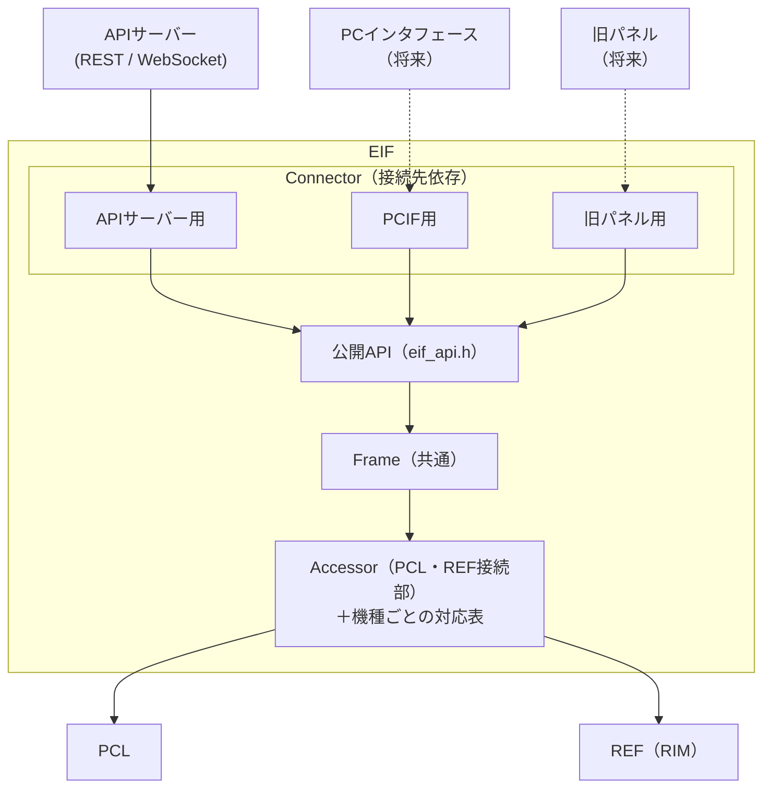
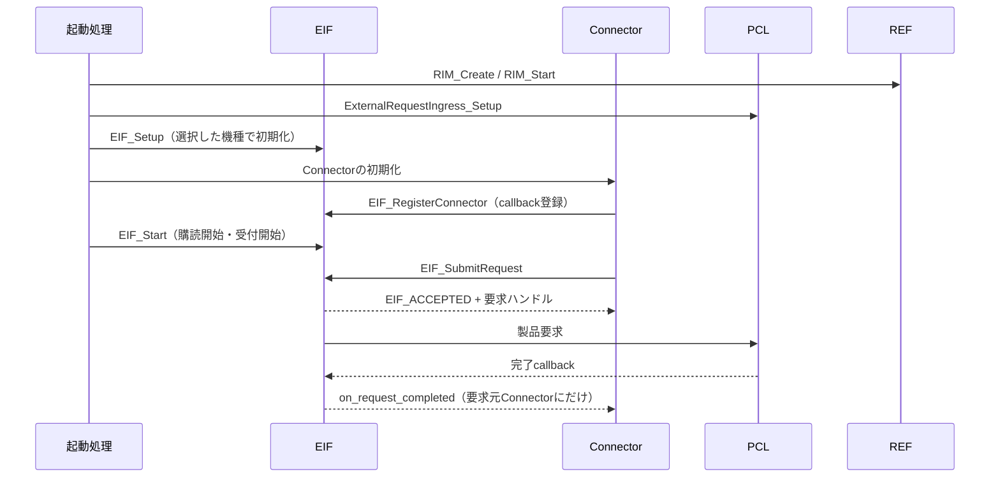
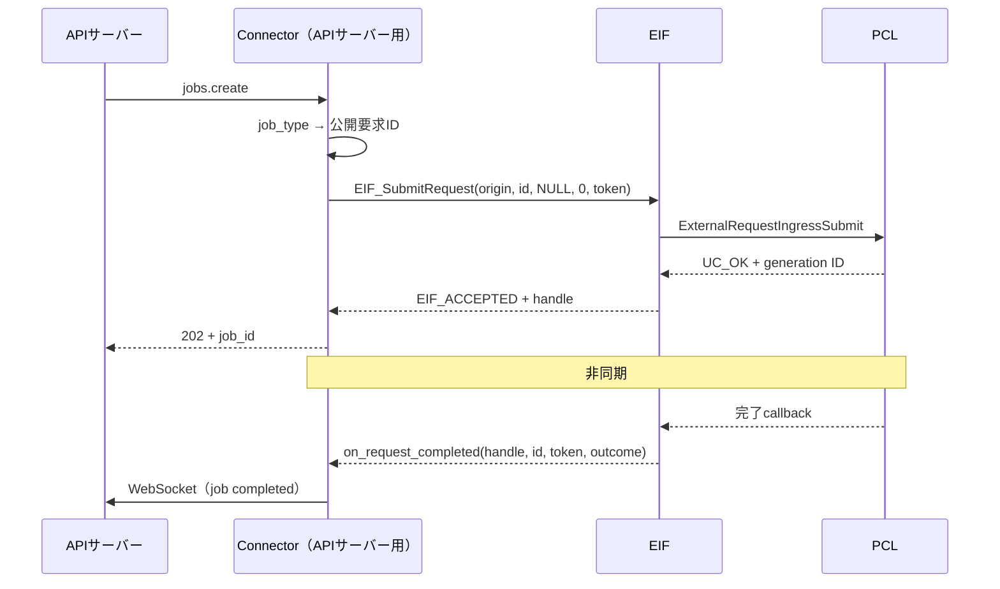
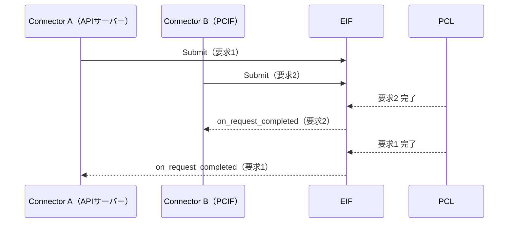
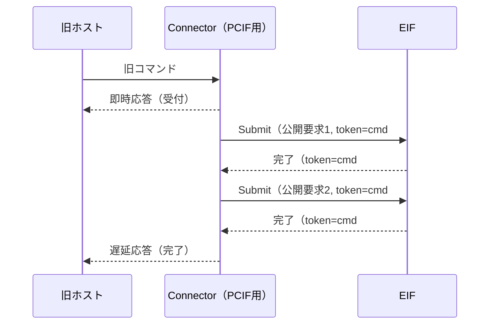
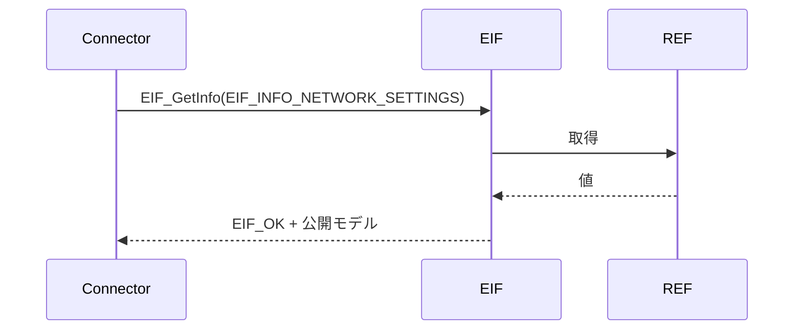
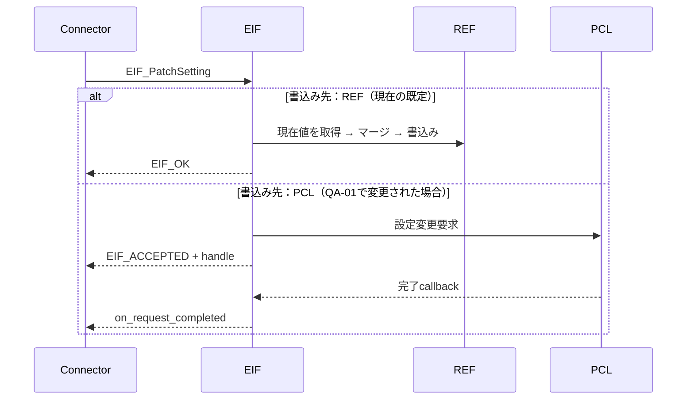
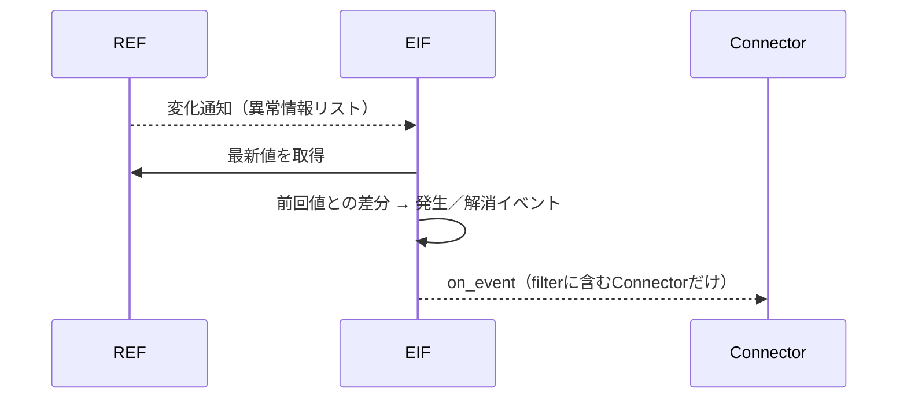

# CONFIDENTIAL

|  |  |
|------|------|
| ドキュメント名 | ExternalInterfaceLayer（EIF）仕様設計書 |
| バージョン | 0.02 |
| レイヤ | External Interface Layer |
| 対象機種 | 全機種共通（機種差は機種ごとの対応表で吸収） |

| 作成 |
|------|
| （検討ドラフト） |

---

## 更新履歴

| バージョン | 更新日 | 更新者 | 内容 |
|------------|--------|--------|------|
| 0.01 | 2026/10/22 | - | 初版作成（要件定義 合意版、2026/10/20 打合せ結果を反映） |
| 0.02 | 2026/10/26 | - | 10章：各IFの目的、引数・メンバの役割、公開モデル（10.2.5）を追加。戻り値を実装に合わせて修正。5章：用語を追加 |

---

## 目次

1. 表紙
2. 更新履歴
3. 目次
4. 概要
    - 4.1 本ドキュメントの目的
    - 4.2 本書が対象とする範囲
    - 4.3 本ドキュメントの読み手
5. 用語集
6. 関連ドキュメント
7. 制約事項
    - 7.1 機能制約（サポート範囲・禁止事項）
    - 7.2 前提条件
8. 他のモジュールとの接続
    - 8.1 想定される接続先
    - 8.2 接続方針
9. 機能概要
    - 9.1 システム構造における位置づけ
    - 9.2 外部から見た処理モデル
    - 9.3 ライフサイクル
    - 9.4 非責務
10. IF仕様
    - 10.1 初期化API
    - 10.2 公開型
    - 10.3 Connector登録
    - 10.4 Submitと完了通知
    - 10.5 結果照会
    - 10.6 取消API
    - 10.7 情報取得
    - 10.8 設定変更
    - 10.9 イベント通知
    - 10.10 容量とtimeout
    - 10.11 Thread safety
    - 10.12 ABI契約
11. コンフィグレーション仕様
12. 呼び出しシーケンス
13. 組み込み手順
    - 13.1 ファイル構造
    - 13.2 初期化手順
    - 13.3 通常利用手順
    - 13.4 接続先（Connector）の追加手順
    - 13.5 機種の追加手順
    - 13.6 テスト方針
14. 非保証事項

---

## 4. 概要

### 4.1 本ドキュメントの目的

本書は、外部インタフェース層（EIF）を利用して、外部コンポーネント（APIサーバー、将来のPCインタフェースや旧パネル等）を本ソフトウェアへ接続するための公開契約を定義する。

EIFは、本ソフトウェアと外部との唯一の境界である。接続相手が変わっても、その影響をPCL・REFへ波及させないことを最大の目的とする（要件 EIF-FR-02 外部接続差異吸収）。

### 4.2 本書が対象とする範囲

- EIFの公開ヘッダーと公開API
- 接続先依存部（Connector）の登録と、要求・応答・通知の契約
- 製品要求の受付、完了通知、結果照会、取消
- システム情報の取得、設定変更、変化通知
- API利用時の結果、所有権、寿命、再入およびthread safety
- 利用者がEIFを組み込む際の呼出順序と前提条件
- 接続先・機種を追加する際の手順

EIFの内部構造と各機能の仕組みは[EIF詳細設計書](詳細設計書.md)で定義する。

### 4.3 本ドキュメントの読み手

| 読み手 | 主に読む章 |
|---|---|
| Connector（接続先依存部）の実装者：APIサーバーとEIFをつなぐ人、将来の接続先を追加する人 | 8、9、10、12、13.4 |
| 機種対応の作成者：機種ごとに公開範囲や、PCL・REFとの対応表を作る人 | 9.2、11、13.5 |
| 起動処理の実装者：EIFを初期化して他レイヤと配線する人 | 7.2、9.3、10.1、13.2 |
| 外部コンポーネント（APIサーバー等）の担当者：EIFの振る舞い（同期・非同期、結果）を知りたい人 | 9、10.4〜10.9、10.11 |

| 用途 | includeするヘッダー |
|---|---|
| 初期化、Connector登録、要求・情報・設定・通知のAPI、公開型 | `eif_api.h` |
| 公開ID（公開要求・公開情報・公開設定・公開イベント） | `eif_public_id.h`（`eif_api.h`が再公開する） |
| 公開モデル（情報・パラメータ・イベントのデータ型） | `eif_model.h`（`eif_api.h`が再公開する） |

利用者は公開include path（`externalInterfaceLayer/include/`）から上記ヘッダーをincludeする。EIFの内部ディレクトリ（`frame/`、`accessors/`等）にある個別ヘッダーを直接includeしてはならない。機種ごとの対応表の書き方は[EIF詳細設計書](詳細設計書.md) 6.5を参照する。

## 5. 用語集

| 用語 | 意味 |
|---|---|
| 外部コンポーネント | 本ソフトウェアの外にあり、EIFを経由して本ソフトウェアを利用するもの。例：APIサーバー（REST／WebSocket）、PCインタフェース、旧パネル |
| Connector（接続先依存部） | 1つの外部コンポーネントとEIFをつなぐ部品。外部の通信方式・データ形式・要求粒度を、EIFの公開要求・公開モデルへ変換する。外部コンポーネントごとに1つ作る |
| Frame | EIFのうち、接続先にも機種にも依存しない共通部分。PCL・REFの型も知らない |
| Accessor（PCL・REF接続部） | FrameがPCL・REFを使うときの接続部。PCL・REFのAPIの呼出しと、機種ごとの対応表（公開範囲、PCL製品要求IDとの対応、REFのIDと型の変換）を持つ |
| 機種セットアップ | 機種ごとに、FrameへどのAccessorをつなぐかを決める部分。`EIF_Setup()`を実装する |
| 外部要求 | 外部コンポーネントが送ってくる要求そのもの（RESTのリクエスト、コマンドのバイト列、ボタン操作等）。全体構成設計 4.3 |
| 公開要求 | EIFが受け付ける要求の単位。公開要求IDで識別する。PCLの製品要求に対応する |
| 製品要求 | PCLが受け付ける要求の単位（`product_request_id_t`）。全体構成設計 4.4 |
| 公開情報／公開設定／公開イベント | EIFが外部へ公開する、システム情報／変更可能な設定／通知 |
| システム情報 | REFが保持し、システム全体で共有される情報（定義は全体構成設計で追記予定。QA-18） |
| 要求ハンドル | EIFが受付成功時に払い出す要求の識別子（`EIF_RequestHandle`）。PCLの受付ID（generation ID）は外へ出さない |
| 要求元トークン | Connectorが要求ごとに付ける任意の値。完了通知でそのまま返す。Connectorが自分の要求（RESTの要求等）と結果を対応付けるために使う |
| 受付完了 | 要求がEIFとPCLで追跡可能になった状態。実行完了ではない |
| 終端結果 | 受け付けた要求が最終的にどうなったか（型は `EIF_RequestOutcome`）。`EIF_OUTCOME_COMPLETED`、`INVALID`、`NOT_SUPPORTED`、`FAILED`、`CANCELED`（10.2.2） |
| 公開モデル | 公開情報・公開設定・イベントの中身のデータ型（`eif_model.h`）。APIサーバーのスキーマと同じ形で、機種によらない（10.2.5） |
| 対応表 | Accessorが機種ごとに持つ、公開ID ⇔ PCL製品要求ID・REFのID・型変換の表。表に行があるものだけが公開される（11章） |
| 下位IF | FrameがPCL・REFを使うときの呼出し口（製品制御・システム情報・設定保存の3つ）。Accessorが実装する。利用者は直接使わない |
| 要求元（origin） | 要求を出したConnector。完了callbackの届け先になる |
| 完了callback／イベントcallback | 要求の終端結果／公開イベントを受け取るために、Connectorが登録時にEIFへ渡す関数（10.3） |
| event_filter | Connectorが受け取りたい公開イベントIDの一覧。登録時に指定する（10.3.3） |
| 先着完了 | PCLの処理が速く、完了callbackが `EIF_SubmitRequest()` の戻りより先に呼ばれること（10.4.2） |

## 6. 関連ドキュメント

| # | 文書名 | 版 | 備考 |
|---|--------|----|------|
| 1 | 全体構成設計 | - | 上位文書。2.3、4章（要求の変換モデル）、7章（EIF） |
| 2 | [EIF要件定義](../../00.共通/要件定義.md) | 合意版（2026/10/20） | 本書の入力 |
| 3 | [EIF詳細設計書](詳細設計書.md) | 0.01 | EIFの内部構造と各機能の仕組み |
| 4 | [QA表](../../00.共通/QA表.md) | - | 確認事項・合意事項。本文中の「QA-xx」 |
| 5 | [EIF構成図](EIF構成図.drawio) | 0.01 | 1.全体構成、2.詳細ブロック図（部品・主要関数・対応表の中身、同期／非同期／注入の線）、3〜5.関係図（要求と完了／情報取得・設定変更／情報変化の通知：同期区間・非同期区間、呼出しと戻り、コールバックの登録と呼出しを関数単位で描く）、6.フォルダ構成 |
| 6 | ProductControlLayer 外部API仕様書 | 0.01 | EIFが利用するPCLの公開契約 |
| 7 | RIM外部仕様書 | - | EIFが利用するREFの公開契約 |

## 7. 制約事項

### 7.1 機能制約（サポート範囲・禁止事項）

- 公開する要求・情報・設定・イベントは、機種ごとの対応表に登録したものに限る。表にないIDは`EIF_ERR_NOT_EXPOSED`で拒否する。
- `EIF_SubmitRequest()`の`EIF_ACCEPTED`は受付完了を示し、実行完了を示さない。
- 完了通知は、要求を出したConnectorにだけ届く。ほかのConnectorには届かない。
- 完了通知は、受付成功した要求について最大1回呼ばれる。
- 完了通知・イベント通知の中から、EIFの要求系API（Submit、Cancel、GetResult、PatchSetting）を呼んではならない。
- EIFは受付可否を判定しない。可否はPCLの判定結果をそのまま返す。
- EIFは時間を契機とした処理（定期送信、生存応答等）を行わない。定期的な通知が必要な情報は、REF Accessorの対応表でREFの定期通知を指定して実現する。
- 設定変更の書込み先（REFへ直接／PCL経由）は、機種セットアップでつなぐAccessorで決まる。Connectorはどちらであっても同じ手順で扱う（10.8）。現時点の既定はREFへ直接（QA-01）。
- 印字データの受付（要件 EIF-FR-05、EIF-FR-06）は方式未確定のため本版の対象外とする（QA-06）。
- Connectorを登録・解除できるのは起動時（`EIF_Start()`前）だけとする。

### 7.2 前提条件

- REF（RIM）が生成・開始済みであること。
- PCLが`ExternalRequestIngress_Setup()`済みであること。
- 機種（`MODEL`）がビルド時に1つだけ選択されていること。
- Connectorは`EIF_Start()`の前に`EIF_RegisterConnector()`で登録すること。
- Connectorが登録する関数ポインタとユーザーcontextは、プログラム終了まで有効であること。

## 8. 他のモジュールとの接続

### 8.1 想定される接続先

| # | 分類 | 接続先 | 接続方式 | 接続要否 | 用途 |
|---|------|--------|----------|---------|------|
| 1 | 上位 | Connector（APIサーバー用） | 公開API、完了通知・イベント通知のcallback | 必須 | REST／WebSocketからの要求、取得、設定、通知 |
| 2 | 上位 | Connector（PCインタフェース用、旧パネル用 等） | 同上 | 任意（将来） | 旧コマンド・旧操作の受付 |
| 3 | 下位 | PCL | `ExternalRequestIngressSubmit()`、取消、GetResult、完了callback | 必須 | 製品要求の実行 |
| 4 | 横断 | REF（RIM） | 取得API、購読API、（設定値の）書込みAPI | 必須 | システム情報の取得・購読、設定値の反映 |
| 5 | 下位 | 印字データの格納先 | T.B.D（QA-06） | 任意 | 印字データ |

### 8.2 接続方針

- 外部コンポーネントは、自分専用のConnectorを通してEIFを利用する。外部コンポーネントがEIFの公開APIを直接呼ぶことは想定しない。
- Connectorは`eif_api.h`だけを使う。PCL・REFのヘッダーをincludeしてはならない。
- 外部コンポーネント固有の通信方式・データ形式・要求の粒度（例：1つの旧コマンドが複数の製品要求になる）は、Connectorの中で吸収する。FrameとAccessorには持ち込まない。
- 機種固有の内容（PCLの製品要求ID、REFのID・型）は、Accessorの機種ごとの対応表の中で吸収する。ConnectorとFrameには持ち込まない。
- EIFはPCL・REFの公開APIだけを使う。EXE・RSC・DEVを参照しない（要件 EIF-NFR-05）。



## 9. 機能概要

### 9.1 システム構造における位置づけ

EIFは外部コンポーネントとPCL・REFの間に位置する。接続相手ごとの違いをConnectorで、PCL・REFとの接続と機種ごとの違いをAccessorで吸収し、Frameはどちらにも依存しない共通処理を行う。

| 変わるもの | 吸収する場所 | 例 |
|---|---|---|
| 接続相手（通信方式、データ形式、要求の粒度、応答の返し方） | Connector | REST⇔公開API、旧コマンド→複数の公開要求、即時応答＋遅延応答 |
| 機種（公開範囲、PCLの製品要求ID、REFのIDと型） | Accessorの機種ごとの対応表 | 公開要求→`PRODUCT_REQUEST_ID_*`、`RIM_network_info_t`→公開モデル |
| PCL・REFのAPI（呼出し方、結果コード） | Accessorの共通処理 | `ExternalRequestIngressSubmit()`、`RIStatus`→`EIF_Result` |
| 内部の接続先（設定の書込み先） | 機種セットアップ（つなぐAccessorを選ぶ） | REFへ直接書込み ⇔ PCLへ設定変更要求 |

### 9.2 外部から見た処理モデル

| 機能 | 呼び方 | 同期性 | 結果の受け取り方 |
|---|---|---|---|
| 製品要求 | `EIF_SubmitRequest()` | 受付は同期、結果は非同期 | 受付結果は戻り値。終端結果は要求元Connectorの完了callback |
| 取消 | `EIF_CancelRequest()` | 受付は同期、結果は非同期 | 取消の受付は戻り値。最終結果は元の要求の完了callback |
| 結果照会 | `EIF_GetRequestResult()` | 同期 | 戻り値と出力引数 |
| 情報取得 | `EIF_GetInfo()` | 同期 | 出力引数に公開モデル |
| 設定変更 | `EIF_PatchSetting()` | 書込み先により同期または非同期 | `EIF_OK`なら完了。`EIF_ACCEPTED`なら完了callback |
| 情報変化の通知 | （登録のみ） | 非同期 | 登録時に指定したイベントのcallback |

- 受付成功時、EIFは0以外の要求ハンドルを返す。
- 完了callbackには、要求ハンドルと、Submit時にConnectorが渡した要求元トークンが渡る。

### 9.3 ライフサイクル



初期化の順序と呼出し元はQA-04で確定する。

### 9.4 非責務

- 製品挙動の決定、受付可否の判定、実行順序の決定、実行状態の保持、動作継続可否の判定
- システム情報の生成、意味の定義、異常状態の管理、機能制限の決定
- 資源管理、ユニット制御、実機制御、印字データの加工・保管
- 時間を契機とした処理（定期送信、生存応答、タイムアウト監視）。定期的な通知はREFの定期通知を使う
- 外部コンポーネントとの通信そのもの（ソケット、HTTP、シリアライズ）。これは外部コンポーネントまたはConnectorの責務

## 10. IF仕様

本章の各IFは、次の順で記載する。

1. **機能**：何をするIFか、誰がいつ使うか
2. **目的**：何のためのIFか
3. **定義**：関数・型の宣言
4. **引数／メンバ**：それぞれの役割と制約（入出力の区分：in＝EIFへ渡す、out＝EIFが書く）
5. **戻り値**と補足

### 10.1 初期化API

**機能**：EIFの初期化（`EIF_Setup`）と受付開始（`EIF_Start`）を行う。起動処理が、他レイヤ（REF・PCL）の起動後に、EIF_Setup → Connectorの登録（10.3）→ EIF_Start の順に1回ずつ呼ぶ。

**目的**：EIFを使える状態にする。

#### 10.1.1 EIF_Setup

**機能**：ビルド時に選択された機種（`MODEL`）の機種セットアップを呼び、FrameへAccessor（PCL・REFの接続部）をつないでEIFを初期化する。

**目的**：機種ごとの違い（公開範囲、PCL・REFとのつなぎ方）をこの中で決め、呼ぶ側が機種を意識しなくて済むようにする。

```c
EIF_Result EIF_Setup(void);
```

| 引数 | 役割 |
|---|---|
| なし | 機種はビルド時の `MODEL` で選ばれているため、引数で指定しない |

| 戻り値 | 意味 |
|---|---|
| `EIF_OK` | 初期化した（多重呼出しの場合は初期化済みの状態を維持して `EIF_OK`） |
| `EIF_ERR_INVALID_CONFIG` | 機種セットアップの構成が不正（Accessorの関数が欠けている等）。EIFは利用できない |

- 選択された機種の機種セットアップ（`setup/<MODEL>/`）が、FrameへAccessor（PCL・REFの接続部）をつなぐ。
- 起動処理のスレッドから1回だけ呼ぶ。

#### 10.1.2 EIF_Start

**機能**：その機種で公開している情報についてREFの購読を登録し、要求の受付を開始する。これ以降、Connectorの登録は締め切られる。

**目的**：Connectorの登録がそろった状態で、情報変化の監視と要求の受付を始める。

```c
EIF_Result EIF_Start(void);
```

| 引数 | 役割 |
|---|---|
| なし | 監視する情報は、その機種で公開している情報から決まる |

| 戻り値 | 意味 |
|---|---|
| `EIF_OK` | 受付を開始した（開始済みの場合も `EIF_OK`） |
| `EIF_ERR_UNAVAILABLE` | `EIF_Setup()` 未実行、またはREF未初期化 |
| `EIF_ERR_BUSY` | REFの購読の登録数の上限 |
| `EIF_ERR_INTERNAL` | 購読の登録失敗、前回値の領域不足 |

- 購読の登録に失敗した場合、REFに購読解除APIが無いため、それまでに登録した購読は残る（QA-07）。

### 10.2 公開型

**機能**：EIFと利用者（Connector・起動処理）の間でやりとりする値の型（結果コード、終端結果、識別子、イベント、公開モデル）を定める。すべて `eif_api.h` から参照できる。

**目的**：PCL・REFの型を外に出さず、利用者が公開型だけでEIFを使えるようにする。

#### 10.2.1 結果コード（EIF_Result）

**機能**：公開APIの戻り値の型。完了・受付完了と、失敗の種類を表す値を定める。

**目的**：公開APIの結果を、呼び出し側が判別できるようにする。**`EIF_OK`（完了）と `EIF_ACCEPTED`（受付完了。結果は後でcallback）を区別することが最も重要である。**

```c
typedef enum {
    EIF_OK = 0,
    EIF_ACCEPTED,
    EIF_ERR_INVALID_PARAM,
    EIF_ERR_NOT_EXPOSED,
    EIF_ERR_NOT_FOUND,
    EIF_ERR_BUSY,
    EIF_ERR_UNAVAILABLE,
    EIF_ERR_INVALID_CONFIG,
    EIF_ERR_INTERNAL
} EIF_Result;
```

| 値 | 意味 | 主な発生条件 |
|---|---|---|
| `EIF_OK` | 完了 | 処理がその場で終わった |
| `EIF_ACCEPTED` | 受付完了 | PCLが要求を受け付けた。終端結果は完了callbackで届く |
| `EIF_ERR_INVALID_PARAM` | 引数・パラメータ不正 | NULL、サイズ不一致、未登録のConnector、変更できない設定項目の変更 |
| `EIF_ERR_NOT_EXPOSED` | 公開対象外 | その機種の対応表に無い要求・情報・設定 |
| `EIF_ERR_NOT_FOUND` | 対象が無い | 要求ハンドルが台帳に無い（終端済み・未登録・要求元が異なる）、REFに値が無い |
| `EIF_ERR_BUSY` | 受け付けられない | PCLが受け付けない（容量・機能禁止・実行中等）、登録数・容量の上限 |
| `EIF_ERR_UNAVAILABLE` | 使えない状態 | 未初期化・未開始、PCL・REFが未初期化 |
| `EIF_ERR_INVALID_CONFIG` | 構成不正 | 機種セットアップの構成不正（初期化時のみ） |
| `EIF_ERR_INTERNAL` | 内部エラー | 変換失敗、REFの型の不一致、その他 |

#### 10.2.2 終端結果（EIF_RequestOutcome）

**機能**：受け付けた要求の終端結果（正常完了・失敗・取消など）を表す型。完了callback（10.3.1）と結果照会（10.5）で使う。

**目的**：受け付けた要求が**最終的にどうなったか**（終端結果）を、Connectorへ伝える。「終端」とは、要求の実行がこれ以上進まない状態（正常完了・失敗・取消など）になったことをいう。

`EIF_Result`（10.2.1）が「APIを呼んだその場の結果（受け付けたかどうか）」を表すのに対し、`EIF_RequestOutcome` は「受け付けた要求の、後でわかる実行の結果」を表す。受付は成功（`EIF_ACCEPTED`）でも、実行は失敗（`EIF_OUTCOME_FAILED`）ということがあるため、別の型にしている。

```c
typedef enum {
    EIF_OUTCOME_COMPLETED = 0,
    EIF_OUTCOME_INVALID = 1,
    EIF_OUTCOME_NOT_SUPPORTED = 2,
    EIF_OUTCOME_FAILED = 3,
    EIF_OUTCOME_CANCELED = 4,
    EIF_OUTCOME_PENDING = 5
} EIF_RequestOutcome;
```

| 使われる場所 | 渡る値 |
|---|---|
| 完了callback（10.3.1）の引数 `outcome` | 終端した結果（`EIF_OUTCOME_PENDING` 以外）。要求1件につき1回 |
| `EIF_GetRequestResult()`（10.5）の出力 `out_outcome` | 未完了なら `EIF_OUTCOME_PENDING`、終端していれば終端結果 |

値はPCLの終端状態をEIFが変換したものであり、PCLの型は外に出さない。

| 値 | 数値 | 意味 | PCLの終端状態との対応 |
|---|---:|---|---|
| `EIF_OUTCOME_COMPLETED` | 0 | 正常完了 | `ACCEPTED`（PCLではこの名前が正常完了を表す） |
| `EIF_OUTCOME_INVALID` | 1 | 要求が不正 | `INVALID` |
| `EIF_OUTCOME_NOT_SUPPORTED` | 2 | 下位機能が未対応 | `NOT_SUPPORTED` |
| `EIF_OUTCOME_FAILED` | 3 | 実行失敗 | `FAILED`（未知の値もこれに変換） |
| `EIF_OUTCOME_CANCELED` | 4 | 取消で終端 | `CANCELED` |
| `EIF_OUTCOME_PENDING` | 5 | 未確定（照会時のみ。完了callbackには渡さない） | `PENDING` |

#### 10.2.3 識別子

**機能**：Connector、受け付けた要求、公開する要求・情報・設定・イベントを指し示す番号の型を定める。

**目的**：利用者とEIFの間で、対象を番号で取り違えなく指し示せるようにする。

```c
typedef uint32_t EIF_ConnectorId;      /* Connectorの番号 */
typedef uint64_t EIF_RequestHandle;    /* 受け付けた要求の番号 */

/* 公開ID（eif_public_id.h）。値の一覧は eif_public_id.h を参照 */
typedef enum { EIF_REQ_INVALID = 0, EIF_REQ_PRINT, /* … */ EIF_REQ_COUNT } eif_request_id_t;
typedef enum { EIF_INFO_INVALID = 0, EIF_INFO_NETWORK_SETTINGS, /* … */ EIF_INFO_COUNT } eif_info_id_t;
typedef enum { EIF_SETTING_INVALID = 0, EIF_SETTING_NETWORK, /* … */ EIF_SETTING_COUNT } eif_setting_id_t;
typedef enum { EIF_EVT_INVALID = 0, EIF_EVT_ERROR_RAISED, /* … */ EIF_EVT_COUNT } eif_event_id_t;
```

| 型 | 役割 | 誰が決めるか | 値の約束 |
|---|---|---|---|
| `EIF_ConnectorId` | Connectorの番号。要求元・通知先を表す | EIF（登録時に払い出す） | 1〜`EIF_MAX_CONNECTORS`。0は無効 |
| `EIF_RequestHandle` | 受け付けた要求の番号（`uint64_t`）。取消・照会・完了通知で要求を指す | EIF（受付成功時に払い出す） | 0は無効。単調増加で、稼働中は再利用しない |
| `eif_request_id_t` | 公開要求ID（何をしてほしいか） | 公開ヘッダー（`eif_public_id.h`） | 全機種共通の値。機種ごとに違うのは有効かどうかだけ |
| `eif_info_id_t` | 公開情報ID（何を知りたいか） | 同上 | 同上 |
| `eif_setting_id_t` | 公開設定ID（何を変えたいか） | 同上 | 同上 |
| `eif_event_id_t` | 公開イベントID（何が起きたか） | 同上 | 同上。値は32未満 |

- 公開IDの値は追加のみ行い、既存の値は変更しない。候補はAPIサーバーのOpenAPI／AsyncAPIの資源に合わせて定義する（QA-08）。
- PCLの受付ID（generation ID）は外へ出さない。利用者が使うのは要求ハンドルだけである。

#### 10.2.4 イベント（EIF_Event）

**機能**：イベントcallbackでConnectorへ渡す、イベントの中身の型。イベントの種類（公開イベントID）と、種類ごとのペイロードを持つ。

**目的**：情報の変化（例：エラーの発生・解消）を、イベントcallback（10.3）でConnectorへ渡す。

```c
typedef struct {
    eif_event_id_t event_id;
    union {
        eif_alarm_t alarm;
    } payload;
} EIF_Event;
```

| メンバ | 役割 |
|---|---|
| `event_id` | 何が起きたか（公開イベントID）。`payload` のどのメンバが有効かもこれで決まる |
| `payload.alarm` | `EIF_EVT_ERROR_*`／`EIF_EVT_WARNING_*` のときに有効。発生・解消したアラーム（10.2.5） |

- イベントは通知callbackの呼出し中だけ有効である。復帰後も必要な場合は利用者の領域へコピーする。
- インク残量の変化（`EIF_EVT_INK_LEVEL_CHANGED`）・ジョブの進捗（`EIF_EVT_JOB_PROGRESS`）のペイロードは、公開モデルの確定（QA-08）とジョブ情報の情報源（QA-05）の決定後に `payload` へ追加する（末尾への追加。10.12）。

#### 10.2.5 公開モデル

**機能**：公開情報・公開設定・イベントの中身のデータ型を定める（`eif_model.h`）。文字列はすべて終端（`'\0'`）付きである。

**目的**：APIサーバーのOpenAPI／AsyncAPIのスキーマと同じ形にし、機種によらない形で情報を受け渡す。

**ネットワーク設定（`eif_network_settings_t`）**：`EIF_INFO_NETWORK_SETTINGS` の取得結果

| メンバ | 型 | 役割 |
|---|---|---|
| `dhcp` | `bool` | DHCPを使うか |
| `ip` | `char[16]` | IPv4アドレス（例 "192.168.0.10"） |
| `netmask` | `char[16]` | サブネットマスク |
| `gateway` | `char[16]` | デフォルトゲートウェイ |
| `filtering` | `bool` | フィルタリングの有効／無効 |
| `hostname` | `char[64]` | ホスト名 |
| `macaddress` | `char[18]` | MACアドレス（例 "AB:CD:EF:01:23:45"）。読取り専用 |

**ネットワーク設定のパッチ（`eif_network_settings_patch_t`）**：`EIF_SETTING_NETWORK` の部分更新（10.8）の入力

| メンバ | 役割 |
|---|---|
| `has_dhcp`／`dhcp` | `has_dhcp` が true のときだけ `dhcp` の値で更新する |
| `has_ip`／`ip` | 同上（IPv4アドレス） |
| `has_netmask`／`netmask` | 同上（サブネットマスク） |
| `has_gateway`／`gateway` | 同上（デフォルトゲートウェイ） |
| `has_filtering`／`filtering` | 同上（機種によっては変更できない） |
| `has_hostname`／`hostname` | 同上（機種によっては変更できない） |

- `has_xxx` が false の項目は、現在値のまま保持する。MACアドレスは変更できないため、パッチに含めない。

**アラーム（`eif_alarm_t`）**：エラー・警告の発生／解消イベントのペイロード

| メンバ | 型 | 役割 |
|---|---|---|
| `alarm_id` | `char[32]` | 公開アラームID。同じアラームかどうかを判断するキー |
| `alarm_code` | `char[32]` | 表示用のアラームコード |

**アラーム一覧（`eif_alarm_list_t`）**：`EIF_INFO_ALARM_LIST` の取得結果（発生中のアラームの一覧）

| メンバ | 型 | 役割 |
|---|---|---|
| `count` | `unsigned` | 有効な件数（最大 `EIF_ALARM_LIST_MAX`＝20） |
| `items` | `eif_alarm_t[20]` | 先頭から `count` 件が有効 |

### 10.3 Connector登録

**機能**：Connector（APIサーバー、旧コマンドの受付など、外部とEIFをつなぐ部品）が、自分の名前・完了callback・イベントcallback・受け取りたいイベントの一覧をEIFへ登録し、Connector IDを受け取る。起動処理の中で、`EIF_Setup()` の後・`EIF_Start()` の前に、Connectorごとに1回呼ぶ。

**目的**：EIFに**結果と通知の届け先（callback）を教える**。EIFは登録順にConnector IDを払い出し、以降、要求の結果は要求を出したConnectorへ、イベントは受け取りを希望したConnectorへ届ける。

#### 10.3.1 完了callback（EIF_RequestCompletedFn）

**機能**：Connectorが用意し、登録時に渡す関数の型。EIFは、受け付けた要求の終端結果が確定したときに、要求を出したConnectorのこの関数を1回呼ぶ。

**目的**：受け付けた要求の終端結果を、要求を出したConnectorへ知らせる。

```c
typedef void (*EIF_RequestCompletedFn)(EIF_RequestHandle  handle,
                                       eif_request_id_t   request_id,
                                       uint64_t           origin_token,
                                       EIF_RequestOutcome outcome,
                                       void              *user_context);
```

| 引数 | 入出力 | 役割 |
|---|---|---|
| `handle` | in | 終わった要求の要求ハンドル。`EIF_SubmitRequest()`（または `EIF_PatchSetting()`）が返した値と同じ |
| `request_id` | in | 終わった要求の公開要求ID。PCL経由の設定変更の場合は `EIF_REQ_INVALID` |
| `origin_token` | in | 要求時にConnectorが渡した要求元トークン。そのまま返るので、Connectorは自分の要求（RESTの要求、旧コマンドの手順等）と対応付けに使う |
| `outcome` | in | 終端結果（10.2.2）。`EIF_OUTCOME_PENDING` は渡さない |
| `user_context` | in | 登録時に渡した `EIF_ConnectorDesc::user_context` |

#### 10.3.2 イベントcallback（EIF_EventFn）

**機能**：Connectorが用意し、登録時に渡す関数の型。EIFは、受け取りを希望した公開イベントが起きたときに、この関数を呼ぶ。

**目的**：受け取りを希望した公開イベントを、Connectorへ知らせる。

```c
typedef void (*EIF_EventFn)(const EIF_Event *event, void *user_context);
```

| 引数 | 入出力 | 役割 |
|---|---|---|
| `event` | in | 起きたイベント（10.2.4）。呼出し中だけ有効 |
| `user_context` | in | 登録時に渡した `EIF_ConnectorDesc::user_context` |

#### 10.3.3 登録内容（EIF_ConnectorDesc）

**機能**：Connectorが登録時にEIFへ渡す内容（名前、完了callback、イベントcallback、受け取りたいイベントの一覧、callbackへ渡す任意のポインタ）をまとめた構造体。

**目的**：登録に必要な内容を1つにまとめて、`EIF_RegisterConnector()` へ渡せるようにする。

```c
typedef struct {
    const char            *name;
    EIF_RequestCompletedFn on_request_completed;
    EIF_EventFn            on_event;
    const eif_event_id_t  *event_filter;
    size_t                 event_filter_count;
    void                  *user_context;
} EIF_ConnectorDesc;
```

| メンバ | 必須 | 役割 |
|---|---|---|
| `name` | 任意 | ログ用の名前（例 "api_server"）。動作には使わない |
| `on_request_completed` | **必須** | 完了callback（10.3.1）。このConnectorが出した要求の結果だけが届く |
| `on_event` | 任意 | イベントcallback（10.3.2）。情報変化を受け取らないならNULL |
| `event_filter` | 任意 | 受け取りたい公開イベントIDの配列。ここに含めたイベントだけが届く。EIFはビット列に写して持ち、配列そのものは保持しない |
| `event_filter_count` | 任意 | `event_filter` の要素数。0なら何も受け取らない |
| `user_context` | 任意 | callbackへそのまま渡す任意のポインタ。Connectorが自分の状態を取り出すために使う |

#### 10.3.4 EIF_RegisterConnector

**機能**：登録内容（10.3.3）をEIFへ渡してコピーさせ、Connector IDを受け取る。`EIF_Start()` の前に呼ぶ。

**目的**：ConnectorをEIFに登録し、以降の要求・取消で要求元を表すConnector IDを得る。

```c
EIF_Result EIF_RegisterConnector(const EIF_ConnectorDesc *desc, EIF_ConnectorId *out_id);
```

| 引数 | 入出力 | 役割 | 制約 |
|---|---|---|---|
| `desc` | in | 登録内容（10.3.3）。EIFが内容をコピーする | NULL不可。関数ポインタと `user_context` の指す先はプログラム終了まで有効であること |
| `out_id` | out | 払い出したConnector ID。以降の要求で `origin` に渡す | NULL不可 |

| 戻り値 | 意味 |
|---|---|
| `EIF_OK` | 登録した。`out_id` にConnector IDを返す |
| `EIF_ERR_INVALID_PARAM` | `desc`・`out_id` がNULL、`on_request_completed` がNULL、`event_filter_count` が1以上なのに `event_filter` がNULL |
| `EIF_ERR_BUSY` | 登録数の上限（`EIF_MAX_CONNECTORS`＝初版4）、または `EIF_Start()` 後 |

- 公開イベントIDの範囲外の値が `event_filter` にあっても無視する（エラーにしない）。

### 10.4 Submitと完了通知

**機能**：Connectorが公開要求IDと要求元トークンを指定して要求を出し、EIFがPCLへ渡す。**受付は同期で即時に返り、実行の結果は後で完了callbackで届く**（要件 NFR-04）。受付に成功すると要求ハンドルを受け取る。

**目的**：外部からの要求を、公開要求としてPCLへ渡す（要件 IF-01 製品要求受付IF）。

```c
EIF_Result EIF_SubmitRequest(EIF_ConnectorId    origin,
                             eif_request_id_t   request_id,
                             const void        *param,
                             size_t             param_size,
                             uint64_t           origin_token,
                             EIF_RequestHandle *out_handle);
```

| 引数 | 入出力 | 役割 | 制約 |
|---|---|---|---|
| `origin` | in | 要求を出したConnectorのID。完了callbackの届け先になる | 登録済みのID |
| `request_id` | in | 何をしてほしいか（公開要求ID） | その機種で公開していること |
| `param` | in | 要求のパラメータ。呼出し中だけ参照する | 現時点ではNULLのみ（QA-02） |
| `param_size` | in | `param` のサイズ | 現時点では0のみ |
| `origin_token` | in | Connectorが要求ごとに付ける任意の値。完了callbackでそのまま返る | 値の意味はConnectorが決める |
| `out_handle` | out | 受付成功時に要求ハンドル（0以外）。失敗時は0 | NULL不可 |

#### 10.4.1 受付結果

| 結果 | 戻り値 | `out_handle` |
|---|---|---:|
| 受付成功 | `EIF_ACCEPTED` | 0以外 |
| 公開対象外のID | `EIF_ERR_NOT_EXPOSED` | 0 |
| 引数・パラメータ不正、未登録の `origin` | `EIF_ERR_INVALID_PARAM` | 0 |
| PCLが受け付けない（容量、機能禁止、実行中 等）、要求の追跡表が満杯 | `EIF_ERR_BUSY` | 0 |
| 未開始、PCLが使えない | `EIF_ERR_UNAVAILABLE` | 0 |
| 内部失敗 | `EIF_ERR_INTERNAL` 等（PCLの結果を変換した値） | 0 |

- 失敗時は要求を登録せず、後から完了callbackを呼ばない。
- 受付可否はPCLが判定し、EIFはその結果をそのまま返す。
- 現時点ではPCLが要求パラメータを受け付けないため、パラメータ付きの公開要求は定義しない（QA-02）。

#### 10.4.2 完了通知

- 受付成功した要求の終端結果が確定したとき、`origin` のConnectorの `on_request_completed`（10.3.1）を1回だけ呼ぶ。
- 引数の `origin_token` には、Submit時に渡した値をそのまま渡す。
- 完了callbackはPCLの要求処理contextから直列に呼ばれる。長時間ブロックしてはならない。callbackの中からEIFの要求系APIを呼んではならない。
- PCLの処理が速い場合、完了callbackが `EIF_SubmitRequest()` の戻りより先に呼ばれることがある。Connectorは要求ハンドルを完了callbackの引数から得ること。
- PCLが応答しない場合、完了callbackは呼ばれない（EIFはタイムアウトを持たない）。

### 10.5 結果照会

**機能**：要求ハンドルを指定して、受付中の要求の状況（未完了か、終端結果か）をPCLに問い合わせる。

**目的**：完了callbackを待たずに要求の状況を確かめる手段を用意する。結果の受け取りは完了callbackが基本であり、照会は補助である（EIFは結果を保持しない）。

```c
EIF_Result EIF_GetRequestResult(EIF_RequestHandle handle, EIF_RequestOutcome *out_outcome);
```

| 引数 | 入出力 | 役割 | 制約 |
|---|---|---|---|
| `handle` | in | 照会する要求の要求ハンドル | 0不可 |
| `out_outcome` | out | 照会結果（10.2.2）。未完了なら `EIF_OUTCOME_PENDING` | NULL不可。失敗時は変更しない |

| 条件 | 戻り値 | `out_outcome` |
|---|---|---|
| 未完了 | `EIF_OK` | `EIF_OUTCOME_PENDING` |
| 終端したが、完了callbackはまだ呼ばれていない | `EIF_OK` | 終端結果（PCLが保持している場合） |
| 完了callbackを呼び終えた、または未登録 | `EIF_ERR_NOT_FOUND` | 変更しない |
| `handle` が0、`out_outcome` がNULL | `EIF_ERR_INVALID_PARAM` | 変更しない |
| 未開始 | `EIF_ERR_UNAVAILABLE` | 変更しない |

- 照会はPCLのGetResultへ委譲する。EIFの要求の追跡表は完了callbackを呼んだ時点で解放するため、完了後の結果は完了callbackで受け取ること。

### 10.6 取消API

**機能**：Connectorが要求ハンドルを指定して、受付中の要求の取消をPCLへ依頼する。取消の可否と最終結果はPCLが決め、最終結果は元の要求の完了callbackで届く。

**目的**：外部からのキャンセル要求を、PCLへ伝える（要件 IF-02 キャンセル要求IF）。

```c
EIF_Result EIF_CancelRequest(EIF_ConnectorId origin, EIF_RequestHandle handle);
```

| 引数 | 入出力 | 役割 | 制約 |
|---|---|---|---|
| `origin` | in | 取消を依頼するConnectorのID | 要求を出したConnectorと一致すること |
| `handle` | in | 取り消す要求の要求ハンドル | 0不可 |

| 戻り値 | 意味 |
|---|---|
| `EIF_OK` | 取消を受け付けた（取消の完了ではない） |
| `EIF_ERR_NOT_FOUND` | 未登録、終端済み、または `origin` が要求元と異なる |
| `EIF_ERR_BUSY` | PCLが取消を受け付けない |
| `EIF_ERR_INVALID_PARAM` | `handle` が0 |
| `EIF_ERR_UNAVAILABLE` | 未開始 |

- 最終結果（`EIF_OUTCOME_CANCELED`、または取消が間に合わず `COMPLETED`）は、元の要求の完了callbackで通知する。
- 一時停止・再開は取消ではなく、それぞれ別の公開要求として扱う（全体構成設計 3.9）。

### 10.7 情報取得

**機能**：公開情報IDを指定して、システム情報の最新値をREFから取得し、公開モデル（10.2.5）に変換して返す。同期で完了する。

**目的**：外部へシステム情報を提供する（要件 IF-05 システム情報取得IF）。REFの型は外に出ない。

```c
EIF_Result EIF_GetInfo(eif_info_id_t info_id, void *out, size_t out_size);
```

| 引数 | 入出力 | 役割 | 制約 |
|---|---|---|---|
| `info_id` | in | 何を知りたいか（公開情報ID） | その機種で公開していること |
| `out` | out | 公開モデルの書込み先（例：`EIF_INFO_NETWORK_SETTINGS` なら `eif_network_settings_t`） | NULL不可。失敗時の内容は保証しない |
| `out_size` | in | `out` のサイズ。公開モデルの型の取り違えを検出するために使う | 公開モデルの `sizeof` と一致すること |

| 戻り値 | 意味 |
|---|---|
| `EIF_OK` | 取得した |
| `EIF_ERR_NOT_EXPOSED` | 公開対象外 |
| `EIF_ERR_INVALID_PARAM` | `out` がNULL、サイズ不一致 |
| `EIF_ERR_NOT_FOUND` | REFに値が無い |
| `EIF_ERR_UNAVAILABLE` | 未開始、REF未初期化 |
| `EIF_ERR_INTERNAL` | 変換失敗、REFの型の不一致、その他 |

- Accessorの対応表に従ってREFから最新値を取得し、公開モデルへ変換して `out` へ書く。
- 同期で完了する。EIFは値を保持しない（毎回REFから取得する）。

### 10.8 設定変更

**機能**：公開設定IDとパッチを指定して、設定の部分更新（PATCH）を反映する。**指定しなかった項目は現在値のまま保持する。** 書込み先により、その場で完了する（`EIF_OK`）か、要求として受け付けて結果を完了callbackで返す（`EIF_ACCEPTED`）。

**目的**：外部から受け取った設定変更を反映する（要件 FR-07）。書込み先（REFへ直接／PCL経由）が変わってもConnectorの作りが変わらないように、戻り値で同期・非同期を表す。

```c
EIF_Result EIF_PatchSetting(EIF_ConnectorId    origin,
                            eif_setting_id_t   setting_id,
                            const void        *patch,
                            size_t             patch_size,
                            uint64_t           origin_token,
                            EIF_RequestHandle *out_handle);
```

| 引数 | 入出力 | 役割 | 制約 |
|---|---|---|---|
| `origin` | in | 依頼したConnectorのID。PCL経由の場合の完了callbackの届け先 | 登録済みのID |
| `setting_id` | in | 何を変えたいか（公開設定ID） | その機種で公開していること |
| `patch` | in | パッチ（例：`EIF_SETTING_NETWORK` なら `eif_network_settings_patch_t`）。`has_xxx` が true の項目だけを更新する | NULL不可 |
| `patch_size` | in | `patch` のサイズ。パッチの型の取り違えを検出するために使う | パッチの `sizeof` と一致すること |
| `origin_token` | in | PCL経由（`EIF_ACCEPTED`）の場合に、完了callbackでそのまま返る値 | 値の意味はConnectorが決める |
| `out_handle` | out | `EIF_ACCEPTED` の場合に要求ハンドル。それ以外は0 | NULL不可 |

| 戻り値 | 意味 | Connectorの扱い |
|---|---|---|
| `EIF_OK` | 反映を完了した（REFへ直接書き込む設定） | その場で成功を返す。`out_handle` は0 |
| `EIF_ACCEPTED` | 設定変更要求として受け付けた（PCL経由の設定） | 完了callbackを待つ。`out_handle` は0以外 |
| `EIF_ERR_NOT_EXPOSED` | 公開対象外 | - |
| `EIF_ERR_INVALID_PARAM` | 引数不正、サイズ不一致、未登録の `origin`、値が不正、変更できない項目の変更 | - |
| `EIF_ERR_BUSY` | PCLが受け付けない（PCL経由の設定） | - |
| `EIF_ERR_UNAVAILABLE`、`EIF_ERR_INTERNAL` 等 | 上記以外の失敗 | - |

- 書込み先は機種セットアップでつなぐAccessorで決まる。
- 複数のConnectorから同時に呼ばれても、現在値の読込みから書込みまでをEIFが排他するため、更新は失われない。

> 書込み先をREFからPCLへ変更する可能性がある（QA-01）。Connectorを上の表どおりに実装しておけば、書込み先が変わってもConnectorの修正は不要である。

### 10.9 イベント通知

**機能**：システム情報の変化を、受け取りを希望したConnectorへ通知する。受け取りの希望は、登録時の `event_filter`（10.3.3）で指定し、通知は `on_event`（10.3.2）で届く。専用の関数は無い。

**目的**：外部へシステム情報の変化を知らせる（要件 FR-09、IF-06 システム情報購読IF）。

- `EIF_RegisterConnector()` の `event_filter` に含めた公開イベントについて、発生時に `on_event` を呼ぶ。
- 同じイベントを複数のConnectorが登録している場合は、登録順に各Connectorへ通知する。
- 通知はREFの通知ワーカーのcontextで呼ばれる。長時間ブロックしてはならない。
- 一覧情報（例：異常情報リスト）の変化は、前回からの差分として個別のイベント（発生／解消）に分けて通知する（QA-03）。差分は公開情報 `EIF_INFO_ALARM_LIST`（公開モデル `eif_alarm_list_t`）に対して、`alarm_id` をキーに求める。起動直後（前回値なし）は、その時点で発生中のものをすべて発生として通知する。
- 定期的な通知が必要な情報は、REF Accessorの対応表でREFの定期通知を指定しておく。値が変わらなくても通知される。

### 10.10 容量とtimeout

**機能**：EIFが扱える量（Connector登録数、未完了要求数など）と、時間に関する約束（timeout）を定める。

**目的**：利用者が上限を前提に設計でき、上限に達したときの振る舞いを想定できるようにする。

| 項目 | 契約 |
|---|---|
| Connector登録数 | 最大4（初版。`EIF_MAX_CONNECTORS`） |
| 未完了要求 | PCLの未完了要求上限（32件）に従う。EIF側の追跡表は32件＋先着完了用の余裕8件（計40件） |
| 結果照会 | PCLの保持件数（最新32件）に従う |
| 実行完了timeout | EIFでは設定しない |
| 1つの公開イベントあたりの通知先 | 登録済みConnector数まで |
| アラーム一覧の件数 | 最大20件（`EIF_ALARM_LIST_MAX`） |

### 10.11 Thread safety

**機能**：各APIとcallbackを、どのスレッドから呼んでよいか・どのスレッドから呼ばれるかを定める。

**目的**：Connectorが排他とブロックを正しく設計し、デッドロックや処理の滞りを起こさないようにする。

| API・callback | 呼べるcontext | 備考 |
|---|---|---|
| `EIF_Setup`、`EIF_RegisterConnector`、`EIF_Start` | 起動処理のスレッド | 1回ずつ、この順に呼ぶ |
| `EIF_SubmitRequest`、`EIF_CancelRequest`、`EIF_GetRequestResult`、`EIF_GetInfo`、`EIF_PatchSetting` | 任意（複数スレッドから同時に呼んでよい） | 完了callback・イベントcallbackの中からは呼ばない |
| `on_request_completed` | PCLの要求処理context（直列） | 長時間ブロック禁止 |
| `on_event` | REFの通知ワーカー | 長時間ブロック禁止 |

- EIFは自身の処理スレッドを持たない（印字データの受付を除く）。要求はConnectorのスレッドで、そのままPCL・REFへ渡る。
- callback呼出し中は、EIFは内部のロックを保持しない。

### 10.12 ABI契約

**機能**：公開ヘッダーを変更するときの約束（変えてよいこと・変えてはならないこと）を定める。

**目的**：公開ヘッダーの変更で、利用者のプログラムが壊れないようにする。

- 公開enumの数値と、公開IDの既存値はABIの一部であり変更しない。
- 公開構造体のfield順を変えない。拡張は末尾への追加で行う。
- Connectorは同じ版の公開ヘッダーとライブラリを組み合わせる。

## 11. コンフィグレーション仕様

EIFの機種差は、Accessorの機種ごとの対応表（`accessors/pcl/models/<MODEL>/`、`accessors/ref/models/<MODEL>/`）と、機種セットアップ（`setup/<MODEL>/`）で定義する。詳細な型と書き方は[EIF詳細設計書](詳細設計書.md) 6.5を参照する。

| 定義 | 1行の内容 | 対応する要件 |
|---|---|---|
| PCLの要求の対応表 | 公開要求ID → PCL製品要求ID | EIF-FR-01、EIF-FR-02（製品要求の受付） |
| REFの情報の対応表 | 公開情報ID → REFのID群、通知契機（変化／定期）、変換関数 | EIF-FR-01、EIF-FR-07、EIF-FR-08、EIF-FR-09 |
| REFの設定の対応表 | 公開設定ID → REFのID、変換関数 | EIF-FR-07 |
| 機種セットアップ | Frameの各下位IFにつなぐAccessor（設定の書込み先を含む） | EIF-FR-07（QA-01） |

- 表にないIDは公開されない（公開範囲の定義を兼ねる）。
- 差分（発生／解消）と設定のマージは公開モデルに対してFrameで行うため、機種ごとに作る必要はない。
- 表は起動後に変更しない。
- 製品はビルド時に`MODEL`で選択する。未指定時は`Skeleton`（何も公開しない）を使う。

Connector側の設定（どの外部コマンドをどの公開要求にするか等）は、各Connectorの中で定義する。

## 12. 呼び出しシーケンス

### 12.1 製品要求（REST POST /jobs の例）



### 12.2 複数の外部コンポーネントからの要求（応答先の振り分け）



完了の順番が要求の順番と異なっても、結果は要求を出したConnectorへ返る。

### 12.3 旧コマンドの吸収（将来のConnectorの例）

1つの旧コマンドが複数の製品要求に分かれ、即時応答と遅延応答を返す必要がある場合も、Connectorの中で吸収する。



### 12.4 情報取得（REST GET）



### 12.5 設定変更（REST PATCH）



### 12.6 情報変化の通知（WebSocket）



## 13. 組み込み手順

### 13.1 ファイル構造

```text
externalInterfaceLayer/
├─ include/            公開ヘッダー（利用者がincludeする）
├─ frame/              共通部（利用者は参照しない）
├─ connectors/         外部コンポーネント接続部（外部コンポーネントごとに1フォルダ）
│   └─ api_server/
├─ accessors/          PCL・REF接続部（利用者は参照しない）
│   ├─ pcl/models/<MODEL>/   機種ごとの対応表
│   └─ ref/models/<MODEL>/   機種ごとの対応表
├─ setup/              機種セットアップ（機種ごとに1フォルダ。MODELで1つ選択）
│   ├─ Skeleton/
│   └─ MiniPrinter/
└─ test/
```

詳細は[EIF詳細設計書](詳細設計書.md) 6.4を参照する。

### 13.2 初期化手順

1. REF（RIM）を生成・開始する。
2. PCLを`ExternalRequestIngress_Setup()`で初期化する。
3. `EIF_Setup()`を呼ぶ。
4. 各Connectorを初期化し、`EIF_RegisterConnector()`で登録する。
5. 外部コンポーネント（APIサーバー等）を開始する。
6. `EIF_Start()`を呼ぶ。

順序はQA-04で確定する。

### 13.3 通常利用手順

- 製品要求は`EIF_SubmitRequest()`で出し、`EIF_ACCEPTED`だけを受付成功と判定する。結果は完了callbackで受け取る。
- 設定変更は`EIF_PatchSetting()`を呼び、`EIF_OK`と`EIF_ACCEPTED`の両方を扱う。
- 情報は`EIF_GetInfo()`で取得する。変化を受け取りたい情報は、登録時の`event_filter`に含める。

### 13.4 接続先（Connector）の追加手順

1. `connectors/<接続先名>/`を作る。
2. 外部コンポーネントの要求（コマンド、REST等）を公開要求・公開情報・公開設定へ変換する処理を書く。複数の公開要求に分かれる場合や、即時応答＋遅延応答が必要な場合も、このフォルダの中で扱う。
3. 公開イベントを外部コンポーネントの通知形式へ変換する処理を書く。
4. 起動処理で`EIF_RegisterConnector()`を呼ぶ。
5. Frame・Accessor・PCL・REFは変更しない。

公開要求・公開情報が足りない場合（外部IF仕様として新しい機能が必要な場合）は、公開IDと公開モデルを追加する。これはEIFの公開範囲の変更であり、Accessorの対応表にも行を追加する。

### 13.5 機種の追加手順

1. `accessors/pcl/models/<機種名>/`に、公開要求ID→PCL製品要求IDの対応表を書く。
2. `accessors/ref/models/<機種名>/`に、公開情報・公開設定→REFのID・型の対応表と変換関数を書く。
3. `setup/Skeleton/`を`setup/<機種名>/`へコピーし、つなぐAccessorを指定する。
4. `MODEL=<機種名>`でビルドする。
5. Frame・Connectorは変更しない。

### 13.6 テスト方針

- Connector：外部形式⇔公開要求・公開モデルの変換、完了callbackでの要求元トークンの対応付け、`EIF_OK`と`EIF_ACCEPTED`の両方の扱い。
- Frame：スタブAccessor（EIFの型だけで作れる）による単体試験。
- Accessor：対応表の整合（ID重複なし、変換関数の有無）、変換関数の入出力。
- 結合：要求→完了通知、情報取得、設定変更、情報変化の通知、複数Connectorの振り分け。

## 14. 非保証事項

- 再起動をまたぐ要求ハンドルと結果の保持
- PCLが応答しない要求の完了通知（EIFはタイムアウトを持たない）
- 購読の解除と、EIFの停止・再初期化（REFに購読解除APIが無いため。QA-07）
- 印字データの受付（方式未確定。QA-06）
- 通知先callbackが長時間ブロックした場合の、PCL・REFの処理遅延
