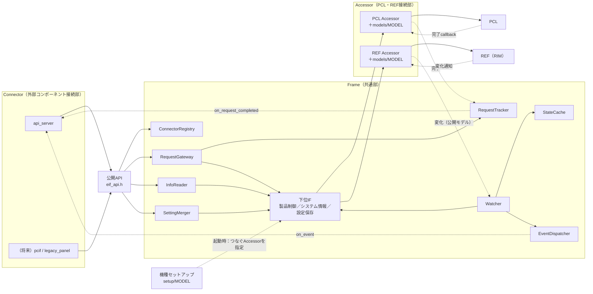
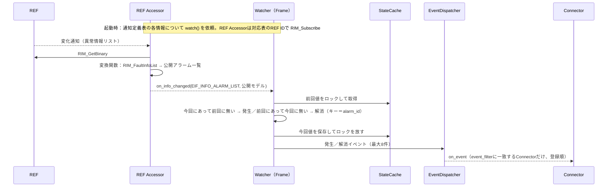

# CONFIDENTIAL

|  |  |
|------|------|
| ドキュメント名 | ExternalInterfaceLayer（EIF）詳細設計書 |
| バージョン | 0.01 |
| レイヤ | External Interface Layer |
| 対象機種 | 全機種共通（Frame・Connector）／MiniPrinter（Accessorの対応表 初版） |

| 作成 |
|------|
| （検討ドラフト） |

---

## 更新履歴

| バージョン | 更新日 | 更新者 | 内容 |
|------------|--------|--------|------|
| 0.01 | 2026/10/22 | - | 初版作成（要件定義 合意版、2026/10/20 打合せ結果を反映） |

---

## 目次

1. 表紙
2. 更新履歴
3. 目次
4. 本書の位置づけ
5. 内部用語
6. 内部処理モデル
  - 6.1 コンポーネント境界と責務
  - 6.2 公開IFと内部IF
  - 6.3 内部データ構造
  - 6.4 ファイル構成と依存規則
  - 6.5 機種ごとの差し替え（Accessorの対応表と機種セットアップ）
  - 6.6 接続先ごとの差し替え（Connector）
  - 6.7 設定の書込み先の差し替え
7. 各機能の詳細ロジック
  - 7.1 初期化と開始
  - 7.2 Connector登録
  - 7.3 要求受付
  - 7.4 完了通知と応答先の振り分け
  - 7.5 取消と結果照会
  - 7.6 情報取得
  - 7.7 設定変更
  - 7.8 情報変化の通知と差分
  - 7.9 APIサーバー用Connector
  - 7.10 印字データ（T.B.D）
8. 保護動作
9. 結果コードの変換
10. 内部状態・データ定義
  - 10.1 排他と所有権
  - 10.2 実行コンテキスト
  - 10.3 性能方針（早く軽く）
  - 10.4 依存関係
11. 実装と試験結果
12. 現行実装からの移行
13. 未検討事項・既知の制約
  - 13.1 テスト観点

---

## 4. 本書の位置づけ

本書は、EIFを実装・保守する人向けに、EIFの内部構造と各機能の仕組みを定義する。

EIFの公開契約（利用者から見た振る舞い）は[EIF仕様設計書](仕様設計書.md)を正とする。本書はその実現方法を定める。構成図は[EIF構成図](EIF構成図.drawio)を参照する。

EIFは次の変化から内部（PCL・REF）と共通処理を守るため、処理を4つに分ける。

| 守る対象の変化 | 吸収する部分 | 根拠 |
|---|---|---|
| 接続相手が変わる（APIサーバー、PCインタフェース、旧パネル等） | Connector（外部コンポーネント接続部） | 要件 EIF-FR-02 外部接続差異吸収、2026/10/20 打合せ |
| 機種が変わる（公開範囲、PCL製品要求ID、REFのIDと型） | Accessorの機種ごとの対応表 | 要件 EIF-FR-01（製品ごとに設定可能）、全体構成設計 3.6 |
| PCL・REFのAPIが変わる | Accessorの共通処理 | 要件 EIF-NFR-05 |
| 機種ごとのつなぎ方（設定の書込み先を含む） | 機種セットアップ | QA-01 |
| どれにも依存しない処理 | Frame（共通部） | - |

設計の基本方針は次の2点である。

1. **FrameはEIF自身の型だけで書く。** FrameがPCL・REFを使うときの呼出し口（下位IF）を、EIFの型（公開ID・公開モデル・`EIF_Result`）でFrame側に定義する。PCL・REFの型（`product_request_id_t`、`RIStatus`、`RI_BINARY`等）はAccessorだけが扱う。
2. **機種ごとの違いはAccessorの対応表に置く。** 機種が変わったときに書くのは、Accessorの`models/<MODEL>/`（対応表と変換関数）と、機種セットアップ（`setup/<MODEL>/`）だけである。

## 5. 内部用語

本書で用いるEIF内部の用語を定義する。公開用語は[EIF仕様設計書](仕様設計書.md) 5章を参照する。

| 用語 | 定義 |
|---|---|
| Frame | 接続先にも機種にも依存しない共通部。PCL・REF・外部コンポーネントの型を知らない。`frame/`に置く |
| Connector | 1つの外部コンポーネントとEIF公開APIをつなぐ部品。`connectors/<名前>/`に置く |
| 下位IF | FrameがPCL・REFを使うときの呼出し口。製品制御IF・システム情報IF・設定保存IFの3つ。Frameが`frame/include/eif_accessor_if.h`で定義する |
| Accessor | 下位IFを実装し、PCL・REFのAPIを呼ぶ部品。共通処理と機種ごとの対応表（`models/<MODEL>/`）からなる。`accessors/pcl/`、`accessors/ref/`に置く |
| 対応表 | Accessorが持つ、機種ごとの表。公開ID → PCL製品要求ID、REFのID・型、変換関数 |
| 機種セットアップ | 起動時に、Frameの各下位IFへどのAccessorをつなぐかを決める部分。`setup/<MODEL>/`に置き、`EIF_Setup()`を実装する |
| チケット | Accessorが払い出す、PCL要求の識別子（`EIF_Ticket`）。PCL AccessorではPCLの受付ID（generation ID）。Frameは中身を解釈しない |
| トランポリン | Accessorへ渡すFrameの共通callback。製品制御の完了（`eif_tracker_on_done`）と情報の変化（`on_info_changed`）の2つ |
| 要求台帳 | 受付中の要求の、要求ハンドル・チケット・要求元を記録する表（RequestTrackerが所有） |
| 先着完了 | 製品要求の完了が、要求台帳への登録より先に届いた状態 |
| 設定定義表／通知定義表 | Frameが持つ、公開モデルに対する表（機種によらない）。6.3.3、6.3.4 |
| StateCache | 差分導出のための前回値（公開モデル）を持つ部品。EIFでデータを保持するのはここだけ |

## 6. 内部処理モデル

### 6.1 コンポーネント境界と責務



#### 6.1.1 責務

| コンポーネント | 置き場所 | 責務 |
|---|---|---|
| Core | `frame/core/` | 初期化状態の管理、下位IFの検証と保持、完了トランポリンの登録、開始処理 |
| ConnectorRegistry | `frame/connector/` | Connectorの登録と、Connector IDからcallbackへの解決 |
| RequestGateway | `frame/request/` | 公開範囲の確認（製品制御IFの`is_supported`）、製品制御IFへの転送、要求台帳への登録、取消・照会 |
| RequestTracker | `frame/request/` | 要求台帳（要求ハンドル ⇔ チケット ⇔ 要求元・要求元トークン）、完了トランポリン、要求元への完了通知、先着完了の処理 |
| InfoReader | `frame/info/` | システム情報IFからの公開モデルの取得 |
| SettingMerger | `frame/setting/` | 設定定義表に従った現在値（公開モデル）とパッチのマージ、設定保存IFへの保存 |
| Watcher | `frame/notify/` | 通知定義表に従ったシステム情報IFへの監視依頼、変化の受け口、一覧の差分から発生／解消イベントを作る |
| StateCache | `frame/cache/` | 前回値（公開モデル）の保持と排他 |
| EventDispatcher | `frame/notify/` | 公開イベントを、event_filterに一致するConnectorへ配信 |
| PCL Accessor | `accessors/pcl/` | 製品制御IFの実装。対応表で公開要求ID→PCL製品要求ID、PCLのAPI呼出し、PCLの結果→`EIF_Result`、PCLの完了callbackをFrameへ渡す |
| REF Accessor | `accessors/ref/` | システム情報IFと設定保存IFの実装。対応表に従ったREFからの取得・購読・書込み、REFの型⇔公開モデルの変換 |
| 機種セットアップ | `setup/<MODEL>/` | `EIF_Setup()`。Frameの各下位IFへAccessorをつなぐ |

#### 6.1.2 非責務

- 外部形式（REST、コマンド、ボタン操作）の解釈と、外部への送信（Connectorの責務）
- 機種固有のID・型の知識（Accessorの対応表の責務。FrameとConnectorは持たない）
- 受付可否、実行状態、タイムアウト、時間を契機とした処理

### 6.2 公開IFと内部IF

#### 6.2.1 公開IF

公開IFは`include/eif_api.h`に限定する（[EIF仕様設計書](仕様設計書.md) 10章）。

| IF | 実装するコンポーネント |
|---|---|
| `EIF_Setup()` | 機種セットアップ（`setup/<MODEL>/eif_setup.c`）。`EIF_Frame_Initialize()`を呼ぶ |
| `EIF_Start()` | Core → Watcher |
| `EIF_RegisterConnector()` | ConnectorRegistry |
| `EIF_SubmitRequest()`、`EIF_CancelRequest()`、`EIF_GetRequestResult()` | RequestGateway → RequestTracker |
| `EIF_GetInfo()` | InfoReader |
| `EIF_PatchSetting()` | SettingMerger |

#### 6.2.2 下位IF（Frame → Accessor）

Frameが定義し、`frame/include/eif_accessor_if.h`に置く。型はすべてEIFの型（公開ID、公開モデル、`EIF_Result`）で書き、PCL・REFの型は出てこない。

```c
typedef uint64_t EIF_Ticket;     /* Accessorが払い出す要求の識別子。0は無効。Frameは中身を解釈しない */

/* ---- 製品制御IF ---- */
typedef void (*EIF_ControlDoneFn)(EIF_Ticket ticket, EIF_RequestOutcome outcome);

typedef struct {
    bool       (*is_supported)(eif_request_id_t id);                    /* この機種で公開しているか */
    EIF_Result (*submit)(eif_request_id_t id, EIF_Ticket *out);         /* EIF_ACCEPTED／EIF_ERR_BUSY 等 */
    EIF_Result (*cancel)(EIF_Ticket ticket);                            /* EIF_OK＝取消を受付 */
    EIF_Result (*query)(EIF_Ticket ticket, EIF_RequestOutcome *out);
    void       (*set_done_handler)(EIF_ControlDoneFn fn);               /* 初期化時に1回 */
} EIF_ProductControlIf;

/* ---- システム情報IF ---- */
typedef void (*EIF_InfoChangedFn)(eif_info_id_t id, const void *public_model, size_t size, void *ctx);

typedef struct {
    bool       (*is_supported)(eif_info_id_t id);
    size_t     (*public_size)(eif_info_id_t id);                         /* 公開モデルのsizeof */
    EIF_Result (*read)(eif_info_id_t id, void *out_public, size_t size); /* 公開モデルで返す */
    EIF_Result (*watch)(eif_info_id_t id, EIF_InfoChangedFn fn, void *ctx); /* 変化（または定期）の通知を依頼 */
} EIF_SystemInfoIf;

/* ---- 設定保存IF ---- */
typedef struct {
    bool       (*is_supported)(eif_setting_id_t id);
    /* EIF_OK：保存完了（REF直接）／EIF_ACCEPTED：受付（PCL経由。結果は製品制御IFの完了と同じ経路で届く） */
    EIF_Result (*store)(eif_setting_id_t id, const void *merged_public, size_t size, EIF_Ticket *out_ticket);
} EIF_SettingStoreIf;

typedef struct {
    const EIF_ProductControlIf *control;
    const EIF_SystemInfoIf     *info;
    const EIF_SettingStoreIf   *setting;
} EIF_AccessorSet;
```

- 「変化時に通知するか、定期的に通知するか」はREF Accessorの対応表で決める。Frameはタイマーを持たない。
- 公開範囲は各IFの`is_supported()`（＝Accessorの対応表に行があるか）で決まる。

#### 6.2.3 機種セットアップ向けIF

| IF | 契約 |
|---|---|
| `EIF_Frame_Initialize(const EIF_AccessorSet*)` | `frame/include/eif_frame_api.h`で宣言。下位IFの関数がそろっているかを検証して保持する。機種セットアップの`EIF_Setup()`からだけ呼ぶ |

#### 6.2.4 公開しない内部IF

`frame/eif_frame_internal.h`に、Frame内部の部品間IF（Registry、Tracker、Gateway、Watcher、StateCache、Dispatcher）を置く。CMakeでPRIVATE includeとし、Connector・Accessor・機種セットアップは使用しない。

### 6.3 内部データ構造

#### 6.3.1 要求台帳（RequestTracker）

| field | 型 | 内容 |
|---|---|---|
| `state` | enum | `FREE`、`ACTIVE`、`EARLY_COMPLETED`（先着完了） |
| `handle` | `EIF_RequestHandle` | EIFが払い出した要求ハンドル |
| `ticket` | `EIF_Ticket` | Accessorが払い出したチケット（PCLの受付ID） |
| `origin` | `EIF_ConnectorId` | 要求元Connector |
| `origin_token` | `uint64_t` | Connectorが渡した要求元トークン |
| `request_id` | `eif_request_id_t` | 公開要求ID（PCL経由の設定変更では`EIF_REQ_INVALID`） |
| `early_outcome` | `EIF_RequestOutcome` | 先着完了時の終端結果 |

- 件数は`EIF_TRACKER_CAPACITY`＝PCLの未完了要求上限（32）＋先着完了用の余裕（8）＝40とする。
- 実行状態（進捗、WAIT等）は持たない。持つのは「どの要求の結果を、誰へ返すか」だけである（2026/10/20 打合せ：応答先を覚える必要がある）。

#### 6.3.2 Connector登録表（ConnectorRegistry）

| field | 内容 |
|---|---|
| `id` | Connector ID（1〜`EIF_MAX_CONNECTORS`＝4） |
| `desc` | 登録時の`EIF_ConnectorDesc`のコピー（name、callback、event_filter、user_context） |
| `event_mask` | event_filterをビット列にしたもの（配信時の判定を速くするため） |

#### 6.3.3 設定定義表（SettingMerger、機種によらない）

| field | 内容 | 例 |
|---|---|---|
| `setting_id` | 公開設定ID | `EIF_SETTING_NETWORK` |
| `current_info` | 現在値を取る公開情報ID | `EIF_INFO_NETWORK_SETTINGS` |
| `public_size`／`patch_size` | 公開モデル・パッチモデルのsizeof | `eif_network_settings_t`／`eif_network_settings_patch_t` |
| `merge` | マージ関数（現在値＋パッチ → 合成結果。公開モデルに対して行う） | `merge_network`：`has_xxx`が真の項目だけ上書き |

マージは公開モデルに対して行うため、機種が変わっても変わらない。公開設定が増えたときだけ行を追加する。

#### 6.3.4 通知定義表（Watcher、機種によらない）

| field | 内容 | 例 |
|---|---|---|
| `info_id` | 監視する公開情報ID | `EIF_INFO_ALARM_LIST` |
| `kind` | 差分の種類 | 一覧の差分（キー＝`alarm_id`） |
| `raised`／`resolved` | 生成する公開イベント | `EIF_EVT_ERROR_RAISED`／`EIF_EVT_ERROR_RESOLVED` |

- 差分をFrameで求めるため、公開情報に`EIF_INFO_ALARM_LIST`（公開モデル`eif_alarm_list_t`、最大20件）を置く。
- 機種がその情報を公開していない場合（`is_supported()`が偽）は監視しない。

#### 6.3.5 StateCache

| 項目 | 値 |
|---|---|
| 容量 | `EIF_STATE_CACHE_BYTES`＝4KB、8スロット |
| スロットの中身 | 前回値（公開モデル。例：`eif_alarm_list_t`） |
| 割当て | `EIF_Start()`時に、監視する公開情報ごとに1スロット |
| 排他 | スロットごとのmutex |

### 6.4 ファイル構成と依存規則

実装（`03.EIF設計/実装/externalInterfaceLayer/`）の構成。

```text
externalInterfaceLayer/
├── CMakeLists.txt                       MODEL選択と、ターゲットごとのinclude path制限
├── build_and_test.sh                    gccだけでビルド確認・試験を行うスクリプト
├── README.md                            区分と依存規則、初版の範囲
├── include/                             【公開】利用者がincludeする唯一のヘッダー群
│   ├── eif_api.h                        公開関数、結果コード、Connector登録の型、EIF_Event
│   ├── eif_public_id.h                  公開要求／情報／設定／イベントID
│   └── eif_model.h                      公開モデル（OpenAPIスキーマと同形）
├── frame/                               【Frame】PCL・REF・外部コンポーネント・機種を知らない
│   ├── include/
│   │   ├── eif_accessor_if.h            下位IF（製品制御・システム情報・設定保存）
│   │   └── eif_frame_api.h              機種セットアップ向け（EIF_Frame_Initialize）
│   ├── eif_frame_internal.h             Frame内部の部品間IF
│   ├── eif_lock.h、eif_log.h            排他（POSIXスレッド）、ログ
│   ├── core/eif_frame.c                 初期化・開始
│   ├── connector/eif_connector_registry.c
│   ├── request/eif_request_gateway.c
│   ├── request/eif_request_tracker.c    要求台帳（キー＝チケット）
│   ├── info/eif_info_reader.c
│   ├── setting/eif_setting_merger.c     設定定義表・公開モデルのマージ関数
│   ├── notify/eif_watcher.c             通知定義表・一覧の差分
│   ├── notify/eif_event_dispatcher.c
│   └── cache/eif_state_cache.c          前回値＝公開モデル
├── connectors/                          【Connector】外部コンポーネントごと
│   └── api_server/
│       ├── include/eif_connector_api_server.h   起動処理向けの入口
│       └── api_server_connector.c       EIFとAPIサーバーへの登録、REST、WebSocket送信
├── accessors/                           【Accessor】PCL・REFとの接続
│   ├── pcl/
│   │   ├── pcl_accessor.h／.c           製品制御IFの実装（共通処理）
│   │   └── models/MiniPrinter/pcl_request_map.c   公開要求ID→製品要求IDの対応表
│   └── ref/
│       ├── ref_accessor.h／.c           システム情報IF・設定保存IFの実装（共通処理）
│       └── models/MiniPrinter/ref_maps.c          公開情報・公開設定→REF ID・型変換の表と変換関数
├── setup/                               【機種セットアップ】MODELで1つ選択
│   ├── MiniPrinter/eif_setup.c          EIF_Setup()
│   └── Skeleton/eif_setup.c             雛形（何も公開しないAccessor）
└── test/
    ├── eif_test.h                       依存の無い最小の試験マクロ
    ├── stubs/                           スタブAccessor（下位IFのスタブ。EIFの型だけで作れる）
    ├── frame/                           Frameの単体試験
    └── integration/                     Frame＋MiniPrinterのセットアップの結合試験（PCL・RIMの関数はスタブ）
```

印字データ（`frame/printdata/`）は、方式が決まるまで置かない（QA-06）。

依存規則はCMakeのinclude pathで強制する。

| ターゲット | 参照してよい | 参照してはいけない |
|---|---|---|
| `eif_frame`（`frame/`） | `include/`、`frame/include/` | **PCL、REF、外部コンポーネントのヘッダーすべて** |
| `connectors/<接続先>` | `include/`、外部コンポーネントのヘッダー | Frame内部、PCL、REF |
| `accessors/pcl` | `include/`、`frame/include/eif_accessor_if.h`、PCL公開ヘッダー | REF、外部コンポーネント |
| `accessors/ref` | `include/`、`frame/include/eif_accessor_if.h`、REF製品非依存ヘッダー（`models/`だけREF製品別ヘッダー） | PCL、外部コンポーネント |
| `setup/<MODEL>` | 上記の公開部分 | - |

依存の向きは、すべて「Connector／Accessor／機種セットアップ → Frame」になる。FrameからPCL・REF・外部コンポーネントへの依存は無い。

### 6.5 機種ごとの差し替え（Accessorの対応表と機種セットアップ）

#### 6.5.1 PCL Accessor

| 部分 | 置き場所 | 内容 |
|---|---|---|
| 共通処理 | `accessors/pcl/pcl_accessor.c` | `ExternalRequestIngressSubmit()`等の呼出し、PCLの結果コード→`EIF_Result`の変換、PCLの完了callbackを受けてFrameの`EIF_ControlDoneFn`へ渡す。チケット＝PCLの受付ID |
| 対応表 | `accessors/pcl/models/<MODEL>/` | 公開要求ID → `product_request_id_t` |

```c
/* accessors/pcl/models/MiniPrinter/pcl_request_map.c */
const EIF_PclRequestMap g_pcl_request_map[] = {
    { EIF_REQ_PRINT,             PRODUCT_REQUEST_ID_PRINT },
    { EIF_REQ_HEAD_CLEANING,     PRODUCT_REQUEST_ID_NORMAL_PURGE_ALL },
    { EIF_REQ_WIPER_MAINTENANCE, PRODUCT_REQUEST_ID_WIPE_ALL },
};
```

`is_supported()`は対応表に行があるかを返す。**公開範囲は、この対応表に行があるかどうかで決まる。** 要求パラメータの変換欄は、PCLがパラメータを受け付けるようになった時点で追加する（QA-02）。

#### 6.5.2 REF Accessor（情報の取得・監視）

| 部分 | 置き場所 | 内容 |
|---|---|---|
| 共通処理 | `accessors/ref/ref_accessor.c` | `RIM_GetBinary()`の呼出しとサイズ検証、`RIM_Subscribe()`の登録（最大8）、REFの通知callbackを受けて取得・変換し、Frameの`EIF_InfoChangedFn`へ渡す。`RIStatus`→`EIF_Result`の変換 |
| 対応表 | `accessors/ref/models/<MODEL>/` | 公開情報ID → REFのID群（最大4）、通知契機（変化／定期）、REFの型→公開モデルの変換関数 |

```c
/* accessors/ref/models/MiniPrinter/ref_maps.c */
const EIF_RefInfoMap g_ref_info_map[] = {
    { EIF_INFO_NETWORK_SETTINGS,
      { RI_DATA_NETWORK_INFO, RI_DATA_HOSTNAME, RI_DATA_MACADDRESS },
      { sizeof(RIM_network_info_t), RIM_HOSTNAME_LEN, RIM_MACADDRESS_LEN }, 3U,
      sizeof(eif_network_settings_t), RI_TRIGGER_ON_CHANGE, 0U, mp_network_to_public },
    { EIF_INFO_ALARM_LIST,
      { RI_DATA_FAULT_INFO_LIST }, { sizeof(RIM_FaultInfoList) }, 1U,
      sizeof(eif_alarm_list_t), RI_TRIGGER_ON_CHANGE, 0U, mp_alarm_list_to_public },  /* Faultコード→公開アラームIDもここ */
};
```

定期的に外部へ送る必要がある情報は`trigger`を`RI_TRIGGER_PERIODIC`にする。EIFはタイマーを持たない（2026/10/20 打合せ）。

#### 6.5.3 REF Accessor（設定の書込み）

| 部分 | 置き場所 | 内容 |
|---|---|---|
| 共通処理 | `accessors/ref/ref_accessor.c` | 書込み先の現在値（REFの型）を読み、対応表の変換関数で公開モデルの値を上書きし、`RIM_SetBinary()`で書き込む。`EIF_OK`を返す |
| 対応表 | `accessors/ref/models/<MODEL>/` | 公開設定ID → 現在値の公開情報ID、REF Data ID、公開モデル→REFの型の変換関数 |

```c
const EIF_RefSettingMap g_ref_setting_map[] = {
    { EIF_SETTING_NETWORK, EIF_INFO_NETWORK_SETTINGS, RI_DATA_NETWORK_INFO, sizeof(RIM_network_info_t),
      mp_network_from_public },   /* hostname・filteringなど変更できない項目の確認もここ */
};
```

公開モデルに無いREFの項目は、REFの現在値を読んでから上書きするため失われない。

#### 6.5.4 機種セットアップ

起動時に「Frameのどの下位IFに、どのAccessorをつなぐか」を決める。機種ごとに`setup/<MODEL>/eif_setup.c`を置き、`EIF_Setup()`を実装する。

```c
/* setup/MiniPrinter/eif_setup.c */
EIF_Result EIF_Setup(void)
{
    static const EIF_AccessorSet acc = {
        .control = &g_pcl_control_if,   /* PCL Accessor（MiniPrinterの対応表） */
        .info    = &g_ref_info_if,      /* REF Accessor（MiniPrinterの対応表） */
        .setting = &g_ref_setting_if,   /* REF書込み。PCL経由にするならここを差し替える（6.7） */
    };
    return EIF_Frame_Initialize(&acc);
}
```

`MODEL`で、`setup/<MODEL>/`と各Accessorの`models/<MODEL>/`を選ぶ。未指定時は`Skeleton`（何も公開しないAccessor）を使う。

#### 6.5.5 機種の追加手順

1. `accessors/pcl/models/<MODEL>/`に、公開要求ID→製品要求IDの対応表を書く。
2. `accessors/ref/models/<MODEL>/`に、公開情報・公開設定→REF ID・型の対応表と変換関数を書く。
3. `setup/<MODEL>/eif_setup.c`で、FrameにAccessorをつなぐ。
4. `MODEL=<MODEL>`でビルドする。
5. Frame・Connectorは変更しない。差分（発生／解消）とマージはFrameが公開モデルに対して行うため、機種ごとに書く必要はない。

### 6.6 接続先ごとの差し替え（Connector）

- Connectorは`connectors/<名前>/`に置き、`include/eif_api.h`だけを使う。
- 外部コンポーネントのヘッダー（APIサーバーの`server_api.h`等）を参照してよいのはConnectorだけである。
- Connectorが持ってよいもの：外部形式⇔公開要求・公開モデルの変換表、1つの外部要求を複数の公開要求に分けるシーケンス、即時応答＋遅延応答の制御、要求元トークンと外部の要求（REST要求等）との対応。
- Connectorが持ってはいけないもの：PCLの製品要求ID、REFのID・型（機種依存はAccessorの対応表へ）。
- Connectorを追加しても、Frame・Accessor・機種セットアップは変更しない。

### 6.7 設定の書込み先の差し替え

設定の書込み先（REFへ直接／PCL経由。QA-01）は、機種セットアップで設定保存IFにつなぐAccessorで決まる。

| 書込み先 | 設定保存IFにつなぐもの | `store()`の戻り値 | 状態 |
|---|---|---|---|
| REFへ直接（現在の既定） | `g_ref_setting_if`（REF Accessor） | `EIF_OK` | 実装・試験済み |
| PCL経由 | PCL経由の設定書込みAccessor（公開モデル→PCLの要求パラメータに変換して送る） | `EIF_ACCEPTED`＋チケット | Frame側の受け入れは実装・試験済み。Accessor本体はQA-02の対応後に実装 |

| 変更 | 変更箇所 |
|---|---|
| 書込み先をREF→PCLへ変更 | `setup/<MODEL>/eif_setup.c`の`.setting`の1行（＋PCL経由の設定書込みAccessorの追加） |
| Frame・Connector | 変更なし（Connectorは仕様設計書10.8の`EIF_OK`／`EIF_ACCEPTED`の両方を扱う） |

## 7. 各機能の詳細ロジック

### 7.1 初期化と開始

#### 7.1.1 `EIF_Frame_Initialize()`（機種セットアップの`EIF_Setup()`から呼ばれる）

1. `acc`がNULLなら`EIF_ERR_INVALID_PARAM`。
2. 3つの下位IFと、その関数ポインタがすべてそろっているかを検証する。欠けていれば`EIF_ERR_INVALID_CONFIG`を返し、未初期化のままとする。
3. 初期化済みなら何もせず`EIF_OK`を返す（多重呼出し）。
4. 下位IFの参照を保持し、製品制御IFの`set_done_handler(eif_tracker_on_done)`で完了トランポリンを渡す。
5. 状態を`INITIALIZED`にする（atomic）。

#### 7.1.2 `EIF_Start()`

1. 状態が`STARTED`なら`EIF_OK`、`INITIALIZED`でなければ`EIF_ERR_UNAVAILABLE`。
2. ConnectorRegistryを閉じる（以降の登録は`EIF_ERR_BUSY`）。
3. 通知定義表の各行について、システム情報IFの`is_supported()`が真なら、StateCacheのスロットを割り当て、`watch(info_id, on_info_changed, 行)`で監視を依頼する。REF Accessorは対応表のREF IDで`RIM_Subscribe()`する。
4. 途中で失敗したら、その時点で中断して結果を返す。登録済みの購読は解除できない（QA-07）。
5. 状態を`STARTED`にする（atomic）。

### 7.2 Connector登録

1. 状態が`STARTED`なら`EIF_ERR_BUSY`。
2. `on_request_completed`がNULLなら`EIF_ERR_INVALID_PARAM`。
3. 空きスロットに`desc`をコピーし、`event_filter`を`event_mask`へ変換する。
4. Connector IDを返す。

### 7.3 要求受付

`EIF_SubmitRequest()`は次を行う。

1. 状態、`origin`の登録有無、引数を検証する。`param`は現時点では受け付けない（QA-02）。
2. 製品制御IFの`is_supported(request_id)`が偽なら`EIF_ERR_NOT_EXPOSED`（PCLを呼ばない）。
3. 製品制御IFの`submit(request_id, &ticket)`を呼ぶ。PCL Accessorは対応表で製品要求IDへ変換し、`ExternalRequestIngressSubmit(product_request, pcl_accessor_on_completed)`を呼ぶ。
4. `EIF_ACCEPTED`以外ならそのまま返す。要求台帳には登録しない。
5. 要求ハンドルを採番し（atomic、単調増加）、要求台帳へ`{handle, ticket, origin, origin_token, request_id}`を登録する（7.4.2の先着完了を確認）。
6. `EIF_ACCEPTED`と要求ハンドルを返す。

| 条件 | 戻り値 | PCL呼出し | 台帳登録 |
|---|---|---|---|
| 正常 | `EIF_ACCEPTED` | あり | あり |
| 未開始、未登録のorigin | `EIF_ERR_UNAVAILABLE`／`EIF_ERR_INVALID_PARAM` | なし | なし |
| 対応表に無い | `EIF_ERR_NOT_EXPOSED` | なし | なし |
| PCL拒否 | 9.1の変換結果 | あり | なし |
| 台帳が満杯 | `EIF_ERR_BUSY`（製品制御IFの`cancel()`で取消を依頼する） | あり | なし |

### 7.4 完了通知と応答先の振り分け

#### 7.4.1 通常の完了

PCLがPCL Accessorの`pcl_accessor_on_completed(product_request_id, generation_id, result)`を呼び、PCL Accessorは結果を`EIF_RequestOutcome`へ変換して（9.2）、Frameの完了トランポリン`eif_tracker_on_done(ticket, outcome)`を呼ぶ。

1. 要求台帳のmutexを取り、`ticket`で検索する。
2. 見つかったら、`origin`、`origin_token`、`handle`、`request_id`を局所変数へ写し、エントリを解放する。mutexを放す。
3. ConnectorRegistryで`origin`のcallbackを引き、`on_request_completed(handle, request_id, origin_token, outcome, user_context)`を呼ぶ。

callbackは要求を出したConnectorにだけ届く。複数のConnectorが同時に要求を出し、PCLが順不同で完了しても、チケット→`origin`の対応で正しく振り分けられる。

#### 7.4.2 先着完了

完了が、7.3の手順5（台帳登録）より先に届く場合がある。

- 7.4.1の手順1で見つからない場合、空きエントリに`state=EARLY_COMPLETED`、`ticket`、`early_outcome`を記録して終わる（通知しない）。
- 7.3の手順5で、同じ`ticket`の`EARLY_COMPLETED`が見つかった場合は、エントリを解放し、要求元へ完了通知を行ってから`EIF_ACCEPTED`を返す。このため、完了callbackが`EIF_SubmitRequest()`の戻りより先に呼ばれることがある（Connectorは要求ハンドルを完了callbackの引数から得ること）。

#### 7.4.3 ロックの原則

下位IFの呼出し中、Connectorのcallback呼出し中は、要求台帳のmutexを保持しない。PCLが同じスレッドで完了callbackを呼ぶ実装になっても、デッドロックしない。

### 7.5 取消と結果照会

- `EIF_CancelRequest()`：要求台帳で`handle`を引き、`origin`が一致すれば製品制御IFの`cancel(ticket)`を呼ぶ。台帳のエントリは残す（最終結果は7.4で通知）。
- `EIF_GetRequestResult()`：台帳に`handle`があれば製品制御IFの`query(ticket)`へ委譲する。台帳に無い（終端済み）場合は`EIF_ERR_NOT_FOUND`を返す。EIFは終端結果を保持しない。

### 7.6 情報取得

`EIF_GetInfo()`は次を行う。

1. システム情報IFの`is_supported(info_id)`が偽なら`EIF_ERR_NOT_EXPOSED`。
2. `out_size`と`public_size(info_id)`を照合する。
3. `read(info_id, out, out_size)`を呼ぶ。REF Accessorは次を行う。
   1. 対応表の各REF IDについて`RIM_GetBinary()`で取得し、サイズを対応表と照合する（型の不一致を検出）。
   2. 取得した値を`EIF_RefView`（ポインタとサイズ）のまま変換関数へ渡し、公開モデルを`out`へ書く。変換に失敗したら`EIF_ERR_INTERNAL`。

REFから取得したデータの中間コピーは作らない（10.3）。ただし`RI_BINARY.data`の有効期間が短い場合はコピーが必要になる（QA-10）。

### 7.7 設定変更

`EIF_PatchSetting()`は次を行う。

1. 設定定義表（6.3.3）で`setting_id`を探す。無い、または設定保存IF・システム情報IFの`is_supported()`が偽なら`EIF_ERR_NOT_EXPOSED`。
2. `patch_size`を照合する。
3. mutexを取る（同時PATCHによる更新の消失を防ぐ）。
4. システム情報IFの`read(current_info)`で現在値（公開モデル）を取得する。
5. 設定定義表のマージ関数で、現在値＋パッチ → 合成結果を作る（指定のない項目は現在値のまま）。
6. 設定保存IFの`store(setting_id, 合成結果)`を呼ぶ。
7. mutexを放す。
8. `store()`が`EIF_OK`ならそのまま返す（`out_handle`は0）。`EIF_ACCEPTED`なら、返ったチケットを7.3の手順5と同じく要求台帳へ登録し、`EIF_ACCEPTED`と要求ハンドルを返す。結果は7.4の経路で要求元へ通知する。

REF Accessorの`store()`（REFへ直接）は、書込み先の現在値（REFの型）を読み、変換関数で合成結果を反映し（変更できない項目が変わっていれば`EIF_ERR_INVALID_PARAM`）、`RIM_SetBinary()`で書き込む。

### 7.8 情報変化の通知と差分



- 起動直後（前回値なし）は、現在発生中のものをすべて「発生」として通知する。
- イベントは呼出し元（REFの通知ワーカー）のスタック上で作り、配信が終われば破棄する。EIF内にキューを持たない（10.3）。
- 差分を公開モデル（公開アラーム一覧）に対して求めるため、**差分の処理は機種によらずFrameで1回だけ書けばよい**。機種ごとに書くのは、REFの型→公開アラーム一覧の変換関数だけである。
- 差分をREFやDEVで出せるようになった場合は、通知定義表の差分の種類を変えてStateCacheを使わない構成へ移せる。

### 7.9 APIサーバー用Connector

| 処理 | 内容 |
|---|---|
| 初期化 | `EIF_RegisterConnector()`で自身を登録。`server_rest_register_callbacks()`でRESTのcallbackを登録 |
| REST GET | APIサーバー型の出力先へ、`EIF_GetInfo()`の公開モデルを詰め替える |
| REST PATCH | APIサーバー型→公開パッチモデル。`EIF_PatchSetting()`が`EIF_OK`なら即応答。`EIF_ACCEPTED`なら、要求元トークンに結び付けた待ち合わせで、上限時間（5秒）まで完了callbackを待つ（RESTは同期応答のため） |
| REST POST /jobs | `job_type`→公開要求ID。`EIF_SubmitRequest()`の要求ハンドルを`job_id`として返す（202） |
| 完了callback | `request_id`と`outcome`から`ws_event_t`（job completed／error／canceled）を作り、`server_ws_emit_event()`で送る |
| イベントcallback | 公開イベント→`ws_event_t`→`server_ws_emit_event()` |
| 結果コード | `EIF_Result`→`uc_result_t`（9.4） |

APIサーバーのcallbackは複数スレッドから同時に呼ばれる。Connector内の待ち合わせ表はConnector自身がmutexで保護する。

### 7.10 印字データ（T.B.D）

- 方式は未確定（QA-06）。2026/10/20 打合せで、EIF→RSC（DataPlane）の直結を例外規定として認める方向で検討中。今クォーター中に必要。
- 方式が決まるまでは、現行の`external_request_printdata_ingress.c`の動作を維持する。
- 想定する構造：Connector（APIサーバー用）がmemory bufferを読み出し口として提供し、Frameが格納先へ書き込む。格納先は下位IFを1つ追加して、PCL経由のチャネル／RSC直結のどちらのAccessorでもつなげるようにする。

## 8. 保護動作

| 状況 | 動作 |
|---|---|
| 下位IFが欠けている | 初期化しない（`EIF_ERR_INVALID_CONFIG`）。全APIが`EIF_ERR_UNAVAILABLE` |
| PCLが受付を拒否 | 台帳に登録せず、完了callbackを呼ばない |
| 台帳が満杯（PCL受付後） | 製品制御IFの`cancel()`で取消を依頼し、`EIF_ERR_BUSY`を返す |
| 台帳に無い完了 | 先着完了として一時保持（7.4.2）。台帳も満杯ならログを出して捨てる |
| 未登録の購読IDで通知 | REF Accessorが捨てる |
| REF取得失敗（通知時） | REF AccessorはFrameへ渡さない。イベントを生成せず、StateCacheを更新しない |
| 変換関数が失敗 | 情報取得は`EIF_ERR_INTERNAL`、通知はFrameへ渡さない |
| 想定外のサイズの変化通知 | Watcherがログを出して捨てる |
| StateCacheの容量不足 | `EIF_Start()`が`EIF_ERR_INTERNAL` |
| 設定の書込み失敗 | 結果コードを返す。REFの値は書込み前のまま（REFの書込みが部分的に成功することはない前提。QA-10） |

## 9. 結果コードの変換

変換は各境界の1か所（PCL Accessor、REF Accessor、Connector）で行う。Frameは`EIF_Result`だけを扱う。

### 9.1 PCL受付結果 → EIF_Result（PCL Accessor）

| PCL `uc_result_t` | EIF_Result |
|---|---|
| `UC_OK` | `EIF_ACCEPTED` |
| `UC_ERR_INVALID_PARAM` | `EIF_ERR_INVALID_PARAM` |
| `UC_ERR_BUSY` | `EIF_ERR_BUSY` |
| `UC_ERR_NOT_FOUND` | `EIF_ERR_NOT_FOUND` |
| `UC_ERR_SERVER_UNAVAILABLE` | `EIF_ERR_UNAVAILABLE` |
| その他 | `EIF_ERR_INTERNAL` |

### 9.2 PCL終端結果 → EIF_RequestOutcome（PCL Accessor）

[EIF仕様設計書](仕様設計書.md) 10.2.2の対応表のとおり。

### 9.3 REF結果 → EIF_Result（REF Accessor）

| `RIStatus` | EIF_Result |
|---|---|
| `RI_SUCCESS` | `EIF_OK` |
| `RI_NOT_INITIALIZED` | `EIF_ERR_UNAVAILABLE` |
| `RI_NO_DATA` | `EIF_ERR_NOT_FOUND` |
| その他 | `EIF_ERR_INTERNAL` |

### 9.4 EIF_Result → uc_result_t（APIサーバー用Connector）

| EIF_Result | `uc_result_t` |
|---|---|
| `EIF_OK`、`EIF_ACCEPTED` | `UC_OK` |
| `EIF_ERR_INVALID_PARAM` | `UC_ERR_INVALID_PARAM` |
| `EIF_ERR_NOT_EXPOSED` | `UC_ERR_NOT_IMPLEMENTED`（QA-09） |
| `EIF_ERR_NOT_FOUND` | `UC_ERR_NOT_FOUND` |
| `EIF_ERR_BUSY` | `UC_ERR_BUSY` |
| `EIF_ERR_UNAVAILABLE` | `UC_ERR_SERVER_UNAVAILABLE` |
| その他 | `UC_ERR_INTERNAL` |

## 10. 内部状態・データ定義

### 10.1 排他と所有権

| 共有状態 | 所有 | 書く側 | 読む側 | 排他 |
|---|---|---|---|---|
| 下位IF一式（`EIF_AccessorSet`）、対応表 | 機種セットアップ・Accessor（const） | 初期化時のみ | 全context | 不要（不変） |
| Connector登録表 | ConnectorRegistry | 起動時のみ | 全context | 不要（`EIF_Start()`後は不変） |
| 監視の登録表 | REF Accessor | `EIF_Start()`のみ | REF通知context | 不要（開始後は不変） |
| 要求台帳 | RequestTracker | Connectorのスレッド群、PCL完了context | 同左 | 台帳mutex |
| StateCacheのスロット | StateCache | REF通知context | 同左 | スロットごとのmutex（REFの通知が直列と保証されれば不要。QA-11） |
| 設定の読込み〜保存区間 | SettingMerger | Connectorのスレッド群 | 同左 | 1つのmutex（設定変更の頻度が低いため） |
| REF Accessorの作業領域 | REF Accessor | 設定保存（SettingMergerのmutex内）、REF通知context | - | 呼出し元で直列（通知は直列の前提。QA-11） |
| 要求ハンドルの採番 | RequestTracker | Connectorのスレッド群 | - | atomic |
| 初期化状態 | Core | 起動処理 | 全API | atomic＋初期化用mutex |

- callback（Connector）を呼ぶ間は、台帳mutexを保持しない。

### 10.2 実行コンテキスト

| # | context | EIF内で走る処理 | 制約 |
|---|---|---|---|
| C1 | 起動処理スレッド | Setup、RegisterConnector、Start | 1回のみ |
| C2 | Connectorのスレッド（APIサーバーのblockingスレッド群等） | Submit、Cancel、GetResult、GetInfo、PatchSetting | 同時並行あり |
| C3 | PCLの要求処理context | PCL Accessorの完了callback→完了トランポリン→Connectorの完了callback | 直列。PCL同期APIへ再入禁止。長時間ブロック禁止 |
| C4 | REFの通知ワーカー | REF Accessorの通知callback→取得・変換→Watcher→配信 | 長時間ブロック禁止 |
| C5 | EIF印字データタスク | 印字データの書込み（T.B.D） | EIF唯一の自前スレッド |

### 10.3 性能方針（早く軽く）

2026/10/20 打合せの指摘（「早く軽くがEIFの方向性」）に従い、次を設計上の制約とする（要件への追記はQA-16）。

| 方針 | 内容 |
|---|---|
| タスクを挟まない | 要求・取得・設定・通知は、すべて呼出し元のcontextでPCL・REF・Connectorまで直接呼ぶ。EIF内にイベントキューや中継タスクを置かない |
| 呼出しを軽くする | 下位IFは関数ポインタの呼出し1回であり、タスク切替やキューは発生しない |
| 不要なコピーをしない | REFから取得したデータはポインタ（`EIF_RefView`）のまま変換関数へ渡す。変換は「REFの型 → 公開モデル」の1回だけ。コピーするのは公開モデルへの変換結果、StateCacheの前回値、設定の作業領域だけ |
| 検索を軽くする | 表は起動後に不変。要求台帳・監視の登録表は固定長配列。イベント配信はビットマスク判定 |
| 時間で動かない | タイマー、ポーリング、定期送信を持たない（印字データタスクを除く） |
| 測定点 | 公開APIの入口と、Connectorへのcallback呼出しの前後にトレースを置ける構造にする |

### 10.4 依存関係

```text
connectors/api_server
  -> include/eif_api.h
  -> libs/api-server/include（server_api.h 等）       ← ここだけ

frame
  -> include/（公開型）
  -> frame/include/（下位IF）
  ※ PCL・REF・外部コンポーネントのヘッダーは参照しない

accessors/pcl
  -> frame/include/eif_accessor_if.h
  -> PCL公開ヘッダー（product_control_api.h、RequestIngress.h）  ← ここだけ

accessors/ref
  -> frame/include/eif_accessor_if.h
  -> REF製品非依存ヘッダー（rim_api_common.h）
  -> REF製品別ヘッダー（rim/include/<MODEL>）：models/<MODEL>/ だけ

setup/<MODEL>
  -> frame/include/eif_frame_api.h、各Accessorのヘッダー
```

- `eif_frame`ターゲットのinclude pathに、PCL・REF・APIサーバーのヘッダーを含めない。Frameにこれらをincludeするとビルドエラーになる。
- EXE・RSC・DEVへは依存しない（印字データはQA-06で決定）。

## 11. 実装と試験結果

Frame・下位IF・PCL／REF Accessor（MiniPrinterの対応表）・機種セットアップ・APIサーバー用Connectorを実装した（`03.EIF設計/実装/externalInterfaceLayer/`）。

| 確認 | 方法 | 結果 |
|---|---|---|
| Frameが PCL・REF・APIサーバーのヘッダーを1つも使わずにビルドできる（依存規則） | `build_and_test.sh` 手順1 | 成功 |
| Frameの単体試験（構成の検証、振り分け、先着完了、取消、情報取得、公開モデルでのマージ、PCL経由の設定の受け入れ、アラーム一覧の差分） | 手順2：スタブAccessor | 10件すべて成功 |
| Frame＋MiniPrinterのセットアップの結合試験（対応表による要求の変換、REFからの取得、REFへの書込み、異常リスト→発生／解消） | 手順3：PCL・RIMの関数はスタブ | 4件すべて成功 |
| Skeletonのセットアップ、APIサーバー用Connectorのコンパイル | 手順4 | 成功 |

実装上の補足：

- Frameの試験に必要なのはスタブAccessor（EIFの型だけ）であり、PCL・REFのヘッダーもスタブ関数も要らない。
- 設定保存IFが`EIF_ACCEPTED`を返す場合（PCL経由）の追跡はFrameで実装・試験済み。PCL経由の設定書込みAccessorそのものは未実装（QA-01、QA-02）。
- ロックはPOSIXスレッド（`frame/eif_lock.h`）。製品のOS抽象へ寄せる場合はこのファイルだけを差し替える。
- CMakeLists.txt は作成のみで、動作は未確認（作成環境にCMakeが無いため）。

## 12. 現行実装からの移行

| Step | 内容 | 現行の対象 |
|---|---|---|
| 1 | フォルダを`include/`・`frame/`・`connectors/`・`accessors/`・`setup/`へ再編。未使用の`external_request_ingress.c`を削除 | 全体 |
| 2 | 下位IFとスタブAccessorを作り、Frameの骨格をスタブで動かす | 新規 |
| 3 | REF Accessor（MiniPrinterの対応表）を作り、WebSocket購読を移行。差分はFrameのWatcherへ | `ws/api_server_ws_subscribe.c`、`ws/api_server_ws_callbacks.c` |
| 4 | REST GETを移行（REF Accessorの`read`） | `rest/settings.c` |
| 5 | REST PATCHを移行（Frameのマージ＋REF Accessorの書込み） | `rest/settings.c` |
| 6 | PCL Accessorを作り、ジョブを接続。WSのjob系Publisherは完了callbackの処理へ統合 | `rest/jobs.c`、`ws/api_server_ws_job_publisher.c` |
| 7 | 起動配線をPCLのStartUpから起動処理へ移す（QA-04） | `productControlLayer/StartUp/frame/StartUpApiServer.c` |
| 8 | 印字データを新構造へ（QA-06の決定後） | `external_request_printdata_ingress.c` |

Step 3・4は既存の動作を変えずに移行でき、機種依存の分離の効果を確認できるため、先行して行う。

## 13. 未検討事項・既知の制約

- REFに購読解除APIが無いため、EIFの停止・再初期化はできない（QA-07）。
- 設定の書込み先をPCL経由にするには、PCLの要求パラメータ対応が必要（QA-01、QA-02）。
- `RI_BINARY.data`の有効期間によっては、7.6のゼロコピーができない（QA-10）。
- REFの通知が直列かどうかで、StateCacheのロックとREF Accessorの作業領域の扱いが変わる（QA-11）。
- 公開ID・公開モデルの確定はAPIサーバーのOpenAPI／AsyncAPIとの突き合わせが必要（QA-08）。一覧型の公開モデル（公開アラーム一覧）のキーと件数の上限、公開設定のパッチモデルの「指定有無」の表し方も合わせて確定する。
- 1機種で、一部の情報だけREF以外から取る場合のつなぎ方（システム情報IFを情報IDで振り分けるAccessorを置く等）。
- 旧コマンド用Connector（PCインタフェース、旧パネル）は構造のみ定義し、実装は対象外。旧メニューの細かいシーケンスまでEIFで扱うかは未決（2026/10/20 打合せ）。
- 印字データの方式（QA-06）。

### 13.1 テスト観点

- 構成の検証：下位IFの関数が欠けていれば`EIF_ERR_INVALID_CONFIG`
- 公開範囲：対応表に無い要求・情報・設定が拒否され、監視・配信されないこと
- 要求：受付成功、PCL拒否時に台帳へ登録しないこと、完了が1回だけ要求元に届くこと
- 振り分け：2つのConnectorから要求し、PCLが逆順に完了しても正しい要求元に届くこと
- 先着完了：Submit戻り前に完了callbackが来ても通知されること
- 取消：要求元以外のConnectorから取消できないこと
- 情報取得：サイズ不一致、REF取得失敗、変換失敗
- 設定変更：同時PATCHで更新が消えないこと、公開モデルに無いREFの項目が保たれること、設定保存IFが`EIF_ACCEPTED`を返す場合に完了が要求元へ届くこと
- 通知：初回（前回値なし）と差分（発生／解消）、event_filterによる配信先の選別、定期通知
- 性能：EIF内でタスク切替が起きないこと、REFデータの中間コピーが無いこと
