# 1. 本書の位置づけ
本書は、外部インタフェース層（EIF）の実装および保守を行う開発者向けに、内部設計を定義するものである。
EIFの外部仕様および利用者との契約は「[EIF仕様設計書](仕様設計書.md)」を正とし、本書ではその実現方法を示す。

本書の4章は、仕様設計書 8.4「責務と非責務」で定めた部品ごとの責務（Connector 7項目、Frame 9項目、Accessor 7項目）を単位に、その実現方法を記載する。

# 2. 用語集

公開用語（公開要求、公開イベント、要求ハンドル等）は仕様設計書 5章を参照する。本書では、EIFの内部で使う用語を次のとおり定義する。

| 用語 | 定義 |
| ---- | ------ |
| 下位IF | FrameがPCL・REFを使うときの呼出し口。製品制御IF・システム情報IF・設定保存IFの3つ。Frameが `frame/include/eif_accessor_if.h` で定義し、Accessorが実装する。型はEIFの型（公開ID・公開モデル・`EIF_Result`）だけで書く |
| 機種セットアップ | 起動時に、Frameの各下位IFへどのAccessorをつなぐかを決める部分。`setup/<MODEL>/` に置き、`EIF_Setup()` を実装する |
| 対応表 | Accessorが機種ごとに持つ表。公開ID → 製品要求ID、REFのID・型・通知、変換関数。表に行があるものだけが公開される |
| 外部要求対応表 | Connectorが持つ表。外部要求 → 公開要求ID。接続先ごとに1つ |
| チケット | Accessorが払い出す、PCL要求の識別子（`EIF_Ticket`）。PCL AccessorではPCLの受付ID（generation ID）。Frameは中身を解釈しない |
| 要求台帳 | Frame（RequestTracker）が持つ、受付中の要求の「要求ハンドル ⇔ チケット ⇔ 要求元Connector・要求元トークン」の表。実行状態は持たない |
| 先着完了 | 製品要求の完了が、要求台帳への登録より先に届いた状態。完了callbackが `EIF_SubmitRequest()` の戻りより先に呼ばれる |
| Connector登録表 | Frame（ConnectorRegistry）が持つ、登録済みConnectorのcallback・購読要求の表。`EIF_Start()` 以降は不変 |
| 購読表 | Frame（Watcher）が持つ、購読要求の組合せ（公開イベント・通知方法・周期）ごとの表。組合せごとに、その購読要求を出したConnectorの集合を持つ |
| 監視登録表 | REF Accessorが持つ、REFの購読IDと、Frameの受け口・購読表の行の対応 |
| トランポリン | Accessorへ渡すFrameの共通callback。製品要求の完了（`eif_tracker_on_done`）と、情報変化のイベント（`on_info_event`）の2つ |
| 実行コンテキスト | 処理が動くスレッド。[C1] 起動処理、[C2] Connectorのスレッド、[C3] PCLの要求処理context、[C4] REFの通知ワーカー |

# 3. 型定義
本章では内部で使用する型を定義する。
使用する型および内部データ構造を定義する。
各データは責務ごとに Connector、Frame、Accessorへ配置する。

データを置く部品は、次の方針で決める。

- データは、そのデータが依存するものを参照してよい部品に置く。
- 外部コンポーネントに依存するデータはConnectorに置く。PCL・REF・機種に依存するデータはAccessor（機種ごとの部分は `models/<MODEL>/`）に置く。
- Frameには、EIFの型（公開ID・公開モデル）だけで書けるデータを置く。

公開型（公開ID、公開モデル、`EIF_Result`、`EIF_ConnectorDesc`、`EIF_SubscriptionRequest` 等）は仕様設計書 9.2を参照する。

## 3.1 Connector型定義
Connectorは外部コンポーネント固有の形式と公開契約との変換を担当する。

### 3.1.1 外部要求対応表（RequestMapping）

**概要**
外部コンポーネント固有の要求を、EIFが定義する公開要求IDへ変換するための対応表。
Connectorは外部要求を受信した際に本対応表を参照し、外部要求を公開要求IDへ変換する。
外部コンポーネントごとに要求名称や要求識別子が異なるため、本対応表により接続先ごとの差異を吸収する。
Frame以降は外部要求を認識せず、公開要求IDのみを扱う。

**置き場所**
```text
connectors/<接続先>/request_mapping.h
```

**型定義例**
```c
typedef struct
{
    ExternalRequestType external_request;
    eif_request_id_t public_request;
} RequestMapping;
```

**メンバー説明**

| メンバー             | 内容                |
| ---------------- | ----------------- |
| external_request | 外部コンポーネント固有の要求識別子 |
| public_request   | EIFが定義する公開要求ID    |

**変換例**（APIサーバー用Connector：`ExternalRequestType` ＝ APIサーバーの `job_type_t`）

| 外部要求          | 公開要求ID                |
| ------------- | --------------------- |
| JOB_TYPE_HEAD_CLEANING | EIF_REQ_HEAD_CLEANING |
| JOB_TYPE_PRINT         | EIF_REQ_PRINT         |
| JOB_TYPE_WIPER_MAINTENANCE | EIF_REQ_WIPER_MAINTENANCE |

- 本対応表は機種によらない。その機種で公開しているかどうかは、Frameが判定する（4.2.1）。
- 外部コンポーネントが公開要求IDの形で要求できる場合は、本対応表を持たなくてよい（素通し）。

### 3.1.2 結果コード対応表（ResultMapping）

**概要**
EIFの結果コード（`EIF_Result`）を、外部コンポーネント固有の結果コードへ変換するための対応表。
EIF公開APIの戻り値を、外部コンポーネントへ返す応答の形式にそろえるために使う。

**置き場所**
```text
connectors/<接続先>/response_mapping.h
```

**型定義例**
```c
typedef struct
{
    EIF_Result      eif_result;
    ExternalResult  external_result;
} ResultMapping;
```

**メンバー説明**

| メンバー | 内容 |
|---|---|
| eif_result | EIFの結果コード |
| external_result | 外部コンポーネント固有の結果コード |

**変換例**（APIサーバー用Connector：`ExternalResult` ＝ `uc_result_t`）

| EIF_Result | 外部結果コード |
|---|---|
| `EIF_OK`、`EIF_ACCEPTED` | `UC_OK` |
| `EIF_ERR_INVALID_PARAM` | `UC_ERR_INVALID_PARAM` |
| `EIF_ERR_NOT_EXPOSED` | `UC_ERR_NOT_IMPLEMENTED` |
| `EIF_ERR_NOT_FOUND` | `UC_ERR_NOT_FOUND` |
| `EIF_ERR_BUSY` | `UC_ERR_BUSY` |
| `EIF_ERR_UNAVAILABLE` | `UC_ERR_SERVER_UNAVAILABLE` |
| その他 | `UC_ERR_INTERNAL` |

### 3.1.3 外部イベント対応表（EventMapping）

**概要**
EIFの公開イベントIDと終端結果を、外部コンポーネント固有の通知の種別へ変換するための対応表。
EIFからのイベント通知と完了通知を、外部コンポーネントの通知形式（WebSocketのイベント等）へ変換するために使う。

**置き場所**
```text
connectors/<接続先>/event_mapping.h
```

**型定義例**
```c
typedef struct
{
    eif_event_id_t     public_event;
    ExternalEventType  external_event;
} EventMapping;
```

**メンバー説明**

| メンバー | 内容 |
|---|---|
| public_event | EIFが定義する公開イベントID |
| external_event | 外部コンポーネント固有の通知の種別 |

**変換例**（APIサーバー用Connector：`ExternalEventType` ＝ `ws_event_type_t`）

| 公開イベントID／終端結果 | 外部の通知 |
|---|---|
| `EIF_EVT_ERROR_RAISED` | error raised |
| `EIF_EVT_ERROR_RESOLVED` | error resolved |
| 完了通知：`EIF_OUTCOME_COMPLETED` | job completed |
| 完了通知：`EIF_OUTCOME_CANCELED` | job canceled |
| 完了通知：上記以外 | job error |

### 3.1.4 購読要求定義（SubscriptionMapping）

**概要**
外部コンポーネントが受け取りたい通知を、EIFの購読要求（`EIF_SubscriptionRequest`）として定義する表。
Connectorは起動時に本表を `EIF_ConnectorDesc::subscriptions` に指定してEIFへ登録する。購読要求は登録時に固定されるため（仕様設計書 9.3.3）、外部コンポーネントが受け取りうる通知をすべて登録しておき、実行中の選別はConnectorの中で行う。

**置き場所**
```text
connectors/<接続先>/subscription_mapping.h
```

**型定義例**
```c
/* 購読要求そのものは公開型 EIF_SubscriptionRequest（仕様設計書 9.2.4）を使う */
static const EIF_SubscriptionRequest k_subscriptions[] =
{
    { .id = EIF_EVT_ERROR_RAISED,   .type = EIF_SUBSCRIBE_ON_CHANGE, .interval_ms = 0 },
    { .id = EIF_EVT_ERROR_RESOLVED, .type = EIF_SUBSCRIBE_ON_CHANGE, .interval_ms = 0 },
};
```

**メンバー説明**

| メンバー | 内容 |
|---|---|
| id | 受け取りたい公開イベントID |
| type | 通知方法（`EIF_SUBSCRIBE_ON_CHANGE`／`EIF_SUBSCRIBE_PERIODIC`） |
| interval_ms | 定期通知の周期[ms]。変化時は0 |

### 3.1.5 完了待ち合わせ表（PendingTable）

**概要**
外部コンポーネントが同期応答を求める場合（REST PATCH等）に、要求元トークンと、完了callbackを待っている外部要求を対応付ける表。
EIFが `EIF_ACCEPTED` を返した要求について、完了callbackが届くまでConnectorのスレッドで待つために使う（仕様設計書 8.2）。

**置き場所**
```text
connectors/<接続先>/<connector>.c
```

**型定義例**
```c
typedef struct
{
    bool               used;      /* 使用中 */
    bool               done;      /* 完了callbackが届いた */
    uint64_t           token;     /* 待っている要求元トークン */
    EIF_RequestOutcome outcome;   /* 届いた終端結果 */
} PendingEntry;
```

**メンバー説明**

| メンバー | 内容 |
|---|---|
| used | エントリを使用中か |
| done | 完了callbackが届いたか |
| token | 待ち合わせのキー（EIFへ渡した要求元トークン） |
| outcome | 届いた終端結果 |

- 先着完了（完了callbackが `EIF_SubmitRequest()`／`EIF_PatchSetting()` の戻りより先に届く）に備え、EIFを呼ぶ前にエントリを確保する。
- 待つ時間の上限はConnectorが決める（APIサーバー用Connectorでは5秒）。EIFはタイムアウトを持たない。

## 3.2 Frame型定義
Frameは機種や接続先に依存しない共通処理を担当する。

### 3.2.1 Connector登録表（ConnectorEntry）

**概要**
登録済みのConnectorの情報を保持する表。
Connector ID、完了callback、イベントcallback、購読要求、user_contextを管理する。要求の完了時やイベントの発生時に、どのConnectorへ通知するかを決めるために使う。
`EIF_RegisterConnector()` で行を追加し、`EIF_Start()` で締め切る。以降は不変のため、ロックせずに読む。

**置き場所**

```text
frame/eif_frame_internal.h
frame/connector/eif_connector_registry.c
```

**型定義例**

```c
#define EIF_MAX_CONNECTORS                  (4U)
#define EIF_MAX_SUBSCRIPTIONS_PER_CONNECTOR (EIF_EVT_COUNT)

typedef struct
{
    EIF_ConnectorId         id;                  /* 1〜EIF_MAX_CONNECTORS */
    const char             *name;                /* ログ用 */
    EIF_RequestCompletedFn  on_request_completed;
    EIF_EventFn             on_event;
    void                   *user_context;
    EIF_SubscriptionRequest subscriptions[EIF_MAX_SUBSCRIPTIONS_PER_CONNECTOR]; /* 登録時に写す */
    size_t                  subscription_count;
} ConnectorEntry;
```

**メンバー説明**

| メンバー | 内容 |
|---|---|
| id | EIFが払い出したConnector ID（登録順に1から） |
| name | ログ用の名前 |
| on_request_completed | 完了callback |
| on_event | イベントcallback（NULL可） |
| user_context | callbackへそのまま渡す値 |
| subscriptions／subscription_count | 登録時に写した購読要求。呼出し元の配列は保持しない |

### 3.2.2 購読表（SubscriptionEntry）

**概要**
`EIF_Start()` が全Connectorの購読要求から作る表。購読要求の組合せ（公開イベント・通知方法・周期）ごとに1行を持ち、その購読要求を出したConnectorの集合をビット列で持つ。
組合せごとにREFの購読を1回だけ依頼し、通知が届いたときに配信先のConnectorを決めるために使う。

**置き場所**

```text
frame/notify/eif_watcher.c
```

**型定義例**

```c
#define EIF_MAX_SUBSCRIPTIONS (8U)   /* REF Accessorの監視登録表の上限と同じ */

typedef struct
{
    EIF_SubscriptionRequest request;        /* 公開イベント・通知方法・周期 */
    uint32_t                connector_mask; /* bit (ID-1) ＝ その購読要求を出したConnector */
    bool                    watching;       /* 下位IFへ監視を依頼済み */
} SubscriptionEntry;
```

**メンバー説明**

| メンバー | 内容 |
|---|---|
| request | 購読要求の組合せ。同じ組合せは1行にまとめる |
| connector_mask | その組合せを指定したConnectorの集合（配信は登録順） |
| watching | 機種が通知する公開イベントで、監視を依頼したか（通知しない公開イベントは false のまま） |

### 3.2.3 要求台帳（RequestEntry）

**概要**
要求ハンドルと要求元Connectorの対応を保持する表。
要求受付時に登録し、要求完了時に削除する。PCLから完了通知を受けた際に、どのConnectorへ結果を返すべきかを判断するために使う。キーはAccessorが払い出したチケットである。

**置き場所**

```text
frame/request/eif_request_tracker.c
```

**型定義例**

```c
#define EIF_TRACKER_CAPACITY (40U)   /* PCLの未完了要求上限32＋先着完了用の余裕8 */

typedef enum { SLOT_FREE = 0, SLOT_ACTIVE, SLOT_EARLY_COMPLETED } SlotState;

typedef struct
{
    SlotState          state;
    EIF_RequestHandle  handle;          /* EIFが払い出した要求ハンドル */
    EIF_Ticket         ticket;          /* Accessorが払い出したチケット（検索キー） */
    EIF_ConnectorId    origin;          /* 要求元Connector */
    uint64_t           origin_token;    /* 要求元トークン */
    eif_request_id_t   request_id;      /* 公開要求ID（PCL経由の設定変更では EIF_REQ_INVALID） */
    EIF_RequestOutcome early_outcome;   /* 先着完了の終端結果 */
} RequestEntry;
```

**メンバー説明**

| メンバー | 内容 |
|---|---|
| state | 空き／受付済み（終端待ち）／先着完了 |
| handle | 要求ハンドル（atomicに採番。単調増加） |
| ticket | チケット（PCLの受付ID） |
| origin／origin_token | 完了通知の届け先と、そのまま返す値 |
| request_id | 完了callbackへ渡す公開要求ID |
| early_outcome | 先着完了のとき、届いていた終端結果 |

- 実行状態（進捗等）は持たない。持つのは「どの要求の結果を、誰へ返すか」だけである。

### 3.2.4 設定定義表（SettingDefinition）

**概要**
公開設定と、その現在値を取得する公開情報との対応を定義する表。
EIFは設定変更にPATCH形式（部分更新）を採用しているため、変更対象以外の値を保持するために現在値を取得する必要がある。その取得先とマージ方法を定義する。公開モデルに対して定義するため、機種によらない。

**置き場所**

```text
frame/setting/eif_setting_merger.c
```

**型定義例**

```c
typedef bool (*MergeFunction)(const void *current, const void *patch, void *out);

typedef struct
{
    eif_setting_id_t setting_id;      /* 公開設定ID */
    eif_info_id_t    current_info_id; /* 現在値を取る公開情報ID */
    size_t           public_size;     /* 公開モデルのsizeof */
    size_t           patch_size;      /* パッチモデルのsizeof */
    MergeFunction    merge_func;      /* 現在値＋パッチ → 合成結果 */
} SettingDefinition;
```

**メンバー説明**

| メンバー | 内容 |
|---|---|
| setting_id | 公開設定ID（例：`EIF_SETTING_NETWORK`） |
| current_info_id | 現在値を取る公開情報ID（例：`EIF_INFO_NETWORK_SETTINGS`） |
| public_size／patch_size | 型の取り違えを検出するためのサイズ |
| merge_func | `has_xxx` が真の項目だけを上書きする関数（例：`merge_network`） |

### 3.2.5 下位IF（EIF_AccessorSet）

**概要**
FrameがPCL・REFを使うときの呼出し口の型。Frameが定義し、Accessorが実装し、機種セットアップがまとめてFrameへ渡す。型はEIFの型だけで書き、PCL・REFの型は出てこない。

**置き場所**

```text
frame/include/eif_accessor_if.h
```

**型定義例**

```c
typedef uint64_t EIF_Ticket;   /* 0は無効。Frameは中身を解釈しない */

/* 製品制御IF */
typedef void (*EIF_ControlDoneFn)(EIF_Ticket ticket, EIF_RequestOutcome outcome);
typedef struct {
    bool       (*is_supported)(eif_request_id_t id);
    EIF_Result (*submit)(eif_request_id_t id, EIF_Ticket *out);
    EIF_Result (*cancel)(EIF_Ticket ticket);
    EIF_Result (*query)(EIF_Ticket ticket, EIF_RequestOutcome *out);
    void       (*set_done_handler)(EIF_ControlDoneFn fn);
} EIF_ProductControlIf;

/* システム情報IF */
typedef void (*EIF_InfoEventFn)(const EIF_Event *event, void *ctx);
typedef struct {
    bool       (*is_supported)(eif_info_id_t id);
    size_t     (*public_size)(eif_info_id_t id);
    EIF_Result (*read)(eif_info_id_t id, void *out_public, size_t size);
    bool       (*is_event_supported)(const EIF_SubscriptionRequest *req);
    EIF_Result (*watch_event)(const EIF_SubscriptionRequest *req, EIF_InfoEventFn fn, void *ctx);
} EIF_SystemInfoIf;

/* 設定保存IF */
typedef struct {
    bool       (*is_supported)(eif_setting_id_t id);
    EIF_Result (*store)(eif_setting_id_t id, const void *merged_public, size_t size, EIF_Ticket *out_ticket);
} EIF_SettingStoreIf;

/* 機種セットアップが Frame へ渡す一式 */
typedef struct {
    const EIF_ProductControlIf *control;
    const EIF_SystemInfoIf     *info;
    const EIF_SettingStoreIf   *setting;
} EIF_AccessorSet;
```

**メンバー説明**

| IF | 関数 | 内容 |
|---|---|---|
| 製品制御IF | is_supported／submit／cancel／query | 公開要求の公開可否、送信、取消、照会 |
| 製品制御IF | set_done_handler | 完了のトランポリン（`eif_tracker_on_done`）を受け取る。初期化時に1回 |
| システム情報IF | is_supported／public_size／read | 公開情報の公開可否、公開モデルのサイズ、取得 |
| システム情報IF | is_event_supported | その購読要求（公開イベント・通知方法）を機種が通知できるか |
| システム情報IF | watch_event | 購読要求1件について、REFの通知を公開イベントとして `fn` へ届けるよう依頼する。`ctx` は購読表の行 |
| 設定保存IF | is_supported／store | 公開設定の公開可否、保存（`EIF_OK`＝REF直接で完了、`EIF_ACCEPTED`＋チケット＝PCL経由で受付） |

## 3.3 Accessor型定義
Accessorは下位レイヤとの接続および機種差異の吸収を担当する。

### 3.3.1 PCL要求対応表（PclRequestMapping）

**概要**
公開要求IDとPCL製品要求IDの対応を定義する表。
Frameから受け取った公開要求をPCL要求へ変換するために使用する。機種ごとの差異を吸収するため、Accessorの `models/<MODEL>/` が保持する。表に行がある公開要求だけが、その機種で公開される。

**置き場所**

```text
accessors/pcl/pcl_accessor.h                  （型）
accessors/pcl/models/<MODEL>/pcl_request_map.c（機種ごとの表）
```

**型定義例**

```c
typedef struct
{
    eif_request_id_t     public_id;   /* 公開要求ID */
    product_request_id_t pcl_id;      /* その機種の製品要求ID */
} PclRequestMapping;
```

**変換例**（MiniPrinter）

| 公開要求ID | 製品要求ID |
|---|---|
| `EIF_REQ_PRINT` | `PRODUCT_REQUEST_ID_PRINT` |
| `EIF_REQ_HEAD_CLEANING` | `PRODUCT_REQUEST_ID_NORMAL_PURGE_ALL` |
| `EIF_REQ_WIPER_MAINTENANCE` | `PRODUCT_REQUEST_ID_WIPE_ALL` |

### 3.3.2 REF情報対応表（RefInfoMapping）

**概要**
公開情報IDと、REFのData ID・型との対応を定義する表。
REFの型を公開モデルへ変換する変換関数も保持する。REFの実装差異や機種差異を吸収するために使用する。

**置き場所**

```text
accessors/ref/ref_accessor.h                 （型）
accessors/ref/models/<MODEL>/ref_maps.c      （機種ごとの表と変換関数）
```

**型定義例**

```c
#define EIF_REF_MAX_SOURCES (4U)

typedef struct { const void *data; size_t size; } RefView;   /* REFの値（コピーしない） */
typedef bool (*ToPublicFunction)(const RefView *src, size_t n, void *out_public, size_t size);

typedef struct
{
    eif_info_id_t    public_info_id;                 /* 公開情報ID */
    uint32_t         ref_ids[EIF_REF_MAX_SOURCES];   /* 取得するREFのData ID */
    size_t           ref_sizes[EIF_REF_MAX_SOURCES]; /* REFの型のsizeof（型の不一致を検出） */
    size_t           ref_count;                      /* 使う ref_ids の数 */
    size_t           public_size;                    /* 公開モデルのsizeof */
    ToPublicFunction convert_func;                   /* REFの型 → 公開モデル */
} RefInfoMapping;
```

**変換例**（MiniPrinter）

| 公開情報ID | REFのData ID | 変換関数 |
|---|---|---|
| `EIF_INFO_NETWORK_SETTINGS` | `RI_DATA_NETWORK_INFO`、`RI_DATA_HOSTNAME`、`RI_DATA_MACADDRESS` | `mp_network_to_public` |
| `EIF_INFO_ALARM_LIST` | `RI_DATA_FAULT_INFO_LIST` | `mp_alarm_list_to_public` |

### 3.3.3 REF設定対応表（RefSettingMapping）

**概要**
公開設定IDと、書込み先のREF Data ID・型との対応を定義する表。
Frameがマージした公開モデルを、REFの型へ変換して書き込むために使用する。

**置き場所**

```text
accessors/ref/ref_accessor.h
accessors/ref/models/<MODEL>/ref_maps.c
```

**型定義例**

```c
typedef bool (*FromPublicFunction)(const void *merged, const void *current_public,
                                   const void *current_ref, void *out_ref, size_t ref_size);

typedef struct
{
    eif_setting_id_t   public_setting_id;  /* 公開設定ID */
    eif_info_id_t      current_info_id;    /* 現在値（公開モデル）を取る公開情報ID */
    uint32_t           ref_id;             /* 書込み先のREF Data ID */
    size_t             ref_size;           /* REFの型のsizeof */
    FromPublicFunction convert_func;       /* 公開モデル → REFの型（変更不可項目の確認を含む） */
} RefSettingMapping;
```

**変換例**（MiniPrinter）

| 公開設定ID | 書込み先 | 変換関数 | 変更できない項目 |
|---|---|---|---|
| `EIF_SETTING_NETWORK` | `RI_DATA_NETWORK_INFO` | `mp_network_from_public` | hostname、filtering（MACアドレスはパッチに含めない） |

### 3.3.4 REFイベント対応表（RefEventMapping）

**概要**
公開イベントIDと、購読するREFの通知との対応を定義する表。
REFの通知内容を公開イベント（`EIF_Event`）へ変換する変換関数と、その公開イベントで指定できる通知方法を保持する。購読要求をREFの購読要求へ変換するために使用する（4.3.6）。

**置き場所**

```text
accessors/ref/ref_accessor.h
accessors/ref/models/<MODEL>/ref_maps.c
```

**型定義例**

```c
typedef bool (*ToEventFunction)(eif_event_id_t id, const void *ref_message, EIF_Event *out);

typedef struct
{
    eif_event_id_t  public_event_id;   /* 公開イベントID */
    uint32_t        ref_source_id;     /* 購読するREFの通知（データ） */
    bool            allow_on_change;   /* 変化時の通知を指定できる */
    bool            allow_periodic;    /* 定期通知を指定できる */
    ToEventFunction convert_func;      /* REFの通知内容 → 公開イベント */
} RefEventMapping;
```

**変換例**（MiniPrinter。REFの通知の名前は、REF（RIM）と調整して確定する）

| 公開イベントID | 購読するREFの通知 | 変化時 | 定期 | 変換関数 |
|---|---|---|---|---|
| `EIF_EVT_ERROR_RAISED` | エラー発生の通知 | ○ | － | `mp_fault_to_event` |
| `EIF_EVT_ERROR_RESOLVED` | エラー解消の通知 | ○ | － | `mp_fault_to_event` |

### 3.3.5 監視登録表（WatchEntry）

**概要**
REF Accessorが `watch_event()` を受けてREFへ購読したときの、REFの購読IDと、Frameの受け口の対応を保持する表。
REFから通知が届いたときに、どの公開イベントへ変換し、Frameのどの購読表の行へ渡すかを決めるために使用する。`EIF_Start()` で作り、以降は不変。

**置き場所**

```text
accessors/ref/ref_accessor.c
```

**型定義例**

```c
#define REF_MAX_WATCH (8U)

typedef struct
{
    bool                   used;
    uint64_t               subscription_id;  /* REFが払い出した購読ID */
    const RefEventMapping *map;              /* イベント対応表の行 */
    EIF_InfoEventFn        fn;               /* Frameの受け口（on_info_event） */
    void                  *ctx;              /* Frameの購読表の行 */
} WatchEntry;
```

### 3.3.6 Accessor接続定義（EifSetupConfig）

**概要**
機種ごとに利用するAccessorを指定する設定である。
機種セットアップ時にFrameへ注入される。使用するPCL Accessor、REF Accessor、設定の書込み先（REF直接／PCL経由）を決定する。型は下位IFの `EIF_AccessorSet`（3.2.5）を使う。

**置き場所**

```text
setup/<MODEL>/eif_setup.c
```

**型定義例**

```c
EIF_Result EIF_Setup(void)
{
    static const EIF_AccessorSet acc = {
        .control = &g_pcl_control_if,   /* PCL Accessor（その機種の対応表） */
        .info    = &g_ref_info_if,      /* REF Accessor（その機種の対応表） */
        .setting = &g_ref_setting_if,   /* 設定の書込み先。PCL経由にする場合はここを差し替える */
    };
    return EIF_Frame_Initialize(&acc);
}
```

### 3.3.7 データの置き場所と依存先

| データ | 置き場所 | 依存先 | 内容が変わるとき |
|---|---|---|---|
| 外部要求対応表・結果コード対応表・外部イベント対応表・購読要求定義・完了待ち合わせ表（3.1） | Connector | 外部コンポーネント | 接続相手の仕様が変わったとき |
| Connector登録表（3.2.1） | Frame（ConnectorRegistry） | なし（EIFの型） | 起動時の登録（以降は不変） |
| 購読表（3.2.2） | Frame（Watcher） | なし（EIFの型） | `EIF_Start()` で作成（以降は不変） |
| 要求台帳（3.2.3） | Frame（RequestTracker） | なし（EIFの型） | 実行中（要求の受付と完了） |
| 設定定義表（3.2.4） | Frame（SettingMerger） | 公開モデル | 公開設定を追加したとき |
| PCL要求対応表（3.3.1） | Accessor（`accessors/pcl/models/<MODEL>/`） | PCL・機種 | 機種の追加、PCLの製品要求の変更 |
| REF情報・設定・イベント対応表（3.3.2〜3.3.4） | Accessor（`accessors/ref/models/<MODEL>/`） | REF・機種 | 機種の追加、REFのID・型・通知の変更 |
| 監視登録表（3.3.5） | Accessor（REF Accessor） | REF | `EIF_Start()` で作成（以降は不変） |
| Accessor接続定義（3.3.6） | 機種セットアップ（`setup/<MODEL>/`） | 機種 | 機種の追加、設定の書込み先の変更 |

# 4. 各機能の詳細
本章では仕様設計書で定義した責務ごとに詳細な実装内容を記載する。

---
## 4.1 Connector

### 4.1.1 外部要求の変換

**目的**
外部コンポーネントから受け取った要求を、EIFが定義する公開要求IDおよび公開モデルへ変換する。
外部形式（REST、WebSocket、コマンド、PCIF等）の差異をConnector内で吸収し、Frame以降が外部コンポーネント固有のデータ形式や通信方式を意識しない構造を実現する。
また、外部要求がEIFの公開契約へ変換可能かを判定し、未対応要求に対しては適切な外部エラーを返却することで、公開要求のみがFrameへ渡されることを保証する。

**関連モジュール**
```text
connectors/<接続先>/
├── request_mapping.h
├── request_mapping.c
└── <connector>.c
```

**処理概要**
1. Connectorは外部コンポーネントから外部要求を受信する。
2. 外部からの要求種別をEIFで公開している要求ID（公開要求ID）に変換可能か、外部要求対応表（RequestMapping）で検索する。
3. 対応する公開要求IDが存在する場合、外部形式を公開モデルへ変換する（例：`network_settings_patch_t` → `eif_network_settings_patch_t`）。
4. 公開要求IDおよび公開モデルをEIF公開APIへ渡す。
5. EIF公開APIの戻り値を、結果コード対応表（ResultMapping）で外部の結果コードへ変換して応答する。

**エラー処理**

| 条件               | 動作        |
| ---------------- | --------- |
| 対応する公開要求IDが存在しない | 未対応エラーを返す（APIサーバー用では `UC_ERR_NOT_IMPLEMENTED`）。EIFは呼ばない |
| 外部形式の値が不正（例：MACアドレスの変更） | パラメータエラーを返す。EIFは呼ばない |
| EIF公開APIがエラーを返した | 結果コード対応表で外部エラーへ変換して返す |

**処理シーケンス**
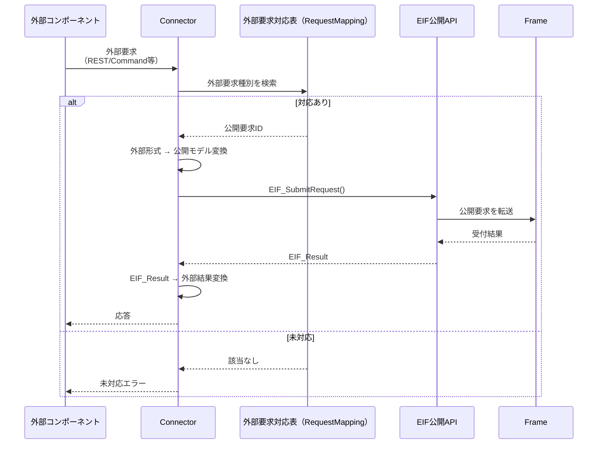


### 4.1.2 外部接続の管理

**目的**
外部コンポーネントとの接続を管理し、EIFとの接続点を提供する。
外部コンポーネントごとに異なる接続方式や通信ライフサイクルをConnector内へ閉じ込めることで、FrameおよびAccessorが接続先固有の実装へ依存しない構造を実現する。
また、要求受付口、完了通知callback、イベント通知callbackを提供し、EIFと外部コンポーネント間の通信経路を確立する。

**関連モジュール**
```text
connectors/<接続先>/
├── <connector>.c
├── <connector>.h
└── <connector>_callbacks.c
```

**処理概要**
1. 起動処理が、`EIF_Setup()` の後・`EIF_Start()` の前に、Connectorの初期化関数（例：`EifApiServerConnector_Setup()`）を呼ぶ。
2. Connectorは `EIF_ConnectorDesc`（完了callback、イベントcallback、購読要求、user_context）を作り、`EIF_RegisterConnector()` でEIFへ登録する。
3. EIFからConnector IDを受け取り、以降の要求で `origin` として使うために保持する。
4. 外部コンポーネントへ、要求の受付口（RESTのcallback等）を登録する。
5. 外部コンポーネントから要求を受け付け、4.1.1の変換を行ってEIF公開APIを呼ぶ。
6. EIFからの完了通知・イベント通知を受け取り、4.1.5の変換を行って外部へ送る。
7. EIFはConnectorの登録解除を持たない。登録は起動時の1回だけで、以降は変わらない。

**エラー処理**

| 条件               | 動作                 |
| ---------------- | ------------------ |
| Connector登録失敗（`EIF_RegisterConnector()` がエラー） | 初期化失敗として起動処理へ返す。外部コンポーネントへの受付口は登録しない |
| callback未設定（完了callbackがNULL） | EIFが `EIF_ERR_INVALID_PARAM` を返す。Connectorの実装誤りとして扱う |
| 登録数の上限・`EIF_Start()` 後の登録 | EIFが `EIF_ERR_BUSY` を返す。初期化失敗として扱う |
| 外部コンポーネントへの受付口の登録失敗 | 初期化失敗として起動処理へ返す |
| EIF未開始（`EIF_Start()` 前）の要求 | EIFが `EIF_ERR_UNAVAILABLE` を返す。外部エラー（サービス利用不可）へ変換して返す |

**処理シーケンス**
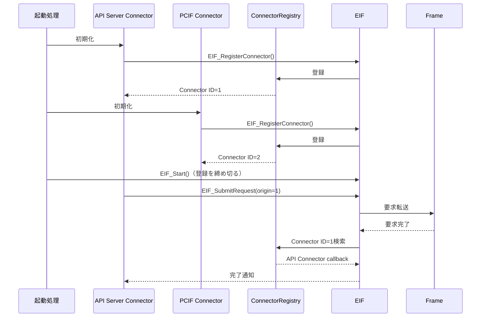

### 4.1.3 接続先差異の吸収

**目的**
外部コンポーネントごとに異なる通信方式、データ形式、要求粒度および応答方式の差異をConnector内で吸収する。
Frame以下は接続先の実装を認識せず、公開要求IDおよび公開モデルのみを扱うことで、接続先の追加・変更時にFrame、Accessor、PCL、REFの変更を不要とする。

**関連モジュール**

```text
connectors/<接続先>/
├── <connector>.c
├── request_mapping.c
├── response_mapping.c
└── event_mapping.c
```

**処理概要**
1. Connectorは外部コンポーネントから要求を受信する。
2. 接続先固有の形式（REST、WebSocket、コマンド等）を解析する。
3. 外部要求を公開要求IDへ変換する。1つの外部要求が複数の公開要求になる場合（旧コマンド等）は、同じ要求元トークンを付けて順に要求し、完了をまとめる。
4. 外部データを公開モデルへ変換する。
5. EIF公開APIを呼び出す。
6. EIFから結果を受け取る。
7. EIF結果を接続先固有の応答形式へ変換する。
8. 外部コンポーネントへ応答を返却する。

**エラー処理**

| 条件           | 動作                   |
| ------------ | -------------------- |
| 未対応の外部要求     | 外部エラーを返却する           |
| 外部データ形式不正    | パラメータエラーを返却する        |
| 公開モデル変換失敗    | 要求を中断しエラーを返却する       |
| EIF API呼出し失敗 | EIF結果を外部エラーへ変換して返却する |
| 複数の公開要求の途中で失敗 | 残りの公開要求は出さず、接続先の作法に従ってエラーを返す |
| 応答変換失敗       | 内部エラーとして扱う           |

**処理シーケンス**

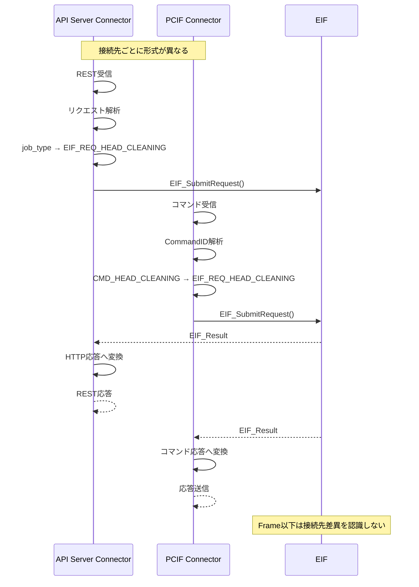

### 4.1.4 処理モデル差異の吸収

**目的**
外部コンポーネントごとに異なる処理モデルの差異を吸収し、EIFへ統一された要求モデルを提供する。
外部コンポーネントによっては同期応答、即時応答＋遅延完了通知、イベント通知型など異なる処理モデルを採用する場合があるが、Connectorはそれらを吸収し、Frameからは同一のEIF公開APIとして利用できるようにする。
また、接続先固有の応答方式をConnector内へ閉じ込めることで、接続先追加時にFrame、Accessor、PCLおよびREFの変更を不要とする。

**関連モジュール**
```text
connectors/<接続先>/
├── <connector>.c
├── request_mapping.c
├── completion_callback.c
└── event_callback.c
```

**処理概要**
1. Connectorは外部コンポーネントから要求を受信する。
2. 外部要求を公開要求へ変換する。
3. EIF公開APIを呼び出す。EIFの処理モデルは「受付は同期、結果は完了callback」である（仕様設計書 8.2）。
4. Connectorは接続先固有の処理モデルに従って応答を返却する。
   - 即時応答＋遅延通知（REST POST /jobs）：受付結果（`EIF_ACCEPTED`）で即時に応答し、完了callbackで遅延通知（WebSocket）を送る。
   - 同期応答（REST PATCH）：`EIF_ACCEPTED` の場合は、完了待ち合わせ表（3.1.5）で完了callbackを上限時間まで待ってから応答する。待つのはConnectorのスレッドである。
   - 結果の問合せ（ポーリング）：完了callbackで受け取った結果をConnectorが保持し、問合せに答える。
5. 要求完了通知を受信した場合は、接続先固有の完了通知形式へ変換する。
6. イベント通知を受信した場合は、接続先固有のイベント形式へ変換する。
7. FrameおよびAccessorは接続先ごとの応答方式を意識しない。

**エラー処理**

| 条件        | 動作                   |
| --------- | -------------------- |
| 外部要求変換失敗  | 外部エラーを返却する           |
| EIF要求受付失敗 | EIF結果を外部エラーへ変換して返却する |
| 同期応答の待ちが上限時間を超えた | タイムアウトの外部エラーを返す。後から届いた完了callbackは捨てる |
| 完了待ち合わせ表が満杯 | 混雑エラーを返す（EIFは呼ばない） |
| 完了通知変換失敗  | ログ出力し通知を破棄する         |
| イベント変換失敗  | ログ出力し通知を破棄する         |

**処理シーケンス**

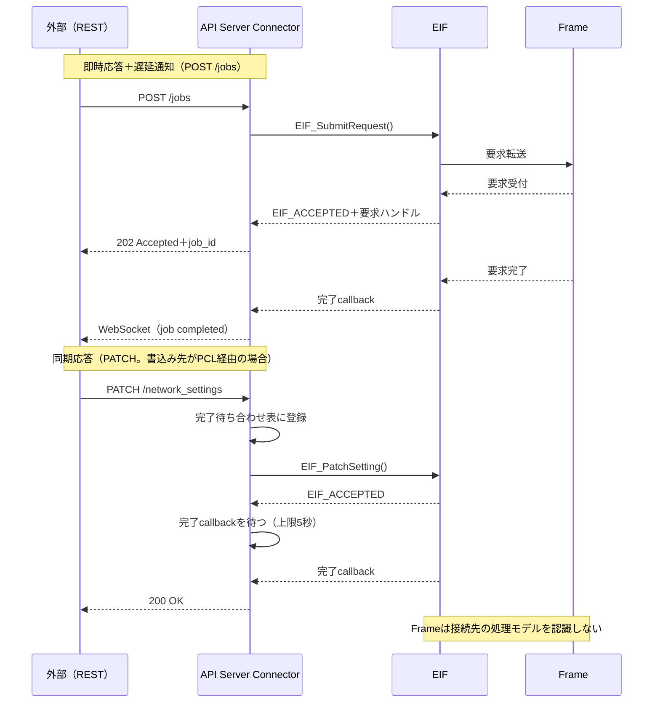

### 4.1.5 通知の外部変換

**目的**
EIFから通知される要求完了通知およびイベント通知を、接続先固有の通知形式へ変換する。
外部コンポーネントはEIFの公開イベントや公開モデルを意識することなく、自身が利用する通知形式で通知を受信できるようにする。

**関連モジュール**
```text
connectors/<接続先>/
├── completion_callback.c
├── event_callback.c
├── response_mapping.c
└── event_mapping.c
```

**処理概要**
1. ConnectorはEIFから要求完了通知（`on_request_completed`）を受信する。
2. 要求元トークンで、自分の要求（待ち合わせ中のPATCH、ジョブ等）を判別する。
3. 終端結果と公開要求IDを、外部イベント対応表（3.1.3）・外部要求対応表（3.1.1の逆引き）で接続先固有の通知へ変換する。
4. ConnectorはEIFからイベント通知（`on_event`）を受信する。
5. 公開イベントIDを外部イベント対応表で接続先固有のイベント形式へ変換し、ペイロード（公開モデル）を外部の型へ詰め替える。
6. 外部コンポーネントへ通知を送信する。

- 完了callbackはPCLの要求処理context [C3]、イベントcallbackはREFの通知ワーカー [C4] から呼ばれる。長時間ブロックしない。送信に時間がかかる場合は、Connectorのキューへ積んで自分のスレッドで送る。
- callbackの中からEIFの要求系APIを呼ばない。
- 受け取った `EIF_Event` はcallbackの呼出し中だけ有効である。後で使う場合はコピーする。

**エラー処理**

| 条件        | 動作              |
| --------- | --------------- |
| 結果コード変換失敗 | 内部エラーとしてログ出力する  |
| イベント変換失敗  | 通知を破棄しログ出力する    |
| 外部通知送信失敗  | 接続先の作法に従う（再送する場合もConnectorのスレッドで行う） |
| 未対応イベント   | 通知を送信しない        |

**処理シーケンス**
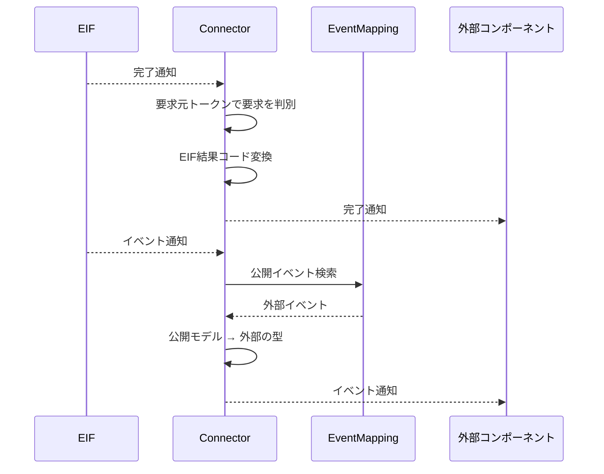

### 4.1.6 外部要求の判定

**目的**
外部コンポーネントから受信した要求がEIFの公開要求へ変換可能であるかを判定する。
未対応要求をEIFへ渡さず、接続先固有のエラーとして処理する。
なお、「その機種で公開している要求か」の判定はFrameが行う（4.2.1）。Connectorは機種を知らないため、機種によって使えない要求もEIFへ渡し、EIFの `EIF_ERR_NOT_EXPOSED` を外部エラーへ変換する。

**関連モジュール**
```text
connectors/<接続先>/
├── request_mapping.c
├── request_validator.c
└── <connector>.c
```

**処理概要**
1. Connectorは外部要求を受信する。
2. 外部要求の形式（必須項目、値の形式）を確認する。
3. RequestMappingを参照する。
4. 外部要求に対応する公開要求IDの有無を確認する。
5. 対応する公開要求IDが存在する場合は変換処理へ進む。
6. 存在しない場合は未対応エラーを返却する。

**エラー処理**

| 条件 | 動作 |
|--------|--------|
| 未対応要求 | 外部エラーを返却する |
| 要求形式不正 | パラメータエラーを返却する |
| 必須項目不足 | パラメータエラーを返却する |
| 変換定義未登録 | 未対応要求として扱う |
| その機種で公開していない要求（EIFが `EIF_ERR_NOT_EXPOSED`） | 結果コード対応表で外部エラー（未実装）へ変換して返す |

**処理シーケンス**
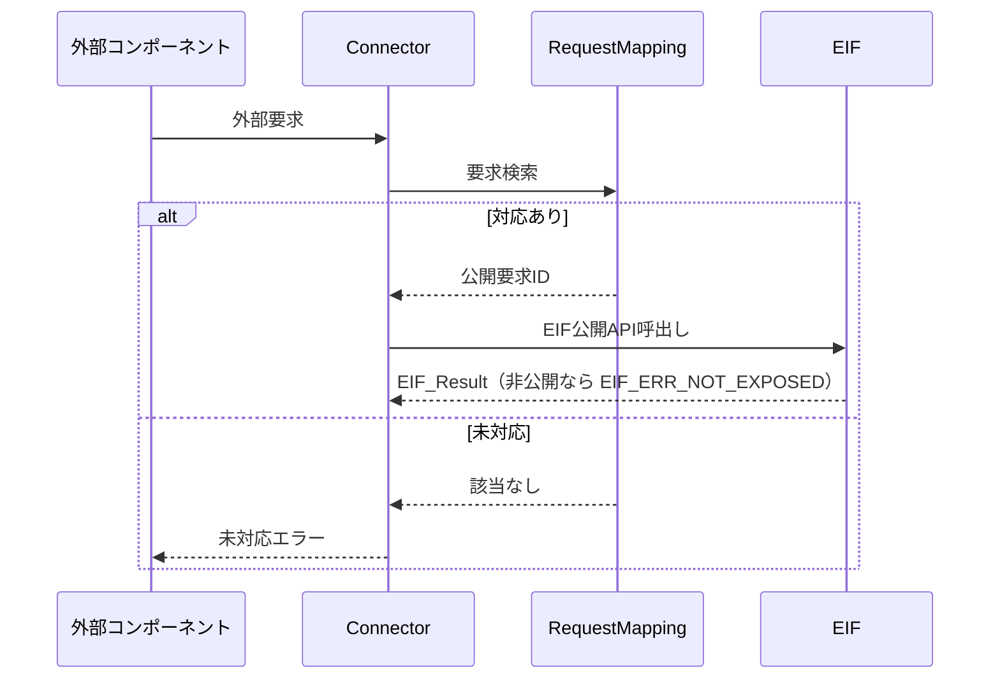

### 4.1.7 購読要求の指定

**目的**
外部コンポーネントが受信を希望するイベントおよび通知方法を、EIFの購読要求としてEIFへ登録する。
購読要求は登録時（`EIF_RegisterConnector()`）に固定され、`EIF_Start()` 以降は変更・解除できない（仕様設計書 9.3.3）。そのため、外部コンポーネントが実行中に購読先を選ぶ場合（WebSocketのクライアントごとの購読等）は、Connectorが受け取りうる通知をすべて起動時に登録しておき、実行中の選別はConnectorの中で行う。

**関連モジュール**
```text
connectors/<接続先>/
├── subscription_mapping.c
├── event_mapping.c
└── <connector>.c
```

**処理概要**
1. Connectorは、外部コンポーネントが受け取りうる通知から、購読要求定義（3.1.4）を作る。公開イベントID・通知方法（変化時／定期）・周期を指定する。
2. 起動時に、購読要求定義を `EIF_ConnectorDesc::subscriptions` に指定して、`EIF_RegisterConnector()` で登録する。
3. 実行中に外部コンポーネントから購読の指定（購読するトピック等）が来た場合は、Connectorの中で、どの外部クライアントへ送るかを管理する。EIFは呼ばない。
4. EIFからイベント通知を受信した場合、外部形式へ変換し、購読を指定した外部クライアントへ通知する（4.1.5）。

**エラー処理**

| 条件 | 動作 |
|--------|--------|
| 購読要求の不正（範囲外の公開イベントID、通知方法と周期の組合せ不正、その公開イベントで指定できない通知方法） | `EIF_RegisterConnector()` が `EIF_ERR_INVALID_PARAM`。Connectorの実装誤りとして初期化失敗にする |
| 同じ公開イベントの重複 | `EIF_RegisterConnector()` が `EIF_ERR_INVALID_PARAM`。1つの公開イベントは1つの購読要求にまとめる |
| 機種がその公開イベントを通知しない | エラーにならず、通知が届かないだけ（Connectorは機種を意識しない） |
| 外部からの購読の指定が、登録した購読要求の範囲外 | 外部へ購読登録エラーを返す（Connectorの中で判定） |

**処理シーケンス**
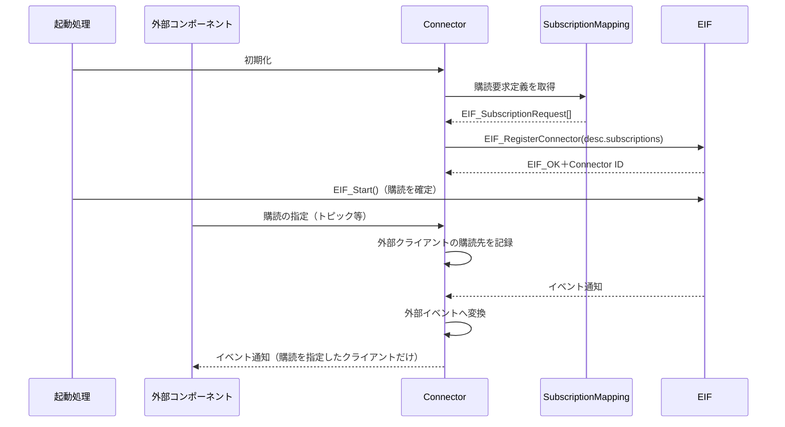
---
## 4.2 Frame

### 4.2.1 公開範囲の管理

**目的**
その機種で公開している公開要求・公開情報・公開設定・公開イベントだけを受け付け、それ以外を `EIF_ERR_NOT_EXPOSED` で拒否する。
判定に使うデータ（機種ごとの対応表）はAccessorが持ち、Frameは下位IFの `is_supported()` を呼んで判定を実行する。これにより、Frameは機種を知らずに公開範囲を守れる。非公開のIDはPCL・REFへ渡らない。

**関連モジュール**
```text
frame/
├── request/eif_request_gateway.c   （公開要求）
├── info/eif_info_reader.c          （公開情報）
├── setting/eif_setting_merger.c    （公開設定）
└── notify/eif_watcher.c            （公開イベント）
```

**処理概要**
1. 公開API（`EIF_SubmitRequest()`、`EIF_GetInfo()`、`EIF_PatchSetting()`）が呼ばれたら、引数と状態を確かめた後、対応する下位IFの `is_supported()` を呼ぶ。
2. 偽なら `EIF_ERR_NOT_EXPOSED` を返し、PCL・REFは呼ばない。
3. 設定変更は、設定定義表（3.2.4）に行があり、かつ設定保存IFと、現在値を取る公開情報の両方が公開されている場合だけ受け付ける。
4. 公開イベントは、`EIF_Start()` で購読表の各行について `is_event_supported()` を呼び、偽のものは監視を依頼しない（4.2.8）。

**エラー処理**

| 条件 | 動作 |
|---|---|
| `is_supported()` が偽 | `EIF_ERR_NOT_EXPOSED` を返す。PCL・REFは呼ばない |
| 設定定義表に無い公開設定 | `EIF_ERR_NOT_EXPOSED` を返す |
| `is_event_supported()` が偽 | エラーにせず、その購読表の行の監視を依頼しない（通知は届かない） |

**処理シーケンス**
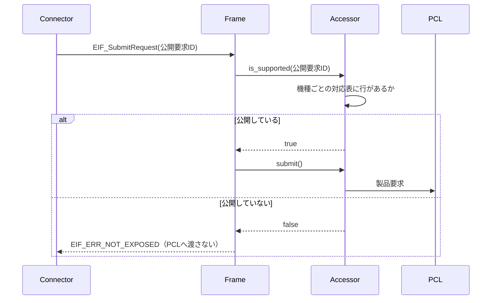

### 4.2.2 要求受付と転送

**目的**
公開要求を受け付け、製品制御IFを通じてPCLへ転送する。受付はPCLの判定をそのまま返し、実行の完了は待たない（受付は同期、結果は完了callback）。Frameは公開要求IDの意味を解釈しない。

**関連モジュール**
```text
frame/request/
├── eif_request_gateway.c   （EIF_SubmitRequest・EIF_CancelRequest・EIF_GetRequestResult）
└── eif_request_tracker.c   （要求台帳）
```

**処理概要**
1. `EIF_SubmitRequest()` は、`out_handle` を0にしてから、状態（受付開始済みか）、`origin` の登録有無、`param`（現時点ではNULL・0のみ）を確かめる。
2. 公開範囲を確かめる（4.2.1）。
3. 製品制御IFの `submit(公開要求ID, &ticket)` を呼ぶ。PCL Accessorは製品要求IDへ変換してPCLへ送る。
4. `EIF_ACCEPTED` 以外なら、そのまま返す。要求台帳には登録しない（完了callbackも呼ばれない）。
5. 要求ハンドルを採番し、要求台帳へ登録する（4.2.3）。
6. `EIF_ACCEPTED` と要求ハンドルを返す。
7. `EIF_CancelRequest()` は、要求台帳で要求ハンドルを引き、要求元が一致すれば製品制御IFの `cancel(ticket)` を呼ぶ。`EIF_GetRequestResult()` は `query(ticket)` へ委譲する。

**エラー処理**

| 条件 | 戻り値 | PCL呼出し | 台帳登録 |
|---|---|---|---|
| `out_handle` がNULL、未登録の `origin`、`param` 指定 | `EIF_ERR_INVALID_PARAM` | なし | なし |
| 受付開始前 | `EIF_ERR_UNAVAILABLE` | なし | なし |
| 非公開の公開要求ID | `EIF_ERR_NOT_EXPOSED` | なし | なし |
| PCLが受け付けない | PCLの結果を変換した値（`EIF_ERR_BUSY` 等） | あり | なし |
| PCL受付後に台帳が満杯 | `EIF_ERR_BUSY`（製品制御IFの `cancel()` で取消を依頼する） | あり | なし |
| 取消：台帳に無い、要求元が違う | `EIF_ERR_NOT_FOUND` | なし | － |

**処理シーケンス**
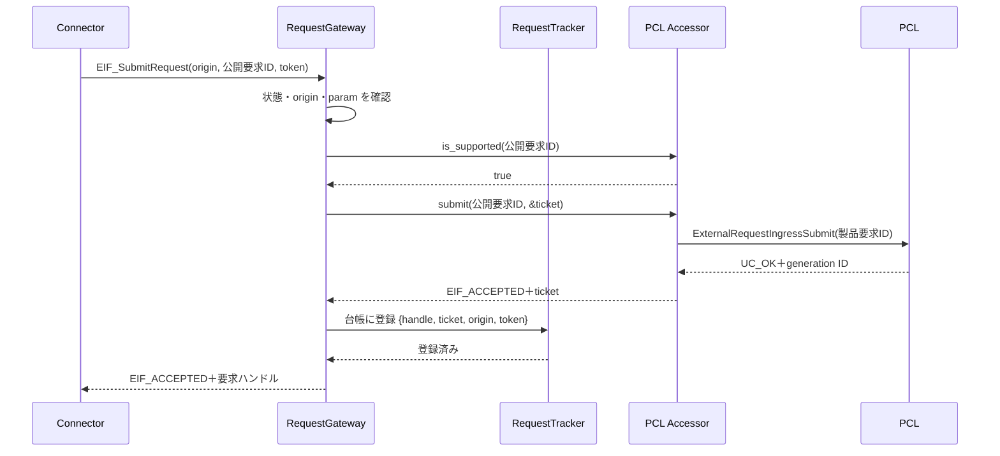

### 4.2.3 応答先管理

**目的**
受け付けた要求と、要求元Connector・要求元トークンの対応を要求台帳（3.2.3）で管理し、PCLから届いた終端結果を、要求を出したConnectorにだけ1回返す。複数のConnectorから要求が来て、PCLが順不同に完了しても、正しい要求元へ返す。

**関連モジュール**
```text
frame/request/
├── eif_request_tracker.c   （要求台帳、完了トランポリン eif_tracker_on_done）
└── eif_request_gateway.c   （台帳への登録 eif_gateway_track）
```

**処理概要**
1. 受付時（4.2.2の手順5）、台帳のmutexを取り、同じチケットの先着完了エントリがあるかを確かめる。
   - 無ければ、空きエントリに `{handle, ticket, origin, origin_token, request_id}` を登録する。
   - あれば（先着完了）、そのエントリを解放し、mutexを放してから要求元へ完了を通知する（4.2.5）。
2. 完了時、PCL Accessorが完了トランポリン `eif_tracker_on_done(ticket, outcome)` を呼ぶ（PCLの要求処理context [C3]）。
3. 台帳のmutexを取り、チケットで検索する。
   - 見つかったら、要求元・トークン・要求ハンドル・公開要求IDを写してエントリを解放し、mutexを放してから要求元へ完了を通知する。
   - 見つからなければ（登録より先に届いた）、先着完了として記録する。
4. PCL経由の設定変更（設定保存IFが `EIF_ACCEPTED`）も、同じ台帳に登録する（公開要求IDは `EIF_REQ_INVALID`）。

- 下位IFの呼出し中、Connectorのcallback呼出し中は、台帳のmutexを保持しない。PCLが同じスレッドで完了を返してもデッドロックしない。

**エラー処理**

| 条件 | 動作 |
|---|---|
| 受付後に台帳が満杯 | 製品制御IFの `cancel()` で取消を依頼し、`EIF_ERR_BUSY` を返す。ログを出す |
| 台帳に無い完了 | 先着完了として一時保持する。台帳も満杯ならログを出して捨てる |
| 要求元のConnectorが登録表に無い | ログを出して捨てる |

**処理シーケンス**
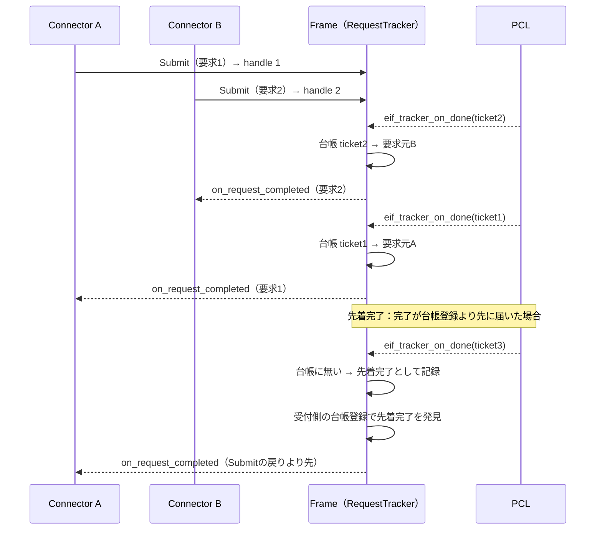

### 4.2.4 通知先管理

**目的**
Connectorごとのcallback（完了・イベント）と購読要求を、Connector登録表（3.2.1）で管理する。登録は起動時だけ受け付け、`EIF_Start()` で締め切る。以降は不変にして、通知のたびにロックを取らずに登録表を読めるようにする。

**関連モジュール**
```text
frame/connector/
└── eif_connector_registry.c
```

**処理概要**
1. `EIF_RegisterConnector(desc, &id)` は、`desc`・`out_id`・完了callbackのNULLを確かめる。
2. 購読要求を1件ずつ確かめる（範囲内の公開イベントID、`type` と `interval_ms` の組合せ、その公開イベントで指定できる通知方法、同じ公開イベントの重複）。
3. 登録表のmutexを取り、締切り後でないこと、登録数が上限未満であることを確かめる。
4. 空き行に、callback・user_context・購読要求の写しを書き、Connector ID（登録順に1から）を払い出す。呼出し元の配列は保持しない。
5. `EIF_Start()` から `eif_registry_close()` が呼ばれたら、締切り済みにする。以降の登録は `EIF_ERR_BUSY`。

- その公開イベントで指定できる通知方法か（例：エラーの発生は変化時のみ）の確認は、公開イベントの定義（仕様設計書 9.3.2）に対して行い、機種には依存しない。

**エラー処理**

| 条件 | 戻り値 |
|---|---|
| `desc`・`out_id`・`on_request_completed` がNULL | `EIF_ERR_INVALID_PARAM` |
| `subscription_count` が1以上なのに `subscriptions` がNULL | `EIF_ERR_INVALID_PARAM` |
| 範囲外の公開イベントID、`PERIODIC` で `interval_ms`＝0、`ON_CHANGE` で `interval_ms`≠0、指定できない通知方法、同じ公開イベントの重複 | `EIF_ERR_INVALID_PARAM` |
| 登録数の上限（4）、締切り後 | `EIF_ERR_BUSY` |

**処理シーケンス**
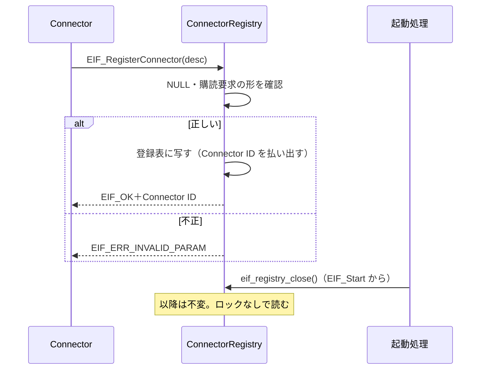

### 4.2.5 通知配信

**目的**
完了通知を要求元のConnectorへ、イベント通知を購読要求が一致するConnectorへ配送する。対象外のConnectorへは通知しない。EIFはキューや中継タスクを持たず、呼出し元のcontextのままConnectorのcallbackを呼ぶ。

**関連モジュール**
```text
frame/
├── request/eif_request_tracker.c    （完了通知 eif_tracker_notify）
└── notify/eif_event_dispatcher.c    （イベント配信 eif_dispatch_event）
```

**処理概要**
1. 完了通知：Connector登録表で要求元のConnector IDを引き、`on_request_completed(handle, request_id, origin_token, outcome, user_context)` を呼ぶ。
2. イベント通知：購読表の行（4.2.8）の `connector_mask` を見て、ビットが立っているConnectorの `on_event(event, user_context)` を、登録順に呼ぶ。
3. どちらも、台帳・購読表のロックを保持しない状態で呼ぶ。

- 完了callbackはPCLの要求処理context [C3]、イベントcallbackはREFの通知ワーカー [C4] のまま呼ぶ。あるConnectorのcallbackが長くブロックすると、他のConnectorへの通知も遅れる（仕様設計書 9.4.1）。
- イベントは呼出し元のスタック上に作り、配信が終われば破棄する。

**エラー処理**

| 条件 | 動作 |
|---|---|
| 要求元のConnectorが登録表に無い | ログを出して捨てる |
| `on_event` がNULLのConnector | 配信しない |
| 範囲外の公開イベントID | 配信しない |

**処理シーケンス**
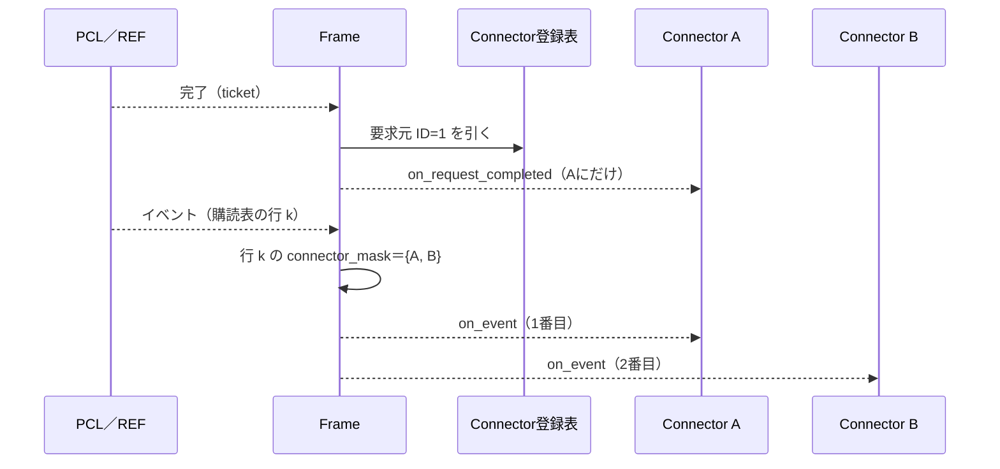

### 4.2.6 システム情報取得

**目的**
公開情報の最新値を、システム情報IFを通じてREFから取得し、公開モデルで返す。同期で完了する。EIFは値を保持せず、毎回REFから取得する。REFの型はFrameに出てこない。

**関連モジュール**
```text
frame/info/
└── eif_info_reader.c
```

**処理概要**
1. `EIF_GetInfo(info_id, out, out_size)` は、`out` のNULLと状態を確かめる。
2. システム情報IFの `is_supported(info_id)` を呼ぶ（4.2.1）。
3. `out_size` と `public_size(info_id)` を照合する（公開モデルの型の取り違えを検出）。
4. `read(info_id, out, out_size)` を呼ぶ。REF Accessorが取得と変換を行う（4.3.3）。
5. 結果をそのまま返す。

**エラー処理**

| 条件 | 戻り値 |
|---|---|
| `out` がNULL、`out_size` が公開モデルと不一致 | `EIF_ERR_INVALID_PARAM` |
| 受付開始前 | `EIF_ERR_UNAVAILABLE` |
| 非公開 | `EIF_ERR_NOT_EXPOSED` |
| REFに値が無い／REF未初期化 | `EIF_ERR_NOT_FOUND`／`EIF_ERR_UNAVAILABLE`（REF Accessorが変換） |
| 変換失敗、REFの型の不一致 | `EIF_ERR_INTERNAL` |

**処理シーケンス**
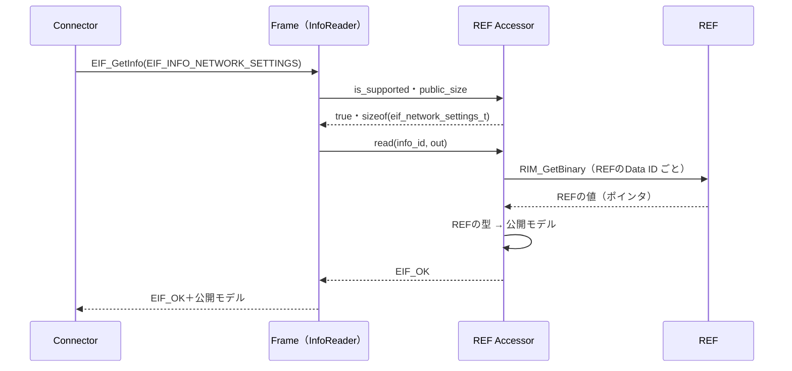

### 4.2.7 設定マージ

**目的**
PATCH形式の設定更新を、現在値（公開モデル）に重ねて合成し、設定保存IFで保存する。指定しなかった項目は現在値のまま残す。マージは公開モデルに対して行うため、機種によらずFrameで1回だけ書けばよい。

**関連モジュール**
```text
frame/setting/
└── eif_setting_merger.c   （設定定義表、マージ関数）
```

**処理概要**
1. `EIF_PatchSetting()` は、`patch`・`out_handle` のNULL、状態、`origin` の登録有無を確かめる。
2. 設定定義表（3.2.4）で公開設定を引き、公開範囲を確かめる（4.2.1）。
3. `patch_size` を照合する。
4. 設定のmutexを取る（同時PATCHで更新が消えないようにする）。
5. システム情報IFの `read(current_info_id)` で現在値（公開モデル）を取得する。
6. マージ関数で、`has_xxx` が真の項目だけを上書きした合成結果を作る。
7. 設定保存IFの `store(setting_id, 合成結果)` を呼ぶ。
8. mutexを放す。
9. `EIF_OK`（REF直接で完了）ならそのまま返す。`EIF_ACCEPTED`（PCL経由で受付）なら、返ったチケットを要求台帳へ登録し（4.2.3）、要求ハンドルを返す。

**エラー処理**

| 条件 | 戻り値 |
|---|---|
| NULL、未登録の `origin`、`patch_size` 不一致 | `EIF_ERR_INVALID_PARAM` |
| 受付開始前 | `EIF_ERR_UNAVAILABLE` |
| 設定定義表に無い、非公開 | `EIF_ERR_NOT_EXPOSED` |
| 現在値の取得失敗 | 取得の結果をそのまま返す（保存しない） |
| 値が不正、変更できない項目の変更（REF Accessorの変換で検出） | `EIF_ERR_INVALID_PARAM`（REFは書込み前のまま） |
| PCL経由でPCLが受け付けない | `EIF_ERR_BUSY` 等 |

**処理シーケンス**
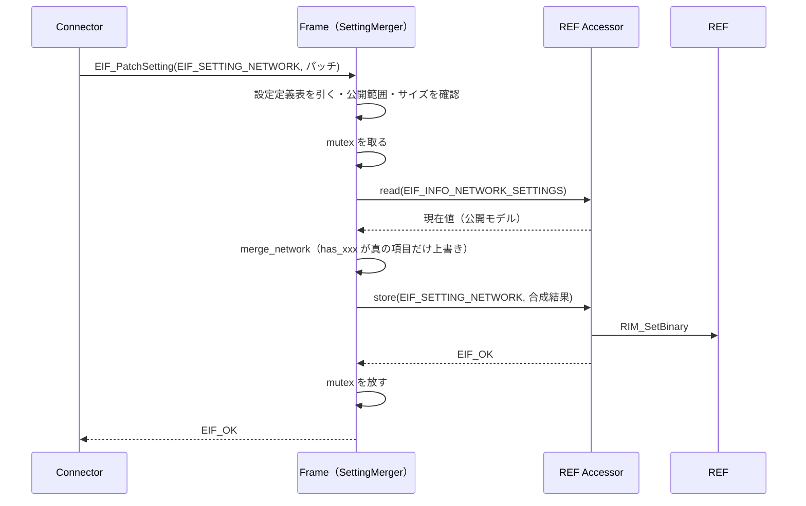

### 4.2.8 情報変化の購読

**目的**
全Connectorの購読要求をまとめ、「公開イベント・通知方法・周期」の組合せごとに、システム情報IFを通じてREFへの購読を1回だけ登録する。同じ組合せを複数のConnectorが指定していても、REFへの購読は1つにする。

**関連モジュール**
```text
frame/
├── core/eif_frame.c           （EIF_Start）
└── notify/eif_watcher.c       （購読表、eif_watcher_start）
```

**処理概要**
1. `EIF_Start()` は、状態がINITIALIZEDであることを確かめ、Connector登録表を締め切る（4.2.4）。
2. 全Connectorの購読要求を登録順に見て、購読表（3.2.2）を作る。
   - 同じ組合せ（公開イベント・通知方法・周期）の行があれば、その行の `connector_mask` にConnectorのビットを足す。
   - 無ければ新しい行を作る。
3. 購読表の各行について、システム情報IFの `is_event_supported(&request)` を呼ぶ。偽なら監視しない（その行のConnectorには通知が届かない）。
4. 真なら `watch_event(&request, on_info_event, 行)` を呼んで監視を依頼する。REF Accessorが購読要求をREFの購読要求へ変換して購読する（4.3.6）。
5. すべて成功したら、状態をSTARTEDにする。

- 購読表と監視は、`EIF_Start()` 以降は変えない。

**エラー処理**

| 条件 | 動作 |
|---|---|
| INITIALIZED でない | `EIF_ERR_UNAVAILABLE`（開始済みなら `EIF_OK`） |
| 購読表の行数が上限（8）を超える | `EIF_ERR_BUSY` を返す（REFへの購読はしない） |
| `watch_event()` の失敗 | その時点で中断して結果を返す。登録済みの購読はREFに解除APIが無いため残る。状態はINITIALIZEDのまま |

**処理シーケンス**
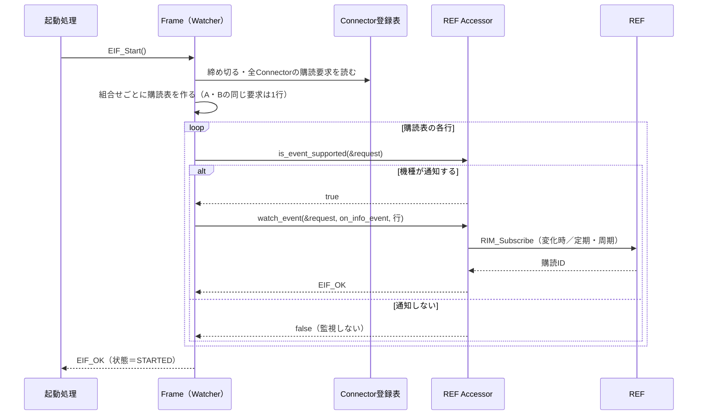

### 4.2.9 情報変化のイベント化

**目的**
REFから届いた情報変化の通知（発生／解消、または定期の通知）を、公開イベントとしてConnectorへ配る。REFの通知から公開イベントへの変換はREF Accessorが行い、Frameは届いた公開イベントを、購読表の行の配信先へ渡す。EIFは前回値を保持せず、差分も求めない。発生／解消の判定はREF（RIM）等が行う。

**関連モジュール**
```text
frame/notify/
├── eif_watcher.c            （受け口 on_info_event）
└── eif_event_dispatcher.c   （配信）
```

**処理概要**
1. REF Accessorが、REFの通知を公開イベント（`EIF_Event`）に変換し、Frameの受け口 `on_info_event(event, ctx)` を呼ぶ（REFの通知ワーカー [C4]）。`ctx` は購読表の行。
2. 公開イベントIDが範囲内であること、購読表の行の公開イベントと一致することを確かめる。
3. 購読表の行の `connector_mask` に従って配信する（4.2.5）。

- 通知1件につき公開イベント1件。EIFは通知をまとめたり、間引いたりしない。

**エラー処理**

| 条件 | 動作 |
|---|---|
| 範囲外の公開イベントID、購読表の行と公開イベントが一致しない | ログを出して捨てる |
| 配信先が無い（`connector_mask`＝0） | 何もしない |

**処理シーケンス**
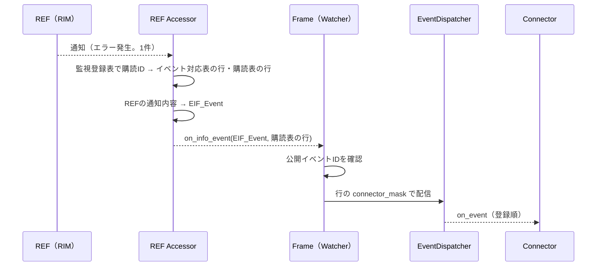
---
## 4.3 Accessor

### 4.3.1 公開範囲の定義

**目的**
機種ごとに公開する公開要求・公開情報・公開設定・公開イベントを、機種ごとの対応表（3.3.1〜3.3.4）として定義する。公開可否は対応表に行があるかどうかだけで決まり、Frame・Connectorは機種の知識を持たない。

**関連モジュール**
```text
accessors/
├── pcl/models/<MODEL>/pcl_request_map.c   （公開要求）
└── ref/models/<MODEL>/ref_maps.c          （公開情報・公開設定・公開イベント）
```

**処理概要**
1. 機種を追加するときは、`models/<MODEL>/` に対応表を書く。その機種で公開するものだけ行を書く。
2. ビルド時に `MODEL` で選んだ機種の対応表だけが組み込まれる。
3. 対応表は起動後に変更しない（ロックなしで読む）。

**エラー処理**

| 条件 | 動作 |
|---|---|
| 対応表に無いID | 公開しない（4.3.7の `is_supported()` が偽） |
| 対応表の不整合（同じIDの重複、変換関数の欠け） | 単体試験で検出する（実行時の検査はしない） |

**処理シーケンス**
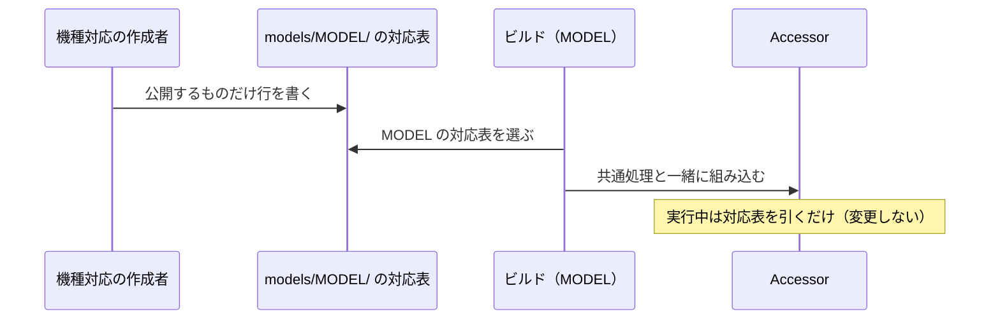

### 4.3.2 ID変換

**目的**
公開IDを、PCL・REFのIDへ変換する。公開要求ID → 製品要求ID、公開情報ID → REFのData ID群、公開設定ID → 書込み先のREF Data ID、公開イベントID → 購読するREFの通知。PCL・REFのIDはAccessorの外へ出さない。

**関連モジュール**
```text
accessors/
├── pcl/pcl_accessor.c       （公開要求ID → 対応表の行）
└── ref/ref_accessor.c       （公開情報・公開設定・公開イベント → 対応表の行）
```

**処理概要**
1. 下位IFの関数が呼ばれたら、公開IDで機種ごとの対応表を検索する（行数が少ないため線形検索）。
2. 見つかった行のPCL・REFのIDを使って、PCL・REFのAPIを呼ぶ。
3. PCLの受付ID（generation ID）はチケットとしてFrameへ返す。Frameは中身を解釈しない。

**エラー処理**

| 条件 | 動作 |
|---|---|
| 対応表に無い（Frameの公開範囲の確認の後なので、通常は起きない） | `EIF_ERR_NOT_EXPOSED` を返す |

**処理シーケンス**
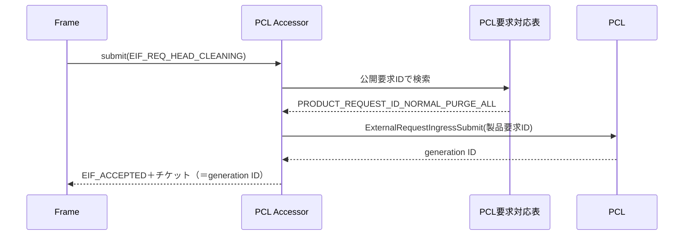

### 4.3.3 モデル変換

**目的**
REFの型と公開モデル・公開イベントを相互に変換する。変換は機種ごとの変換関数（`models/<MODEL>/`）で行い、REFの型はAccessorの外へ出さない。変換関数は純粋関数とする（登録・送信・排他をしない。入力から出力を作るだけ）。

**関連モジュール**
```text
accessors/ref/
├── ref_accessor.c                  （取得・サイズ照合・変換関数の呼出し）
└── models/<MODEL>/ref_maps.c       （変換関数）
```

**処理概要**
1. 取得（`read`）：対応表の各REF Data IDについて `RIM_GetBinary()` で取得し、サイズを表の型サイズと照合する。値はポインタ（RefView）のまま変換関数へ渡し、公開モデルを書き出す（中間コピーを作らない）。
2. 保存（`store`）：書込み先の現在値（REFの型）を読んでコピーし、変換関数で合成結果（公開モデル）を反映する。公開モデルに無いREFの項目は、現在値のコピーを土台にするため失われない。変更できない項目が変わっていれば失敗にする。
3. 通知：REFの通知内容を、イベント対応表の変換関数で公開イベント（公開イベントID＋公開アラーム等）に変換する（4.3.6）。

**エラー処理**

| 条件 | 動作 |
|---|---|
| 取得したサイズが表の型サイズと違う（REFの型の変更） | `EIF_ERR_INTERNAL` |
| 変換関数の失敗（取得） | `EIF_ERR_INTERNAL` |
| 変換関数の失敗（保存：値の形式不正、変更できない項目の変更） | `EIF_ERR_INVALID_PARAM`（REFへは書かない） |
| 変換関数の失敗（通知） | Frameへ渡さない（イベントを作らない） |

**処理シーケンス**
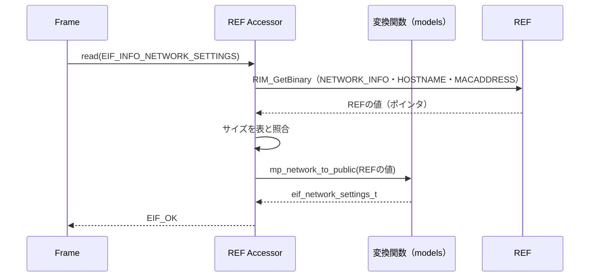

### 4.3.4 API呼出し

**目的**
PCL・REFの公開APIを呼び出す。Frameは下位IFだけを呼び、PCL・REFのAPIや呼出し方を知らない。Accessorは呼出し元のcontextのままPCL・REFを呼び、タスクを挟まない。

**関連モジュール**
```text
accessors/
├── pcl/pcl_accessor.c   （ExternalRequestIngressSubmit・Cancel・GetResult、完了callback）
└── ref/ref_accessor.c   （RIM_GetBinary・RIM_SetBinary・RIM_Subscribe、通知callback）
```

**処理概要**

| 下位IF | 呼ぶPCL・REFのAPI | context |
|---|---|---|
| 製品制御IF `submit` | `ExternalRequestIngressSubmit(製品要求ID, pcl_accessor_on_completed)` | [C2] |
| 製品制御IF `cancel` | `ExternalRequestIngressCancelRequestedByOwnerGeneration(generation ID)` | [C2] |
| 製品制御IF `query` | `ExternalRequestIngressGetResult(generation ID)` | [C2] |
| （完了） | PCLが `pcl_accessor_on_completed()` を呼ぶ → 完了トランポリンへ | [C3] |
| システム情報IF `read` | `RIM_GetBinary()` | [C2] |
| システム情報IF `watch_event` | `RIM_Subscribe()`（4.3.6） | [C1] |
| （通知） | REFが `on_ref_notified()` を呼ぶ → Frameの受け口へ | [C4] |
| 設定保存IF `store` | `RIM_GetBinary()`、`RIM_SetBinary()` | [C2] |

- PCLの完了callbackは、`ExternalRequestIngressSubmit()` の戻りより先に呼ばれることがある（先着完了。4.2.3）。

**エラー処理**

| 条件 | 動作 |
|---|---|
| PCL・REFのAPIがエラーを返した | 結果コードを変換して返す（4.3.5） |
| 完了のトランポリンが未設定のときにPCLの完了が来た | 何もしない（初期化前） |
| 未登録の購読IDで通知が来た | 捨てる |

**処理シーケンス**
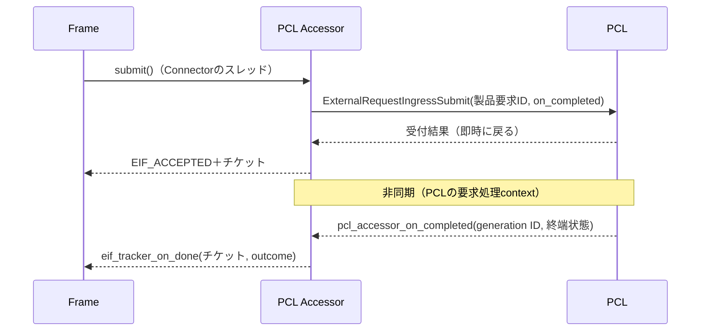

### 4.3.5 結果コード変換

**目的**
PCL・REFの結果コードを、EIFの結果コード（`EIF_Result`）と終端結果（`EIF_RequestOutcome`）へ変換する。変換は各境界の1か所（Accessor）で行い、Frameは `EIF_Result` だけを扱う。PCL・REFの結果コードは外へ出さない。

**関連モジュール**
```text
accessors/
├── pcl/pcl_accessor.c   （pcl_accessor_map_uc、map_outcome）
└── ref/ref_accessor.c   （map_ri）
```

**処理概要**

PCLの受付結果 → `EIF_Result`

| PCL `uc_result_t` | EIF_Result |
|---|---|
| `UC_OK` | `EIF_ACCEPTED`（取消の受付は `EIF_OK`） |
| `UC_ERR_INVALID_PARAM` | `EIF_ERR_INVALID_PARAM` |
| `UC_ERR_BUSY` | `EIF_ERR_BUSY` |
| `UC_ERR_NOT_FOUND` | `EIF_ERR_NOT_FOUND` |
| `UC_ERR_SERVER_UNAVAILABLE` | `EIF_ERR_UNAVAILABLE` |
| その他 | `EIF_ERR_INTERNAL` |

PCLの終端状態 → `EIF_RequestOutcome`

| PCLの終端状態 | EIF_RequestOutcome |
|---|---|
| `ACCEPTED`（PCLでは正常完了） | `EIF_OUTCOME_COMPLETED` |
| `INVALID` | `EIF_OUTCOME_INVALID` |
| `NOT_SUPPORTED` | `EIF_OUTCOME_NOT_SUPPORTED` |
| `CANCELED` | `EIF_OUTCOME_CANCELED` |
| `PENDING` | `EIF_OUTCOME_PENDING` |
| `FAILED`、未知の値 | `EIF_OUTCOME_FAILED` |

REFの結果 → `EIF_Result`

| `RIStatus` | EIF_Result |
|---|---|
| `RI_SUCCESS` | `EIF_OK` |
| `RI_NOT_INITIALIZED` | `EIF_ERR_UNAVAILABLE` |
| `RI_NO_DATA` | `EIF_ERR_NOT_FOUND` |
| その他 | `EIF_ERR_INTERNAL` |

**エラー処理**

| 条件 | 動作 |
|---|---|
| 未知の結果コード | `EIF_ERR_INTERNAL`（終端状態は `EIF_OUTCOME_FAILED`） |

**処理シーケンス**
```mermaid
sequenceDiagram
    participant FRM as Frame
    participant ACC as Accessor
    participant LOW as PCL／REF

    FRM->>ACC: 下位IFの呼出し
    ACC->>LOW: PCL・REFのAPI
    LOW-->>ACC: uc_result_t／RIStatus
    ACC->>ACC: 結果コード変換
    ACC-->>FRM: EIF_Result
```

### 4.3.6 購読要求の変換

**目的**
Frameから受け取った購読要求（公開イベントID・通知方法・周期）を、REFの購読要求（購読する通知・通知契機・周期・呼んでもらう関数）へ変換して購読する。また、REFから届いた通知を、購読要求に対応する公開イベントへ変換してFrameへ渡す。REFの購読の型はAccessorの外へ出さない。

**関連モジュール**
```text
accessors/ref/
├── ref_accessor.c               （watch_event、on_ref_notified、監視登録表）
└── models/<MODEL>/ref_maps.c    （REFイベント対応表、変換関数）
```

**処理概要**
1. `watch_event(&request, fn, ctx)` は、REFイベント対応表（3.3.4）で公開イベントIDの行を引く。
2. 購読要求をREFの購読要求へ変換する。

| EIFの購読要求 | REFの購読要求（`RI_SUBSCRIPTION_REQUEST`） |
|---|---|
| `id`（公開イベントID） | `targetType`＝データ、`targetId`＝対応表の `ref_source_id` |
| `type`＝`EIF_SUBSCRIBE_ON_CHANGE` | `trigger`＝`RI_TRIGGER_ON_CHANGE` |
| `type`＝`EIF_SUBSCRIBE_PERIODIC` | `trigger`＝`RI_TRIGGER_PERIODIC` |
| `interval_ms` | `intervalMs` |
| － | `method`＝callback、`callback`＝`on_ref_notified` |

3. `RIM_Subscribe()` を呼び、返った購読IDを監視登録表（3.3.5）に `{購読ID, 対応表の行, fn, ctx}` として記録する。
4. 通知時、REFが `on_ref_notified(購読ID, 通知内容)` を呼ぶ。監視登録表を購読IDで引き、対応表の変換関数で公開イベントへ変換し、`fn(event, ctx)`（Frameの `on_info_event`）を呼ぶ。

- 定期通知の周期の計時はREF（RIM）が行う。EIFはタイマーを持たない。

**エラー処理**

| 条件 | 動作 |
|---|---|
| 対応表に無い公開イベント、`fn` がNULL | `EIF_ERR_NOT_EXPOSED` |
| 監視登録表が満杯（8） | `EIF_ERR_BUSY` |
| `RIM_Subscribe()` の失敗 | `map_ri` で変換して返す |
| 未登録の購読IDで通知 | 捨てる |
| 通知内容の変換に失敗 | Frameへ渡さない |

**処理シーケンス**
```mermaid
sequenceDiagram
    participant FRM as Frame（Watcher）
    participant ACC as REF Accessor
    participant MAP as REFイベント対応表
    participant REF as REF（RIM）

    FRM->>ACC: watch_event({ERROR_RAISED, ON_CHANGE, 0}, on_info_event, 行)
    ACC->>MAP: 公開イベントIDで検索
    MAP-->>ACC: 購読するREFの通知・変換関数
    ACC->>ACC: RI_SUBSCRIPTION_REQUEST を作る（ON_CHANGE → RI_TRIGGER_ON_CHANGE）
    ACC->>REF: RIM_Subscribe(…, on_ref_notified)
    REF-->>ACC: 購読ID
    ACC->>ACC: 監視登録表に記録
    ACC-->>FRM: EIF_OK

    REF-->>ACC: on_ref_notified(購読ID, 通知内容)
    ACC->>ACC: 監視登録表で購読ID → 行
    ACC->>ACC: 変換関数：通知内容 → EIF_Event
    ACC-->>FRM: on_info_event(EIF_Event, 行)
```

### 4.3.7 対応有無情報の提供

**目的**
Frameが公開範囲を判定できるように、下位IFの `is_supported()`／`is_event_supported()` で、その機種の対応有無を返す。答えの元は機種ごとの対応表だけで、Frameは機種を知らずに判定できる。

**関連モジュール**
```text
accessors/
├── pcl/pcl_accessor.c   （製品制御IF is_supported）
└── ref/ref_accessor.c   （システム情報IF is_supported・is_event_supported、設定保存IF is_supported）
```

**処理概要**

| 関数 | 返す値 |
|---|---|
| 製品制御IF `is_supported(公開要求ID)` | PCL要求対応表に行があれば真 |
| システム情報IF `is_supported(公開情報ID)` | REF情報対応表に行があれば真 |
| システム情報IF `public_size(公開情報ID)` | 公開モデルの `sizeof`（無ければ0） |
| システム情報IF `is_event_supported(&購読要求)` | REFイベント対応表に行があり、かつ指定の通知方法（`allow_on_change`／`allow_periodic`）が許されていれば真 |
| 設定保存IF `is_supported(公開設定ID)` | REF設定対応表に行があれば真 |

- 機種セットアップのSkeleton（何も公開しない雛形）は、すべて偽を返す。

**エラー処理**

| 条件 | 動作 |
|---|---|
| 対応表に無い | 偽を返す（エラーにはしない） |

**処理シーケンス**
```mermaid
sequenceDiagram
    participant FRM as Frame
    participant ACC as Accessor
    participant MAP as 機種ごとの対応表

    FRM->>ACC: is_event_supported({環境状態（例）, PERIODIC, 1000})
    ACC->>MAP: 公開イベントIDで検索
    alt 行があり、定期通知が許されている
        MAP-->>ACC: 行（allow_periodic＝true）
        ACC-->>FRM: true
    else 行が無い、または定期通知が許されていない
        ACC-->>FRM: false
    end
```
